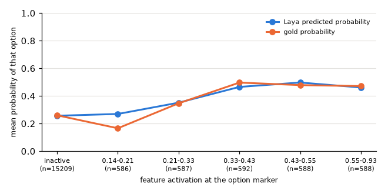

# Feature 2534

Critérios em que aparece: attribution_toward_correct

**Interpretação (preencher):** 

---

## Maiores ativações

**tr_invoice_processing_000181 / discrepancy_severity** (score, invoice_processing) | ativação 2.369 em `estado` | opções ['0', '1', '2', '3'] | Laya: **2** [0.062, 0.375, 0.506, 0.057] | gabarito: **3**

```
<bos> score question: How material is any discrepancy between the invoice, the order and the delivery?<eos>
▸ <mask> level 0: None: everything reconciles.
▸ <mask> level 1: Trivial: rounding or a cosmetic difference.
▸ <mask> level 2: Moderate: a real difference worth confirming.
▸ <mask> level 3: Material: a large or unexplained difference.

<eos>

 {"delivery": {"condition": "accepted with exceptions", "date": "2026-03-27", "received_qty": 1000}, "invoice": {"currency": "USD", "id": "INV-2026-4638", "lines": [{"qty": 1000, "sku": "SKU-503", "total_usd": 151490.0, "unit_usd": 151.49}], "total_usd": 151490.0, "vendor": "Acme Fabrication"}, "payment": {"days_until_due": 2, "discount_expires_in_days": null, "early_payment_discount_pct": null, "status": "scheduled", "terms": "net 30"}, "purchase_order": {"freight_terms": "freight prepaid by vendor⟦,⟧ not separately billable", "id": "PO-2215", "lines": [{"qty": 1000, "unit_usd": 151.49}], "total_usd": 151490.0}, "vendor_history": {"disputes_12m": 5, "invoices_12m": 12, "prior_invoice_ids": ["INV-2026-4638", "INV-2026-9285", "INV-2026-4100", "INV-2026-2909"]}}<eos>
```

**tr_invoice_processing_000268 / discrepancy_severity** (score, invoice_processing) | ativação 2.361 em `estado` | opções ['0', '1', '2', '3'] | Laya: **2** [0.051, 0.44, 0.447, 0.061] | gabarito: **0**

```
<bos> score question: How material is any discrepancy between the invoice, the order and the delivery?<eos>
▸ <mask> level 0: None: everything reconciles.
▸ <mask> level 1: Trivial: rounding or a cosmetic difference.
▸ <mask> level 2: Moderate: a real difference worth confirming.
▸ <mask> level 3: Material: a large or unexplained difference.

<eos>

 {"delivery": {"condition": "accepted", "date": "2026-03-08", "received_qty": 5}, "invoice": {"currency": "USD", "id": "INV-2026-3492", "lines": [{"qty": 5, "sku": "SKU-605", "total_usd": 1104.6, "unit_usd": 220.92}], "total_usd": 1104.6, "vendor": "Pallas Industrial"}, "payment": {"days_until_due": 2, "discount_expires_in_days": null, "early_payment_discount_pct": null, "status": "scheduled", "terms": "net 30"}, "purchase_order": {"freight_terms": "freight prepaid by vendor⟦,⟧ not separately billable", "id": "PO-3026", "lines": [{"qty": 25, "unit_usd": 220.92}], "total_usd": 5523.0}, "vendor_history": {"disputes_12m": 5, "invoices_12m": 1, "prior_invoice_ids": ["INV-2026-6730", "INV-2026-2551", "INV-2026-8707", "INV-2026-1458"]}}<eos>
```

**tr_invoice_processing_000095 / matches_order** (noul, invoice_processing) | ativação 2.355 em `estado` | opções ['false', 'true'] | Laya: **true** [0.044, 0.956] | gabarito: **true**

```
<bos> noul question: The invoice reconciles with the purchase order and the recorded delivery.<eos>
▸ <mask> false: There is a discrepancy against the order or the delivery.
▸ <mask> true: Line items, quantities and amounts reconcile.

<eos>

 {"delivery": {"condition": "accepted with exceptions", "date": "2026-03-13", "received_qty": 400}, "invoice": {"currency": "USD", "id": "INV-2026-8960", "lines": [{"qty": 400, "sku": "SKU-939", "total_usd": 85296.0, "unit_usd": 213.24}], "total_usd": 85296.0, "vendor": "Acme Fabrication"}, "payment": {"days_until_due": 2, "discount_expires_in_days": null, "early_payment_discount_pct": null, "status": "scheduled", "terms": "net 30"}, "purchase_order": {"freight_terms": "freight prepaid by vendor⟦,⟧ not separately billable", "id": "PO-5610", "lines": [{"qty": 400, "unit_usd": 213.24}], "total_usd": 85296.0}, "vendor_history": {"disputes_12m": 0, "invoices_12m": 22, "prior_invoice_ids": ["INV-2026-7383", "INV-2026-8366", "INV-2026-3430", "INV-2026-3330"]}}<eos>
```

**tr_invoice_processing_000077 / matches_order** (noul, invoice_processing) | ativação 2.340 em `estado` | opções ['false', 'true'] | Laya: **true** [0.042, 0.958] | gabarito: **false**

```
<bos> noul question: The invoice reconciles with the purchase order and the recorded delivery.<eos>
▸ <mask> false: There is a discrepancy against the order or the delivery.
▸ <mask> true: Line items, quantities and amounts reconcile.

<eos>

 {"delivery": {"condition": "accepted with exceptions", "date": "2026-03-08", "received_qty": 100}, "invoice": {"currency": "USD", "id": "INV-2026-4183", "lines": [{"qty": 100, "sku": "SKU-157", "total_usd": 11758.0, "unit_usd": 117.58}], "total_usd": 11758.0, "vendor": "Northwind Components"}, "payment": {"days_until_due": 18, "discount_expires_in_days": null, "early_payment_discount_pct": null, "status": "scheduled", "terms": "net 15"}, "purchase_order": {"freight_terms": "freight prepaid by vendor⟦,⟧ not separately billable", "id": "PO-2671", "lines": [{"qty": 100, "unit_usd": 117.58}], "total_usd": 11758.0}, "vendor_history": {"disputes_12m": 0, "invoices_12m": 26, "prior_invoice_ids": ["INV-2026-3365", "INV-2026-5702", "INV-2026-1342", "INV-2026-4633"]}}<eos>
```

**tr_invoice_processing_000182 / discrepancy_severity** (score, invoice_processing) | ativação 2.340 em `estado` | opções ['0', '1', '2', '3'] | Laya: **2** [0.059, 0.334, 0.534, 0.072] | gabarito: **2**

```
<bos> score question: How material is any discrepancy between the invoice, the order and the delivery?<eos>
▸ <mask> level 0: None: everything reconciles.
▸ <mask> level 1: Trivial: rounding or a cosmetic difference.
▸ <mask> level 2: Moderate: a real difference worth confirming.
▸ <mask> level 3: Material: a large or unexplained difference.

<eos>

 {"delivery": {"condition": "accepted with exceptions", "date": "2026-03-16", "received_qty": 25}, "invoice": {"currency": "USD", "id": "INV-2026-1869", "lines": [{"qty": 25, "sku": "SKU-634", "total_usd": 7297.25, "unit_usd": 291.89}], "total_usd": 7297.25, "vendor": "Kestrel Supply"}, "payment": {"days_until_due": 0, "discount_expires_in_days": null, "early_payment_discount_pct": null, "status": "scheduled", "terms": "net 60"}, "purchase_order": {"freight_terms": "freight prepaid by vendor⟦,⟧ not separately billable", "id": "PO-8882", "lines": [{"qty": 25, "unit_usd": 291.89}], "total_usd": 7297.25}, "vendor_history": {"disputes_12m": 1, "invoices_12m": 11, "prior_invoice_ids": ["INV-2026-5214", "INV-2026-5412", "INV-2026-2686", "INV-2026-8750"]}}<eos>
```

## Ativações medianas (faixa 40-60%, mediana 0.573)

**tr_customer_service_000003 / urgency** (score, customer_service) | ativação 0.607 em `estado` | opções ['0', '1', '2', '3'] | Laya: **2** [0.257, 0.155, 0.333, 0.255] | gabarito: **2**

```
<bos> score question: How time-sensitive is this conversation?<eos>
▸ <mask> level 0: No time pressure; can wait indefinitely.
▸ <mask> level 1: Routine; handle within the normal queue.
▸ <mask> level 2: Elevated; should be handled within the same week.
▸ <mask> level 3: Critical; requires action within the same day.

<eos>

 {"account": {"lifetime_value_usd": 89, "prior_tickets_90d": 5, "seats": 1, "tenure_months": 1, "tier": "premium"}, "orders": [{"amount_usd": 49, "date": "2026-02-28", "id": "A-29326", "status": "settled"}], "thread": [{"role": "customer", "text": "I’m extremely frustrated – the item I received is completely wrong and I need the correct product by Friday, otherwise I’m canceling my premium subscription."}, {"role": "agent", "text": "I’m sorry you’ve had this experience. Could you share the order number so I can look up the details?"}, {"role": "customer", "text": "The order number is #A12345⟦.⟧ I ordered the wireless headphones, but got a Bluetooth speaker instead. I need the headphones before the weekend."}, {"role": "agent", "text": "Thank you for the information. To arrange a replacement, could you confirm the shipping address you’d like the headphones sent to?"}, {"role": "customer", "text": "Send them to 742 Evergreen Terrace, Springfield. I’ll be watching for the delivery, and I expect it before Friday as I mentioned."}]}<eos>
```

**tr_security_incidents_000120 / urgency** (score, security_incidents) | ativação 0.513 em `estado` | opções ['0', '1', '2', '3'] | Laya: **3** [0.133, 0.315, 0.2, 0.351] | gabarito: **3**

```
<bos> score question: How quickly must a responder act on this alert?<eos>
▸ <mask> level 0: No time pressure; can wait indefinitely.
▸ <mask> level 1: Routine; handle within the normal queue.
▸ <mask> level 2: Elevated; should be handled within the same week.
▸ <mask> level 3: Critical; requires action within the same day.

<eos>

 {"alert": {"description": "an endpoint agent matched a known signature", "evidence": "The endpoint agent on CI runner host 'runner-7x2' identified a signature match for 'malware.linux.syslog' during an active session. This connection originated from an unrecognized IP address (203.0.113.88) using unprivileged credentials that were last rotated 90 days ago.", "rule": "malware_signature"}, "context": {"asset_criticality": "high", "change_window_active": false, "source_on_allowlist": false}, "history": {"credential_rotation_days_ago": 90, "distinct_countries_30d": 1, "logins_30d": 1882⟦,⟧ "prior_alerts_90d": 8}, "principal": {"mfa_enrolled": true, "name": "usr-billing-642", "privileges": ["repo:read"], "type": "ci_runner"}}<eos>
```

**tr_invoice_processing_000155 / urgency** (score, invoice_processing) | ativação 0.506 em `estado` | opções ['0', '1', '2', '3'] | Laya: **1** [0.153, 0.439, 0.264, 0.144] | gabarito: **3**

```
<bos> score question: How time-sensitive is processing this invoice?<eos>
▸ <mask> level 0: No time pressure; can wait indefinitely.
▸ <mask> level 1: Routine; handle within the normal queue.
▸ <mask> level 2: Elevated; should be handled within the same week.
▸ <mask> level 3: Critical; requires action within the same day.

<eos>

 {"delivery": {"condition": "accepted", "date": "2026-03-06", "received_qty": 50}, "invoice": {"currency": "USD", "id": "INV-2026-6593", "lines": [{"qty": 50, "sku": "SKU-818", "total_usd": 3631.5, "unit_usd": 72.63}], "total_usd": 3631.5, "vendor": "Pallas Industrial"}, "payment": {"days_until_due": 18, "discount_expires_in_days": 1, "early_payment_discount_pct": 2.0, "status":⟦ "⟧scheduled", "terms": "net 45"}, "purchase_order": {"freight_terms": "freight prepaid by vendor, not separately billable", "id": "PO-9149", "lines": [{"qty": 50, "unit_usd": 70.51}], "total_usd": 3525.5}, "vendor_history": {"disputes_12m": 0, "invoices_12m": 16, "prior_invoice_ids": ["INV-2026-8810", "INV-2026-4192"]}}<eos>
```

**tr_security_incidents_000171 / urgency** (score, security_incidents) | ativação 0.617 em `estado` | opções ['0', '1', '2', '3'] | Laya: **3** [0.14, 0.185, 0.224, 0.451] | gabarito: **3**

```
<bos> score question: How quickly must a responder act on this alert?<eos>
▸ <mask> level 0: No time pressure; can wait indefinitely.
▸ <mask> level 1: Routine; handle within the normal queue.
▸ <mask> level 2: Elevated; should be handled within the same week.
▸ <mask> level 3: Critical; requires action within the same day.

<eos>

 {"alert": {"description": "an account granted itself or received elevated permissions", "evidence": "At 03:15 UTC, the shared_mailbox identity successfully modified its own permission set while connecting from an unrecognized remote source. This unprivileged account, which last updated its credentials 14 days ago, conducted the modification outside of any authorized change window.", "rule": "privilege_escalation"}, "context": {"asset_criticality": "crown_jewel", "change_window_active": false, "source_on_allowlist": false}, "history": {"credential_rotation_days_ago": 14⟦,⟧ "distinct_countries_30d": 3, "logins_30d": 1112, "prior_alerts_90d": 3}, "principal": {"mfa_enrolled": true, "name": "usr-billing-667", "privileges": ["repo:read"], "type": "shared_mailbox"}}<eos>
```

**tr_security_incidents_000210 / true_positive** (noul, security_incidents) | ativação 0.524 em `estado` | opções ['false', 'true'] | Laya: **true** [0.011, 0.989] | gabarito: **true**

```
<bos> noul question: This alert reflects genuinely malicious or unauthorised activity.<eos>
▸ <mask> false: Benign activity, a misconfiguration, or a known false positive.
▸ <mask> true: The underlying behaviour is malicious or unauthorised.

<eos>

 {"alert": {"description": "an account granted itself or received elevated permissions", "evidence": "At 14:22 UTC⟦,⟧ service account `svc-prod-access` performed a self-assignment of the 'Owner' role from unrecognized IP address 198.51.100.12. This action occurred outside of an approved change window using credentials that were last rotated 365 days ago.", "rule": "privilege_escalation"}, "context": {"asset_criticality": "medium", "change_window_active": false, "source_on_allowlist": false}, "history": {"credential_rotation_days_ago": 365, "distinct_countries_30d": 2, "logins_30d": 577, "prior_alerts_90d": 0}, "principal": {"mfa_enrolled": false, "name": "adm-analytics-333", "privileges": ["repo:read"], "type": "service_account"}}<eos>
```

## Estatísticas (conjunto de descoberta, dev e teste)

**pred / error**

| split | decisões | ativas | ativas e Laya errou | taxa | lift | q (BH) | OR (CMH) | q (CMH) |
|---|---|---|---|---|---|---|---|---|
| discovery | 5100 | 1281 | 695 | 0.543 | 0.84 | 9.8e-17 | 0.79 | 0.232 |
| dev | 900 | 250 | 136 | 0.544 | 0.81 | 9.49e-06 | 0.71 | 0.712 |
| test | 2000 | 510 | 283 | 0.555 | 0.85 | 1.81e-06 | 0.88 | 0.819 |

**corr / error**

| split | decisões | ativas | ativas e Laya errou | taxa | lift | q (BH) | OR (CMH) | q (CMH) |
|---|---|---|---|---|---|---|---|---|
| discovery | 5100 | 1109 | 523 | 0.472 | 0.73 | 9.69e-39 | 0.62 | 0.00423 |
| dev | 900 | 216 | 102 | 0.472 | 0.70 | 8.36e-11 | 0.91 | 0.977 |
| test | 2000 | 432 | 205 | 0.475 | 0.73 | 5.64e-16 | 0.94 | 0.948 |

**state / error**

| split | decisões | ativas | ativas e Laya errou | taxa | lift | q (BH) | OR (CMH) | q (CMH) |
|---|---|---|---|---|---|---|---|---|
| discovery | 5100 | 4385 | 2746 | 0.626 | 0.97 | 1.24e-09 | 0.82 | 0.358 |
| dev | 900 | 798 | 534 | 0.669 | 1.00 | 0.946 | 1.37 | 0.675 |
| test | 2000 | 1735 | 1121 | 0.646 | 0.99 | 0.617 | 1.23 | 0.652 |

**pred / probe_right_laya_wrong**

| split | decisões | ativas | ativas e Laya errou | taxa | lift | q (BH) | OR (CMH) | q (CMH) |
|---|---|---|---|---|---|---|---|---|
| discovery | 2819 | 717 | 380 | 0.530 | 0.82 | 4.29e-13 | 0.58 | 0.0195 |
| dev | 520 | 153 | 74 | 0.484 | 0.72 | 1.19e-07 | 0.21 | 0.0101 |
| test | 1106 | 281 | 145 | 0.516 | 0.82 | 1.43e-05 | 0.42 | 0.0499 |

**corr / probe_right_laya_wrong**

| split | decisões | ativas | ativas e Laya errou | taxa | lift | q (BH) | OR (CMH) | q (CMH) |
|---|---|---|---|---|---|---|---|---|
| discovery | 2819 | 618 | 281 | 0.455 | 0.70 | 2.54e-27 | 0.49 | 0.00688 |
| dev | 520 | 133 | 54 | 0.406 | 0.60 | 5.31e-12 | 0.39 | 0.226 |
| test | 1106 | 246 | 110 | 0.447 | 0.71 | 1.65e-10 | 0.78 | 0.751 |

**state / probe_right_laya_wrong**

| split | decisões | ativas | ativas e Laya errou | taxa | lift | q (BH) | OR (CMH) | q (CMH) |
|---|---|---|---|---|---|---|---|---|
| discovery | 2819 | 2492 | 1569 | 0.630 | 0.97 | 5.24e-07 | 0.94 | 0.875 |
| dev | 520 | 470 | 313 | 0.666 | 0.99 | 0.549 | 1.16 | 0.887 |
| test | 1106 | 995 | 618 | 0.621 | 0.98 | 0.0768 | 1.07 | 0.932 |

Confusão mais sobre-representada (pred): `matches_order|1>0` (n=117, lift 3.91, p=0). Formato `pergunta|índice previsto>índice correto`.

Confusão mais sobre-representada (corr): `credential_compromise|1>0` (n=82, lift 4.60, p=0). Formato `pergunta|índice previsto>índice correto`.

Confusão mais sobre-representada (state): `duplicate|1>0` (n=217, lift 1.16, p=2.69e-15). Formato `pergunta|índice previsto>índice correto`.



