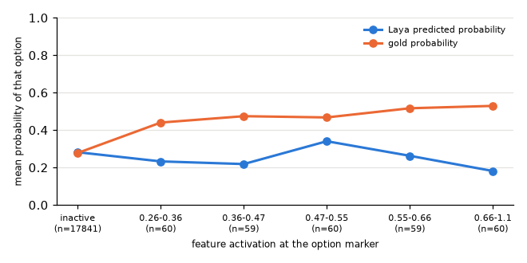

# Feature 2548

Critérios em que aparece: corr_error_stratified, corr_probe_right_laya_wrong_stratified

**Interpretação (preencher):** 

---

## Maiores ativações

**tr_security_incidents_000108 / credential_compromise** (noul, security_incidents) | ativação 2.730 em `estado` | opções ['false', 'true'] | Laya: **true** [0.05, 0.95] | gabarito: **true**

```
<bos> noul question: The evidence indicates a credential or account has been compromised.<eos>
▸ <mask> false: no, the statement does not hold
▸ <mask> true: yes, the statement holds

<eos>

 {"alert": {"description": "a large transfer to an external destination", "evidence": "A transfer of approximately 2.3 ⟦TB⟧ was recorded from internal address 10.12.45.78 to external destination 203.0.113.45 over TCP port 443, beginning at 2026-09-15 02:14 UTC and completing at 03:01 UTC. The activity originated from a shared_mailbox account with privileged rights, MFA enabled, and a password last rotated 90 days ago, occurring outside any defined change window.", "rule": "data_egress"}, "context": {"asset_criticality": "medium", "change_window_active": false, "source_on_allowlist": false}, "history": {"credential_rotation_days_ago": 90, "distinct_countries_30d": 1, "logins_30d": 1708, "prior_alerts_90d": 3}, "principal": {"mfa_enrolled": true, "name": "usr-support-496", "privileges": ["deploy:production", "secrets:read"], "type": "shared_mailbox"}}<eos>
```

**tr_security_incidents_000108 / true_positive** (noul, security_incidents) | ativação 2.674 em `estado` | opções ['false', 'true'] | Laya: **true** [0.036, 0.964] | gabarito: **true**

```
<bos> noul question: This alert reflects genuinely malicious or unauthorised activity.<eos>
▸ <mask> false: Benign activity, a misconfiguration, or a known false positive.
▸ <mask> true: The underlying behaviour is malicious or unauthorised.

<eos>

 {"alert": {"description": "a large transfer to an external destination", "evidence": "A transfer of approximately 2.3 ⟦TB⟧ was recorded from internal address 10.12.45.78 to external destination 203.0.113.45 over TCP port 443, beginning at 2026-09-15 02:14 UTC and completing at 03:01 UTC. The activity originated from a shared_mailbox account with privileged rights, MFA enabled, and a password last rotated 90 days ago, occurring outside any defined change window.", "rule": "data_egress"}, "context": {"asset_criticality": "medium", "change_window_active": false, "source_on_allowlist": false}, "history": {"credential_rotation_days_ago": 90, "distinct_countries_30d": 1, "logins_30d": 1708, "prior_alerts_90d": 3}, "principal": {"mfa_enrolled": true, "name": "usr-support-496", "privileges": ["deploy:production", "secrets:read"], "type": "shared_mailbox"}}<eos>
```

**tr_security_incidents_000108 / urgency** (score, security_incidents) | ativação 2.674 em `estado` | opções ['0', '1', '2', '3'] | Laya: **3** [0.114, 0.23, 0.29, 0.367] | gabarito: **3**

```
<bos> score question: How quickly must a responder act on this alert?<eos>
▸ <mask> level 0: No time pressure; can wait indefinitely.
▸ <mask> level 1: Routine; handle within the normal queue.
▸ <mask> level 2: Elevated; should be handled within the same week.
▸ <mask> level 3: Critical; requires action within the same day.

<eos>

 {"alert": {"description": "a large transfer to an external destination", "evidence": "A transfer of approximately 2.3 ⟦TB⟧ was recorded from internal address 10.12.45.78 to external destination 203.0.113.45 over TCP port 443, beginning at 2026-09-15 02:14 UTC and completing at 03:01 UTC. The activity originated from a shared_mailbox account with privileged rights, MFA enabled, and a password last rotated 90 days ago, occurring outside any defined change window.", "rule": "data_egress"}, "context": {"asset_criticality": "medium", "change_window_active": false, "source_on_allowlist": false}, "history": {"credential_rotation_days_ago": 90, "distinct_countries_30d": 1, "logins_30d": 1708, "prior_alerts_90d": 3}, "principal": {"mfa_enrolled": true, "name": "usr-support-496", "privileges": ["deploy:production", "secrets:read"], "type": "shared_mailbox"}}<eos>
```

**tr_security_incidents_000108 / severity** (score, security_incidents) | ativação 2.641 em `estado` | opções ['0', '1', '2', '3', '4'] | Laya: **2** [0.14, 0.224, 0.352, 0.14, 0.144] | gabarito: **3**

```
<bos> score question: How severe is the potential impact if this alert is real?<eos>
▸ <mask> level 0: Negligible: no access to anything sensitive.
▸ <mask> level 1: Low: limited access, easily reversed.
▸ <mask> level 2: Moderate: access to internal systems or non-public data.
▸ <mask> level 3: High: access to production, secrets or customer data.
▸ <mask> level 4: Critical: active compromise of crown-jewel systems.

<eos>

 {"alert": {"description": "a large transfer to an external destination", "evidence": "A transfer of approximately 2.3 ⟦TB⟧ was recorded from internal address 10.12.45.78 to external destination 203.0.113.45 over TCP port 443, beginning at 2026-09-15 02:14 UTC and completing at 03:01 UTC. The activity originated from a shared_mailbox account with privileged rights, MFA enabled, and a password last rotated 90 days ago, occurring outside any defined change window.", "rule": "data_egress"}, "context": {"asset_criticality": "medium", "change_window_active": false, "source_on_allowlist": false}, "history": {"credential_rotation_days_ago": 90, "distinct_countries_30d": 1, "logins_30d": 1708, "prior_alerts_90d": 3}, "principal": {"mfa_enrolled": true, "name": "usr-support-496", "privileges": ["deploy:production", "secrets:read"], "type": "shared_mailbox"}}<eos>
```

**tr_security_incidents_000296 / credential_compromise** (noul, security_incidents) | ativação 2.617 em `estado` | opções ['false', 'true'] | Laya: **true** [0.006, 0.994] | gabarito: **true**

```
<bos> noul question: The evidence indicates a credential or account has been compromised.<eos>
▸ <mask> false: no, the statement does not hold
▸ <mask> true: yes, the statement holds

<eos>

 {"alert": {"description": "an unrecognised binary executed on a server", "evidence": "An unrecognized binary named 'svc_host_⟦tmp⟧.exe' was executed on server SRV-PROD-04 at 09:22 UTC. This activity originated from an unlisted IP address and was performed by an unprivileged employee account.", "rule": "suspicious_process"}, "context": {"asset_criticality": "high", "change_window_active": false, "source_on_allowlist": false}, "history": {"credential_rotation_days_ago": 30, "distinct_countries_30d": 4, "logins_30d": 158, "prior_alerts_90d": 0}, "principal": {"mfa_enrolled": true, "name": "usr-analytics-518", "privileges": ["repo:read"], "type": "employee"}}<eos>
```

## Ativações medianas (faixa 40-60%, mediana 0.577)

**tr_security_incidents_000015 / credential_compromise** (noul, security_incidents) | ativação 0.583 em `marcador` | opções ['false', 'true'] | Laya: **false** [0.995, 0.005] | gabarito: **true**

```
<bos> noul question: The evidence indicates a credential or account has been compromised.<eos>
▸ ⟦<mask>⟧ false: no, the statement does not hold
▸ <mask> true: yes, the statement holds

<eos>

 {"alert": {"description": "audit logging was turned off on a host", "evidence": "At 03:12 UTC on 2026‑09‑15, audit logging was disabled on host 10.2.5.17. The change was made by service account svc_acct_42, which has privileged access, MFA disabled, and credentials that were last rotated 90 days earlier.", "rule": "disabled_logging"}, "context": {"asset_criticality": "low", "change_window_active": false, "source_on_allowlist": false}, "history": {"credential_rotation_days_ago": 90, "distinct_countries_30d": 4, "logins_30d": 1088, "prior_alerts_90d": 0}, "principal": {"mfa_enrolled": false, "name": "ci-support-435", "privileges": ["deploy:production", "secrets:read"], "type": "service_account"}}<eos>
```

**tr_security_incidents_000228 / credential_compromise** (noul, security_incidents) | ativação 0.517 em `marcador` | opções ['false', 'true'] | Laya: **true** [0.009, 0.991] | gabarito: **true**

```
<bos> noul question: The evidence indicates a credential or account has been compromised.<eos>
▸ ⟦<mask>⟧ false: no, the statement does not hold
▸ <mask> true: yes, the statement holds

<eos>

 {"alert": {"description": "a first-ever sign-in from an unfamiliar country", "evidence": "At 08:42 UTC, the unprivileged shared mailbox authenticated from IP 185.156.174.20 in the Netherlands, marking the first recorded sign-in from this country. The session used valid credentials rotated 14 days ago and passed multi-factor authentication from an unrecognized source device.", "rule": "new_country_login"}, "context": {"asset_criticality": "high", "change_window_active": false, "source_on_allowlist": false}, "history": {"credential_rotation_days_ago": 14, "distinct_countries_30d": 2, "logins_30d": 1119, "prior_alerts_90d": 0}, "principal": {"mfa_enrolled": true, "name": "ci-billing-303", "privileges": ["repo:read"], "type": "shared_mailbox"}}<eos>
```

**tr_security_incidents_000294 / credential_compromise** (noul, security_incidents) | ativação 0.585 em `marcador` | opções ['false', 'true'] | Laya: **true** [0.427, 0.573] | gabarito: **true**

```
<bos> noul question: The evidence indicates a credential or account has been compromised.<eos>
▸ ⟦<mask>⟧ false: no, the statement does not hold
▸ <mask> true: yes, the statement holds

<eos>

 {"alert": {"description": "audit logging was turned off on a host", "evidence": "The audit logging service was disabled on the host at 02:14 UTC during an active change window. The operation was performed by the shared mailbox account 'svc_archive', which accessed the system from an unrecognized IP address.", "rule": "disabled_logging"}, "context": {"asset_criticality": "medium", "change_window_active": true, "source_on_allowlist": false}, "history": {"credential_rotation_days_ago": 90, "distinct_countries_30d": 1, "logins_30d": 1770, "prior_alerts_90d": 8}, "principal": {"mfa_enrolled": true, "name": "adm-support-964", "privileges": ["repo:read"], "type": "shared_mailbox"}}<eos>
```

**tr_security_incidents_000179 / credential_compromise** (noul, security_incidents) | ativação 0.630 em `marcador` | opções ['false', 'true'] | Laya: **true** [0.013, 0.987] | gabarito: **true**

```
<bos> noul question: The evidence indicates a credential or account has been compromised.<eos>
▸ ⟦<mask>⟧ false: no, the statement does not hold
▸ <mask> true: yes, the statement holds

<eos>

 {"alert": {"description": "many failed authentications followed by a success", "evidence": "From 2026-09-15 03:20:05 UTC to 03:22:31 UTC, the privileged service account svc_backup attempted 87 logins from allowlisted IP 192.0.2.55, recording 86 failed password attempts before a successful authentication. MFA was disabled for this account, and its password has not been changed since 2024-09-20 (approximately 700 days). No change window was in effect at the time.", "rule": "brute_force"}, "context": {"asset_criticality": "medium", "change_window_active": false, "source_on_allowlist": true}, "history": {"credential_rotation_days_ago": 700, "distinct_countries_30d": 1, "logins_30d": 1592, "prior_alerts_90d": 0}, "principal": {"mfa_enrolled": false, "name": "ci-deploy-675", "privileges": ["deploy:production", "secrets:read"], "type": "service_account"}}<eos>
```

**tr_security_incidents_000099 / credential_compromise** (noul, security_incidents) | ativação 0.579 em `marcador` | opções ['false', 'true'] | Laya: **false** [1.0, 0.0] | gabarito: **false**

```
<bos> noul question: The evidence indicates a credential or account has been compromised.<eos>
▸ ⟦<mask>⟧ false: no, the statement does not hold
▸ <mask> true: yes, the statement holds

<eos>

 {"alert": {"description": "a security group was opened to the public internet", "evidence": "At 2026-09-15 03:42 UTC, security group SG-9f2b3c was altered to include an inbound rule allowing 0.0.0.0/0 on TCP port 443. The change was performed by user alice@example.com (admin, MFA enabled) from IP 203.0.113.45, which is not listed in the known asset inventory. The credentials used for this action were last rotated on 2026-09-12.", "rule": "config_drift"}, "context": {"asset_criticality": "low", "change_window_active": false, "source_on_allowlist": false}, "history": {"credential_rotation_days_ago": 3, "distinct_countries_30d": 4, "logins_30d": 1790, "prior_alerts_90d": 8}, "principal": {"mfa_enrolled": true, "name": "ci-support-886", "privileges": ["repo:read"], "type": "admin"}}<eos>
```

## Estatísticas (conjunto de descoberta, dev e teste)

**pred / error**

| split | decisões | ativas | ativas e Laya errou | taxa | lift | q (BH) | OR (CMH) | q (CMH) |
|---|---|---|---|---|---|---|---|---|
| discovery | 5100 | 59 | 33 | 0.559 | 0.87 | 0.275 | 3.25 | 0.232 |
| dev | 900 | 12 | 5 | 0.417 | 0.62 | nan | nan | nan |
| test | 2000 | 23 | 8 | 0.348 | 0.53 | 0.0114 | 0.22 | 0.284 |

**corr / error**

| split | decisões | ativas | ativas e Laya errou | taxa | lift | q (BH) | OR (CMH) | q (CMH) |
|---|---|---|---|---|---|---|---|---|
| discovery | 5100 | 125 | 99 | 0.792 | 1.23 | 0.000666 | 4.17 | 0.0035 |
| dev | 900 | 21 | 14 | 0.667 | 0.99 | 1 | 0.94 | 0.982 |
| test | 2000 | 52 | 37 | 0.712 | 1.09 | 0.491 | 0.88 | 0.926 |

**state / error**

| split | decisões | ativas | ativas e Laya errou | taxa | lift | q (BH) | OR (CMH) | q (CMH) |
|---|---|---|---|---|---|---|---|---|
| discovery | 5100 | 122 | 74 | 0.607 | 0.94 | 0.62 | 1.06 | 0.922 |
| dev | 900 | 27 | 13 | 0.481 | 0.72 | 0.296 | 0.52 | 0.435 |
| test | 2000 | 96 | 47 | 0.490 | 0.75 | 0.0228 | 0.56 | 0.208 |

**pred / probe_right_laya_wrong**

| split | decisões | ativas | ativas e Laya errou | taxa | lift | q (BH) | OR (CMH) | q (CMH) |
|---|---|---|---|---|---|---|---|---|
| discovery | 2819 | 41 | 26 | 0.634 | 0.98 | 0.995 | 6.95 | 0.206 |
| dev | 520 | 11 | 5 | 0.455 | 0.67 | nan | nan | nan |
| test | 1106 | 13 | 5 | 0.385 | 0.61 | nan | nan | nan |

**corr / probe_right_laya_wrong**

| split | decisões | ativas | ativas e Laya errou | taxa | lift | q (BH) | OR (CMH) | q (CMH) |
|---|---|---|---|---|---|---|---|---|
| discovery | 2819 | 85 | 70 | 0.824 | 1.27 | 0.000701 | 9.65 | 0.0229 |
| dev | 520 | 13 | 7 | 0.538 | 0.80 | nan | nan | nan |
| test | 1106 | 35 | 27 | 0.771 | 1.22 | 0.147 | 1.15 | 0.978 |

**state / probe_right_laya_wrong**

| split | decisões | ativas | ativas e Laya errou | taxa | lift | q (BH) | OR (CMH) | q (CMH) |
|---|---|---|---|---|---|---|---|---|
| discovery | 2819 | 73 | 43 | 0.589 | 0.91 | 0.492 | 1.02 | 0.974 |
| dev | 520 | 16 | 6 | 0.375 | 0.56 | nan | nan | nan |
| test | 1106 | 72 | 28 | 0.389 | 0.61 | 0.0011 | 0.41 | 0.0278 |

Confusão mais sobre-representada (pred): `credential_compromise|0>1` (n=20, lift 78.58, p=1.13e-38). Formato `pergunta|índice previsto>índice correto`.

Confusão mais sobre-representada (corr): `credential_compromise|1>0` (n=77, lift 38.31, p=0). Formato `pergunta|índice previsto>índice correto`.

Confusão mais sobre-representada (state): `severity|2>3` (n=4, lift 4.40, p=0.0123). Formato `pergunta|índice previsto>índice correto`.



