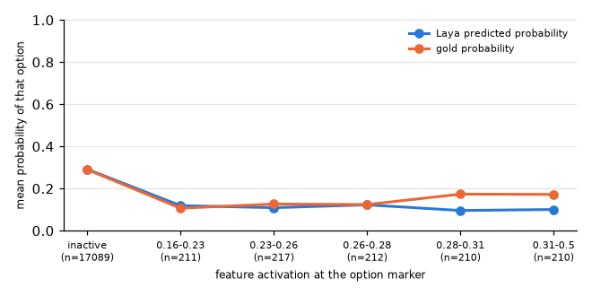

# Feature 2575

Critérios em que aparece: pred_error, corr_probe_right_laya_wrong

**Interpretação (preencher):** 

---

## Maiores ativações

**tr_customer_service_000088 / needs_human** (noul, customer_service) | ativação 2.557 em `estado` | opções ['false', 'true'] | Laya: **true** [0.347, 0.653] | gabarito: **true**

```
<bos> noul question: This conversation requires a human agent rather than automated handling.<eos>
▸ <mask> false: Automation can carry this to resolution.
▸ <mask> true: A human must take over: judgement, authority or empathy is required.

<eos>

 {"account": {"lifetime_value_usd": 73, "prior_tickets_90d": 1, "seats": 5, "tenure_months": 2, "tier": "enterprise"}, "orders": [{"amount_usd": 19, "date": "2026-02-04", "id": "A-66055", "status": "settled"}], "thread": [{"role": "customer", "text": "Hello, I hope you can help – I tried to renew our Enterprise plan today and the $19 charge didn’t go through. This is our second month with you, and we’ve already opened a ticket about a similar issue that was resolved, but it seems to be happening again."}, {"role": "agent", "text": "I’m sorry to hear the payment didn’t process. Could you let me know the date of the attempted charge and the last four digits of the card you used?"}, {"role": "customer", "text": "The attempt was on September 12th, and the card ends in 8427. I also tried using the same card on the portal, but it still shows a failure."}, {"role": "agent", "text": "Thank you for the details. Have you tried using a different payment method, or does the same error appear with another card?"}, {"role": "customer", "text": "We only have the one corporate card for billing⟦,⟧ so we haven’t switched. The earlier ticket (ID #12345) was resolved, but the problem resurfaced today."}, {"role": "agent", "text": "I see, and I’ve noted the previous ticket. I’ll look into the transaction logs and see why the charge is failing again."}, {"role": "customer", "text": "Please let me know when you have an update, as we need the renewal to be confirmed before the end of the week."}]}<eos>
```

**tr_customer_service_000183 / category** (choice, customer_service) | ativação 2.473 em `estado` | opções ['account', 'billing', 'delivery', 'refund', 'technical'] | Laya: **billing** [0.263, 0.703, 0.0, 0.001, 0.033] | gabarito: **billing**

```
<bos> choice question: What is this customer conversation primarily about?<eos>
▸ <mask> account: Login, plan changes, profile or access management.
▸ <mask> billing: A charge, invoice, subscription or payment problem.
▸ <mask> delivery: Shipping, fulfilment or delivery of a physical item.
▸ <mask> refund: The customer is explicitly asking for money back.
▸ <mask> technical: The product or service is not working as expected.

<eos>

 {"account": {"lifetime_value_usd": 455, "prior_tickets_90d": 0, "seats": 1, "tenure_months": 5, "tier": "free"}, "orders": [{"amount_usd": 98, "date": "2026-03-24", "id": "A-16754", "status": "settled"}], "thread": [{"role": "customer", "text": "My payment just failed again and I have a hard deadline tomorrow to keep my account active – this is getting ridiculous."}, {"role": "agent", "text": "I’m really sorry you’re experiencing this. Could you tell me which payment method you’re trying to use?"}, {"role": "customer", "text": "I’m using the Visa ending in 4321. Every time I hit submit I get an error code 502 and the charge never goes through."}, {"role": "agent", "text": "Got it⟦,⟧ thank you. Do you see any additional message on the screen besides the error code, like a declined notice or a timeout?"}, {"role": "customer", "text": "Just the generic “payment could not be processed” line. I need a solution right now, otherwise my free‑plan account will be suspended."}, {"role": "agent", "text": "I understand the urgency. Do you have an alternative payment option available, such as a different card or PayPal?"}, {"role": "customer", "text": "Yes, I have a PayPal account I can use. How do I switch to that quickly?"}]}<eos>
```

**tr_customer_service_000002 / category** (choice, customer_service) | ativação 2.422 em `estado` | opções ['account', 'billing', 'delivery', 'refund', 'technical'] | Laya: **billing** [0.034, 0.939, 0.002, 0.001, 0.025] | gabarito: **account**

```
<bos> choice question: What is this customer conversation primarily about?<eos>
▸ <mask> account: Login, plan changes, profile or access management.
▸ <mask> billing: A charge, invoice, subscription or payment problem.
▸ <mask> delivery: Shipping, fulfilment or delivery of a physical item.
▸ <mask> refund: The customer is explicitly asking for money back.
▸ <mask> technical: The product or service is not working as expected.

<eos>

 {"account": {"lifetime_value_usd": 37, "prior_tickets_90d": 0, "seats": 1, "tenure_months": 1, "tier": "standard"}, "thread": [{"role": "customer", "text": "Good afternoon, could you please arrange for a full export of all my data from the Standard plan? I’d like it in CSV format."}, {"role": "agent", "text": "Certainly, I can help with that. May I confirm the email address on the account and whether you need the export within a particular timeframe?"}, {"role": "customer", "text": "The account is under michael.brown@example.com, and I’d like to receive the file by the end of the week if possible."}, {"role": "agent", "text": "Got it⟦,⟧ thank you. I’ll queue the export and will need to verify your identity – could you provide the last four digits of the payment method on file?"}, {"role": "customer", "text": "The last four digits are 4321. Please let me know when the download link is ready."}]}<eos>
```

**tr_customer_service_000183 / action** (choice, customer_service) | ativação 2.408 em `estado` | opções ['answer_directly', 'close_no_action', 'escalate_to_human', 'execute_refund', 'request_information'] | Laya: **answer_directly** [0.866, 0.085, 0.008, 0.04, 0.001] | gabarito: **answer_directly**

```
<bos> choice question: What should the assistant do next with this conversation?<eos>
▸ <mask> answer_directly: The assistant can resolve this itself with information it already has.
▸ <mask> close_no_action: No further action is warranted; the matter is settled.
▸ <mask> escalate_to_human: Hand off to a human agent with the appropriate authority.
▸ <mask> execute_refund: Issue the refund or credit the customer is owed.
▸ <mask> request_information: More detail is needed from the customer before anything can be done.

<eos>

 {"account": {"lifetime_value_usd": 455, "prior_tickets_90d": 0, "seats": 1, "tenure_months": 5, "tier": "free"}, "orders": [{"amount_usd": 98, "date": "2026-03-24", "id": "A-16754", "status": "settled"}], "thread": [{"role": "customer", "text": "My payment just failed again and I have a hard deadline tomorrow to keep my account active – this is getting ridiculous."}, {"role": "agent", "text": "I’m really sorry you’re experiencing this. Could you tell me which payment method you’re trying to use?"}, {"role": "customer", "text": "I’m using the Visa ending in 4321. Every time I hit submit I get an error code 502 and the charge never goes through."}, {"role": "agent", "text": "Got it⟦,⟧ thank you. Do you see any additional message on the screen besides the error code, like a declined notice or a timeout?"}, {"role": "customer", "text": "Just the generic “payment could not be processed” line. I need a solution right now, otherwise my free‑plan account will be suspended."}, {"role": "agent", "text": "I understand the urgency. Do you have an alternative payment option available, such as a different card or PayPal?"}, {"role": "customer", "text": "Yes, I have a PayPal account I can use. How do I switch to that quickly?"}]}<eos>
```

**tr_customer_service_000088 / needs_human** (noul, customer_service) | ativação 2.402 em `estado` | opções ['false', 'true'] | Laya: **true** [0.347, 0.653] | gabarito: **true**

```
<bos> noul question: This conversation requires a human agent rather than automated handling.<eos>
▸ <mask> false: Automation can carry this to resolution.
▸ <mask> true: A human must take over: judgement, authority or empathy is required.

<eos>

 {"account": {"lifetime_value_usd": 73, "prior_tickets_90d": 1, "seats": 5, "tenure_months": 2, "tier": "enterprise"}, "orders": [{"amount_usd": 19, "date": "2026-02-04", "id": "A-66055", "status": "settled"}], "thread": [{"role": "customer", "text": "Hello, I hope you can help – I tried to renew our Enterprise plan today and the $19 charge didn’t go through. This is our second month with you, and we’ve already opened a ticket about a similar issue that was resolved⟦,⟧ but it seems to be happening again."}, {"role": "agent", "text": "I’m sorry to hear the payment didn’t process. Could you let me know the date of the attempted charge and the last four digits of the card you used?"}, {"role": "customer", "text": "The attempt was on September 12th, and the card ends in 8427. I also tried using the same card on the portal, but it still shows a failure."}, {"role": "agent", "text": "Thank you for the details. Have you tried using a different payment method, or does the same error appear with another card?"}, {"role": "customer", "text": "We only have the one corporate card for billing, so we haven’t switched. The earlier ticket (ID #12345) was resolved, but the problem resurfaced today."}, {"role": "agent", "text": "I see, and I’ve noted the previous ticket. I’ll look into the transaction logs and see why the charge is failing again."}, {"role": "customer", "text": "Please let me know when you have an update, as we need the renewal to be confirmed before the end of the week."}]}<eos>
```

## Ativações medianas (faixa 40-60%, mediana 0.653)

**tr_security_incidents_000208 / urgency** (score, security_incidents) | ativação 0.665 em `estado` | opções ['0', '1', '2', '3'] | Laya: **1** [0.216, 0.345, 0.223, 0.216] | gabarito: **2**

```
<bos> score question: How quickly must a responder act on this alert?<eos>
▸ <mask> level 0: No time pressure; can wait indefinitely.
▸ <mask> level 1: Routine; handle within the normal queue.
▸ <mask> level 2: Elevated; should be handled within the same week.
▸ <mask> level 3: Critical; requires action within the same day.

<eos>

 {"alert": {"description": "a large transfer to an external destination", "evidence": "At 04:03 UTC on 2026-09-15, a service account named svc_backup transferred 4.8 GB of data to external IP 198.51.100.77 over port 443 using the process rsync.exe. The transfer completed in 7 minutes and originated from an unrecognised host in the DMZ. The event took place during an open change window.", "rule": "data_egress"}, "context": {"asset_criticality": "low", "change_window_active": true, "source_on_allowlist": false}, "history": {"credential_rotation_days_ago": 30⟦,⟧ "distinct_countries_30d": 3, "logins_30d": 873, "prior_alerts_90d": 3}, "principal": {"mfa_enrolled": false, "name": "ci-support-613", "privileges": ["deploy:production", "secrets:read"], "type": "service_account"}}<eos>
```

**tr_security_incidents_000079 / disposition** (choice, security_incidents) | ativação 0.692 em `estado` | opções ['close_benign', 'contain', 'investigate', 'monitor'] | Laya: **monitor** [0.012, 0.207, 0.057, 0.724] | gabarito: **investigate**

```
<bos> choice question: How should this security alert be dispositioned?<eos>
▸ <mask> close_benign: Expected, explainable activity; close without analyst time.
▸ <mask> contain: Contain the host or account immediately; do not wait for triage.
▸ <mask> investigate: Warrants an analyst opening an investigation.
▸ <mask> monitor: Not clearly malicious, but worth watching for recurrence.

<eos>

 {"alert": {"description": "many failed authentications followed by a success", "evidence": "Between 2026-09-16T08:05:12Z and 08:12:47Z, the shared mailbox \"alerts@corp.com\" recorded 27 consecutive failed login attempts from allow‑listed IP 198.51.100.22, followed by a successful authentication at 08:13:04Z. MFA was active for this account, and the password was rotated 3 days prior to the event.", "rule": "brute_force"}, "context": {"asset_criticality": "medium", "change_window_active": false, "source_on_allowlist": true}, "history": {"credential_rotation_days_ago": 3⟦,⟧ "distinct_countries_30d": 3, "logins_30d": 1029, "prior_alerts_90d": 0}, "principal": {"mfa_enrolled": true, "name": "svc-analytics-857", "privileges": ["repo:read"], "type": "shared_mailbox"}}<eos>
```

**tr_customer_service_000147 / churn_risk** (score, customer_service) | ativação 0.665 em `estado` | opções ['0', '1', '2', '3'] | Laya: **2** [0.097, 0.32, 0.326, 0.258] | gabarito: **3**

```
<bos> score question: How likely is this customer to stop doing business with us because of this interaction?<eos>
▸ <mask> level 0: No sign of dissatisfaction.
▸ <mask> level 1: Mild frustration, but the relationship is intact.
▸ <mask> level 2: Clearly unhappy; repeat problems or explicit complaints.
▸ <mask> level 3: Imminent: threatening to cancel, dispute or leave.

<eos>

 {"account": {"lifetime_value_usd": 117, "prior_tickets_90d": 3, "seats": 1, "tenure_months": 5, "tier": "premium"}, "thread": [{"role": "customer", "text": "I’m writing to let you know I’d like to cancel my account. I’ve been on the Premium plan for five months⟦,⟧ and after three unresolved tickets I’ve decided to move on."}, {"role": "agent", "text": "I’m sorry to hear you want to cancel. Can you confirm the email address associated with the account so I can pull up the correct details?"}, {"role": "customer", "text": "The account is registered to jane.doe@example.com. Please let me know what the next steps are for the cancellation."}]}<eos>
```

**tr_security_incidents_000161 / urgency** (score, security_incidents) | ativação 0.614 em `estado` | opções ['0', '1', '2', '3'] | Laya: **3** [0.127, 0.334, 0.144, 0.396] | gabarito: **3**

```
<bos> score question: How quickly must a responder act on this alert?<eos>
▸ <mask> level 0: No time pressure; can wait indefinitely.
▸ <mask> level 1: Routine; handle within the normal queue.
▸ <mask> level 2: Elevated; should be handled within the same week.
▸ <mask> level 3: Critical; requires action within the same day.

<eos>

 {"alert": {"description": "many failed authentications followed by a success", "evidence": "From 2026‑09‑15 01:05 to 01:12 UTC, 27 consecutive failed login attempts were logged for the privileged service account svc‑backup originating from allowlisted IP 10.0.2.5, after which a successful authentication occurred at 01:13 UTC. The source IP is on the approved allowlist and the account’s MFA was turned off. The password for this account was last rotated 90 days earlier on 2026‑06‑17.", "rule": "brute_force"}, "context": {"asset_criticality": "medium", "change_window_active": false, "source_on_allowlist": true}, "history": {"credential_rotation_days_ago": 90⟦,⟧ "distinct_countries_30d": 1, "logins_30d": 205, "prior_alerts_90d": 1}, "principal": {"mfa_enrolled": false, "name": "usr-billing-991", "privileges": ["deploy:production", "secrets:read"], "type": "service_account"}}<eos>
```

**tr_security_incidents_000273 / true_positive** (noul, security_incidents) | ativação 0.696 em `estado` | opções ['false', 'true'] | Laya: **true** [0.008, 0.992] | gabarito: **true**

```
<bos> noul question: This alert reflects genuinely malicious or unauthorised activity.<eos>
▸ <mask> false: Benign activity, a misconfiguration, or a known false positive.
▸ <mask> true: The underlying behaviour is malicious or unauthorised.

<eos>

 {"alert": {"description": "an endpoint agent matched a known signature", "evidence": "Endpoint sensor on workstation WKS-07 detected a file named 'svchost64.dll' in C:\\Users\\temp that matched the known malware signature 'Trojan:Win32/Emotet.A' at 2026-09-15 08:17:02 UTC. The detection was generated by an unregistered source. The associated admin account, which has MFA enabled and was last rotated 14 days prior, was not in a scheduled change window.", "rule": "malware_signature"}, "context": {"asset_criticality": "medium", "change_window_active": false, "source_on_allowlist": false}, "history": {"credential_rotation_days_ago": 14, "distinct_countries_30d": 2⟦,⟧ "logins_30d": 1414, "prior_alerts_90d": 0}, "principal": {"mfa_enrolled": true, "name": "adm-infra-828", "privileges": ["deploy:production", "secrets:read"], "type": "admin"}}<eos>
```

## Estatísticas (conjunto de descoberta, dev e teste)

**pred / error**

| split | decisões | ativas | ativas e Laya errou | taxa | lift | q (BH) | OR (CMH) | q (CMH) |
|---|---|---|---|---|---|---|---|---|
| discovery | 5100 | 27 | 26 | 0.963 | 1.50 | 0.000476 | 2.94 | 0.582 |
| dev | 900 | 3 | 3 | 1.000 | 1.49 | nan | nan | nan |
| test | 2000 | 8 | 8 | 1.000 | 1.54 | nan | nan | nan |

**corr / error**

| split | decisões | ativas | ativas e Laya errou | taxa | lift | q (BH) | OR (CMH) | q (CMH) |
|---|---|---|---|---|---|---|---|---|
| discovery | 5100 | 115 | 114 | 0.991 | 1.54 | 5.71e-20 | 0.00 | 0.798 |
| dev | 900 | 23 | 23 | 1.000 | 1.49 | 0.000578 | nan | nan |
| test | 2000 | 67 | 67 | 1.000 | 1.54 | 3.11e-12 | nan | nan |

**state / error**

| split | decisões | ativas | ativas e Laya errou | taxa | lift | q (BH) | OR (CMH) | q (CMH) |
|---|---|---|---|---|---|---|---|---|
| discovery | 5100 | 5010 | 3226 | 0.644 | 1.00 | 1 | 0.90 | 0.891 |
| dev | 900 | 885 | 593 | 0.670 | 1.00 | 0.782 | 0.25 | 0.274 |
| test | 2000 | 1967 | 1284 | 0.653 | 1.00 | 0.397 | 1.40 | 0.749 |

**pred / probe_right_laya_wrong**

| split | decisões | ativas | ativas e Laya errou | taxa | lift | q (BH) | OR (CMH) | q (CMH) |
|---|---|---|---|---|---|---|---|---|
| discovery | 2819 | 6 | 6 | 1.000 | 1.55 | nan | nan | nan |
| dev | 520 | 1 | 1 | 1.000 | 1.48 | nan | nan | nan |
| test | 1106 | 3 | 3 | 1.000 | 1.58 | nan | nan | nan |

**corr / probe_right_laya_wrong**

| split | decisões | ativas | ativas e Laya errou | taxa | lift | q (BH) | OR (CMH) | q (CMH) |
|---|---|---|---|---|---|---|---|---|
| discovery | 2819 | 45 | 45 | 1.000 | 1.55 | 1.35e-08 | nan | nan |
| dev | 520 | 9 | 9 | 1.000 | 1.48 | nan | nan | nan |
| test | 1106 | 26 | 26 | 1.000 | 1.58 | 2.86e-05 | nan | nan |

**state / probe_right_laya_wrong**

| split | decisões | ativas | ativas e Laya errou | taxa | lift | q (BH) | OR (CMH) | q (CMH) |
|---|---|---|---|---|---|---|---|---|
| discovery | 2819 | 2775 | 1797 | 0.648 | 1.00 | 0.863 | 0.90 | 0.907 |
| dev | 520 | 509 | 342 | 0.672 | 1.00 | 0.817 | 0.20 | 0.115 |
| test | 1106 | 1089 | 694 | 0.637 | 1.01 | 0.124 | 1.65 | 0.681 |

Confusão mais sobre-representada (pred): `severity|0>2` (n=6, lift 161.90, p=8.47e-14). Formato `pergunta|índice previsto>índice correto`.

Confusão mais sobre-representada (corr): `risk|2>0` (n=33, lift 35.69, p=0). Formato `pergunta|índice previsto>índice correto`.

Confusão mais sobre-representada (state): `duplicate|1>0` (n=217, lift 1.02, p=0.0193). Formato `pergunta|índice previsto>índice correto`.



