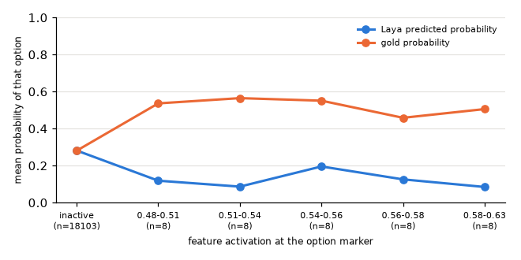

# Feature 2587

Critérios em que aparece: corr_error, corr_probe_right_laya_wrong

**Interpretação (preencher):** 

---

## Maiores ativações

**tr_invoice_processing_000187 / duplicate** (noul, invoice_processing) | ativação 1.029 em `estado` | opções ['false', 'true'] | Laya: **true** [0.017, 0.982] | gabarito: **false**

```
<bos> noul question: This invoice appears to duplicate an invoice already submitted.<eos>
▸ <mask> false: no, the statement does not hold
▸ <mask> true: yes, the statement holds

<eos>

 {"delivery": {"condition": "accepted with exceptions", "date": "2026-03-23", "received_qty": 1000}, "invoice": {"currency": "USD", "id": "INV-2026-9934", "lines": [{"qty": 1000, "sku": "SKU-841", "total_usd": 111730.0, "unit_usd": 111.73}], "total_usd": 111730.0, "vendor": "Acme Fabrication"}, "payment": {"days_until_due": 44, "discount_expires_in_days": null, "early_payment_discount_pct": null, "status": "scheduled", "terms": "net 30"}, "purchase_order": {"freight_terms": "freight prepaid by vendor, not separately billable", "id": null, "lines": [{"qty": 1000, "unit_usd": 111.⟦7⟧3}], "total_usd": 111730.0}, "vendor_history": {"disputes_12m": 2, "invoices_12m": 33, "prior_invoice_ids": ["INV-2026-9102"]}}<eos>
```

**tr_invoice_processing_000246 / duplicate** (noul, invoice_processing) | ativação 1.016 em `estado` | opções ['false', 'true'] | Laya: **true** [0.027, 0.973] | gabarito: **false**

```
<bos> noul question: This invoice appears to duplicate an invoice already submitted.<eos>
▸ <mask> false: no, the statement does not hold
▸ <mask> true: yes, the statement holds

<eos>

 {"delivery": {"condition": "accepted with exceptions", "date": "2026-03-13", "received_qty": 100}, "invoice": {"currency": "USD", "id": "INV-2026-9771", "lines": [{"qty": 100, "sku": "SKU-808", "total_usd": 28674.0, "unit_usd": 286.74}], "total_usd": 28674.0, "vendor": "Vantage Materials"}, "payment": {"days_until_due": 18, "discount_expires_in_days": null, "early_payment_discount_pct": null, "status": "scheduled", "terms": "net 30"}, "purchase_order": {"freight_terms": "freight prepaid by vendor, not separately billable", "id": "PO-5067", "lines": [{"qty": 100, "unit_usd": 286.⟦7⟧4}], "total_usd": 28674.0}, "vendor_history": {"disputes_12m": 0, "invoices_12m": 33, "prior_invoice_ids": ["INV-2026-6899", "INV-2026-5358", "INV-2026-9069", "INV-2026-1688"]}}<eos>
```

**tr_security_incidents_000217 / disposition** (choice, security_incidents) | ativação 1.015 em `estado` | opções ['close_benign', 'contain', 'investigate', 'monitor'] | Laya: **monitor** [0.105, 0.174, 0.024, 0.698] | gabarito: **investigate**

```
<bos> choice question: How should this security alert be dispositioned?<eos>
▸ <mask> close_benign: Expected, explainable activity; close without analyst time.
▸ <mask> contain: Contain the host or account immediately; do not wait for triage.
▸ <mask> investigate: Warrants an analyst opening an investigation.
▸ <mask> monitor: Not clearly malicious, but worth watching for recurrence.

<eos>

 {"alert": {"description": "a⟦ session⟧ token was presented from a second address", "evidence": "At 11:30 UTC, a session token belonging to the privileged account `svc_storage_admin` was presented from IP `10.50.2.14` and subsequently from `10.50.2.89`. The activity originated from an allowlisted source, though the account's authentication credentials have not been updated in 412 days.", "rule": "token_reuse"}, "context": {"asset_criticality": "crown_jewel", "change_window_active": false, "source_on_allowlist": true}, "history": {"credential_rotation_days_ago": 412, "distinct_countries_30d": 3, "logins_30d": 50, "prior_alerts_90d": 0}, "principal": {"mfa_enrolled": false, "name": "usr-deploy-906", "privileges": ["deploy:production", "secrets:read"], "type": "service_account"}}<eos>
```

**tr_invoice_processing_000187 / matches_order** (noul, invoice_processing) | ativação 1.004 em `estado` | opções ['false', 'true'] | Laya: **true** [0.035, 0.965] | gabarito: **true**

```
<bos> noul question: The invoice reconciles with the purchase order and the recorded delivery.<eos>
▸ <mask> false: There is a discrepancy against the order or the delivery.
▸ <mask> true: Line items, quantities and amounts reconcile.

<eos>

 {"delivery": {"condition": "accepted with exceptions", "date": "2026-03-23", "received_qty": 1000}, "invoice": {"currency": "USD", "id": "INV-2026-9934", "lines": [{"qty": 1000, "sku": "SKU-841", "total_usd": 111730.0, "unit_usd": 111.73}], "total_usd": 111730.0, "vendor": "Acme Fabrication"}, "payment": {"days_until_due": 44, "discount_expires_in_days": null, "early_payment_discount_pct": null, "status": "scheduled", "terms": "net 30"}, "purchase_order": {"freight_terms": "freight prepaid by vendor, not separately billable", "id": null, "lines": [{"qty": 1000, "unit_usd": 111.⟦7⟧3}], "total_usd": 111730.0}, "vendor_history": {"disputes_12m": 2, "invoices_12m": 33, "prior_invoice_ids": ["INV-2026-9102"]}}<eos>
```

**tr_customer_service_000022 / urgency** (score, customer_service) | ativação 0.998 em `estado` | opções ['0', '1', '2', '3'] | Laya: **1** [0.304, 0.474, 0.166, 0.056] | gabarito: **2**

```
<bos> score question: How time-sensitive is this conversation?<eos>
▸ <mask> level 0: No time pressure; can wait indefinitely.
▸ <mask> level 1: Routine; handle within the normal queue.
▸ <mask> level 2: Elevated; should be handled within the same week.
▸ <mask> level 3: Critical; requires action within the same day.

<eos>

 {"account": {"lifetime_value_usd": 60, "prior_tickets_90d": 1, "seats": 1, "tenure_months": 1, "tier": "premium"}, "thread": [{"role": "customer", "text": "Last week you promised a refund for my premium subscription, but nothing’s shown up yet. I’m just waiting for an update."}, {"role": "agent", "text": "I’m sorry you haven’t seen the refund yet. Could you provide the ticket number you were given for that request?"}, {"role": "customer", "text": "The ticket number is #4529. I just need to know if the refund is on⟦ its⟧ way."}, {"role": "agent", "text": "Thanks for the reference. I’ll check with our finance team. Do you still have the original payment method details handy?"}, {"role": "customer", "text": "Yes, it was the Visa ending in 1234. I’ll wait for your next update."}]}<eos>
```

## Ativações medianas (faixa 40-60%, mediana 0.646)

**tr_invoice_processing_000241 / urgency** (score, invoice_processing) | ativação 0.700 em `estado` | opções ['0', '1', '2', '3'] | Laya: **1** [0.096, 0.482, 0.304, 0.119] | gabarito: **2**

```
<bos> score question: How time-sensitive is processing this invoice?<eos>
▸ <mask> level 0: No time pressure; can wait indefinitely.
▸ <mask> level 1: Routine; handle within the normal queue.
▸ <mask> level 2: Elevated; should be handled within the same week.
▸ <mask> level 3: Critical; requires action within the same day.

<eos>

 {"delivery": {"condition": "accepted with exceptions", "date": "2026-03-01", "received_qty": 100}, "invoice": {"currency": "USD", "id": "INV-2026-2388", "lines": [{"qty": 100, "sku": "SKU-830", "total_usd": 12672.0, "unit_usd": 126.72}], "total_usd": 12672.0, "vendor": "Pallas Industrial"}, "payment": {"days_until_due": 0, "discount_expires_in_days": null, "early_payment_discount_pct": null, "status": "scheduled", "terms": "net 60"}, "purchase_order": {"freight_terms": "freight prepaid by vendor, not separately billable", "id": "PO-8926", "lines": [{"qty": 100, "unit_usd": 126.⟦7⟧2}], "total_usd": 12672.0}, "vendor_history": {"disputes_12m": 0, "invoices_12m": 55, "prior_invoice_ids": ["INV-2026-2882", "INV-2026-6390"]}}<eos>
```

**tr_security_incidents_000174 / disposition** (choice, security_incidents) | ativação 0.580 em `marcador` | opções ['close_benign', 'contain', 'investigate', 'monitor'] | Laya: **monitor** [0.035, 0.169, 0.08, 0.716] | gabarito: **investigate**

```
<bos> choice question: How should this security alert be dispositioned?<eos>
▸ <mask> close_benign: Expected, explainable activity; close without analyst time.
▸ <mask> contain: Contain the host or account immediately; do not wait for triage.
▸ ⟦<mask>⟧ investigate: Warrants an analyst opening an investigation.
▸ <mask> monitor: Not clearly malicious, but worth watching for recurrence.

<eos>

 {"alert": {"description": "a long-unused account became active", "evidence": "The unprivileged contractor account, previously inactive for 180 days, initiated a session from the unrecognized IP 198.51.100.12 at 02:45 UTC. This login utilized credentials rotated 14 days ago and passed MFA verification despite falling outside any active change window.", "rule": "dormant_account_use"}, "context": {"asset_criticality": "crown_jewel", "change_window_active": false, "source_on_allowlist": false}, "history": {"credential_rotation_days_ago": 14, "distinct_countries_30d": 4, "logins_30d": 1934, "prior_alerts_90d": 0}, "principal": {"mfa_enrolled": true, "name": "adm-support-509", "privileges": ["repo:read"], "type": "contractor"}}<eos>
```

**tr_security_incidents_000048 / disposition** (choice, security_incidents) | ativação 0.577 em `marcador` | opções ['close_benign', 'contain', 'investigate', 'monitor'] | Laya: **monitor** [0.044, 0.322, 0.197, 0.438] | gabarito: **investigate**

```
<bos> choice question: How should this security alert be dispositioned?<eos>
▸ <mask> close_benign: Expected, explainable activity; close without analyst time.
▸ <mask> contain: Contain the host or account immediately; do not wait for triage.
▸ ⟦<mask>⟧ investigate: Warrants an analyst opening an investigation.
▸ <mask> monitor: Not clearly malicious, but worth watching for recurrence.

<eos>

 {"alert": {"description": "a long-unused account became active", "evidence": "Administrative principal access was detected from an unrecognized source after 700 days of account inactivity. The privileged session was established using MFA during an active change window.", "rule": "dormant_account_use"}, "context": {"asset_criticality": "crown_jewel", "change_window_active": true, "source_on_allowlist": false}, "history": {"credential_rotation_days_ago": 700, "distinct_countries_30d": 3, "logins_30d": 503, "prior_alerts_90d": 8}, "principal": {"mfa_enrolled": true, "name": "svc-analytics-977", "privileges": ["deploy:production", "secrets:read"], "type": "admin"}}<eos>
```

**tr_security_incidents_000047 / disposition** (choice, security_incidents) | ativação 0.585 em `marcador` | opções ['close_benign', 'contain', 'investigate', 'monitor'] | Laya: **contain** [0.148, 0.512, 0.037, 0.303] | gabarito: **investigate**

```
<bos> choice question: How should this security alert be dispositioned?<eos>
▸ <mask> close_benign: Expected, explainable activity; close without analyst time.
▸ <mask> contain: Contain the host or account immediately; do not wait for triage.
▸ ⟦<mask>⟧ investigate: Warrants an analyst opening an investigation.
▸ <mask> monitor: Not clearly malicious, but worth watching for recurrence.

<eos>

 {"alert": {"description": "audit logging was turned off on a host", "evidence": "Audit logging was disabled on host \"WIN-DB01\" at 2026-09-15 04:55:47 UTC when the service account \"svc_audit\" stopped the \"Windows Event Log\" service via PowerShell. The host resides on an allowlisted subnet, MFA is enabled for the account, a change window was open, and the account's credentials have not been rotated for 412 days.", "rule": "disabled_logging"}, "context": {"asset_criticality": "medium", "change_window_active": true, "source_on_allowlist": true}, "history": {"credential_rotation_days_ago": 412, "distinct_countries_30d": 3, "logins_30d": 1519, "prior_alerts_90d": 25}, "principal": {"mfa_enrolled": true, "name": "adm-deploy-371", "privileges": ["deploy:production", "secrets:read"], "type": "service_account"}}<eos>
```

**tr_customer_service_000159 / urgency** (score, customer_service) | ativação 0.587 em `estado` | opções ['0', '1', '2', '3'] | Laya: **3** [0.104, 0.266, 0.297, 0.332] | gabarito: **3**

```
<bos> score question: How time-sensitive is this conversation?<eos>
▸ <mask> level 0: No time pressure; can wait indefinitely.
▸ <mask> level 1: Routine; handle within the normal queue.
▸ <mask> level 2: Elevated; should be handled within the same week.
▸ <mask> level 3: Critical; requires action within the same day.

<eos>

 {"account": {"lifetime_value_usd": 89, "prior_tickets_90d": 1, "seats": 1, "tenure_months": 5, "tier": "enterprise"}, "orders": [{"amount_usd": 87, "date": "2026-01-01", "id": "A-56225", "status": "settled"}, {"amount_usd": 87, "date": "2026-03-06", "id": "A-51942", "status": "settled"}], "thread": [{"role": "customer", "text": "I’m really frustrated – I can’t log in and I have a client presentation in two hours. Every time I try, the system says my credentials are invalid."}, {"role": "agent", "text": "I’m sorry you’re dealing with this, especially with the deadline. Could you let me know if you’re using single‑sign‑on or the standard login, and⟦ whether⟧ you’ve cleared your cache recently?"}, {"role": "customer", "text": "I’m using the standard login, and I cleared the cache this morning, but the same message appears. I need this fixed before my meeting."}]}<eos>
```

## Estatísticas (conjunto de descoberta, dev e teste)

**pred / error**

| split | decisões | ativas | ativas e Laya errou | taxa | lift | q (BH) | OR (CMH) | q (CMH) |
|---|---|---|---|---|---|---|---|---|
| discovery | 5100 | 1 | 1 | 1.000 | 1.55 | nan | nan | nan |
| dev | 900 | 0 | 0 | nan | nan | nan | nan | nan |
| test | 2000 | 2 | 1 | 0.500 | 0.77 | nan | nan | nan |

**corr / error**

| split | decisões | ativas | ativas e Laya errou | taxa | lift | q (BH) | OR (CMH) | q (CMH) |
|---|---|---|---|---|---|---|---|---|
| discovery | 5100 | 28 | 28 | 1.000 | 1.55 | 1.73e-05 | inf | 0.348 |
| dev | 900 | 4 | 4 | 1.000 | 1.49 | nan | nan | nan |
| test | 2000 | 13 | 12 | 0.923 | 1.42 | nan | nan | nan |

**state / error**

| split | decisões | ativas | ativas e Laya errou | taxa | lift | q (BH) | OR (CMH) | q (CMH) |
|---|---|---|---|---|---|---|---|---|
| discovery | 5100 | 64 | 38 | 0.594 | 0.92 | 0.656 | 0.89 | 0.897 |
| dev | 900 | 20 | 12 | 0.600 | 0.89 | 0.923 | 0.61 | 0.696 |
| test | 2000 | 35 | 24 | 0.686 | 1.05 | 0.982 | 1.55 | 0.641 |

**pred / probe_right_laya_wrong**

| split | decisões | ativas | ativas e Laya errou | taxa | lift | q (BH) | OR (CMH) | q (CMH) |
|---|---|---|---|---|---|---|---|---|
| discovery | 2819 | 0 | 0 | nan | nan | nan | nan | nan |
| dev | 520 | 0 | 0 | nan | nan | nan | nan | nan |
| test | 1106 | 1 | 0 | 0.000 | 0.00 | nan | nan | nan |

**corr / probe_right_laya_wrong**

| split | decisões | ativas | ativas e Laya errou | taxa | lift | q (BH) | OR (CMH) | q (CMH) |
|---|---|---|---|---|---|---|---|---|
| discovery | 2819 | 28 | 28 | 1.000 | 1.55 | 1.68e-05 | inf | 0.391 |
| dev | 520 | 4 | 4 | 1.000 | 1.48 | nan | nan | nan |
| test | 1106 | 12 | 11 | 0.917 | 1.45 | nan | nan | nan |

**state / probe_right_laya_wrong**

| split | decisões | ativas | ativas e Laya errou | taxa | lift | q (BH) | OR (CMH) | q (CMH) |
|---|---|---|---|---|---|---|---|---|
| discovery | 2819 | 42 | 28 | 0.667 | 1.03 | 0.999 | 1.22 | 0.773 |
| dev | 520 | 14 | 9 | 0.643 | 0.95 | nan | nan | nan |
| test | 1106 | 20 | 15 | 0.750 | 1.19 | 0.642 | 2.90 | 0.204 |

Confusão mais sobre-representada (pred): `disposition|2>1` (n=1, lift 850.00, p=nan). Formato `pergunta|índice previsto>índice correto`.

Confusão mais sobre-representada (corr): `disposition|3>2` (n=23, lift 24.94, p=1.5e-30). Formato `pergunta|índice previsto>índice correto`.

Confusão mais sobre-representada (state): `discrepancy_severity|1>0` (n=1, lift 79.69, p=0.0125). Formato `pergunta|índice previsto>índice correto`.



