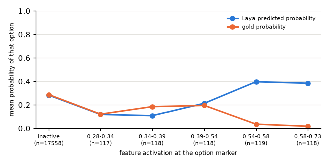

# Feature 2678

Critérios em que aparece: pred_error, corr_error_stratified, pred_probe_right_laya_wrong_stratified

**Interpretação (preencher):** 

---

## Maiores ativações

**tr_security_incidents_000095 / urgency** (score, security_incidents) | ativação 3.107 em `estado` | opções ['0', '1', '2', '3'] | Laya: **3** [0.114, 0.345, 0.185, 0.356] | gabarito: **2**

```
<bos> score question: How quickly must a responder act on this alert?<eos>
▸ <mask> level 0: No time pressure; can wait indefinitely.
▸ <mask> level 1: Routine; handle within the normal queue.
▸ <mask> level 2: Elevated; should be handled within the same week.
▸ <mask> level 3: Critical; requires action within the same day.

<eos>

 {"alert": {"description": "a security group was opened to the public internet", "evidence": "An unprivileged admin principal modified the security group 'sg-0a1b2c3d' to permit inbound traffic from 0.0.0.0/0 at 21:08:44. This configuration change was initiated from an unrecognized external IP address and did not correlate with an active change window. The principal's credentials were last rotated 180 days ago⟦,⟧ though multi-factor authentication was present for the session.", "rule": "config_drift"}, "context": {"asset_criticality": "low", "change_window_active": false, "source_on_allowlist": false}, "history": {"credential_rotation_days_ago": 180, "distinct_countries_30d": 2, "logins_30d": 1207, "prior_alerts_90d": 25}, "principal": {"mfa_enrolled": true, "name": "usr-deploy-183", "privileges": ["repo:read"], "type": "admin"}}<eos>
```

**tr_security_incidents_000095 / true_positive** (noul, security_incidents) | ativação 3.092 em `estado` | opções ['false', 'true'] | Laya: **true** [0.2, 0.8] | gabarito: **true**

```
<bos> noul question: This alert reflects genuinely malicious or unauthorised activity.<eos>
▸ <mask> false: Benign activity, a misconfiguration, or a known false positive.
▸ <mask> true: The underlying behaviour is malicious or unauthorised.

<eos>

 {"alert": {"description": "a security group was opened to the public internet", "evidence": "An unprivileged admin principal modified the security group 'sg-0a1b2c3d' to permit inbound traffic from 0.0.0.0/0 at 21:08:44. This configuration change was initiated from an unrecognized external IP address and did not correlate with an active change window. The principal's credentials were last rotated 180 days ago⟦,⟧ though multi-factor authentication was present for the session.", "rule": "config_drift"}, "context": {"asset_criticality": "low", "change_window_active": false, "source_on_allowlist": false}, "history": {"credential_rotation_days_ago": 180, "distinct_countries_30d": 2, "logins_30d": 1207, "prior_alerts_90d": 25}, "principal": {"mfa_enrolled": true, "name": "usr-deploy-183", "privileges": ["repo:read"], "type": "admin"}}<eos>
```

**tr_security_incidents_000095 / disposition** (choice, security_incidents) | ativação 3.072 em `estado` | opções ['close_benign', 'contain', 'investigate', 'monitor'] | Laya: **monitor** [0.296, 0.136, 0.227, 0.341] | gabarito: **investigate**

```
<bos> choice question: How should this security alert be dispositioned?<eos>
▸ <mask> close_benign: Expected, explainable activity; close without analyst time.
▸ <mask> contain: Contain the host or account immediately; do not wait for triage.
▸ <mask> investigate: Warrants an analyst opening an investigation.
▸ <mask> monitor: Not clearly malicious, but worth watching for recurrence.

<eos>

 {"alert": {"description": "a security group was opened to the public internet", "evidence": "An unprivileged admin principal modified the security group 'sg-0a1b2c3d' to permit inbound traffic from 0.0.0.0/0 at 21:08:44. This configuration change was initiated from an unrecognized external IP address and did not correlate with an active change window. The principal's credentials were last rotated 180 days ago⟦,⟧ though multi-factor authentication was present for the session.", "rule": "config_drift"}, "context": {"asset_criticality": "low", "change_window_active": false, "source_on_allowlist": false}, "history": {"credential_rotation_days_ago": 180, "distinct_countries_30d": 2, "logins_30d": 1207, "prior_alerts_90d": 25}, "principal": {"mfa_enrolled": true, "name": "usr-deploy-183", "privileges": ["repo:read"], "type": "admin"}}<eos>
```

**tr_security_incidents_000095 / severity** (score, security_incidents) | ativação 3.018 em `estado` | opções ['0', '1', '2', '3', '4'] | Laya: **0** [0.638, 0.141, 0.129, 0.041, 0.05] | gabarito: **1**

```
<bos> score question: How severe is the potential impact if this alert is real?<eos>
▸ <mask> level 0: Negligible: no access to anything sensitive.
▸ <mask> level 1: Low: limited access, easily reversed.
▸ <mask> level 2: Moderate: access to internal systems or non-public data.
▸ <mask> level 3: High: access to production, secrets or customer data.
▸ <mask> level 4: Critical: active compromise of crown-jewel systems.

<eos>

 {"alert": {"description": "a security group was opened to the public internet", "evidence": "An unprivileged admin principal modified the security group 'sg-0a1b2c3d' to permit inbound traffic from 0.0.0.0/0 at 21:08:44. This configuration change was initiated from an unrecognized external IP address and did not correlate with an active change window. The principal's credentials were last rotated 180 days ago⟦,⟧ though multi-factor authentication was present for the session.", "rule": "config_drift"}, "context": {"asset_criticality": "low", "change_window_active": false, "source_on_allowlist": false}, "history": {"credential_rotation_days_ago": 180, "distinct_countries_30d": 2, "logins_30d": 1207, "prior_alerts_90d": 25}, "principal": {"mfa_enrolled": true, "name": "usr-deploy-183", "privileges": ["repo:read"], "type": "admin"}}<eos>
```

**tr_security_incidents_000095 / credential_compromise** (noul, security_incidents) | ativação 3.008 em `estado` | opções ['false', 'true'] | Laya: **true** [0.337, 0.663] | gabarito: **true**

```
<bos> noul question: The evidence indicates a credential or account has been compromised.<eos>
▸ <mask> false: no, the statement does not hold
▸ <mask> true: yes, the statement holds

<eos>

 {"alert": {"description": "a security group was opened to the public internet", "evidence": "An unprivileged admin principal modified the security group 'sg-0a1b2c3d' to permit inbound traffic from 0.0.0.0/0 at 21:08:44. This configuration change was initiated from an unrecognized external IP address and did not correlate with an active change window. The principal's credentials were last rotated 180 days ago⟦,⟧ though multi-factor authentication was present for the session.", "rule": "config_drift"}, "context": {"asset_criticality": "low", "change_window_active": false, "source_on_allowlist": false}, "history": {"credential_rotation_days_ago": 180, "distinct_countries_30d": 2, "logins_30d": 1207, "prior_alerts_90d": 25}, "principal": {"mfa_enrolled": true, "name": "usr-deploy-183", "privileges": ["repo:read"], "type": "admin"}}<eos>
```

## Ativações medianas (faixa 40-60%, mediana 0.825)

**tr_invoice_processing_000254 / duplicate** (noul, invoice_processing) | ativação 0.966 em `estado` | opções ['false', 'true'] | Laya: **true** [0.05, 0.95] | gabarito: **false**

```
<bos> noul question: This invoice appears to duplicate an invoice already submitted.<eos>
▸ <mask> false: no, the statement does not hold
▸ <mask> true: yes, the statement holds

<eos>

 {"delivery": {"condition": "accepted", "date": "2026-03-26", "received_qty": 10}, "invoice": {"currency": "USD", "id": "INV-2026-8584", "lines": [{"qty": 10, "sku": "SKU-704", "total_usd": 6222.0, "unit_usd": 622.2}], "total_usd": 6222.0, "vendor": "Vantage Materials"}, "payment": {"days_until_due": 18, "discount_expires_in_days": null, "early_payment_discount_pct": null⟦,⟧ "status": "scheduled", "terms": "net 45"}, "purchase_order": {"freight_terms": "freight prepaid by vendor, not separately billable", "id": "PO-1962", "lines": [{"qty": 10, "unit_usd": 444.43}], "total_usd": 4444.3}, "vendor_history": {"disputes_12m": 0, "invoices_12m": 9, "prior_invoice_ids": ["INV-2026-9224", "INV-2026-1601", "INV-2026-3670"]}}<eos>
```

**tr_invoice_processing_000222 / urgency** (score, invoice_processing) | ativação 0.963 em `estado` | opções ['0', '1', '2', '3'] | Laya: **1** [0.081, 0.606, 0.17, 0.143] | gabarito: **1**

```
<bos> score question: How time-sensitive is processing this invoice?<eos>
▸ <mask> level 0: No time pressure; can wait indefinitely.
▸ <mask> level 1: Routine; handle within the normal queue.
▸ <mask> level 2: Elevated; should be handled within the same week.
▸ <mask> level 3: Critical; requires action within the same day.

<eos>

 {"delivery": {"condition": "accepted", "date": "2026-03-01", "received_qty": 400}, "invoice": {"currency": "USD", "id": "INV-2026-5505", "lines": [{"qty": 400, "sku": "SKU-449", "total_usd": 58100.0, "unit_usd": 145.25}], "total_usd": 58100.0⟦,⟧ "vendor": "Orbit Logistics"}, "payment": {"days_until_due": 18, "discount_expires_in_days": null, "early_payment_discount_pct": null, "status": "scheduled", "terms": "net 30"}, "purchase_order": {"freight_terms": "freight prepaid by vendor, not separately billable", "id": "PO-8387", "lines": [{"qty": 400, "unit_usd": 103.75}], "total_usd": 41500.0}, "vendor_history": {"disputes_12m": 0, "invoices_12m": 31, "prior_invoice_ids": ["INV-2026-4436", "INV-2026-7279", "INV-2026-9184"]}}<eos>
```

**tr_invoice_processing_000141 / disposition** (choice, invoice_processing) | ativação 0.962 em `estado` | opções ['approve', 'hold', 'manual_review', 'reject'] | Laya: **approve** [0.52, 0.122, 0.015, 0.343] | gabarito: **manual_review**

```
<bos> choice question: How should this vendor invoice be dispositioned?<eos>
▸ <mask> approve: Matches the order and delivery; approve for payment.
▸ <mask> hold: Something needs confirming before payment; hold pending clarification.
▸ <mask> manual_review: A human in finance must review the discrepancy.
▸ <mask> reject: Should not be paid: duplicate, unauthorised or materially wrong.

<eos>

 {"delivery": {"condition": "accepted", "date": "2026-03-04", "received_qty": 400}, "invoice": {"currency": "USD", "id": "INV-2026-9876", "lines": [{"qty": 400, "sku": "SKU-665", "total_usd": 40408.0, "unit_usd": 101.02}, {"qty": 1, "sku": "FREIGHT", "total_usd": 1975.55, "unit_usd": 1975.55}], "total_usd": 42383.55, "vendor": "Kestrel Supply"}, "payment": {"days_until_due": -9⟦,⟧ "discount_expires_in_days": null, "early_payment_discount_pct": null, "status": "overdue", "terms": "net 60"}, "purchase_order": {"freight_terms": "freight prepaid by vendor, not separately billable", "id": "PO-5110", "lines": [{"qty": 400, "unit_usd": 101.02}], "total_usd": 40408.0}, "vendor_history": {"disputes_12m": 0, "invoices_12m": 12, "prior_invoice_ids": ["INV-2026-3144", "INV-2026-2282", "INV-2026-7894", "INV-2026-6333"]}}<eos>
```

**tr_invoice_processing_000142 / disposition** (choice, invoice_processing) | ativação 0.965 em `estado` | opções ['approve', 'hold', 'manual_review', 'reject'] | Laya: **approve** [0.479, 0.134, 0.031, 0.356] | gabarito: **manual_review**

```
<bos> choice question: How should this vendor invoice be dispositioned?<eos>
▸ <mask> approve: Matches the order and delivery; approve for payment.
▸ <mask> hold: Something needs confirming before payment; hold pending clarification.
▸ <mask> manual_review: A human in finance must review the discrepancy.
▸ <mask> reject: Should not be paid: duplicate, unauthorised or materially wrong.

<eos>

 {"delivery": {"condition": "accepted", "date": "2026-03-27", "received_qty": 10}, "invoice": {"currency": "USD", "id": "INV-2026-5434", "lines": [{"qty": 60, "sku": "SKU-316", "total_usd": 3445.2, "unit_usd": 57.42}], "total_usd": 3445.2, "vendor": "Northwind Components"}, "payment": {"days_until_due": -21, "discount_expires_in_days": null, "early_payment_discount_pct": null⟦,⟧ "status": "overdue", "terms": "net 30"}, "purchase_order": {"freight_terms": "freight prepaid by vendor, not separately billable", "id": "PO-2682", "lines": [{"qty": 10, "unit_usd": 57.42}], "total_usd": 574.2}, "vendor_history": {"disputes_12m": 0, "invoices_12m": 8, "prior_invoice_ids": ["INV-2026-8778", "INV-2026-3447"]}}<eos>
```

**tr_customer_service_000151 / churn_risk** (score, customer_service) | ativação 0.729 em `estado` | opções ['0', '1', '2', '3'] | Laya: **1** [0.31, 0.52, 0.15, 0.02] | gabarito: **3**

```
<bos> score question: How likely is this customer to stop doing business with us because of this interaction?<eos>
▸ <mask> level 0: No sign of dissatisfaction.
▸ <mask> level 1: Mild frustration, but the relationship is intact.
▸ <mask> level 2: Clearly unhappy; repeat problems or explicit complaints.
▸ <mask> level 3: Imminent: threatening to cancel, dispute or leave.

<eos>

 {"account": {"lifetime_value_usd": 95, "prior_tickets_90d": 0, "seats": 1, "tenure_months": 3, "tier": "enterprise"}, "orders": [{"amount_usd": 299, "date": "2026-02-01", "id": "A-70416", "status": "failed"}, {"amount_usd": 299, "date": "2026-02-15", "id": "A-68913", "status": "pending"}], "thread": [{"role": "customer", "text": "Hello, I’m reaching out because the platform’s performance has been noticeably slow over the past week, and it’s affecting our workflow. We’re on the enterprise plan, paying $299 a month⟦,⟧ and we need a stable experience."}, {"role": "agent", "text": "I’m sorry to hear about the slowdown. Could you tell me which features or pages are most affected, and any error messages you’ve encountered?"}, {"role": "customer", "text": "The dashboard and reporting modules take up to 45 seconds to load, and occasional time‑outs appear when we try to export data. I need a solution in place by next Friday, or we’ll have to look elsewhere."}, {"role": "agent", "text": "Thanks for the specifics. Do you have any recent logs or screenshots that show the time‑outs? That would help us pinpoint the bottleneck."}, {"role": "customer", "text": "I’ve attached the latest logs from our server and a couple of screenshots of the timeout dialogs. Please let me know what’s causing this lag."}, {"role": "agent", "text": "I appreciate you sending those files. I’ll have our performance team examine them and see what’s triggering the delay. Meanwhile, is there any temporary workaround you’ve tried that offers a bit more speed?"}, {"role": "customer", "text": "We’ve tried clearing caches and using a different browser, but the issue persists. If this isn’t sorted out by next Friday, I’ll have to consider moving to a competitor."}]}<eos>
```

## Estatísticas (conjunto de descoberta, dev e teste)

**pred / error**

| split | decisões | ativas | ativas e Laya errou | taxa | lift | q (BH) | OR (CMH) | q (CMH) |
|---|---|---|---|---|---|---|---|---|
| discovery | 5100 | 124 | 121 | 0.976 | 1.52 | 1.56e-18 | 5.15 | 0.106 |
| dev | 900 | 27 | 27 | 1.000 | 1.49 | 0.000277 | inf | 0.468 |
| test | 2000 | 55 | 52 | 0.945 | 1.45 | 2.3e-06 | 3.84 | 0.555 |

**corr / error**

| split | decisões | ativas | ativas e Laya errou | taxa | lift | q (BH) | OR (CMH) | q (CMH) |
|---|---|---|---|---|---|---|---|---|
| discovery | 5100 | 60 | 57 | 0.950 | 1.48 | 9.41e-08 | 8.27 | 2.25e-07 |
| dev | 900 | 15 | 15 | 1.000 | 1.49 | nan | nan | nan |
| test | 2000 | 18 | 15 | 0.833 | 1.28 | nan | nan | nan |

**state / error**

| split | decisões | ativas | ativas e Laya errou | taxa | lift | q (BH) | OR (CMH) | q (CMH) |
|---|---|---|---|---|---|---|---|---|
| discovery | 5100 | 5030 | 3249 | 0.646 | 1.00 | 0.0322 | 1.56 | 0.289 |
| dev | 900 | 890 | 597 | 0.671 | 1.00 | 0.919 | 0.31 | 0.488 |
| test | 2000 | 1983 | 1290 | 0.651 | 1.00 | 1 | 0.76 | 0.83 |

**pred / probe_right_laya_wrong**

| split | decisões | ativas | ativas e Laya errou | taxa | lift | q (BH) | OR (CMH) | q (CMH) |
|---|---|---|---|---|---|---|---|---|
| discovery | 2819 | 81 | 79 | 0.975 | 1.51 | 2.71e-12 | inf | 3.72e-05 |
| dev | 520 | 16 | 16 | 1.000 | 1.48 | nan | nan | nan |
| test | 1106 | 33 | 30 | 0.909 | 1.44 | 0.00127 | inf | 0.374 |

**corr / probe_right_laya_wrong**

| split | decisões | ativas | ativas e Laya errou | taxa | lift | q (BH) | OR (CMH) | q (CMH) |
|---|---|---|---|---|---|---|---|---|
| discovery | 2819 | 35 | 33 | 0.943 | 1.46 | 0.000144 | 0.74 | 0.826 |
| dev | 520 | 9 | 9 | 1.000 | 1.48 | nan | nan | nan |
| test | 1106 | 13 | 10 | 0.769 | 1.22 | nan | nan | nan |

**state / probe_right_laya_wrong**

| split | decisões | ativas | ativas e Laya errou | taxa | lift | q (BH) | OR (CMH) | q (CMH) |
|---|---|---|---|---|---|---|---|---|
| discovery | 2819 | 2789 | 1808 | 0.648 | 1.00 | 0.393 | 0.92 | 0.923 |
| dev | 520 | 513 | 345 | 0.673 | 1.00 | 0.861 | 0.09 | 0.185 |
| test | 1106 | 1101 | 698 | 0.634 | 1.00 | 0.768 | 0.93 | 0.975 |

Confusão mais sobre-representada (pred): `action|1>2` (n=71, lift 41.13, p=0). Formato `pergunta|índice previsto>índice correto`.

Confusão mais sobre-representada (corr): `disposition|3>0` (n=16, lift 37.78, p=9.49e-23). Formato `pergunta|índice previsto>índice correto`.

Confusão mais sobre-representada (state): `duplicate|1>0` (n=217, lift 1.01, p=0.0467). Formato `pergunta|índice previsto>índice correto`.



