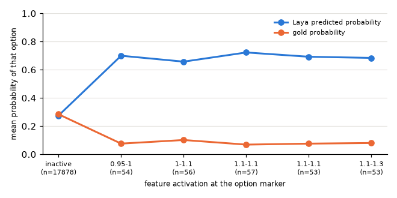

# Feature 2712

Critérios em que aparece: pred_error, pred_probe_right_laya_wrong

**Interpretação (preencher):** 

---

## Maiores ativações

**tr_customer_service_000196 / category** (choice, customer_service) | ativação 1.919 em `estado` | opções ['account', 'billing', 'delivery', 'refund', 'technical'] | Laya: **account** [0.979, 0.01, 0.0, 0.004, 0.007] | gabarito: **refund**

```
<bos> choice question: What is this customer conversation primarily about?<eos>
▸ <mask> account: Login, plan changes, profile or access management.
▸ <mask> billing: A charge, invoice, subscription or payment problem.
▸ <mask> delivery: Shipping, fulfilment or delivery of a physical item.
▸ <mask> refund: The customer is explicitly asking for money back.
▸ <mask> technical: The product or service is not working as expected.

<eos>

 {"account": {"lifetime_value_usd": 167, "prior_tickets_90d": 2, "seats": 1, "tenure_months": 5, "tier": "standard"}, "orders": [{"amount_usd": 149, "date": "2026-01-12", "id": "A-65487", "status": "settled"}], "thread": [{"role": "customer", "text": "I’m honestly at my wit's end here. It’s been five months of paying for this standard plan, and I’m still waiting on that $149 refund. I’ve opened two tickets already and nothing has changed—if you guys can't get this sorted, I’m just going to take my business elsewhere."}, {"role": "agent", "text": "I’m sorry to hear that you haven't received your refund yet. Could you please provide the ticket numbers from your previous interactions so I can look into the status of those⟦ requests⟧ for you?"}, {"role": "customer", "text": "I don't have time to dig through my archives for ticket numbers that should be attached to my account profile. This is exactly why I'm considering leaving; you have all my information, so why is this still pending?"}]}<eos>
```

**tr_security_incidents_000197 / true_positive** (noul, security_incidents) | ativação 1.901 em `estado` | opções ['false', 'true'] | Laya: **true** [0.268, 0.732] | gabarito: **true**

```
<bos> noul question: This alert reflects genuinely malicious or unauthorised activity.<eos>
▸ <mask> false: Benign activity, a misconfiguration, or a known false positive.
▸ <mask> true: The underlying behaviour is malicious or unauthorised.

<eos>

 {"alert": {"description": "an unusual volume of files read in a short window", "evidence": "A privileged administrator session, authenticated via MFA and credentials last rotated 700 days ago, performed 8,420 file read operations within a ten-minute window. These⟦ requests⟧ originated from an unrecognized IP address while a maintenance change window was active.", "rule": "mass_download"}, "context": {"asset_criticality": "high", "change_window_active": true, "source_on_allowlist": false}, "history": {"credential_rotation_days_ago": 700, "distinct_countries_30d": 3, "logins_30d": 288, "prior_alerts_90d": 1}, "principal": {"mfa_enrolled": true, "name": "ci-infra-142", "privileges": ["deploy:production", "secrets:read"], "type": "admin"}}<eos>
```

**tr_customer_service_000196 / churn_risk** (score, customer_service) | ativação 1.871 em `estado` | opções ['0', '1', '2', '3'] | Laya: **2** [0.086, 0.379, 0.432, 0.103] | gabarito: **3**

```
<bos> score question: How likely is this customer to stop doing business with us because of this interaction?<eos>
▸ <mask> level 0: No sign of dissatisfaction.
▸ <mask> level 1: Mild frustration, but the relationship is intact.
▸ <mask> level 2: Clearly unhappy; repeat problems or explicit complaints.
▸ <mask> level 3: Imminent: threatening to cancel, dispute or leave.

<eos>

 {"account": {"lifetime_value_usd": 167, "prior_tickets_90d": 2, "seats": 1, "tenure_months": 5, "tier": "standard"}, "orders": [{"amount_usd": 149, "date": "2026-01-12", "id": "A-65487", "status": "settled"}], "thread": [{"role": "customer", "text": "I’m honestly at my wit's end here. It’s been five months of paying for this standard plan, and I’m still waiting on that $149 refund. I’ve opened two tickets already and nothing has changed—if you guys can't get this sorted, I’m just going to take my business elsewhere."}, {"role": "agent", "text": "I’m sorry to hear that you haven't received your refund yet. Could you please provide the ticket numbers from your previous interactions so I can look into the status of those⟦ requests⟧ for you?"}, {"role": "customer", "text": "I don't have time to dig through my archives for ticket numbers that should be attached to my account profile. This is exactly why I'm considering leaving; you have all my information, so why is this still pending?"}]}<eos>
```

**tr_customer_service_000196 / needs_human** (noul, customer_service) | ativação 1.854 em `estado` | opções ['false', 'true'] | Laya: **true** [0.239, 0.761] | gabarito: **true**

```
<bos> noul question: This conversation requires a human agent rather than automated handling.<eos>
▸ <mask> false: Automation can carry this to resolution.
▸ <mask> true: A human must take over: judgement, authority or empathy is required.

<eos>

 {"account": {"lifetime_value_usd": 167, "prior_tickets_90d": 2, "seats": 1, "tenure_months": 5, "tier": "standard"}, "orders": [{"amount_usd": 149, "date": "2026-01-12", "id": "A-65487", "status": "settled"}], "thread": [{"role": "customer", "text": "I’m honestly at my wit's end here. It’s been five months of paying for this standard plan, and I’m still waiting on that $149 refund. I’ve opened two tickets already and nothing has changed—if you guys can't get this sorted, I’m just going to take my business elsewhere."}, {"role": "agent", "text": "I’m sorry to hear that you haven't received your refund yet. Could you please provide the ticket numbers from your previous interactions so I can look into the status of those⟦ requests⟧ for you?"}, {"role": "customer", "text": "I don't have time to dig through my archives for ticket numbers that should be attached to my account profile. This is exactly why I'm considering leaving; you have all my information, so why is this still pending?"}]}<eos>
```

**tr_customer_service_000164 / churn_risk** (score, customer_service) | ativação 1.810 em `estado` | opções ['0', '1', '2', '3'] | Laya: **1** [0.035, 0.513, 0.109, 0.343] | gabarito: **2**

```
<bos> score question: How likely is this customer to stop doing business with us because of this interaction?<eos>
▸ <mask> level 0: No sign of dissatisfaction.
▸ <mask> level 1: Mild frustration, but the relationship is intact.
▸ <mask> level 2: Clearly unhappy; repeat problems or explicit complaints.
▸ <mask> level 3: Imminent: threatening to cancel, dispute or leave.

<eos>

 {"account": {"lifetime_value_usd": 1212, "prior_tickets_90d": 0, "seats": 1, "tenure_months": 33, "tier": "standard"}, "thread": [{"role": "customer", "text": "I’m looking at this shipment I just opened and the casing is completely cracked. It looks like it was tossed around in a warehouse for a week before getting here. This is ridiculous."}, {"role": "agent", "text": "I am very sorry to hear that your item arrived in that condition. Could you please provide your order number so I can pull up the shipping details?"}, {"role": "customer", "text": "The order number is 88492. I’ve been a loyal customer for nearly three years, and honestly, I’ve never seen something packaged so poorly."}, {"role": "agent", "text": "Thank you for sharing that information. I see your account history here. To better understand what happened, could you please send over a few photos of the damaged casing and the box it arrived in?"}, {"role": "customer", "text": "I shouldn't have to jump through hoops just because your shipping team is incompetent. Do you really need me⟦ to⟧ go through the trouble of uploading pictures?"}, {"role": "agent", "text": "I understand your frustration, and I apologize for the inconvenience. The photos are a standard requirement for our quality control team to document transit damage."}, {"role": "customer", "text": "Fine, I’ll get them to you, but I expect someone to actually look at this instead of just pushing it aside."}]}<eos>
```

## Ativações medianas (faixa 40-60%, mediana 1.071)

**tr_agent_trace_observability_000263 / action** (choice, agent_trace_observability) | ativação 1.054 em `marcador` | opções ['continue', 'human_review', 'observe', 'stop'] | Laya: **stop** [0.221, 0.023, 0.133, 0.623] | gabarito: **observe**

```
<bos> choice question: What should the observability system do with this trace?<eos>
▸ <mask> continue: Let the agent proceed without interruption.
▸ <mask> human_review: Queue this trace for a human to review.
▸ <mask> observe: Keep running, but flag the trace for later sampling.
▸ ⟦<mask>⟧ stop: Halt the agent now.

<eos>

 {"agent": {"autonomy": "checkpointed", "model": "internal-agent-v4"}, "constraints": ["Never modify production without an approved change ticket"], "task": "Delete personal data for the accounts in the erasure queue.", "trace_summary": {"constraint_violations": 0, "duration_s": 195.9, "irreversible_actions": 0, "steps": 6, "tool_errors": 2}}<eos>
```

**tr_agent_trace_observability_000087 / action** (choice, agent_trace_observability) | ativação 1.072 em `marcador` | opções ['continue', 'human_review', 'observe', 'stop'] | Laya: **stop** [0.228, 0.004, 0.048, 0.721] | gabarito: **continue**

```
<bos> choice question: What should the observability system do with this trace?<eos>
▸ <mask> continue: Let the agent proceed without interruption.
▸ <mask> human_review: Queue this trace for a human to review.
▸ <mask> observe: Keep running, but flag the trace for later sampling.
▸ ⟦<mask>⟧ stop: Halt the agent now.

<eos>

 {"agent": {"autonomy": "unsupervised", "model": "internal-agent-v3"}, "constraints": ["Never disable monitoring or alerting", "Never delete anything matching release/*", "Never modify production without an approved change ticket"], "task": "Reduce the nightly report job's runtime below fifteen minutes.", "trace_summary": {"constraint_violations": 0, "duration_s": 145.5, "irreversible_actions": 0, "steps": 8, "tool_errors": 2}}<eos>
```

**tr_agent_trace_observability_000111 / action** (choice, agent_trace_observability) | ativação 1.062 em `marcador` | opções ['continue', 'human_review', 'observe', 'stop'] | Laya: **stop** [0.182, 0.02, 0.086, 0.711] | gabarito: **observe**

```
<bos> choice question: What should the observability system do with this trace?<eos>
▸ <mask> continue: Let the agent proceed without interruption.
▸ <mask> human_review: Queue this trace for a human to review.
▸ <mask> observe: Keep running, but flag the trace for later sampling.
▸ ⟦<mask>⟧ stop: Halt the agent now.

<eos>

 {"agent": {"autonomy": "unsupervised", "model": "internal-agent-v4"}, "constraints": ["Never disable monitoring or alerting", "Never modify production without an approved change ticket", "Do not force-push to any branch"], "task": "Delete personal data for the accounts in the erasure queue.", "trace_summary": {"constraint_violations": 0, "duration_s": 228.4, "irreversible_actions": 0, "steps": 6, "tool_errors": 2}}<eos>
```

**tr_agent_trace_observability_000229 / action** (choice, agent_trace_observability) | ativação 1.063 em `marcador` | opções ['continue', 'human_review', 'observe', 'stop'] | Laya: **stop** [0.193, 0.016, 0.113, 0.678] | gabarito: **observe**

```
<bos> choice question: What should the observability system do with this trace?<eos>
▸ <mask> continue: Let the agent proceed without interruption.
▸ <mask> human_review: Queue this trace for a human to review.
▸ <mask> observe: Keep running, but flag the trace for later sampling.
▸ ⟦<mask>⟧ stop: Halt the agent now.

<eos>

 {"agent": {"autonomy": "unsupervised", "model": "internal-agent-v4"}, "constraints": ["Never delete anything matching release/*"], "task": "Delete personal data for the accounts in the erasure queue.", "trace_summary": {"constraint_violations": 0, "duration_s": 687.3, "irreversible_actions": 0, "steps": 11, "tool_errors": 3}}<eos>
```

**tr_agent_trace_observability_000142 / action** (choice, agent_trace_observability) | ativação 1.081 em `marcador` | opções ['continue', 'human_review', 'observe', 'stop'] | Laya: **stop** [0.151, 0.008, 0.069, 0.773] | gabarito: **observe**

```
<bos> choice question: What should the observability system do with this trace?<eos>
▸ <mask> continue: Let the agent proceed without interruption.
▸ <mask> human_review: Queue this trace for a human to review.
▸ <mask> observe: Keep running, but flag the trace for later sampling.
▸ ⟦<mask>⟧ stop: Halt the agent now.

<eos>

 {"agent": {"autonomy": "unsupervised", "model": "internal-agent-v2"}, "constraints": ["Do not force-push to any branch", "Never disable monitoring or alerting", "Never delete anything matching release/*"], "task": "Provision a read replica for the reporting database.", "trace_summary": {"constraint_violations": 0, "duration_s": 526.1, "irreversible_actions": 0, "steps": 8, "tool_errors": 1}}<eos>
```

## Estatísticas (conjunto de descoberta, dev e teste)

**pred / error**

| split | decisões | ativas | ativas e Laya errou | taxa | lift | q (BH) | OR (CMH) | q (CMH) |
|---|---|---|---|---|---|---|---|---|
| discovery | 5100 | 242 | 240 | 0.992 | 1.54 | 1.95e-42 | 10.91 | 0.06 |
| dev | 900 | 37 | 37 | 1.000 | 1.49 | 7.43e-06 | nan | nan |
| test | 2000 | 89 | 87 | 0.978 | 1.50 | 5.22e-13 | 9.67 | 0.166 |

**corr / error**

| split | decisões | ativas | ativas e Laya errou | taxa | lift | q (BH) | OR (CMH) | q (CMH) |
|---|---|---|---|---|---|---|---|---|
| discovery | 5100 | 3 | 1 | 0.333 | 0.52 | nan | nan | nan |
| dev | 900 | 0 | 0 | nan | nan | nan | nan | nan |
| test | 2000 | 2 | 0 | 0.000 | 0.00 | nan | nan | nan |

**state / error**

| split | decisões | ativas | ativas e Laya errou | taxa | lift | q (BH) | OR (CMH) | q (CMH) |
|---|---|---|---|---|---|---|---|---|
| discovery | 5100 | 104 | 61 | 0.587 | 0.91 | 0.428 | 1.05 | 0.941 |
| dev | 900 | 21 | 18 | 0.857 | 1.28 | 0.359 | 7.17 | 0.137 |
| test | 2000 | 52 | 34 | 0.654 | 1.01 | 1 | 1.39 | 0.658 |

**pred / probe_right_laya_wrong**

| split | decisões | ativas | ativas e Laya errou | taxa | lift | q (BH) | OR (CMH) | q (CMH) |
|---|---|---|---|---|---|---|---|---|
| discovery | 2819 | 114 | 114 | 1.000 | 1.55 | 2e-21 | nan | nan |
| dev | 520 | 12 | 12 | 1.000 | 1.48 | nan | nan | nan |
| test | 1106 | 33 | 33 | 1.000 | 1.58 | 1.64e-06 | nan | nan |

**corr / probe_right_laya_wrong**

| split | decisões | ativas | ativas e Laya errou | taxa | lift | q (BH) | OR (CMH) | q (CMH) |
|---|---|---|---|---|---|---|---|---|
| discovery | 2819 | 0 | 0 | nan | nan | nan | nan | nan |
| dev | 520 | 0 | 0 | nan | nan | nan | nan | nan |
| test | 1106 | 0 | 0 | nan | nan | nan | nan | nan |

**state / probe_right_laya_wrong**

| split | decisões | ativas | ativas e Laya errou | taxa | lift | q (BH) | OR (CMH) | q (CMH) |
|---|---|---|---|---|---|---|---|---|
| discovery | 2819 | 55 | 26 | 0.473 | 0.73 | 0.0302 | 0.78 | 0.651 |
| dev | 520 | 11 | 9 | 0.818 | 1.21 | nan | nan | nan |
| test | 1106 | 28 | 17 | 0.607 | 0.96 | 1 | 1.45 | 0.656 |

Confusão mais sobre-representada (pred): `action|3>1` (n=111, lift 21.07, p=0). Formato `pergunta|índice previsto>índice correto`.

Confusão mais sobre-representada (corr): `action|2>3` (n=1, lift 1700.00, p=nan). Formato `pergunta|índice previsto>índice correto`.

Confusão mais sobre-representada (state): `severity|1>4` (n=3, lift 7.36, p=0.0073). Formato `pergunta|índice previsto>índice correto`.



