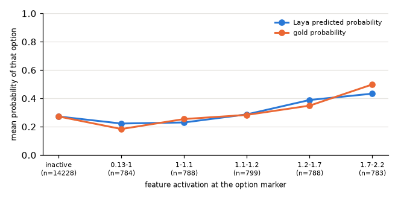

# Feature 2751

Critérios em que aparece: attribution_toward_correct

**Interpretação (preencher):** 

---

## Maiores ativações

**tr_invoice_processing_000088 / matches_order** (noul, invoice_processing) | ativação 3.557 em `opção` | opções ['false', 'true'] | Laya: **true** [0.05, 0.95] | gabarito: **false**

```
<bos> noul question: The invoice reconciles with the purchase order and the recorded delivery.<eos>
▸ <mask> false: There is a discrepancy against the order or the delivery.
▸ <mask> true: Line items, quantities⟦ and⟧ amounts reconcile.

<eos>

 {"delivery": {"condition": "accepted with exceptions", "date": "2026-03-27", "received_qty": 25}, "invoice": {"currency": "USD", "id": "INV-2026-2129", "lines": [{"qty": 45, "sku": "SKU-699", "total_usd": 2321.55, "unit_usd": 51.59}], "total_usd": 2321.55, "vendor": "Vantage Materials"}, "payment": {"days_until_due": 44, "discount_expires_in_days": 7, "early_payment_discount_pct": 2.0, "status": "scheduled", "terms": "net 60"}, "purchase_order": {"freight_terms": "freight prepaid by vendor, not separately billable", "id": "PO-2831", "lines": [{"qty": 25, "unit_usd": 51.59}], "total_usd": 1289.75}, "vendor_history": {"disputes_12m": 0, "invoices_12m": 5, "prior_invoice_ids": ["INV-2026-4325", "INV-2026-3895"]}}<eos>
```

**tr_invoice_processing_000178 / matches_order** (noul, invoice_processing) | ativação 3.541 em `opção` | opções ['false', 'true'] | Laya: **true** [0.076, 0.924] | gabarito: **false**

```
<bos> noul question: The invoice reconciles with the purchase order and the recorded delivery.<eos>
▸ <mask> false: There is a discrepancy against the order or the delivery.
▸ <mask> true: Line items, quantities⟦ and⟧ amounts reconcile.

<eos>

 {"delivery": {"condition": "accepted with exceptions", "date": "2026-03-16", "received_qty": 230}, "invoice": {"currency": "USD", "id": "INV-2026-9222", "lines": [{"qty": 230, "sku": "SKU-724", "total_usd": 44150.8, "unit_usd": 191.96}], "total_usd": 44150.8, "vendor": "Kestrel Supply"}, "payment": {"days_until_due": 11, "discount_expires_in_days": 5, "early_payment_discount_pct": 2.0, "status": "scheduled", "terms": "net 15"}, "purchase_order": {"freight_terms": "freight prepaid by vendor, not separately billable", "id": "PO-1262", "lines": [{"qty": 250, "unit_usd": 191.96}], "total_usd": 47990.0}, "vendor_history": {"disputes_12m": 1, "invoices_12m": 26, "prior_invoice_ids": ["INV-2026-2957", "INV-2026-1376"]}}<eos>
```

**tr_invoice_processing_000047 / matches_order** (noul, invoice_processing) | ativação 3.535 em `opção` | opções ['false', 'true'] | Laya: **true** [0.056, 0.944] | gabarito: **true**

```
<bos> noul question: The invoice reconciles with the purchase order and the recorded delivery.<eos>
▸ <mask> false: There is a discrepancy against the order or the delivery.
▸ <mask> true: Line items, quantities⟦ and⟧ amounts reconcile.

<eos>

 {"delivery": {"condition": "accepted with exceptions", "date": "2026-03-06", "received_qty": 400}, "invoice": {"currency": "USD", "id": "INV-2026-2687", "lines": [{"qty": 400, "sku": "SKU-741", "total_usd": 96300.0, "unit_usd": 240.75}], "total_usd": 96300.0, "vendor": "Pallas Industrial"}, "payment": {"days_until_due": 2, "discount_expires_in_days": 6, "early_payment_discount_pct": 2.0, "status": "scheduled", "terms": "net 60"}, "purchase_order": {"freight_terms": "freight prepaid by vendor, not separately billable", "id": "PO-1827", "lines": [{"qty": 400, "unit_usd": 240.75}], "total_usd": 96300.0}, "vendor_history": {"disputes_12m": 2, "invoices_12m": 25, "prior_invoice_ids": ["INV-2026-2687", "INV-2026-6074", "INV-2026-7980"]}}<eos>
```

**tr_invoice_processing_000049 / matches_order** (noul, invoice_processing) | ativação 3.525 em `opção` | opções ['false', 'true'] | Laya: **true** [0.049, 0.951] | gabarito: **false**

```
<bos> noul question: The invoice reconciles with the purchase order and the recorded delivery.<eos>
▸ <mask> false: There is a discrepancy against the order or the delivery.
▸ <mask> true: Line items, quantities⟦ and⟧ amounts reconcile.

<eos>

 {"delivery": {"condition": "accepted with exceptions", "date": "2026-03-16", "received_qty": 1000}, "invoice": {"currency": "USD", "id": "INV-2026-8794", "lines": [{"qty": 1000, "sku": "SKU-610", "total_usd": 287770.0, "unit_usd": 287.77}], "total_usd": 287770.0, "vendor": "Pallas Industrial"}, "payment": {"days_until_due": -9, "discount_expires_in_days": null, "early_payment_discount_pct": null, "status": "overdue", "terms": "net 15"}, "purchase_order": {"freight_terms": "freight prepaid by vendor, not separately billable", "id": "PO-9867", "lines": [{"qty": 1000, "unit_usd": 287.77}], "total_usd": 287770.0}, "vendor_history": {"disputes_12m": 0, "invoices_12m": 54, "prior_invoice_ids": ["INV-2026-7292", "INV-2026-5406"]}}<eos>
```

**tr_invoice_processing_000241 / matches_order** (noul, invoice_processing) | ativação 3.514 em `opção` | opções ['false', 'true'] | Laya: **true** [0.051, 0.949] | gabarito: **true**

```
<bos> noul question: The invoice reconciles with the purchase order and the recorded delivery.<eos>
▸ <mask> false: There is a discrepancy against the order or the delivery.
▸ <mask> true: Line items, quantities⟦ and⟧ amounts reconcile.

<eos>

 {"delivery": {"condition": "accepted with exceptions", "date": "2026-03-01", "received_qty": 100}, "invoice": {"currency": "USD", "id": "INV-2026-2388", "lines": [{"qty": 100, "sku": "SKU-830", "total_usd": 12672.0, "unit_usd": 126.72}], "total_usd": 12672.0, "vendor": "Pallas Industrial"}, "payment": {"days_until_due": 0, "discount_expires_in_days": null, "early_payment_discount_pct": null, "status": "scheduled", "terms": "net 60"}, "purchase_order": {"freight_terms": "freight prepaid by vendor, not separately billable", "id": "PO-8926", "lines": [{"qty": 100, "unit_usd": 126.72}], "total_usd": 12672.0}, "vendor_history": {"disputes_12m": 0, "invoices_12m": 55, "prior_invoice_ids": ["INV-2026-2882", "INV-2026-6390"]}}<eos>
```

## Ativações medianas (faixa 40-60%, mediana 1.140)

**tr_invoice_processing_000295 / disposition** (choice, invoice_processing) | ativação 1.084 em `opção` | opções ['approve', 'hold', 'manual_review', 'reject'] | Laya: **reject** [0.402, 0.169, 0.023, 0.406] | gabarito: **hold**

```
<bos> choice question: How should this vendor invoice be dispositioned?<eos>
▸ <mask> approve: Matches the order and delivery; approve for payment.
▸ <mask> hold: Something needs confirming before payment; hold pending clarification.
▸ <mask> manual_review: A human in finance must review the discrepancy.
▸ <mask> reject: Should not be paid: duplicate, unauthorised⟦ or⟧ materially wrong.

<eos>

 {"delivery": {"condition": "accepted with exceptions", "date": "2026-03-12", "received_qty": 25}, "invoice": {"currency": "EUR", "id": "INV-2026-7576", "lines": [{"qty": 25, "sku": "SKU-352", "total_usd": 9343.0, "unit_usd": 373.72}], "total_usd": 9343.0, "vendor": "Orbit Logistics"}, "payment": {"days_until_due": 27, "discount_expires_in_days": null, "early_payment_discount_pct": null, "status": "scheduled", "terms": "net 30"}, "purchase_order": {"freight_terms": "freight prepaid by vendor, not separately billable", "id": "PO-3117", "lines": [{"qty": 25, "unit_usd": 373.72}], "total_usd": 9343.0}, "vendor_history": {"disputes_12m": 0, "invoices_12m": 9, "prior_invoice_ids": ["INV-2026-6695"]}}<eos>
```

**tr_invoice_processing_000011 / urgency** (score, invoice_processing) | ativação 1.274 em `opção` | opções ['0', '1', '2', '3'] | Laya: **1** [0.093, 0.502, 0.261, 0.144] | gabarito: **2**

```
<bos> score question: How time-sensitive is processing this invoice?<eos>
▸ <mask> level 0: No time pressure; can wait indefinitely.
▸ <mask> level 1: Routine; handle within the normal queue.
▸ <mask> level 2: Elevated; should be handled within the same week.
▸ <mask> level⟦ ⟧3: Critical; requires action within the same day.

<eos>

 {"delivery": {"condition": "accepted", "date": "2026-03-18", "received_qty": 10}, "invoice": {"currency": "USD", "id": "INV-2026-8793", "lines": [{"qty": 30, "sku": "SKU-614", "total_usd": 3975.9, "unit_usd": 132.53}], "total_usd": 3975.9, "vendor": "Northwind Components"}, "payment": {"days_until_due": -9, "discount_expires_in_days": null, "early_payment_discount_pct": null, "status": "overdue", "terms": "net 30"}, "purchase_order": {"freight_terms": "freight prepaid by vendor, not separately billable", "id": "PO-1475", "lines": [{"qty": 10, "unit_usd": 132.53}], "total_usd": 1325.3}, "vendor_history": {"disputes_12m": 0, "invoices_12m": 7, "prior_invoice_ids": ["INV-2026-4215", "INV-2026-5312", "INV-2026-4441"]}}<eos>
```

**tr_invoice_processing_000253 / urgency** (score, invoice_processing) | ativação 1.217 em `opção` | opções ['0', '1', '2', '3'] | Laya: **1** [0.145, 0.426, 0.267, 0.162] | gabarito: **2**

```
<bos> score question: How time-sensitive is processing this invoice?<eos>
▸ <mask> level 0: No time pressure; can wait indefinitely.
▸ <mask> level 1: Routine; handle within the normal queue.
▸ <mask> level 2: Elevated; should be handled within the same week.
▸ <mask> level 3: Critical; requires action within the same day⟦.⟧

<eos>

 {"delivery": {"condition": "accepted", "date": "2026-03-23", "received_qty": 50}, "invoice": {"currency": "USD", "id": "INV-2026-6964", "lines": [{"qty": 50, "sku": "SKU-290", "total_usd": 620.5, "unit_usd": 12.41}], "total_usd": 620.5, "vendor": "Orbit Logistics"}, "payment": {"days_until_due": 5, "discount_expires_in_days": 7, "early_payment_discount_pct": 2.0, "status": "scheduled", "terms": "net 15"}, "purchase_order": {"freight_terms": "freight prepaid by vendor, not separately billable", "id": "PO-4144", "lines": [{"qty": 50, "unit_usd": 12.41}], "total_usd": 620.5}, "vendor_history": {"disputes_12m": 0, "invoices_12m": 23, "prior_invoice_ids": ["INV-2026-6197", "INV-2026-7648"]}}<eos>
```

**tr_invoice_processing_000004 / matches_order** (noul, invoice_processing) | ativação 1.244 em `pergunta` | opções ['false', 'true'] | Laya: **true** [0.068, 0.932] | gabarito: **false**

```
<bos> noul question: The invoice reconciles with the purchase order and the recorded delivery.⟦<eos>⟧
▸ <mask> false: There is a discrepancy against the order or the delivery.
▸ <mask> true: Line items, quantities and amounts reconcile.

<eos>

 {"delivery": {"condition": "accepted", "date": "2026-03-05", "received_qty": 1000}, "invoice": {"currency": "USD", "id": "INV-2026-1815", "lines": [{"qty": 1005, "sku": "SKU-949", "total_usd": 242797.95, "unit_usd": 241.59}], "total_usd": 242797.95, "vendor": "Kestrel Supply"}, "payment": {"days_until_due": 0, "discount_expires_in_days": null, "early_payment_discount_pct": null, "status": "scheduled", "terms": "net 45"}, "purchase_order": {"freight_terms": "freight prepaid by vendor, not separately billable", "id": "PO-1289", "lines": [{"qty": 1000, "unit_usd": 241.59}], "total_usd": 241590.0}, "vendor_history": {"disputes_12m": 0, "invoices_12m": 19, "prior_invoice_ids": ["INV-2026-9801", "INV-2026-7713", "INV-2026-7561", "INV-2026-3366"]}}<eos>
```

**tr_invoice_processing_000247 / duplicate** (noul, invoice_processing) | ativação 1.204 em `estado` | opções ['false', 'true'] | Laya: **true** [0.064, 0.936] | gabarito: **false**

```
<bos> noul question: This invoice appears to duplicate an invoice already submitted.<eos>
▸ <mask> false: no, the statement does not hold
▸ <mask> true: yes, the statement holds

<eos>

 {"delivery": {"condition": "accepted with exceptions", "date": "2026-03-11", "received_qty": 400⟦},⟧ "invoice": {"currency": "USD", "id": "INV-2026-7062", "lines": [{"qty": 400, "sku": "SKU-763", "total_usd": 129912.0, "unit_usd": 324.78}], "total_usd": 129912.0, "vendor": "Vantage Materials"}, "payment": {"days_until_due": -3, "discount_expires_in_days": 7, "early_payment_discount_pct": 2.0, "status": "overdue", "terms": "net 30"}, "purchase_order": {"freight_terms": "freight prepaid by vendor, not separately billable", "id": "PO-9000", "lines": [{"qty": 400, "unit_usd": 324.78}], "total_usd": 129912.0}, "vendor_history": {"disputes_12m": 1, "invoices_12m": 8, "prior_invoice_ids": ["INV-2026-7160", "INV-2026-4762", "INV-2026-1182", "INV-2026-3903"]}}<eos>
```

## Estatísticas (conjunto de descoberta, dev e teste)

**pred / error**

| split | decisões | ativas | ativas e Laya errou | taxa | lift | q (BH) | OR (CMH) | q (CMH) |
|---|---|---|---|---|---|---|---|---|
| discovery | 5100 | 1227 | 818 | 0.667 | 1.04 | 0.0835 | 0.66 | 0.0653 |
| dev | 900 | 291 | 208 | 0.715 | 1.06 | 0.134 | 0.51 | 0.468 |
| test | 2000 | 503 | 348 | 0.692 | 1.06 | 0.0452 | 0.68 | 0.461 |

**corr / error**

| split | decisões | ativas | ativas e Laya errou | taxa | lift | q (BH) | OR (CMH) | q (CMH) |
|---|---|---|---|---|---|---|---|---|
| discovery | 5100 | 1224 | 815 | 0.666 | 1.03 | 0.0862 | 0.70 | 0.0496 |
| dev | 900 | 291 | 208 | 0.715 | 1.06 | 0.113 | 0.53 | 0.366 |
| test | 2000 | 503 | 348 | 0.692 | 1.06 | 0.0395 | 1.20 | 0.718 |

**state / error**

| split | decisões | ativas | ativas e Laya errou | taxa | lift | q (BH) | OR (CMH) | q (CMH) |
|---|---|---|---|---|---|---|---|---|
| discovery | 5100 | 1426 | 899 | 0.630 | 0.98 | 0.39 | 0.66 | 0.000991 |
| dev | 900 | 335 | 226 | 0.675 | 1.00 | 1 | 0.52 | 0.137 |
| test | 2000 | 609 | 391 | 0.642 | 0.99 | 0.87 | 0.64 | 0.129 |

**pred / probe_right_laya_wrong**

| split | decisões | ativas | ativas e Laya errou | taxa | lift | q (BH) | OR (CMH) | q (CMH) |
|---|---|---|---|---|---|---|---|---|
| discovery | 2819 | 728 | 512 | 0.703 | 1.09 | 0.000427 | 0.42 | 0.00152 |
| dev | 520 | 177 | 126 | 0.712 | 1.05 | 0.349 | 0.14 | 0.00661 |
| test | 1106 | 301 | 214 | 0.711 | 1.12 | 0.00225 | 0.38 | 0.12 |

**corr / probe_right_laya_wrong**

| split | decisões | ativas | ativas e Laya errou | taxa | lift | q (BH) | OR (CMH) | q (CMH) |
|---|---|---|---|---|---|---|---|---|
| discovery | 2819 | 728 | 512 | 0.703 | 1.09 | 0.000379 | 0.37 | 0.00889 |
| dev | 520 | 177 | 126 | 0.712 | 1.05 | 0.319 | 0.05 | 0.00484 |
| test | 1106 | 302 | 215 | 0.712 | 1.12 | 0.00187 | 0.49 | 0.495 |

**state / probe_right_laya_wrong**

| split | decisões | ativas | ativas e Laya errou | taxa | lift | q (BH) | OR (CMH) | q (CMH) |
|---|---|---|---|---|---|---|---|---|
| discovery | 2819 | 860 | 559 | 0.650 | 1.00 | 0.949 | 0.50 | 1.3e-06 |
| dev | 520 | 197 | 133 | 0.675 | 1.00 | 1 | 0.25 | 0.00113 |
| test | 1106 | 363 | 235 | 0.647 | 1.02 | 0.774 | 0.47 | 0.00768 |

Confusão mais sobre-representada (pred): `discrepancy_severity|2>0` (n=108, lift 4.16, p=0). Formato `pergunta|índice previsto>índice correto`.

Confusão mais sobre-representada (corr): `discrepancy_severity|2>0` (n=108, lift 4.17, p=0). Formato `pergunta|índice previsto>índice correto`.

Confusão mais sobre-representada (state): `discrepancy_severity|2>0` (n=108, lift 3.58, p=0). Formato `pergunta|índice previsto>índice correto`.



