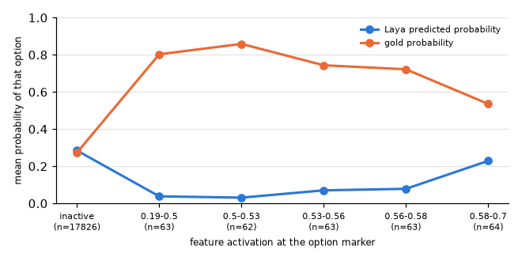

# Feature 2865

Critérios em que aparece: corr_probe_right_laya_wrong

**Interpretação (preencher):** 

---

## Maiores ativações

**tr_customer_service_000136 / category** (choice, customer_service) | ativação 2.064 em `estado` | opções ['account', 'billing', 'delivery', 'refund', 'technical'] | Laya: **billing** [0.002, 0.997, 0.0, 0.0, 0.001] | gabarito: **billing**

```
<bos> choice question: What is this customer conversation primarily about?<eos>
▸ <mask> account: Login, plan changes, profile or access management.
▸ <mask> billing: A charge, invoice, subscription or payment problem.
▸ <mask> delivery: Shipping, fulfilment or delivery of a physical item.
▸ <mask> refund: The customer is explicitly asking for money back.
▸ <mask> technical: The product or service is not working as expected.

<eos>

 {"account": {"lifetime_value_usd": 151, "prior_tickets_90d": 0, "seats": 1, "tenure_months": 2, "tier": "free"}, "orders": [{"amount_usd": 2997, "date": "2026-02-27", "id": "A-95428", "status": "refunded"}], "thread": [{"role": "customer", "text": "I just got my latest invoice and it shows a charge of $2,997—something I never signed up for. I've only been on the free plan for two months and this is urgent, please explain why this amount is appearing."}, {"role": "agent", "text": "I’m sorry to hear about the surprise charge. Could you share the invoice number or the date it was issued so I can look into the details?"}, {"role": "customer", "text": "The invoice is #INV-8392, dated August 5th. I didn’t receive any notice about upgrading, and I’m still under the free tier."}, {"role": "agent", "text": "Thank you for that information. I’ll verify the account activity around that date. Did you perhaps receive any promotional email that might have triggered an automatic upgrade?"}, {"role": "customer", "text": "No, I haven’t seen any promotion, and I never clicked any upgrade link. I need to know what happened before this gets billed again."}, {"role": "agent", "text": "Understood. I’ll check the billing logs and see if there’s a mis⟦applied⟧ charge. Meanwhile, could you confirm the primary email address on the account?"}, {"role": "customer", "text": "The email is jessica.rivera@example.com. Please let me know what you find as soon as possible."}]}<eos>
```

**tr_customer_service_000271 / churn_risk** (score, customer_service) | ativação 1.801 em `estado` | opções ['0', '1', '2', '3'] | Laya: **2** [0.078, 0.4, 0.413, 0.109] | gabarito: **1**

```
<bos> score question: How likely is this customer to stop doing business with us because of this interaction?<eos>
▸ <mask> level 0: No sign of dissatisfaction.
▸ <mask> level 1: Mild frustration, but the relationship is intact.
▸ <mask> level 2: Clearly unhappy; repeat problems or explicit complaints.
▸ <mask> level 3: Imminent: threatening to cancel, dispute or leave.

<eos>

 {"account": {"lifetime_value_usd": 886, "prior_tickets_90d": 1, "seats": 1, "tenure_months": 33, "tier": "free"}, "thread": [{"role": "customer", "text": "Hi there, I’m trying to get a full export of my data from the platform. I’m on the free plan and have been with you for 33 months. I opened a ticket about this a few weeks ago and was told the export would be ready, but I still haven’t received anything."}, {"role": "agent", "text": "I’m sorry you haven’t received the export yet. Could you tell me the⟦ date⟧ range you need the data for, and whether you prefer a CSV or JSON file?"}, {"role": "customer", "text": "I need everything from January 2023 through September 2023, and a CSV would be best. Please let me know when I can expect the file."}]}<eos>
```

**tr_customer_service_000136 / needs_human** (noul, customer_service) | ativação 1.801 em `estado` | opções ['false', 'true'] | Laya: **true** [0.124, 0.876] | gabarito: **true**

```
<bos> noul question: This conversation requires a human agent rather than automated handling.<eos>
▸ <mask> false: Automation can carry this to resolution.
▸ <mask> true: A human must take over: judgement, authority or empathy is required.

<eos>

 {"account": {"lifetime_value_usd": 151, "prior_tickets_90d": 0, "seats": 1, "tenure_months": 2, "tier": "free"}, "orders": [{"amount_usd": 2997, "date": "2026-02-27", "id": "A-95428", "status": "refunded"}], "thread": [{"role": "customer", "text": "I just got my latest invoice and it shows a charge of $2,997—something I never signed up for. I've only been on the free plan for two months and this is urgent, please explain why this amount is appearing."}, {"role": "agent", "text": "I’m sorry to hear about the surprise charge. Could you share the invoice number or the date it was issued so I can look into the details?"}, {"role": "customer", "text": "The invoice is #INV-8392, dated August 5th. I didn’t receive any notice about upgrading, and I’m still under the free tier."}, {"role": "agent", "text": "Thank you for that information. I’ll verify the account activity around that date. Did you perhaps receive any promotional email that might have triggered an automatic upgrade?"}, {"role": "customer", "text": "No, I haven’t seen any promotion, and I never clicked any upgrade link. I need to know what happened before this gets billed again."}, {"role": "agent", "text": "Understood. I’ll check the billing logs and see if there’s a mis⟦applied⟧ charge. Meanwhile, could you confirm the primary email address on the account?"}, {"role": "customer", "text": "The email is jessica.rivera@example.com. Please let me know what you find as soon as possible."}]}<eos>
```

**tr_customer_service_000136 / action** (choice, customer_service) | ativação 1.789 em `estado` | opções ['answer_directly', 'close_no_action', 'escalate_to_human', 'execute_refund', 'request_information'] | Laya: **answer_directly** [0.662, 0.259, 0.022, 0.054, 0.003] | gabarito: **escalate_to_human**

```
<bos> choice question: What should the assistant do next with this conversation?<eos>
▸ <mask> answer_directly: The assistant can resolve this itself with information it already has.
▸ <mask> close_no_action: No further action is warranted; the matter is settled.
▸ <mask> escalate_to_human: Hand off to a human agent with the appropriate authority.
▸ <mask> execute_refund: Issue the refund or credit the customer is owed.
▸ <mask> request_information: More detail is needed from the customer before anything can be done.

<eos>

 {"account": {"lifetime_value_usd": 151, "prior_tickets_90d": 0, "seats": 1, "tenure_months": 2, "tier": "free"}, "orders": [{"amount_usd": 2997, "date": "2026-02-27", "id": "A-95428", "status": "refunded"}], "thread": [{"role": "customer", "text": "I just got my latest invoice and it shows a charge of $2,997—something I never signed up for. I've only been on the free plan for two months and this is urgent, please explain why this amount is appearing."}, {"role": "agent", "text": "I’m sorry to hear about the surprise charge. Could you share the invoice number or the date it was issued so I can look into the details?"}, {"role": "customer", "text": "The invoice is #INV-8392, dated August 5th. I didn’t receive any notice about upgrading, and I’m still under the free tier."}, {"role": "agent", "text": "Thank you for that information. I’ll verify the account activity around that date. Did you perhaps receive any promotional email that might have triggered an automatic upgrade?"}, {"role": "customer", "text": "No, I haven’t seen any promotion, and I never clicked any upgrade link. I need to know what happened before this gets billed again."}, {"role": "agent", "text": "Understood. I’ll check the billing logs and see if there’s a mis⟦applied⟧ charge. Meanwhile, could you confirm the primary email address on the account?"}, {"role": "customer", "text": "The email is jessica.rivera@example.com. Please let me know what you find as soon as possible."}]}<eos>
```

**tr_customer_service_000136 / urgency** (score, customer_service) | ativação 1.786 em `estado` | opções ['0', '1', '2', '3'] | Laya: **1** [0.188, 0.438, 0.14, 0.234] | gabarito: **3**

```
<bos> score question: How time-sensitive is this conversation?<eos>
▸ <mask> level 0: No time pressure; can wait indefinitely.
▸ <mask> level 1: Routine; handle within the normal queue.
▸ <mask> level 2: Elevated; should be handled within the same week.
▸ <mask> level 3: Critical; requires action within the same day.

<eos>

 {"account": {"lifetime_value_usd": 151, "prior_tickets_90d": 0, "seats": 1, "tenure_months": 2, "tier": "free"}, "orders": [{"amount_usd": 2997, "date": "2026-02-27", "id": "A-95428", "status": "refunded"}], "thread": [{"role": "customer", "text": "I just got my latest invoice and it shows a charge of $2,997—something I never signed up for. I've only been on the free plan for two months and this is urgent, please explain why this amount is appearing."}, {"role": "agent", "text": "I’m sorry to hear about the surprise charge. Could you share the invoice number or the date it was issued so I can look into the details?"}, {"role": "customer", "text": "The invoice is #INV-8392, dated August 5th. I didn’t receive any notice about upgrading, and I’m still under the free tier."}, {"role": "agent", "text": "Thank you for that information. I’ll verify the account activity around that date. Did you perhaps receive any promotional email that might have triggered an automatic upgrade?"}, {"role": "customer", "text": "No, I haven’t seen any promotion, and I never clicked any upgrade link. I need to know what happened before this gets billed again."}, {"role": "agent", "text": "Understood. I’ll check the billing logs and see if there’s a mis⟦applied⟧ charge. Meanwhile, could you confirm the primary email address on the account?"}, {"role": "customer", "text": "The email is jessica.rivera@example.com. Please let me know what you find as soon as possible."}]}<eos>
```

## Ativações medianas (faixa 40-60%, mediana 0.727)

**tr_invoice_processing_000266 / disposition** (choice, invoice_processing) | ativação 0.761 em `opção` | opções ['approve', 'hold', 'manual_review', 'reject'] | Laya: **approve** [0.464, 0.145, 0.021, 0.37] | gabarito: **approve**

```
<bos> choice question: How should this vendor invoice be dispositioned?<eos>
▸ <mask> approve: Matches the order and delivery;⟦ approve⟧ for payment.
▸ <mask> hold: Something needs confirming before payment; hold pending clarification.
▸ <mask> manual_review: A human in finance must review the discrepancy.
▸ <mask> reject: Should not be paid: duplicate, unauthorised or materially wrong.

<eos>

 {"delivery": {"condition": "accepted", "date": "2026-03-01", "received_qty": 10}, "invoice": {"currency": "USD", "id": "INV-2026-9048", "lines": [{"qty": 10, "sku": "SKU-496", "total_usd": 1442.8, "unit_usd": 144.28}], "total_usd": 1442.8, "vendor": "Kestrel Supply"}, "payment": {"days_until_due": -21, "discount_expires_in_days": null, "early_payment_discount_pct": null, "status": "overdue", "terms": "net 30"}, "purchase_order": {"freight_terms": "freight prepaid by vendor, not separately billable", "id": "PO-8683", "lines": [{"qty": 10, "unit_usd": 144.28}], "total_usd": 1442.8}, "vendor_history": {"disputes_12m": 2, "invoices_12m": 17, "prior_invoice_ids": ["INV-2026-2055", "INV-2026-5598", "INV-2026-7732", "INV-2026-9595"]}}<eos>
```

**tr_agent_trace_observability_000112 / action** (choice, agent_trace_observability) | ativação 0.769 em `opção` | opções ['continue', 'human_review', 'observe', 'stop'] | Laya: **stop** [0.044, 0.003, 0.009, 0.943] | gabarito: **observe**

```
<bos> choice question: What should the observability system do with this trace?<eos>
▸ <mask> continue: Let the agent proceed without interruption.
▸ <mask> human_review: Queue this trace for a human to review.
▸ <mask> observe: Keep running, but flag the trace for later sampling.
▸ <mask> stop:⟦ Halt⟧ the agent now.

<eos>

 {"agent": {"autonomy": "unsupervised", "model": "internal-agent-v4"}, "constraints": ["Do not touch customer data outside the named accounts", "Do not exceed a $50 spend on cloud resources", "Never disable monitoring or alerting"], "task": "Update every service to the patched logging library.", "trace_summary": {"constraint_violations": 0, "duration_s": 583.2, "irreversible_actions": 0, "steps": 4, "tool_errors": 1}}<eos>
```

**tr_invoice_processing_000032 / disposition** (choice, invoice_processing) | ativação 0.759 em `opção` | opções ['approve', 'hold', 'manual_review', 'reject'] | Laya: **approve** [0.43, 0.34, 0.033, 0.197] | gabarito: **approve**

```
<bos> choice question: How should this vendor invoice be dispositioned?<eos>
▸ <mask> approve: Matches the order and delivery;⟦ approve⟧ for payment.
▸ <mask> hold: Something needs confirming before payment; hold pending clarification.
▸ <mask> manual_review: A human in finance must review the discrepancy.
▸ <mask> reject: Should not be paid: duplicate, unauthorised or materially wrong.

<eos>

 {"delivery": {"condition": "accepted", "date": "2026-03-05", "received_qty": 100}, "invoice": {"currency": "USD", "id": "INV-2026-2226", "lines": [{"qty": 100, "sku": "SKU-343", "total_usd": 18967.0, "unit_usd": 189.67}], "total_usd": 18967.0, "vendor": "Acme Fabrication"}, "payment": {"days_until_due": 27, "discount_expires_in_days": null, "early_payment_discount_pct": null, "status": "scheduled", "terms": "net 15"}, "purchase_order": {"freight_terms": "freight prepaid by vendor, not separately billable", "id": "PO-8529", "lines": [{"qty": 100, "unit_usd": 189.67}], "total_usd": 18967.0}, "vendor_history": {"disputes_12m": 0, "invoices_12m": 4, "prior_invoice_ids": ["INV-2026-8783"]}}<eos>
```

**tr_agent_trace_observability_000181 / action** (choice, agent_trace_observability) | ativação 0.666 em `opção` | opções ['continue', 'human_review', 'observe', 'stop'] | Laya: **continue** [0.432, 0.009, 0.184, 0.376] | gabarito: **continue**

```
<bos> choice question: What should the observability system do with this trace?<eos>
▸ <mask> continue: Let the agent proceed without interruption.
▸ <mask> human_review: Queue this trace for a human to review.
▸ <mask> observe: Keep running, but flag the trace for later sampling.
▸ <mask> stop:⟦ Halt⟧ the agent now.

<eos>

 {"agent": {"autonomy": "unsupervised", "model": "internal-agent-v1"}, "constraints": ["Do not touch customer data outside the named accounts"], "task": "Migrate the user table to the new schema without downtime.", "trace_summary": {"constraint_violations": 0, "duration_s": 339.4, "irreversible_actions": 0, "steps": 4, "tool_errors": 0}}<eos>
```

**tr_invoice_processing_000185 / disposition** (choice, invoice_processing) | ativação 0.768 em `opção` | opções ['approve', 'hold', 'manual_review', 'reject'] | Laya: **approve** [0.649, 0.127, 0.027, 0.198] | gabarito: **approve**

```
<bos> choice question: How should this vendor invoice be dispositioned?<eos>
▸ <mask> approve: Matches the order and delivery;⟦ approve⟧ for payment.
▸ <mask> hold: Something needs confirming before payment; hold pending clarification.
▸ <mask> manual_review: A human in finance must review the discrepancy.
▸ <mask> reject: Should not be paid: duplicate, unauthorised or materially wrong.

<eos>

 {"delivery": {"condition": "accepted", "date": "2026-03-11", "received_qty": 100}, "invoice": {"currency": "USD", "id": "INV-2026-5921", "lines": [{"qty": 100, "sku": "SKU-796", "total_usd": 32023.0, "unit_usd": 320.23}], "total_usd": 32023.0, "vendor": "Acme Fabrication"}, "payment": {"days_until_due": 18, "discount_expires_in_days": 8, "early_payment_discount_pct": 2.0, "status": "scheduled", "terms": "net 30"}, "purchase_order": {"freight_terms": "freight prepaid by vendor, not separately billable", "id": "PO-9122", "lines": [{"qty": 100, "unit_usd": 320.23}], "total_usd": 32023.0}, "vendor_history": {"disputes_12m": 0, "invoices_12m": 31, "prior_invoice_ids": ["INV-2026-2674", "INV-2026-5172"]}}<eos>
```

## Estatísticas (conjunto de descoberta, dev e teste)

**pred / error**

| split | decisões | ativas | ativas e Laya errou | taxa | lift | q (BH) | OR (CMH) | q (CMH) |
|---|---|---|---|---|---|---|---|---|
| discovery | 5100 | 19 | 17 | 0.895 | 1.39 | nan | nan | nan |
| dev | 900 | 4 | 4 | 1.000 | 1.49 | nan | nan | nan |
| test | 2000 | 13 | 13 | 1.000 | 1.54 | nan | nan | nan |

**corr / error**

| split | decisões | ativas | ativas e Laya errou | taxa | lift | q (BH) | OR (CMH) | q (CMH) |
|---|---|---|---|---|---|---|---|---|
| discovery | 5100 | 223 | 221 | 0.991 | 1.54 | 7.82e-39 | 0.67 | 0.842 |
| dev | 900 | 55 | 55 | 1.000 | 1.49 | 4.21e-09 | nan | nan |
| test | 2000 | 92 | 92 | 1.000 | 1.54 | 9.23e-17 | inf | 0.552 |

**state / error**

| split | decisões | ativas | ativas e Laya errou | taxa | lift | q (BH) | OR (CMH) | q (CMH) |
|---|---|---|---|---|---|---|---|---|
| discovery | 5100 | 154 | 94 | 0.610 | 0.95 | 0.609 | 1.37 | 0.365 |
| dev | 900 | 13 | 10 | 0.769 | 1.14 | nan | nan | nan |
| test | 2000 | 41 | 27 | 0.659 | 1.01 | 1 | 1.43 | 0.709 |

**pred / probe_right_laya_wrong**

| split | decisões | ativas | ativas e Laya errou | taxa | lift | q (BH) | OR (CMH) | q (CMH) |
|---|---|---|---|---|---|---|---|---|
| discovery | 2819 | 8 | 8 | 1.000 | 1.55 | nan | nan | nan |
| dev | 520 | 1 | 1 | 1.000 | 1.48 | nan | nan | nan |
| test | 1106 | 6 | 6 | 1.000 | 1.58 | nan | nan | nan |

**corr / probe_right_laya_wrong**

| split | decisões | ativas | ativas e Laya errou | taxa | lift | q (BH) | OR (CMH) | q (CMH) |
|---|---|---|---|---|---|---|---|---|
| discovery | 2819 | 217 | 217 | 1.000 | 1.55 | 5.74e-42 | nan | nan |
| dev | 520 | 55 | 55 | 1.000 | 1.48 | 3.3e-09 | nan | nan |
| test | 1106 | 89 | 89 | 1.000 | 1.58 | 1.28e-17 | nan | nan |

**state / probe_right_laya_wrong**

| split | decisões | ativas | ativas e Laya errou | taxa | lift | q (BH) | OR (CMH) | q (CMH) |
|---|---|---|---|---|---|---|---|---|
| discovery | 2819 | 94 | 55 | 0.585 | 0.90 | 0.37 | 1.51 | 0.303 |
| dev | 520 | 9 | 6 | 0.667 | 0.99 | nan | nan | nan |
| test | 1106 | 27 | 15 | 0.556 | 0.88 | 0.761 | 1.00 | 0.997 |

Confusão mais sobre-representada (pred): `outcome|0>3` (n=10, lift 103.24, p=nan). Formato `pergunta|índice previsto>índice correto`.

Confusão mais sobre-representada (corr): `duplicate|1>0` (n=217, lift 22.87, p=0). Formato `pergunta|índice previsto>índice correto`.

Confusão mais sobre-representada (state): `true_positive|1>0` (n=11, lift 5.20, p=6.2e-06). Formato `pergunta|índice previsto>índice correto`.



