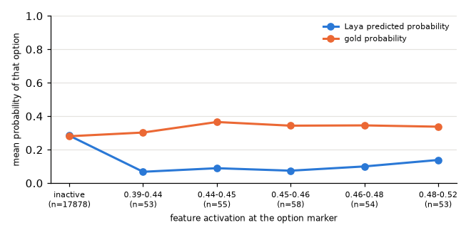

# Feature 2888

Critérios em que aparece: corr_probe_right_laya_wrong

**Interpretação (preencher):** 

---

## Maiores ativações

**tr_customer_service_000041 / action** (choice, customer_service) | ativação 4.945 em `estado` | opções ['answer_directly', 'close_no_action', 'escalate_to_human', 'execute_refund', 'request_information'] | Laya: **close_no_action** [0.241, 0.742, 0.007, 0.003, 0.007] | gabarito: **escalate_to_human**

```
<bos> choice question: What should the assistant do next with this conversation?<eos>
▸ <mask> answer_directly: The assistant can resolve this itself with information it already has.
▸ <mask> close_no_action: No further action is warranted; the matter is settled.
▸ <mask> escalate_to_human: Hand off to a human agent with the appropriate authority.
▸ <mask> execute_refund: Issue the refund or credit the customer is owed.
▸ <mask> request_information: More detail is needed from the customer before anything can be done.

<eos>

 {"account": {"lifetime_value_usd": 446, "prior_tickets_90d": 1, "seats": 1, "tenure_months": 5, "tier": "free"}, "orders": [{"amount_usd": 999, "date": "2026-01-24", "id": "A-86387", "status": "pending"}, {"amount_usd": 999, "date": "2026-03-10", "id": "A-88077", "status": "settled"}, {"amount_usd": 999, "date": "2026-01-19", "id": "A-21190", "status": "settled"}], "thread": [{"role": "customer", "text": "I thought my order was supposed to arrive last week, but nothing’s here yet. I need it for the event on Friday and I’m completely confused."}, {"role": "agent", "text": "I understand how frustrating that can be. Could you share the order number so I can look into the shipping status?"}, {"role": "customer", "text": "It’s #A12345. The tracking just says ‘in transit’ and I’ve got no idea where it is."}, {"role": "agent", "text": "Thanks for that. Do⟦ you⟧ know which carrier was selected for the shipment? That will help me pinpoint the delay."}, {"role": "customer", "text": "It was supposed to be UPS, but I’m not sure if they even have it. I really need it before Friday, can anything be done?"}]}<eos>
```

**tr_customer_service_000041 / urgency** (score, customer_service) | ativação 4.895 em `estado` | opções ['0', '1', '2', '3'] | Laya: **0** [0.664, 0.161, 0.042, 0.133] | gabarito: **3**

```
<bos> score question: How time-sensitive is this conversation?<eos>
▸ <mask> level 0: No time pressure; can wait indefinitely.
▸ <mask> level 1: Routine; handle within the normal queue.
▸ <mask> level 2: Elevated; should be handled within the same week.
▸ <mask> level 3: Critical; requires action within the same day.

<eos>

 {"account": {"lifetime_value_usd": 446, "prior_tickets_90d": 1, "seats": 1, "tenure_months": 5, "tier": "free"}, "orders": [{"amount_usd": 999, "date": "2026-01-24", "id": "A-86387", "status": "pending"}, {"amount_usd": 999, "date": "2026-03-10", "id": "A-88077", "status": "settled"}, {"amount_usd": 999, "date": "2026-01-19", "id": "A-21190", "status": "settled"}], "thread": [{"role": "customer", "text": "I thought my order was supposed to arrive last week, but nothing’s here yet. I need it for the event on Friday and I’m completely confused."}, {"role": "agent", "text": "I understand how frustrating that can be. Could you share the order number so I can look into the shipping status?"}, {"role": "customer", "text": "It’s #A12345. The tracking just says ‘in transit’ and I’ve got no idea where it is."}, {"role": "agent", "text": "Thanks for that. Do⟦ you⟧ know which carrier was selected for the shipment? That will help me pinpoint the delay."}, {"role": "customer", "text": "It was supposed to be UPS, but I’m not sure if they even have it. I really need it before Friday, can anything be done?"}]}<eos>
```

**tr_customer_service_000041 / needs_human** (noul, customer_service) | ativação 4.879 em `estado` | opções ['false', 'true'] | Laya: **false** [0.874, 0.126] | gabarito: **true**

```
<bos> noul question: This conversation requires a human agent rather than automated handling.<eos>
▸ <mask> false: Automation can carry this to resolution.
▸ <mask> true: A human must take over: judgement, authority or empathy is required.

<eos>

 {"account": {"lifetime_value_usd": 446, "prior_tickets_90d": 1, "seats": 1, "tenure_months": 5, "tier": "free"}, "orders": [{"amount_usd": 999, "date": "2026-01-24", "id": "A-86387", "status": "pending"}, {"amount_usd": 999, "date": "2026-03-10", "id": "A-88077", "status": "settled"}, {"amount_usd": 999, "date": "2026-01-19", "id": "A-21190", "status": "settled"}], "thread": [{"role": "customer", "text": "I thought my order was supposed to arrive last week, but nothing’s here yet. I need it for the event on Friday and I’m completely confused."}, {"role": "agent", "text": "I understand how frustrating that can be. Could you share the order number so I can look into the shipping status?"}, {"role": "customer", "text": "It’s #A12345. The tracking just says ‘in transit’ and I’ve got no idea where it is."}, {"role": "agent", "text": "Thanks for that. Do⟦ you⟧ know which carrier was selected for the shipment? That will help me pinpoint the delay."}, {"role": "customer", "text": "It was supposed to be UPS, but I’m not sure if they even have it. I really need it before Friday, can anything be done?"}]}<eos>
```

**tr_customer_service_000041 / category** (choice, customer_service) | ativação 4.879 em `estado` | opções ['account', 'billing', 'delivery', 'refund', 'technical'] | Laya: **delivery** [0.002, 0.005, 0.971, 0.002, 0.019] | gabarito: **delivery**

```
<bos> choice question: What is this customer conversation primarily about?<eos>
▸ <mask> account: Login, plan changes, profile or access management.
▸ <mask> billing: A charge, invoice, subscription or payment problem.
▸ <mask> delivery: Shipping, fulfilment or delivery of a physical item.
▸ <mask> refund: The customer is explicitly asking for money back.
▸ <mask> technical: The product or service is not working as expected.

<eos>

 {"account": {"lifetime_value_usd": 446, "prior_tickets_90d": 1, "seats": 1, "tenure_months": 5, "tier": "free"}, "orders": [{"amount_usd": 999, "date": "2026-01-24", "id": "A-86387", "status": "pending"}, {"amount_usd": 999, "date": "2026-03-10", "id": "A-88077", "status": "settled"}, {"amount_usd": 999, "date": "2026-01-19", "id": "A-21190", "status": "settled"}], "thread": [{"role": "customer", "text": "I thought my order was supposed to arrive last week, but nothing’s here yet. I need it for the event on Friday and I’m completely confused."}, {"role": "agent", "text": "I understand how frustrating that can be. Could you share the order number so I can look into the shipping status?"}, {"role": "customer", "text": "It’s #A12345. The tracking just says ‘in transit’ and I’ve got no idea where it is."}, {"role": "agent", "text": "Thanks for that. Do⟦ you⟧ know which carrier was selected for the shipment? That will help me pinpoint the delay."}, {"role": "customer", "text": "It was supposed to be UPS, but I’m not sure if they even have it. I really need it before Friday, can anything be done?"}]}<eos>
```

**tr_customer_service_000041 / churn_risk** (score, customer_service) | ativação 4.875 em `estado` | opções ['0', '1', '2', '3'] | Laya: **1** [0.138, 0.416, 0.239, 0.207] | gabarito: **2**

```
<bos> score question: How likely is this customer to stop doing business with us because of this interaction?<eos>
▸ <mask> level 0: No sign of dissatisfaction.
▸ <mask> level 1: Mild frustration, but the relationship is intact.
▸ <mask> level 2: Clearly unhappy; repeat problems or explicit complaints.
▸ <mask> level 3: Imminent: threatening to cancel, dispute or leave.

<eos>

 {"account": {"lifetime_value_usd": 446, "prior_tickets_90d": 1, "seats": 1, "tenure_months": 5, "tier": "free"}, "orders": [{"amount_usd": 999, "date": "2026-01-24", "id": "A-86387", "status": "pending"}, {"amount_usd": 999, "date": "2026-03-10", "id": "A-88077", "status": "settled"}, {"amount_usd": 999, "date": "2026-01-19", "id": "A-21190", "status": "settled"}], "thread": [{"role": "customer", "text": "I thought my order was supposed to arrive last week, but nothing’s here yet. I need it for the event on Friday and I’m completely confused."}, {"role": "agent", "text": "I understand how frustrating that can be. Could you share the order number so I can look into the shipping status?"}, {"role": "customer", "text": "It’s #A12345. The tracking just says ‘in transit’ and I’ve got no idea where it is."}, {"role": "agent", "text": "Thanks for that. Do⟦ you⟧ know which carrier was selected for the shipment? That will help me pinpoint the delay."}, {"role": "customer", "text": "It was supposed to be UPS, but I’m not sure if they even have it. I really need it before Friday, can anything be done?"}]}<eos>
```

## Ativações medianas (faixa 40-60%, mediana 0.988)

**tr_customer_service_000111 / churn_risk** (score, customer_service) | ativação 0.925 em `estado` | opções ['0', '1', '2', '3'] | Laya: **1** [0.088, 0.457, 0.313, 0.142] | gabarito: **3**

```
<bos> score question: How likely is this customer to stop doing business with us because of this interaction?<eos>
▸ <mask> level 0: No sign of dissatisfaction.
▸ <mask> level 1: Mild frustration, but the relationship is intact.
▸ <mask> level 2: Clearly unhappy; repeat problems or explicit complaints.
▸ <mask> level 3: Imminent: threatening to cancel, dispute or leave.

<eos>

 {"account": {"lifetime_value_usd": 181, "prior_tickets_90d": 0, "seats": 1, "tenure_months": 2, "tier": "free"}, "thread": [{"role": "customer", "text": "We have to add three more seats to our team right now, or we can't meet our client deadline tomorrow. If this isn't sorted immediately, we'll have to look for another service."}, {"role": "agent", "text": "Got it. Can you provide the account ID⟦ and⟧ let me know which usernames need the new seats?"}, {"role": "customer", "text": "We're on the free plan, account ID 98765. Please tell me what I need to do to get those seats added before 5 pm today."}]}<eos>
```

**tr_customer_service_000297 / needs_human** (noul, customer_service) | ativação 1.169 em `estado` | opções ['false', 'true'] | Laya: **false** [0.883, 0.117] | gabarito: **true**

```
<bos> noul question: This conversation requires a human agent rather than automated handling.<eos>
▸ <mask> false: Automation can carry this to resolution.
▸ <mask> true: A human must take over: judgement, authority or empathy is required.

<eos>

 {"account": {"lifetime_value_usd": 581, "prior_tickets_90d": 2, "seats": 40, "tenure_months": 11, "tier": "enterprise"}, "orders": [{"amount_usd": 299, "date": "2026-03-03", "id": "A-90996", "status": "settled"}], "thread": [{"role": "customer", "text": "I just opened the box and the hardware is cracked, but I'm not sure if this happened during shipping or if it was like this already? I have a hard deadline this Friday and really need this working."}, {"role": "agent", "text": "I'm sorry to hear about the damage. To help me look into this, could you please provide your order number and upload a few photos of the packaging?"}, {"role": "customer", "text": "I think I sent photos in my last two tickets, but I can'⟦t⟧ remember if they actually saw them. Where do I upload them again?"}]}<eos>
```

**tr_customer_service_000230 / action** (choice, customer_service) | ativação 1.134 em `estado` | opções ['answer_directly', 'close_no_action', 'escalate_to_human', 'execute_refund', 'request_information'] | Laya: **close_no_action** [0.343, 0.421, 0.011, 0.22, 0.006] | gabarito: **answer_directly**

```
<bos> choice question: What should the assistant do next with this conversation?<eos>
▸ <mask> answer_directly: The assistant can resolve this itself with information it already has.
▸ <mask> close_no_action: No further action is warranted; the matter is settled.
▸ <mask> escalate_to_human: Hand off to a human agent with the appropriate authority.
▸ <mask> execute_refund: Issue the refund or credit the customer is owed.
▸ <mask> request_information: More detail is needed from the customer before anything can be done.

<eos>

 {"account": {"lifetime_value_usd": 284, "prior_tickets_90d": 1, "seats": 1, "tenure_months": 8, "tier": "free"}, "orders": [{"amount_usd": 18, "date": "2026-02-04", "id": "A-58579", "status": "refunded"}, {"amount_usd": 18, "date": "2026-02-26", "id": "A-36822", "status": "settled"}, {"amount_usd": 18, "date": "2026-02-07", "id": "A-33566", "status": "settled"}], "thread": [{"role": "customer", "text": "I’m furious that I still haven’t received the invoice copy for the $18 charge—this is the second time I’ve had to chase you about it!"}, {"role": "agent", "text": "I’m sorry you’ve had to follow up again. Could you tell me the date of the transaction or the invoice number you’re looking for?"}, {"role": "customer", "text": "It was on July 12, reference #FRE-2023-07-12. I opened a ticket about this last week and only got a vague reply, which didn’t include the document."}, {"role": "agent", "text": "Thank you for⟦ that⟧ information. Just to double‑check, is the email address jane.free@example.com still the best way to send the PDF?"}, {"role": "customer", "text": "Yes, that’s the address. Send me the proper invoice this time; I’m tired of being bounced around."}]}<eos>
```

**tr_customer_service_000043 / needs_human** (noul, customer_service) | ativação 0.937 em `estado` | opções ['false', 'true'] | Laya: **false** [0.51, 0.49] | gabarito: **false**

```
<bos> noul question: This conversation requires a human agent rather than automated handling.<eos>
▸ <mask> false: Automation can carry this to resolution.
▸ <mask> true: A human must take over: judgement, authority or empathy is required.

<eos>

 {"account": {"lifetime_value_usd": 208, "prior_tickets_90d": 0, "seats": 1, "tenure_months": 3, "tier": "free"}, "orders": [{"amount_usd": 999, "date": "2026-03-09", "id": "A-17017", "status": "refunded"}, {"amount_usd": 999, "date": "2026-01-04", "id": "A-58989", "status": "failed"}], "thread": [{"role": "customer", "text": "I need to get my data out of the system, but I’m not holding⟦ my⟧ breath—it probably won’t happen any time soon."}, {"role": "agent", "text": "I hear you. Could you tell me which parts of your account you’d like included in the export?"}, {"role": "customer", "text": "Just the basic account information—profile details and settings. Nothing fancy."}, {"role": "agent", "text": "Understood. Do you have a preferred format for the file—CSV, JSON, or something else?"}, {"role": "customer", "text": "Whatever you can manage, I don’t mind waiting."}]}<eos>
```

**tr_customer_service_000222 / category** (choice, customer_service) | ativação 0.851 em `estado` | opções ['account', 'billing', 'delivery', 'refund', 'technical'] | Laya: **account** [0.939, 0.001, 0.001, 0.057, 0.003] | gabarito: **account**

```
<bos> choice question: What is this customer conversation primarily about?<eos>
▸ <mask> account: Login, plan changes, profile or access management.
▸ <mask> billing: A charge, invoice, subscription or payment problem.
▸ <mask> delivery: Shipping, fulfilment or delivery of a physical item.
▸ <mask> refund: The customer is explicitly asking for money back.
▸ <mask> technical: The product or service is not working as expected.

<eos>

 {"account": {"lifetime_value_usd": 3359, "prior_tickets_90d": 1, "seats": 12, "tenure_months": 41, "tier": "enterprise"}, "thread": [{"role": "customer", "text": "I am writing to request an immediate downgrade of my enterprise plan. Given that my previous request for service improvements was ignored, I am finding it difficult⟦ to⟧ justify continuing our partnership and may be forced to take my business elsewhere if this is not addressed promptly."}]}<eos>
```

## Estatísticas (conjunto de descoberta, dev e teste)

**pred / error**

| split | decisões | ativas | ativas e Laya errou | taxa | lift | q (BH) | OR (CMH) | q (CMH) |
|---|---|---|---|---|---|---|---|---|
| discovery | 5100 | 4 | 3 | 0.750 | 1.17 | nan | nan | nan |
| dev | 900 | 0 | 0 | nan | nan | nan | nan | nan |
| test | 2000 | 1 | 0 | 0.000 | 0.00 | nan | nan | nan |

**corr / error**

| split | decisões | ativas | ativas e Laya errou | taxa | lift | q (BH) | OR (CMH) | q (CMH) |
|---|---|---|---|---|---|---|---|---|
| discovery | 5100 | 108 | 107 | 0.991 | 1.54 | 1.01e-18 | 3.77 | 0.36 |
| dev | 900 | 14 | 14 | 1.000 | 1.49 | nan | nan | nan |
| test | 2000 | 30 | 29 | 0.967 | 1.49 | 0.000185 | 0.56 | 0.904 |

**state / error**

| split | decisões | ativas | ativas e Laya errou | taxa | lift | q (BH) | OR (CMH) | q (CMH) |
|---|---|---|---|---|---|---|---|---|
| discovery | 5100 | 2020 | 1149 | 0.569 | 0.88 | 3.16e-17 | 0.97 | 0.906 |
| dev | 900 | 334 | 198 | 0.593 | 0.88 | 0.0229 | 1.07 | 0.918 |
| test | 2000 | 764 | 451 | 0.590 | 0.91 | 0.0014 | 0.99 | 0.989 |

**pred / probe_right_laya_wrong**

| split | decisões | ativas | ativas e Laya errou | taxa | lift | q (BH) | OR (CMH) | q (CMH) |
|---|---|---|---|---|---|---|---|---|
| discovery | 2819 | 2 | 2 | 1.000 | 1.55 | nan | nan | nan |
| dev | 520 | 0 | 0 | nan | nan | nan | nan | nan |
| test | 1106 | 0 | 0 | nan | nan | nan | nan | nan |

**corr / probe_right_laya_wrong**

| split | decisões | ativas | ativas e Laya errou | taxa | lift | q (BH) | OR (CMH) | q (CMH) |
|---|---|---|---|---|---|---|---|---|
| discovery | 2819 | 37 | 37 | 1.000 | 1.55 | 3.91e-07 | inf | 0.59 |
| dev | 520 | 5 | 5 | 1.000 | 1.48 | nan | nan | nan |
| test | 1106 | 12 | 12 | 1.000 | 1.58 | nan | nan | nan |

**state / probe_right_laya_wrong**

| split | decisões | ativas | ativas e Laya errou | taxa | lift | q (BH) | OR (CMH) | q (CMH) |
|---|---|---|---|---|---|---|---|---|
| discovery | 2819 | 1151 | 628 | 0.546 | 0.84 | 3.35e-18 | 1.31 | 0.11 |
| dev | 520 | 196 | 114 | 0.582 | 0.86 | 0.0441 | 2.17 | 0.143 |
| test | 1106 | 453 | 251 | 0.554 | 0.88 | 0.000574 | 1.44 | 0.247 |

Confusão mais sobre-representada (pred): `action|2>1` (n=2, lift 1275.00, p=nan). Formato `pergunta|índice previsto>índice correto`.

Confusão mais sobre-representada (corr): `action|3>2` (n=102, lift 41.88, p=0). Formato `pergunta|índice previsto>índice correto`.

Confusão mais sobre-representada (state): `action|1>2` (n=69, lift 2.45, p=8.21e-26). Formato `pergunta|índice previsto>índice correto`.



