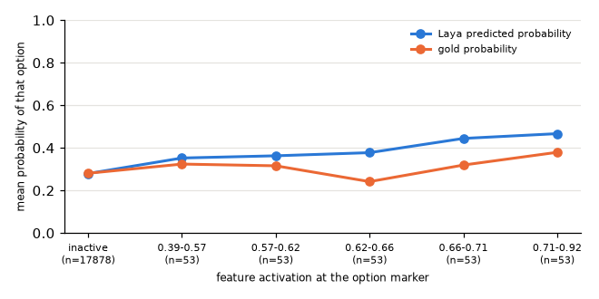

# Feature 2925

Critérios em que aparece: attribution_toward_wrong

**Interpretação (preencher):** 

---

## Maiores ativações

**tr_customer_service_000157 / category** (choice, customer_service) | ativação 13.961 em `estado` | opções ['account', 'billing', 'delivery', 'refund', 'technical'] | Laya: **account** [1.0, 0.0, 0.0, 0.0, 0.0] | gabarito: **account**

```
<bos> choice question: What is this customer conversation primarily about?<eos>
▸ <mask> account: Login, plan changes, profile or access management.
▸ <mask> billing: A charge, invoice, subscription or payment problem.
▸ <mask> delivery: Shipping, fulfilment or delivery of a physical item.
▸ <mask> refund: The customer is explicitly asking for money back.
▸ <mask> technical: The product or service is not working as expected.

<eos>

 {"account": {"lifetime_value_usd": 3086, "prior_tickets_90d": 3, "seats": 1, "tenure_months": 49, "tier": "standard"}, "thread": [{"role": "customer", "text": "I need to get into my account right now – the login page just keeps looping back to⟦ the⟧ password screen and I can’t access anything."}, {"role": "agent", "text": "I understand the urgency. Could you share the exact error message you’re seeing, or let me know if you’ve tried resetting the password?"}, {"role": "customer", "text": "The message says “authentication failed” after I enter my credentials, and I’ve already tried the password reset twice with no luck."}]}<eos>
```

**tr_customer_service_000157 / needs_human** (noul, customer_service) | ativação 13.891 em `estado` | opções ['false', 'true'] | Laya: **true** [0.086, 0.914] | gabarito: **true**

```
<bos> noul question: This conversation requires a human agent rather than automated handling.<eos>
▸ <mask> false: Automation can carry this to resolution.
▸ <mask> true: A human must take over: judgement, authority or empathy is required.

<eos>

 {"account": {"lifetime_value_usd": 3086, "prior_tickets_90d": 3, "seats": 1, "tenure_months": 49, "tier": "standard"}, "thread": [{"role": "customer", "text": "I need to get into my account right now – the login page just keeps looping back to⟦ the⟧ password screen and I can’t access anything."}, {"role": "agent", "text": "I understand the urgency. Could you share the exact error message you’re seeing, or let me know if you’ve tried resetting the password?"}, {"role": "customer", "text": "The message says “authentication failed” after I enter my credentials, and I’ve already tried the password reset twice with no luck."}]}<eos>
```

**tr_security_incidents_000149 / severity** (score, security_incidents) | ativação 13.781 em `estado` | opções ['0', '1', '2', '3', '4'] | Laya: **1** [0.079, 0.452, 0.252, 0.153, 0.064] | gabarito: **4**

```
<bos> score question: How severe is the potential impact if this alert is real?<eos>
▸ <mask> level 0: Negligible: no access to anything sensitive.
▸ <mask> level 1: Low: limited access, easily reversed.
▸ <mask> level 2: Moderate: access to internal systems or non-public data.
▸ <mask> level 3: High: access to production, secrets or customer data.
▸ <mask> level 4: Critical: active compromise of crown-jewel systems.

<eos>

 {"alert": {"description": "an account granted itself or received elevated permissions", "evidence": "A privilege change was recorded at 2026-09-16 08:09:12 UTC where user \"ADMIN_JONES\" was added to the \"Domain Admins\" group on⟦ the⟧ domain controller. The account already has privileged status, MFA is enabled, but the source of the request originates from an unrecognized endpoint; the credentials for this account were last rotated 14 days prior and the activity fell outside any scheduled change window.", "rule": "privilege_escalation"}, "context": {"asset_criticality": "low", "change_window_active": false, "source_on_allowlist": false}, "history": {"credential_rotation_days_ago": 14, "distinct_countries_30d": 4, "logins_30d": 1034, "prior_alerts_90d": 0}, "principal": {"mfa_enrolled": true, "name": "ci-analytics-841", "privileges": ["deploy:production", "secrets:read"], "type": "admin"}}<eos>
```

**tr_security_incidents_000149 / true_positive** (noul, security_incidents) | ativação 13.633 em `estado` | opções ['false', 'true'] | Laya: **true** [0.324, 0.676] | gabarito: **true**

```
<bos> noul question: This alert reflects genuinely malicious or unauthorised activity.<eos>
▸ <mask> false: Benign activity, a misconfiguration, or a known false positive.
▸ <mask> true: The underlying behaviour is malicious or unauthorised.

<eos>

 {"alert": {"description": "an account granted itself or received elevated permissions", "evidence": "A privilege change was recorded at 2026-09-16 08:09:12 UTC where user \"ADMIN_JONES\" was added to the \"Domain Admins\" group on⟦ the⟧ domain controller. The account already has privileged status, MFA is enabled, but the source of the request originates from an unrecognized endpoint; the credentials for this account were last rotated 14 days prior and the activity fell outside any scheduled change window.", "rule": "privilege_escalation"}, "context": {"asset_criticality": "low", "change_window_active": false, "source_on_allowlist": false}, "history": {"credential_rotation_days_ago": 14, "distinct_countries_30d": 4, "logins_30d": 1034, "prior_alerts_90d": 0}, "principal": {"mfa_enrolled": true, "name": "ci-analytics-841", "privileges": ["deploy:production", "secrets:read"], "type": "admin"}}<eos>
```

**tr_security_incidents_000149 / disposition** (choice, security_incidents) | ativação 13.594 em `estado` | opções ['close_benign', 'contain', 'investigate', 'monitor'] | Laya: **monitor** [0.076, 0.079, 0.12, 0.725] | gabarito: **investigate**

```
<bos> choice question: How should this security alert be dispositioned?<eos>
▸ <mask> close_benign: Expected, explainable activity; close without analyst time.
▸ <mask> contain: Contain the host or account immediately; do not wait for triage.
▸ <mask> investigate: Warrants an analyst opening an investigation.
▸ <mask> monitor: Not clearly malicious, but worth watching for recurrence.

<eos>

 {"alert": {"description": "an account granted itself or received elevated permissions", "evidence": "A privilege change was recorded at 2026-09-16 08:09:12 UTC where user \"ADMIN_JONES\" was added to the \"Domain Admins\" group on⟦ the⟧ domain controller. The account already has privileged status, MFA is enabled, but the source of the request originates from an unrecognized endpoint; the credentials for this account were last rotated 14 days prior and the activity fell outside any scheduled change window.", "rule": "privilege_escalation"}, "context": {"asset_criticality": "low", "change_window_active": false, "source_on_allowlist": false}, "history": {"credential_rotation_days_ago": 14, "distinct_countries_30d": 4, "logins_30d": 1034, "prior_alerts_90d": 0}, "principal": {"mfa_enrolled": true, "name": "ci-analytics-841", "privileges": ["deploy:production", "secrets:read"], "type": "admin"}}<eos>
```

## Ativações medianas (faixa 40-60%, mediana 6.559)

**tr_customer_service_000151 / churn_risk** (score, customer_service) | ativação 6.176 em `estado` | opções ['0', '1', '2', '3'] | Laya: **1** [0.31, 0.52, 0.15, 0.02] | gabarito: **3**

```
<bos> score question: How likely is this customer to stop doing business with us because of this interaction?<eos>
▸ <mask> level 0: No sign of dissatisfaction.
▸ <mask> level 1: Mild frustration, but the relationship is intact.
▸ <mask> level 2: Clearly unhappy; repeat problems or explicit complaints.
▸ <mask> level 3: Imminent: threatening to cancel, dispute or leave.

<eos>

 {"account": {"lifetime_value_usd": 95, "prior_tickets_90d": 0, "seats": 1, "tenure_months": 3, "tier": "enterprise"}, "orders": [{"amount_usd": 299, "date": "2026-02-01", "id": "A-70416", "status": "failed"}, {"amount_usd": 299, "date": "2026-02-15", "id": "A-68913", "status": "pending"}], "thread": [{"role": "customer", "text": "Hello, I’m reaching out because the platform’s performance has been noticeably slow over the past week, and it’s affecting our workflow. We’re on the enterprise plan, paying $299 a month, and we need a stable experience."}, {"role": "agent", "text": "I’m sorry to hear about the slowdown. Could you tell me which features or pages are most affected, and any error messages you’ve encountered?"}, {"role": "customer", "text": "The dashboard and reporting modules take up to 45 seconds to load, and occasional time‑outs appear when we try to export data. I need a solution in place by next Friday, or we’ll have to look elsewhere."}, {"role": "agent", "text": "Thanks for the specifics. Do you have any recent logs or screenshots that show the time‑outs? That would help us pinpoint the bottleneck."}, {"role": "customer", "text": "I’ve attached the latest logs from our server and a couple of screenshots of the timeout dialogs. Please let me know what’s causing this lag."}, {"role": "agent", "text": "I appreciate you sending those files. I’ll have our performance team examine them and see what’s triggering the delay. Meanwhile, is there any temporary workaround you’ve tried that offers a bit more speed?"}, {"role": "customer", "text": "We’ve tried clearing caches and using a different browser, but⟦ the⟧ issue persists. If this isn’t sorted out by next Friday, I’ll have to consider moving to a competitor."}]}<eos>
```

**tr_customer_service_000186 / category** (choice, customer_service) | ativação 6.875 em `estado` | opções ['account', 'billing', 'delivery', 'refund', 'technical'] | Laya: **account** [0.509, 0.069, 0.0, 0.005, 0.416] | gabarito: **account**

```
<bos> choice question: What is this customer conversation primarily about?<eos>
▸ <mask> account: Login, plan changes, profile or access management.
▸ <mask> billing: A charge, invoice, subscription or payment problem.
▸ <mask> delivery: Shipping, fulfilment or delivery of a physical item.
▸ <mask> refund: The customer is explicitly asking for money back.
▸ <mask> technical: The product or service is not working as expected.

<eos>

 {"account": {"lifetime_value_usd": 94, "prior_tickets_90d": 0, "seats": 1, "tenure_months": 2, "tier": "free"}, "orders": [{"amount_usd": 99, "date": "2026-03-11", "id": "A-98793", "status": "pending"}, {"amount_usd": 99, "date": "2026-03-28", "id": "A-39133", "status": "failed"}], "thread": [{"role": "customer", "text": "I’m sick of this platform—cancel my account immediately and stop charging me the $99 I’m being billed each month."}, {"role": "agent", "text": "I understand you want to close the account. Could you verify the email address linked to the subscription so I can locate the correct profile?"}, {"role": "customer", "text": "It’s john.doe@example.com. I’ve already told you this before; if you don’t process⟦ the⟧ cancellation right now I’ll be forced to dispute the charges."}]}<eos>
```

**tr_customer_service_000298 / category** (choice, customer_service) | ativação 6.711 em `opção` | opções ['account', 'billing', 'delivery', 'refund', 'technical'] | Laya: **delivery** [0.115, 0.02, 0.666, 0.025, 0.174] | gabarito: **delivery**

```
<bos> choice question: What is this customer conversation primarily about?<eos>
▸ <mask> account: Login, plan changes, profile or access management.
▸ <mask> billing: A charge, invoice, subscription or payment problem.
▸ <mask> delivery: Shipping, fulfilment or delivery of a physical item.
▸ <mask> refund:⟦ The⟧ customer is explicitly asking for money back.
▸ <mask> technical: The product or service is not working as expected.

<eos>

 {"account": {"lifetime_value_usd": 58, "prior_tickets_90d": 0, "seats": 1, "tenure_months": 1, "tier": "enterprise"}, "thread": [{"role": "customer", "text": "The item arrived but it looks broken? I don't understand why it's shaped like this."}, {"role": "agent", "text": "I apologize for the confusion. Could you describe which specific part of the item appears to be damaged?"}, {"role": "customer", "text": "It's the main plastic casing, it's just kind of smashed in."}]}<eos>
```

**tr_customer_service_000154 / category** (choice, customer_service) | ativação 6.605 em `opção` | opções ['account', 'billing', 'delivery', 'refund', 'technical'] | Laya: **technical** [0.224, 0.035, 0.003, 0.015, 0.724] | gabarito: **technical**

```
<bos> choice question: What is this customer conversation primarily about?<eos>
▸ <mask> account: Login, plan changes, profile or access management.
▸ <mask> billing: A charge, invoice, subscription or payment problem.
▸ <mask> delivery: Shipping, fulfilment or delivery of a physical item.
▸ <mask> refund:⟦ The⟧ customer is explicitly asking for money back.
▸ <mask> technical: The product or service is not working as expected.

<eos>

 {"account": {"lifetime_value_usd": 1803, "prior_tickets_90d": 0, "seats": 1, "tenure_months": 19, "tier": "free"}, "orders": [{"amount_usd": 198, "date": "2026-02-24", "id": "A-56491", "status": "refunded"}, {"amount_usd": 198, "date": "2026-02-25", "id": "A-17184", "status": "settled"}], "thread": [{"role": "customer", "text": "My attempt to upload a PDF to the project folder keeps timing out after a few seconds."}, {"role": "agent", "text": "Understood. Are you seeing any error messages, or does the process simply stop?"}, {"role": "customer", "text": "It just stops; the spinner spins forever, no error text appears."}, {"role": "agent", "text": "Thanks for clarifying. Have you tried clearing your browser cache or using a different browser?"}, {"role": "customer", "text": "I tried Chrome incognito and it behaved the same way."}]}<eos>
```

**tr_agent_trace_observability_000019 / urgency** (score, agent_trace_observability) | ativação 5.918 em `opção` | opções ['0', '1', '2', '3'] | Laya: **3** [0.104, 0.193, 0.139, 0.564] | gabarito: **1**

```
<bos> score question: How quickly does this trace need attention?<eos>
▸ <mask> level 0: No time pressure; can wait indefinitely.
▸ <mask> level 1: Routine; handle within the normal queue.
▸ <mask> level 2: Elevated; should be handled within⟦ the⟧ same week.
▸ <mask> level 3: Critical; requires action within the same day.

<eos>

 {"agent": {"autonomy": "checkpointed", "model": "internal-agent-v2"}, "constraints": ["Never disable monitoring or alerting", "Do not exceed a $50 spend on cloud resources"], "task": "Rotate the expired TLS certificate on the staging load balancer.", "trace_summary": {"constraint_violations": 0, "duration_s": 118.2, "irreversible_actions": 0, "steps": 12, "tool_errors": 3}}<eos>
```

## Estatísticas (conjunto de descoberta, dev e teste)

**pred / error**

| split | decisões | ativas | ativas e Laya errou | taxa | lift | q (BH) | OR (CMH) | q (CMH) |
|---|---|---|---|---|---|---|---|---|
| discovery | 5100 | 118 | 76 | 0.644 | 1.00 | 1 | 0.87 | 0.897 |
| dev | 900 | 12 | 7 | 0.583 | 0.87 | nan | nan | nan |
| test | 2000 | 46 | 31 | 0.674 | 1.04 | 0.899 | 0.77 | 0.909 |

**corr / error**

| split | decisões | ativas | ativas e Laya errou | taxa | lift | q (BH) | OR (CMH) | q (CMH) |
|---|---|---|---|---|---|---|---|---|
| discovery | 5100 | 68 | 26 | 0.382 | 0.59 | 3.54e-05 | 0.33 | 0.0119 |
| dev | 900 | 11 | 6 | 0.545 | 0.81 | nan | nan | nan |
| test | 2000 | 26 | 11 | 0.423 | 0.65 | 0.0408 | 0.25 | 0.151 |

**state / error**

| split | decisões | ativas | ativas e Laya errou | taxa | lift | q (BH) | OR (CMH) | q (CMH) |
|---|---|---|---|---|---|---|---|---|
| discovery | 5100 | 4983 | 3210 | 0.644 | 1.00 | 0.862 | 1.22 | 0.69 |
| dev | 900 | 869 | 581 | 0.669 | 0.99 | 0.649 | 0.89 | 0.945 |
| test | 2000 | 1952 | 1267 | 0.649 | 1.00 | 0.772 | 0.81 | 0.806 |

**pred / probe_right_laya_wrong**

| split | decisões | ativas | ativas e Laya errou | taxa | lift | q (BH) | OR (CMH) | q (CMH) |
|---|---|---|---|---|---|---|---|---|
| discovery | 2819 | 58 | 37 | 0.638 | 0.99 | 0.996 | 0.48 | 0.397 |
| dev | 520 | 7 | 5 | 0.714 | 1.06 | nan | nan | nan |
| test | 1106 | 25 | 14 | 0.560 | 0.88 | 0.681 | 0.19 | 0.485 |

**corr / probe_right_laya_wrong**

| split | decisões | ativas | ativas e Laya errou | taxa | lift | q (BH) | OR (CMH) | q (CMH) |
|---|---|---|---|---|---|---|---|---|
| discovery | 2819 | 36 | 15 | 0.417 | 0.64 | 0.0104 | 1.17 | 0.881 |
| dev | 520 | 4 | 2 | 0.500 | 0.74 | nan | nan | nan |
| test | 1106 | 17 | 6 | 0.353 | 0.56 | nan | nan | nan |

**state / probe_right_laya_wrong**

| split | decisões | ativas | ativas e Laya errou | taxa | lift | q (BH) | OR (CMH) | q (CMH) |
|---|---|---|---|---|---|---|---|---|
| discovery | 2819 | 2762 | 1789 | 0.648 | 1.00 | 0.812 | 1.14 | 0.852 |
| dev | 520 | 503 | 336 | 0.668 | 0.99 | 0.377 | 0.46 | 0.599 |
| test | 1106 | 1087 | 686 | 0.631 | 1.00 | 0.734 | 0.93 | 0.962 |

Confusão mais sobre-representada (pred): `action|0>2` (n=45, lift 31.37, p=0). Formato `pergunta|índice previsto>índice correto`.

Confusão mais sobre-representada (corr): `action|1>0` (n=10, lift 57.69, p=2.48e-17). Formato `pergunta|índice previsto>índice correto`.

Confusão mais sobre-representada (state): `urgency|1>3` (n=151, lift 1.02, p=0.0285). Formato `pergunta|índice previsto>índice correto`.



