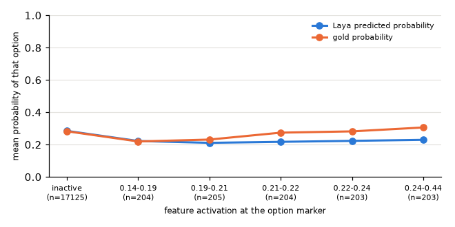

# Feature 2927

Critérios em que aparece: pred_probe_right_laya_wrong_stratified

**Interpretação (preencher):** 

---

## Maiores ativações

**tr_customer_service_000225 / action** (choice, customer_service) | ativação 10.141 em `estado` | opções ['answer_directly', 'close_no_action', 'escalate_to_human', 'execute_refund', 'request_information'] | Laya: **close_no_action** [0.095, 0.85, 0.008, 0.02, 0.028] | gabarito: **request_information**

```
<bos> choice question: What should the assistant do next with this conversation?<eos>
▸ <mask> answer_directly: The assistant can resolve this itself with information it already has.
▸ <mask> close_no_action: No further action is warranted; the matter is settled.
▸ <mask> escalate_to_human: Hand off to a human agent with the appropriate authority.
▸ <mask> execute_refund: Issue the refund or credit the customer is owed.
▸ <mask> request_information: More detail is needed from the customer before anything can be done.

<eos>

 {"account": {"lifetime_value_usd": 419, "prior_tickets_90d": 1, "seats": 1, "tenure_months": 5, "tier": "standard"}, "orders": [{"amount_usd": 99, "date": "2026-01-07", "id": "A-67520", "status": "settled"}, {"amount_usd": 99, "date": "2026-03-11", "id": "A-78780", "status": "settled"}, {"amount_usd": 99, "date": "2026-02-08", "id": "A-39325", "status": "settled"}], "thread": [{"role": "customer", "text": "Hello, I’m writing because I accidentally dropped the $99 device I bought five months ago, and the screen is now completely cracked."}, {"role": "agent", "text": "I’m sorry to hear that your device was damaged. Could you please provide your order number and a brief description of the current display functionality?"}, {"role": "customer", "text": "The order number is #88291, and while the touch screen is unresponsive, the device still⟦ powers⟧ on."}, {"role": "agent", "text": "Thank you for providing those details. Just to ensure I have the full picture, could you tell me if there is any visible damage to the charging port or the frame?"}, {"role": "customer", "text": "No, the frame and charging port look perfectly fine, it is just the screen."}]}<eos>
```

**tr_customer_service_000225 / churn_risk** (score, customer_service) | ativação 10.047 em `estado` | opções ['0', '1', '2', '3'] | Laya: **2** [0.271, 0.298, 0.335, 0.095] | gabarito: **1**

```
<bos> score question: How likely is this customer to stop doing business with us because of this interaction?<eos>
▸ <mask> level 0: No sign of dissatisfaction.
▸ <mask> level 1: Mild frustration, but the relationship is intact.
▸ <mask> level 2: Clearly unhappy; repeat problems or explicit complaints.
▸ <mask> level 3: Imminent: threatening to cancel, dispute or leave.

<eos>

 {"account": {"lifetime_value_usd": 419, "prior_tickets_90d": 1, "seats": 1, "tenure_months": 5, "tier": "standard"}, "orders": [{"amount_usd": 99, "date": "2026-01-07", "id": "A-67520", "status": "settled"}, {"amount_usd": 99, "date": "2026-03-11", "id": "A-78780", "status": "settled"}, {"amount_usd": 99, "date": "2026-02-08", "id": "A-39325", "status": "settled"}], "thread": [{"role": "customer", "text": "Hello, I’m writing because I accidentally dropped the $99 device I bought five months ago, and the screen is now completely cracked."}, {"role": "agent", "text": "I’m sorry to hear that your device was damaged. Could you please provide your order number and a brief description of the current display functionality?"}, {"role": "customer", "text": "The order number is #88291, and while the touch screen is unresponsive, the device still⟦ powers⟧ on."}, {"role": "agent", "text": "Thank you for providing those details. Just to ensure I have the full picture, could you tell me if there is any visible damage to the charging port or the frame?"}, {"role": "customer", "text": "No, the frame and charging port look perfectly fine, it is just the screen."}]}<eos>
```

**tr_customer_service_000225 / urgency** (score, customer_service) | ativação 9.883 em `estado` | opções ['0', '1', '2', '3'] | Laya: **1** [0.25, 0.406, 0.175, 0.169] | gabarito: **1**

```
<bos> score question: How time-sensitive is this conversation?<eos>
▸ <mask> level 0: No time pressure; can wait indefinitely.
▸ <mask> level 1: Routine; handle within the normal queue.
▸ <mask> level 2: Elevated; should be handled within the same week.
▸ <mask> level 3: Critical; requires action within the same day.

<eos>

 {"account": {"lifetime_value_usd": 419, "prior_tickets_90d": 1, "seats": 1, "tenure_months": 5, "tier": "standard"}, "orders": [{"amount_usd": 99, "date": "2026-01-07", "id": "A-67520", "status": "settled"}, {"amount_usd": 99, "date": "2026-03-11", "id": "A-78780", "status": "settled"}, {"amount_usd": 99, "date": "2026-02-08", "id": "A-39325", "status": "settled"}], "thread": [{"role": "customer", "text": "Hello, I’m writing because I accidentally dropped the $99 device I bought five months ago, and the screen is now completely cracked."}, {"role": "agent", "text": "I’m sorry to hear that your device was damaged. Could you please provide your order number and a brief description of the current display functionality?"}, {"role": "customer", "text": "The order number is #88291, and while the touch screen is unresponsive, the device still⟦ powers⟧ on."}, {"role": "agent", "text": "Thank you for providing those details. Just to ensure I have the full picture, could you tell me if there is any visible damage to the charging port or the frame?"}, {"role": "customer", "text": "No, the frame and charging port look perfectly fine, it is just the screen."}]}<eos>
```

**tr_customer_service_000225 / category** (choice, customer_service) | ativação 9.766 em `estado` | opções ['account', 'billing', 'delivery', 'refund', 'technical'] | Laya: **technical** [0.392, 0.086, 0.004, 0.032, 0.486] | gabarito: **technical**

```
<bos> choice question: What is this customer conversation primarily about?<eos>
▸ <mask> account: Login, plan changes, profile or access management.
▸ <mask> billing: A charge, invoice, subscription or payment problem.
▸ <mask> delivery: Shipping, fulfilment or delivery of a physical item.
▸ <mask> refund: The customer is explicitly asking for money back.
▸ <mask> technical: The product or service is not working as expected.

<eos>

 {"account": {"lifetime_value_usd": 419, "prior_tickets_90d": 1, "seats": 1, "tenure_months": 5, "tier": "standard"}, "orders": [{"amount_usd": 99, "date": "2026-01-07", "id": "A-67520", "status": "settled"}, {"amount_usd": 99, "date": "2026-03-11", "id": "A-78780", "status": "settled"}, {"amount_usd": 99, "date": "2026-02-08", "id": "A-39325", "status": "settled"}], "thread": [{"role": "customer", "text": "Hello, I’m writing because I accidentally dropped the $99 device I bought five months ago, and the screen is now completely cracked."}, {"role": "agent", "text": "I’m sorry to hear that your device was damaged. Could you please provide your order number and a brief description of the current display functionality?"}, {"role": "customer", "text": "The order number is #88291, and while the touch screen is unresponsive, the device still⟦ powers⟧ on."}, {"role": "agent", "text": "Thank you for providing those details. Just to ensure I have the full picture, could you tell me if there is any visible damage to the charging port or the frame?"}, {"role": "customer", "text": "No, the frame and charging port look perfectly fine, it is just the screen."}]}<eos>
```

**tr_customer_service_000016 / churn_risk** (score, customer_service) | ativação 9.406 em `estado` | opções ['0', '1', '2', '3'] | Laya: **2** [0.052, 0.392, 0.529, 0.026] | gabarito: **1**

```
<bos> score question: How likely is this customer to stop doing business with us because of this interaction?<eos>
▸ <mask> level 0: No sign of dissatisfaction.
▸ <mask> level 1: Mild frustration, but the relationship is intact.
▸ <mask> level 2: Clearly unhappy; repeat problems or explicit complaints.
▸ <mask> level 3: Imminent: threatening to cancel, dispute or leave.

<eos>

 {"account": {"lifetime_value_usd": 1800, "prior_tickets_90d": 0, "seats": 1, "tenure_months": 41, "tier": "premium"}, "orders": [{"amount_usd": 87, "date": "2026-02-18", "id": "A-57523", "status": "settled"}, {"amount_usd": 87, "date": "2026-01-28", "id": "A-53386", "status": "settled"}, {"amount_usd": 87, "date": "2026-02-26", "id": "A-93511", "status": "failed"}], "thread": [{"role": "customer", "text": "I managed to drop my device on the tile floor this morning and the screen is completely shattered. I've been with you folks for over three years now, so I figured I’d reach out, though I know it’s likely my own fault."}, {"role": "agent", "text": "I am sorry to hear about the damage to your device. I see you are on our premium plan; could you please provide the serial number located on the back of the unit so I can review your account details?"}, {"role": "customer", "text": "I'll have to look for that in a minute. It’s an $87 model, so I suppose I should have been more careful with it. Is there anything that can even be done for something like this?"}, {"role": "agent", "text": "I understand your concern. To help me better assist you, could you describe the extent of the screen fracture and let me know if the device is still⟦ powering⟧ on at all?"}, {"role": "customer", "text": "It won't turn on. Everything is just dark. I don't know, maybe it's just meant to be replaced, but I thought I'd ask before tossing it."}]}<eos>
```

## Ativações medianas (faixa 40-60%, mediana 0.601)

**tr_invoice_processing_000267 / urgency** (score, invoice_processing) | ativação 0.499 em `estado` | opções ['0', '1', '2', '3'] | Laya: **1** [0.104, 0.373, 0.356, 0.168] | gabarito: **2**

```
<bos> score question: How time-sensitive is processing this invoice?<eos>
▸ <mask> level 0: No time pressure; can wait indefinitely.
▸ <mask> level 1: Routine; handle within the normal queue.
▸ <mask> level 2: Elevated; should be handled within the same week.
▸ <mask> level 3: Critical; requires action within the same day.

<eos>

 {"delivery": {"condition": "accepted", "date": "2026-03-04", "received_qty": 250}, "invoice": {"currency": "USD", "id": "INV-2026-4915", "lines": [{"qty": 250, "sku": "SKU-624", "total_usd": 59980.0, "unit_usd": 239.92}], "total_usd": 59980.0, "vendor": "Kestrel Supply"}, "payment": {"days_until_due": 44, "discount_expires_in_days": 4, "early_payment_discount_pct": 2⟦.⟧0, "status": "scheduled", "terms": "net 15"}, "purchase_order": {"freight_terms": "freight prepaid by vendor, not separately billable", "id": null, "lines": [{"qty": 250, "unit_usd": 239.92}], "total_usd": 59980.0}, "vendor_history": {"disputes_12m": 0, "invoices_12m": 29, "prior_invoice_ids": ["INV-2026-6690", "INV-2026-1352", "INV-2026-1118", "INV-2026-2984"]}}<eos>
```

**tr_security_incidents_000265 / urgency** (score, security_incidents) | ativação 0.682 em `pergunta` | opções ['0', '1', '2', '3'] | Laya: **2** [0.141, 0.256, 0.318, 0.285] | gabarito: **3**

```
<bos> score question: How quickly must a responder act⟦ on⟧ this alert?<eos>
▸ <mask> level 0: No time pressure; can wait indefinitely.
▸ <mask> level 1: Routine; handle within the normal queue.
▸ <mask> level 2: Elevated; should be handled within the same week.
▸ <mask> level 3: Critical; requires action within the same day.

<eos>

 {"alert": {"description": "an account granted itself or received elevated permissions", "evidence": "The account assigned to an unprivileged contractor was granted elevated permissions at 11:05 AM from an unrecognized source address. Although multi-factor authentication was enabled and credentials were last rotated 14 days ago, no scheduled change window was present for this administrative action.", "rule": "privilege_escalation"}, "context": {"asset_criticality": "medium", "change_window_active": false, "source_on_allowlist": false}, "history": {"credential_rotation_days_ago": 14, "distinct_countries_30d": 3, "logins_30d": 164, "prior_alerts_90d": 1}, "principal": {"mfa_enrolled": true, "name": "usr-infra-439", "privileges": ["repo:read"], "type": "contractor"}}<eos>
```

**tr_security_incidents_000168 / severity** (score, security_incidents) | ativação 0.686 em `estado` | opções ['0', '1', '2', '3', '4'] | Laya: **2** [0.103, 0.327, 0.338, 0.152, 0.08] | gabarito: **3**

```
<bos> score question: How severe is the potential impact if this alert is real?<eos>
▸ <mask> level 0: Negligible: no access to anything sensitive.
▸ <mask> level 1: Low: limited access, easily reversed.
▸ <mask> level 2: Moderate: access to internal systems or non-public data.
▸ <mask> level 3: High: access to production, secrets or customer data.
▸ <mask> level 4: Critical: active compromise of crown-jewel systems.

<eos>

 {"alert": {"description": "an account granted itself or received elevated permissions", "evidence": "At 2026-09-15 14:23 UTC, employee account jdoe@example.com was added to the privileged Domain Admins group via the AzureAD PowerShell cmdlet Add-ADGroupMember. The operation originated from internal IP 10.2.5.12, which is listed in the allowlist, and occurred within the scheduled change window (14:00‑16:00 UTC). Credential rotation for the account was logged three days earlier.", "rule": "privilege_escalation"}, "context": {"asset_⟦critical⟧ity": "medium", "change_window_active": true, "source_on_allowlist": true}, "history": {"credential_rotation_days_ago": 3, "distinct_countries_30d": 3, "logins_30d": 80, "prior_alerts_90d": 0}, "principal": {"mfa_enrolled": true, "name": "adm-infra-497", "privileges": ["deploy:production", "secrets:read"], "type": "employee"}}<eos>
```

**tr_invoice_processing_000289 / matches_order** (noul, invoice_processing) | ativação 0.631 em `estado` | opções ['false', 'true'] | Laya: **true** [0.039, 0.961] | gabarito: **true**

```
<bos> noul question: The invoice reconciles with the purchase order and the recorded delivery.<eos>
▸ <mask> false: There is a discrepancy against the order or the delivery.
▸ <mask> true: Line items, quantities and amounts reconcile.

<eos>

 {"delivery": {"condition": "accepted with exceptions", "date": "2026-03-27", "received_qty": 100}, "invoice": {"currency": "USD", "id": "INV-2026-8801", "lines": [{"qty": 100, "sku": "SKU-986", "total_usd": 27049.0, "unit_usd": 270.49}], "total_usd": 27049.0, "vendor": "Orbit Logistics"}, "payment": {"days_until_due": 18, "discount_expires_in_days": 4, "early_payment_discount_pct": 2⟦.⟧0, "status": "scheduled", "terms": "net 30"}, "purchase_order": {"freight_terms": "freight prepaid by vendor, not separately billable", "id": "PO-5260", "lines": [{"qty": 100, "unit_usd": 270.49}], "total_usd": 27049.0}, "vendor_history": {"disputes_12m": 5, "invoices_12m": 52, "prior_invoice_ids": ["INV-2026-2893", "INV-2026-9152", "INV-2026-3271", "INV-2026-5562"]}}<eos>
```

**tr_security_incidents_000026 / disposition** (choice, security_incidents) | ativação 0.654 em `estado` | opções ['close_benign', 'contain', 'investigate', 'monitor'] | Laya: **contain** [0.026, 0.53, 0.028, 0.416] | gabarito: **monitor**

```
<bos> choice question: How should this security alert be dispositioned?<eos>
▸ <mask> close_benign: Expected, explainable activity; close without analyst time.
▸ <mask> contain: Contain the host or account immediately; do not wait for triage.
▸ <mask> investigate: Warrants an analyst opening an investigation.
▸ <mask> monitor: Not clearly malicious, but worth watching for recurrence.

<eos>

 {"alert": {"description": "a first-ever sign-in from an unfamiliar country", "evidence": "The CI runner account initiated a sign-in session from a country that has no prior history of authentication for this principal. This event was observed from an allowlisted source, following a credential rotation period of 700 days.", "rule": "new_country_login"}, "context": {"asset_criticality": "low", "change_window_active": false, "source_on_allowlist": true}, "history": {"credential_rotation_days_ago": 700, "distinct_countries_30d": 2, "logins_30d": 3⟦8⟧5, "prior_alerts_90d": 1}, "principal": {"mfa_enrolled": true, "name": "usr-infra-839", "privileges": ["repo:read"], "type": "ci_runner"}}<eos>
```

## Estatísticas (conjunto de descoberta, dev e teste)

**pred / error**

| split | decisões | ativas | ativas e Laya errou | taxa | lift | q (BH) | OR (CMH) | q (CMH) |
|---|---|---|---|---|---|---|---|---|
| discovery | 5100 | 220 | 159 | 0.723 | 1.12 | 0.0226 | 1.59 | 0.138 |
| dev | 900 | 34 | 24 | 0.706 | 1.05 | 0.924 | 1.19 | 0.873 |
| test | 2000 | 85 | 63 | 0.741 | 1.14 | 0.127 | 1.73 | 0.411 |

**corr / error**

| split | decisões | ativas | ativas e Laya errou | taxa | lift | q (BH) | OR (CMH) | q (CMH) |
|---|---|---|---|---|---|---|---|---|
| discovery | 5100 | 284 | 223 | 0.785 | 1.22 | 3.72e-07 | 0.90 | 0.748 |
| dev | 900 | 47 | 37 | 0.787 | 1.17 | 0.171 | 0.96 | 0.982 |
| test | 2000 | 113 | 91 | 0.805 | 1.24 | 0.000684 | 0.79 | 0.797 |

**state / error**

| split | decisões | ativas | ativas e Laya errou | taxa | lift | q (BH) | OR (CMH) | q (CMH) |
|---|---|---|---|---|---|---|---|---|
| discovery | 5100 | 2771 | 1793 | 0.647 | 1.01 | 0.774 | 1.17 | 0.157 |
| dev | 900 | 502 | 345 | 0.687 | 1.02 | 0.67 | 1.49 | 0.213 |
| test | 2000 | 1075 | 693 | 0.645 | 0.99 | 0.842 | 1.06 | 0.878 |

**pred / probe_right_laya_wrong**

| split | decisões | ativas | ativas e Laya errou | taxa | lift | q (BH) | OR (CMH) | q (CMH) |
|---|---|---|---|---|---|---|---|---|
| discovery | 2819 | 119 | 95 | 0.798 | 1.23 | 0.000628 | 2.66 | 0.0098 |
| dev | 520 | 16 | 13 | 0.812 | 1.20 | nan | nan | nan |
| test | 1106 | 45 | 35 | 0.778 | 1.23 | 0.0804 | 2.27 | 0.423 |

**corr / probe_right_laya_wrong**

| split | decisões | ativas | ativas e Laya errou | taxa | lift | q (BH) | OR (CMH) | q (CMH) |
|---|---|---|---|---|---|---|---|---|
| discovery | 2819 | 152 | 128 | 0.842 | 1.30 | 1.66e-07 | 1.15 | 0.824 |
| dev | 520 | 27 | 24 | 0.889 | 1.32 | 0.0309 | 2.80 | 0.62 |
| test | 1106 | 65 | 55 | 0.846 | 1.34 | 0.000393 | 0.92 | 0.978 |

**state / probe_right_laya_wrong**

| split | decisões | ativas | ativas e Laya errou | taxa | lift | q (BH) | OR (CMH) | q (CMH) |
|---|---|---|---|---|---|---|---|---|
| discovery | 2819 | 1590 | 1040 | 0.654 | 1.01 | 0.534 | 1.28 | 0.0704 |
| dev | 520 | 297 | 204 | 0.687 | 1.02 | 0.871 | 1.53 | 0.257 |
| test | 1106 | 623 | 398 | 0.639 | 1.01 | 0.895 | 1.19 | 0.565 |

Confusão mais sobre-representada (pred): `severity|2>3` (n=28, lift 17.08, p=3.48e-31). Formato `pergunta|índice previsto>índice correto`.

Confusão mais sobre-representada (corr): `severity|1>3` (n=64, lift 16.19, p=0). Formato `pergunta|índice previsto>índice correto`.

Confusão mais sobre-representada (state): `needs_review|0>1` (n=94, lift 1.65, p=3.75e-15). Formato `pergunta|índice previsto>índice correto`.



