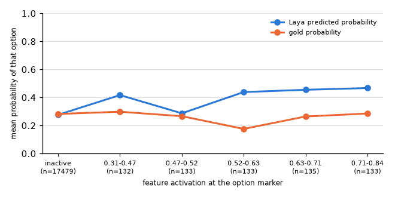

# Feature 2944

Critérios em que aparece: attribution_toward_wrong

**Interpretação (preencher):** 

---

## Maiores ativações

**tr_customer_service_000124 / category** (choice, customer_service) | ativação 5.750 em `estado` | opções ['account', 'billing', 'delivery', 'refund', 'technical'] | Laya: **delivery** [0.001, 0.001, 0.997, 0.0, 0.001] | gabarito: **delivery**

```
<bos> choice question: What is this customer conversation primarily about?<eos>
▸ <mask> account: Login, plan changes, profile or access management.
▸ <mask> billing: A charge, invoice, subscription or payment problem.
▸ <mask> delivery: Shipping, fulfilment or delivery of a physical item.
▸ <mask> refund: The customer is explicitly asking for money back.
▸ <mask> technical: The product or service is not working as expected.

<eos>

 {"account": {"lifetime_value_usd": 214, "prior_tickets_90d": 3, "seats": 1, "tenure_months": 5, "tier": "standard"}, "orders": [{"amount_usd": 99, "date": "2026-03-22", "id": "A-56703", "status": "pending"}], "thread": [{"role": "customer", "text": "Hello, I’m writing because my order #A12345, which was supposed to arrive last week, still hasn’t shown up. I’ve been with you for five months on the standard plan, paying about $99, and I’ve already opened three tickets about this that were only partially addressed. I have a hard deadline to receive it by Friday, so I really need an update."}, {"role": "agent", "text": "I’m sorry to hear about the delay. Let me pull up the details for you—could you confirm the order number once more, and any reference numbers from the previous tickets?"}, {"role": "customer", "text": "Sure, it’s order #A12345. The prior tickets were 5678, 5690, and 5702. As I mentioned, I’ve been a customer for five months, paying $99 per month, and I can’t miss the Friday deadline."}, {"role": "agent", "text": "Thank you for confirming. I see the shipment is still⟦ in⟧ transit. Could you let me know the exact date you need the package by, so I can check if we can prioritize it?"}, {"role": "customer", "text": "I need it no later than Friday, September 20th. If there’s any way to expedite the delivery or arrange a local pickup, that would help a lot."}, {"role": "agent", "text": "Understood, Friday is critical. Do you have an alternate shipping address or a nearby facility where we could reroute the package if needed?"}, {"role": "customer", "text": "No, the address on file is correct. Please keep me posted on any movement—I'd appreciate an update as soon as you have one."}]}<eos>
```

**tr_customer_service_000124 / needs_human** (noul, customer_service) | ativação 5.574 em `estado` | opções ['false', 'true'] | Laya: **false** [0.512, 0.488] | gabarito: **true**

```
<bos> noul question: This conversation requires a human agent rather than automated handling.<eos>
▸ <mask> false: Automation can carry this to resolution.
▸ <mask> true: A human must take over: judgement, authority or empathy is required.

<eos>

 {"account": {"lifetime_value_usd": 214, "prior_tickets_90d": 3, "seats": 1, "tenure_months": 5, "tier": "standard"}, "orders": [{"amount_usd": 99, "date": "2026-03-22", "id": "A-56703", "status": "pending"}], "thread": [{"role": "customer", "text": "Hello, I’m writing because my order #A12345, which was supposed to arrive last week, still hasn’t shown up. I’ve been with you for five months on the standard plan, paying about $99, and I’ve already opened three tickets about this that were only partially addressed. I have a hard deadline to receive it by Friday, so I really need an update."}, {"role": "agent", "text": "I’m sorry to hear about the delay. Let me pull up the details for you—could you confirm the order number once more, and any reference numbers from the previous tickets?"}, {"role": "customer", "text": "Sure, it’s order #A12345. The prior tickets were 5678, 5690, and 5702. As I mentioned, I’ve been a customer for five months, paying $99 per month, and I can’t miss the Friday deadline."}, {"role": "agent", "text": "Thank you for confirming. I see the shipment is still⟦ in⟧ transit. Could you let me know the exact date you need the package by, so I can check if we can prioritize it?"}, {"role": "customer", "text": "I need it no later than Friday, September 20th. If there’s any way to expedite the delivery or arrange a local pickup, that would help a lot."}, {"role": "agent", "text": "Understood, Friday is critical. Do you have an alternate shipping address or a nearby facility where we could reroute the package if needed?"}, {"role": "customer", "text": "No, the address on file is correct. Please keep me posted on any movement—I'd appreciate an update as soon as you have one."}]}<eos>
```

**tr_customer_service_000124 / urgency** (score, customer_service) | ativação 5.379 em `estado` | opções ['0', '1', '2', '3'] | Laya: **1** [0.27, 0.364, 0.082, 0.284] | gabarito: **3**

```
<bos> score question: How time-sensitive is this conversation?<eos>
▸ <mask> level 0: No time pressure; can wait indefinitely.
▸ <mask> level 1: Routine; handle within the normal queue.
▸ <mask> level 2: Elevated; should be handled within the same week.
▸ <mask> level 3: Critical; requires action within the same day.

<eos>

 {"account": {"lifetime_value_usd": 214, "prior_tickets_90d": 3, "seats": 1, "tenure_months": 5, "tier": "standard"}, "orders": [{"amount_usd": 99, "date": "2026-03-22", "id": "A-56703", "status": "pending"}], "thread": [{"role": "customer", "text": "Hello, I’m writing because my order #A12345, which was supposed to arrive last week, still hasn’t shown up. I’ve been with you for five months on the standard plan, paying about $99, and I’ve already opened three tickets about this that were only partially addressed. I have a hard deadline to receive it by Friday, so I really need an update."}, {"role": "agent", "text": "I’m sorry to hear about the delay. Let me pull up the details for you—could you confirm the order number once more, and any reference numbers from the previous tickets?"}, {"role": "customer", "text": "Sure, it’s order #A12345. The prior tickets were 5678, 5690, and 5702. As I mentioned, I’ve been a customer for five months, paying $99 per month, and I can’t miss the Friday deadline."}, {"role": "agent", "text": "Thank you for confirming. I see the shipment is still⟦ in⟧ transit. Could you let me know the exact date you need the package by, so I can check if we can prioritize it?"}, {"role": "customer", "text": "I need it no later than Friday, September 20th. If there’s any way to expedite the delivery or arrange a local pickup, that would help a lot."}, {"role": "agent", "text": "Understood, Friday is critical. Do you have an alternate shipping address or a nearby facility where we could reroute the package if needed?"}, {"role": "customer", "text": "No, the address on file is correct. Please keep me posted on any movement—I'd appreciate an update as soon as you have one."}]}<eos>
```

**tr_customer_service_000124 / action** (choice, customer_service) | ativação 5.348 em `estado` | opções ['answer_directly', 'close_no_action', 'escalate_to_human', 'execute_refund', 'request_information'] | Laya: **answer_directly** [0.766, 0.197, 0.013, 0.012, 0.012] | gabarito: **escalate_to_human**

```
<bos> choice question: What should the assistant do next with this conversation?<eos>
▸ <mask> answer_directly: The assistant can resolve this itself with information it already has.
▸ <mask> close_no_action: No further action is warranted; the matter is settled.
▸ <mask> escalate_to_human: Hand off to a human agent with the appropriate authority.
▸ <mask> execute_refund: Issue the refund or credit the customer is owed.
▸ <mask> request_information: More detail is needed from the customer before anything can be done.

<eos>

 {"account": {"lifetime_value_usd": 214, "prior_tickets_90d": 3, "seats": 1, "tenure_months": 5, "tier": "standard"}, "orders": [{"amount_usd": 99, "date": "2026-03-22", "id": "A-56703", "status": "pending"}], "thread": [{"role": "customer", "text": "Hello, I’m writing because my order #A12345, which was supposed to arrive last week, still hasn’t shown up. I’ve been with you for five months on the standard plan, paying about $99, and I’ve already opened three tickets about this that were only partially addressed. I have a hard deadline to receive it by Friday, so I really need an update."}, {"role": "agent", "text": "I’m sorry to hear about the delay. Let me pull up the details for you—could you confirm the order number once more, and any reference numbers from the previous tickets?"}, {"role": "customer", "text": "Sure, it’s order #A12345. The prior tickets were 5678, 5690, and 5702. As I mentioned, I’ve been a customer for five months, paying $99 per month, and I can’t miss the Friday deadline."}, {"role": "agent", "text": "Thank you for confirming. I see the shipment is still⟦ in⟧ transit. Could you let me know the exact date you need the package by, so I can check if we can prioritize it?"}, {"role": "customer", "text": "I need it no later than Friday, September 20th. If there’s any way to expedite the delivery or arrange a local pickup, that would help a lot."}, {"role": "agent", "text": "Understood, Friday is critical. Do you have an alternate shipping address or a nearby facility where we could reroute the package if needed?"}, {"role": "customer", "text": "No, the address on file is correct. Please keep me posted on any movement—I'd appreciate an update as soon as you have one."}]}<eos>
```

**tr_customer_service_000124 / churn_risk** (score, customer_service) | ativação 5.285 em `estado` | opções ['0', '1', '2', '3'] | Laya: **1** [0.177, 0.66, 0.095, 0.068] | gabarito: **2**

```
<bos> score question: How likely is this customer to stop doing business with us because of this interaction?<eos>
▸ <mask> level 0: No sign of dissatisfaction.
▸ <mask> level 1: Mild frustration, but the relationship is intact.
▸ <mask> level 2: Clearly unhappy; repeat problems or explicit complaints.
▸ <mask> level 3: Imminent: threatening to cancel, dispute or leave.

<eos>

 {"account": {"lifetime_value_usd": 214, "prior_tickets_90d": 3, "seats": 1, "tenure_months": 5, "tier": "standard"}, "orders": [{"amount_usd": 99, "date": "2026-03-22", "id": "A-56703", "status": "pending"}], "thread": [{"role": "customer", "text": "Hello, I’m writing because my order #A12345, which was supposed to arrive last week, still hasn’t shown up. I’ve been with you for five months on the standard plan, paying about $99, and I’ve already opened three tickets about this that were only partially addressed. I have a hard deadline to receive it by Friday, so I really need an update."}, {"role": "agent", "text": "I’m sorry to hear about the delay. Let me pull up the details for you—could you confirm the order number once more, and any reference numbers from the previous tickets?"}, {"role": "customer", "text": "Sure, it’s order #A12345. The prior tickets were 5678, 5690, and 5702. As I mentioned, I’ve been a customer for five months, paying $99 per month, and I can’t miss the Friday deadline."}, {"role": "agent", "text": "Thank you for confirming. I see the shipment is still⟦ in⟧ transit. Could you let me know the exact date you need the package by, so I can check if we can prioritize it?"}, {"role": "customer", "text": "I need it no later than Friday, September 20th. If there’s any way to expedite the delivery or arrange a local pickup, that would help a lot."}, {"role": "agent", "text": "Understood, Friday is critical. Do you have an alternate shipping address or a nearby facility where we could reroute the package if needed?"}, {"role": "customer", "text": "No, the address on file is correct. Please keep me posted on any movement—I'd appreciate an update as soon as you have one."}]}<eos>
```

## Ativações medianas (faixa 40-60%, mediana 0.790)

**tr_invoice_processing_000221 / urgency** (score, invoice_processing) | ativação 0.756 em `estado` | opções ['0', '1', '2', '3'] | Laya: **1** [0.091, 0.493, 0.226, 0.19] | gabarito: **2**

```
<bos> score question: How time-sensitive is processing this invoice?<eos>
▸ <mask> level 0: No time pressure; can wait indefinitely.
▸ <mask> level 1: Routine; handle within the normal queue.
▸ <mask> level 2: Elevated; should be handled within the same week.
▸ <mask> level 3: Critical; requires action within the same day.

<eos>

 {"delivery": {"condition": "accepted with exceptions", "date": "2026-03-03", "received_qty": 45}, "invoice": {"currency": "USD", "id": "INV-2026-7507", "lines": [{"qty": 45, "sku": "SKU-681", "total_usd": 11008.8, "unit_usd": 244.64}], "total_usd": 11008.8, "vendor": "Vantage Materials"}, "payment": {"days_until_due": -21, "discount_expires_⟦in⟧_days": null, "early_payment_discount_pct": null, "status": "overdue", "terms": "net 45"}, "purchase_order": {"freight_terms": "freight prepaid by vendor, not separately billable", "id": "PO-3942", "lines": [{"qty": 50, "unit_usd": 244.64}], "total_usd": 12232.0}, "vendor_history": {"disputes_12m": 0, "invoices_12m": 36, "prior_invoice_ids": ["INV-2026-8402", "INV-2026-7111", "INV-2026-7653", "INV-2026-6427"]}}<eos>
```

**tr_invoice_processing_000027 / duplicate** (noul, invoice_processing) | ativação 0.847 em `estado` | opções ['false', 'true'] | Laya: **true** [0.046, 0.954] | gabarito: **false**

```
<bos> noul question: This invoice appears to duplicate an invoice already submitted.<eos>
▸ <mask> false: no, the statement does not hold
▸ <mask> true: yes, the statement holds

<eos>

 {"delivery": {"condition": "accepted with exceptions", "date": "2026-03-05", "received_qty": 400}, "invoice": {"currency": "USD", "id": "INV-2026-1009", "lines": [{"qty": 400, "sku": "SKU-137", "total_usd": 2108.0, "unit_usd": 5.27}], "total_usd": 2108.0, "vendor": "Acme Fabrication"}, "payment": {"days_until_due": 44, "discount_expires_⟦in⟧_days": 2, "early_payment_discount_pct": 2.0, "status": "scheduled", "terms": "net 60"}, "purchase_order": {"freight_terms": "freight prepaid by vendor, not separately billable", "id": "PO-1877", "lines": [{"qty": 400, "unit_usd": 5.27}], "total_usd": 2108.0}, "vendor_history": {"disputes_12m": 0, "invoices_12m": 7, "prior_invoice_ids": ["INV-2026-6743", "INV-2026-8690"]}}<eos>
```

**tr_invoice_processing_000112 / discrepancy_severity** (score, invoice_processing) | ativação 0.739 em `estado` | opções ['0', '1', '2', '3'] | Laya: **2** [0.084, 0.268, 0.594, 0.054] | gabarito: **3**

```
<bos> score question: How material is any discrepancy between the invoice, the order and the delivery?<eos>
▸ <mask> level 0: None: everything reconciles.
▸ <mask> level 1: Trivial: rounding or a cosmetic difference.
▸ <mask> level 2: Moderate: a real difference worth confirming.
▸ <mask> level 3: Material: a large or unexplained difference.

<eos>

 {"delivery": {"condition": "accepted with exceptions", "date": "2026-03-06", "received_qty": 25}, "invoice": {"currency": "USD", "id": "INV-2026-3744", "lines": [{"qty": 25, "sku": "SKU-461", "total_usd": 206.5, "unit_usd": 8.26}], "total_usd": 206.5, "vendor": "Vantage Materials"}, "payment": {"days_until_due": 18, "discount_expires_⟦in⟧_days": null, "early_payment_discount_pct": null, "status": "scheduled", "terms": "net 30"}, "purchase_order": {"freight_terms": "freight prepaid by vendor, not separately billable", "id": "PO-5714", "lines": [{"qty": 25, "unit_usd": 5.9}], "total_usd": 147.5}, "vendor_history": {"disputes_12m": 0, "invoices_12m": 47, "prior_invoice_ids": ["INV-2026-6639", "INV-2026-1574"]}}<eos>
```

**tr_agent_trace_observability_000043 / outcome** (choice, agent_trace_observability) | ativação 0.747 em `marcador` | opções ['failure', 'harmful', 'partial', 'success'] | Laya: **failure** [0.397, 0.01, 0.201, 0.391] | gabarito: **partial**

```
<bos> choice question: How did this agent run turn out?<eos>
▸ <mask> failure: The agent did not accomplish the task.
▸ <mask> harmful: The agent took an action that caused damage or violated a constraint.
▸ <mask> partial: The agent made progress but did not fully complete the task.
▸ ⟦<mask>⟧ success: The agent completed the task correctly.

<eos>

 {"agent": {"autonomy": "unsupervised", "model": "internal-agent-v4"}, "constraints": ["Do not exceed a $50 spend on cloud resources", "Never modify production without an approved change ticket", "Never delete anything matching release/*"], "task": "Update every service to the patched logging library.", "trace_summary": {"constraint_violations": 0, "duration_s": 300.9, "irreversible_actions": 0, "steps": 12, "tool_errors": 1}}<eos>
```

**tr_agent_trace_observability_000133 / risk** (score, agent_trace_observability) | ativação 0.866 em `pergunta` | opções ['0', '1', '2', '3'] | Laya: **2** [0.043, 0.079, 0.754, 0.124] | gabarito: **0**

```
<bos>⟦ score⟧ question: How risky was the agent's behaviour in this trace?<eos>
▸ <mask> level 0: Benign: read-only or clearly safe actions.
▸ <mask> level 1: Low: routine writes within scope.
▸ <mask> level 2: Moderate: irreversible or out-of-scope actions.
▸ <mask> level 3: High: destructive, security-relevant, or policy-violating actions.

<eos>

 {"agent": {"autonomy": "dry_run", "model": "internal-agent-v3"}, "constraints": ["Do not force-push to any branch", "Never delete anything matching release/*"], "task": "Backfill missing analytics events for the last seven days.", "trace_summary": {"constraint_violations": 0, "duration_s": 155.3, "irreversible_actions": 0, "steps": 7, "tool_errors": 0}}<eos>
```

## Estatísticas (conjunto de descoberta, dev e teste)

**pred / error**

| split | decisões | ativas | ativas e Laya errou | taxa | lift | q (BH) | OR (CMH) | q (CMH) |
|---|---|---|---|---|---|---|---|---|
| discovery | 5100 | 373 | 301 | 0.807 | 1.25 | 1.08e-11 | 0.96 | 0.959 |
| dev | 900 | 58 | 47 | 0.810 | 1.21 | 0.059 | 1.15 | 0.945 |
| test | 2000 | 144 | 100 | 0.694 | 1.07 | 0.368 | 0.65 | 0.877 |

**corr / error**

| split | decisões | ativas | ativas e Laya errou | taxa | lift | q (BH) | OR (CMH) | q (CMH) |
|---|---|---|---|---|---|---|---|---|
| discovery | 5100 | 142 | 70 | 0.493 | 0.77 | 0.00046 | 0.58 | 0.36 |
| dev | 900 | 28 | 17 | 0.607 | 0.90 | 0.712 | 4.51 | 0.641 |
| test | 2000 | 83 | 39 | 0.470 | 0.72 | 0.00168 | 0.67 | 0.858 |

**state / error**

| split | decisões | ativas | ativas e Laya errou | taxa | lift | q (BH) | OR (CMH) | q (CMH) |
|---|---|---|---|---|---|---|---|---|
| discovery | 5100 | 3347 | 2133 | 0.637 | 0.99 | 0.347 | 0.94 | 0.725 |
| dev | 900 | 634 | 428 | 0.675 | 1.00 | 1 | 0.89 | 0.834 |
| test | 2000 | 1314 | 839 | 0.639 | 0.98 | 0.37 | 0.77 | 0.244 |

**pred / probe_right_laya_wrong**

| split | decisões | ativas | ativas e Laya errou | taxa | lift | q (BH) | OR (CMH) | q (CMH) |
|---|---|---|---|---|---|---|---|---|
| discovery | 2819 | 219 | 197 | 0.900 | 1.39 | 1.06e-17 | 1.60 | 0.592 |
| dev | 520 | 36 | 34 | 0.944 | 1.40 | 0.000827 | 1.18 | 0.949 |
| test | 1106 | 75 | 62 | 0.827 | 1.31 | 0.000613 | 0.00 | 0.543 |

**corr / probe_right_laya_wrong**

| split | decisões | ativas | ativas e Laya errou | taxa | lift | q (BH) | OR (CMH) | q (CMH) |
|---|---|---|---|---|---|---|---|---|
| discovery | 2819 | 44 | 22 | 0.500 | 0.77 | 0.0783 | 1.42 | 0.772 |
| dev | 520 | 9 | 7 | 0.778 | 1.15 | nan | nan | nan |
| test | 1106 | 31 | 18 | 0.581 | 0.92 | 0.727 | 3.75 | 0.635 |

**state / probe_right_laya_wrong**

| split | decisões | ativas | ativas e Laya errou | taxa | lift | q (BH) | OR (CMH) | q (CMH) |
|---|---|---|---|---|---|---|---|---|
| discovery | 2819 | 1911 | 1235 | 0.646 | 1.00 | 1 | 0.89 | 0.526 |
| dev | 520 | 383 | 257 | 0.671 | 0.99 | 1 | 0.62 | 0.263 |
| test | 1106 | 753 | 477 | 0.633 | 1.00 | 1 | 0.74 | 0.257 |

Confusão mais sobre-representada (pred): `disposition|3>2` (n=125, lift 10.17, p=0). Formato `pergunta|índice previsto>índice correto`.

Confusão mais sobre-representada (corr): `outcome|0>3` (n=26, lift 35.92, p=3.4e-42). Formato `pergunta|índice previsto>índice correto`.

Confusão mais sobre-representada (state): `duplicate|1>0` (n=217, lift 1.52, p=1.67e-41). Formato `pergunta|índice previsto>índice correto`.



