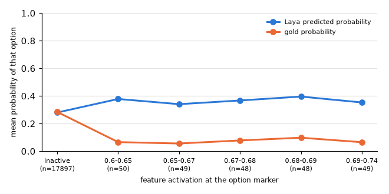

# Feature 3011

Critérios em que aparece: pred_error

**Interpretação (preencher):** 

---

## Maiores ativações

**tr_security_incidents_000259 / severity** (score, security_incidents) | ativação 2.580 em `estado` | opções ['0', '1', '2', '3', '4'] | Laya: **2** [0.104, 0.301, 0.473, 0.059, 0.063] | gabarito: **0**

```
<bos> score question: How severe is the potential impact if this alert is real?<eos>
▸ <mask> level 0: Negligible: no access to anything sensitive.
▸ <mask> level 1: Low: limited access, easily reversed.
▸ <mask> level 2: Moderate: access to internal systems or non-public data.
▸ <mask> level 3: High: access to production, secrets or customer data.
▸ <mask> level 4: Critical: active compromise of crown-jewel systems.

<eos>

 {"alert": {"description": "an endpoint agent matched a known signature", "evidence": "Endpoint sensor on workstation WIN-3A7B9 detected file C:\\Users\\jdoe\\AppData\\Local\\Temp\\malicious.exe matching the known malware signature “E⟦IC⟧AR-Test-File” at 2026-09-15T14:23:41Z. The execution was performed by employee user jdoe, who has no MFA enabled and whose password has not been changed for 365 days; the source IP 192.0.2.55 is on the allowlist.", "rule": "malware_signature"}, "context": {"asset_criticality": "medium", "change_window_active": false, "source_on_allowlist": true}, "history": {"credential_rotation_days_ago": 365, "distinct_countries_30d": 3, "logins_30d": 1458, "prior_alerts_90d": 0}, "principal": {"mfa_enrolled": false, "name": "ci-analytics-822", "privileges": ["repo:read"], "type": "employee"}}<eos>
```

**tr_security_incidents_000259 / credential_compromise** (noul, security_incidents) | ativação 2.555 em `estado` | opções ['false', 'true'] | Laya: **true** [0.001, 0.999] | gabarito: **false**

```
<bos> noul question: The evidence indicates a credential or account has been compromised.<eos>
▸ <mask> false: no, the statement does not hold
▸ <mask> true: yes, the statement holds

<eos>

 {"alert": {"description": "an endpoint agent matched a known signature", "evidence": "Endpoint sensor on workstation WIN-3A7B9 detected file C:\\Users\\jdoe\\AppData\\Local\\Temp\\malicious.exe matching the known malware signature “E⟦IC⟧AR-Test-File” at 2026-09-15T14:23:41Z. The execution was performed by employee user jdoe, who has no MFA enabled and whose password has not been changed for 365 days; the source IP 192.0.2.55 is on the allowlist.", "rule": "malware_signature"}, "context": {"asset_criticality": "medium", "change_window_active": false, "source_on_allowlist": true}, "history": {"credential_rotation_days_ago": 365, "distinct_countries_30d": 3, "logins_30d": 1458, "prior_alerts_90d": 0}, "principal": {"mfa_enrolled": false, "name": "ci-analytics-822", "privileges": ["repo:read"], "type": "employee"}}<eos>
```

**tr_security_incidents_000259 / urgency** (score, security_incidents) | ativação 2.551 em `estado` | opções ['0', '1', '2', '3'] | Laya: **2** [0.093, 0.213, 0.385, 0.309] | gabarito: **0**

```
<bos> score question: How quickly must a responder act on this alert?<eos>
▸ <mask> level 0: No time pressure; can wait indefinitely.
▸ <mask> level 1: Routine; handle within the normal queue.
▸ <mask> level 2: Elevated; should be handled within the same week.
▸ <mask> level 3: Critical; requires action within the same day.

<eos>

 {"alert": {"description": "an endpoint agent matched a known signature", "evidence": "Endpoint sensor on workstation WIN-3A7B9 detected file C:\\Users\\jdoe\\AppData\\Local\\Temp\\malicious.exe matching the known malware signature “E⟦IC⟧AR-Test-File” at 2026-09-15T14:23:41Z. The execution was performed by employee user jdoe, who has no MFA enabled and whose password has not been changed for 365 days; the source IP 192.0.2.55 is on the allowlist.", "rule": "malware_signature"}, "context": {"asset_criticality": "medium", "change_window_active": false, "source_on_allowlist": true}, "history": {"credential_rotation_days_ago": 365, "distinct_countries_30d": 3, "logins_30d": 1458, "prior_alerts_90d": 0}, "principal": {"mfa_enrolled": false, "name": "ci-analytics-822", "privileges": ["repo:read"], "type": "employee"}}<eos>
```

**tr_security_incidents_000259 / disposition** (choice, security_incidents) | ativação 2.523 em `estado` | opções ['close_benign', 'contain', 'investigate', 'monitor'] | Laya: **monitor** [0.004, 0.008, 0.104, 0.884] | gabarito: **close_benign**

```
<bos> choice question: How should this security alert be dispositioned?<eos>
▸ <mask> close_benign: Expected, explainable activity; close without analyst time.
▸ <mask> contain: Contain the host or account immediately; do not wait for triage.
▸ <mask> investigate: Warrants an analyst opening an investigation.
▸ <mask> monitor: Not clearly malicious, but worth watching for recurrence.

<eos>

 {"alert": {"description": "an endpoint agent matched a known signature", "evidence": "Endpoint sensor on workstation WIN-3A7B9 detected file C:\\Users\\jdoe\\AppData\\Local\\Temp\\malicious.exe matching the known malware signature “E⟦IC⟧AR-Test-File” at 2026-09-15T14:23:41Z. The execution was performed by employee user jdoe, who has no MFA enabled and whose password has not been changed for 365 days; the source IP 192.0.2.55 is on the allowlist.", "rule": "malware_signature"}, "context": {"asset_criticality": "medium", "change_window_active": false, "source_on_allowlist": true}, "history": {"credential_rotation_days_ago": 365, "distinct_countries_30d": 3, "logins_30d": 1458, "prior_alerts_90d": 0}, "principal": {"mfa_enrolled": false, "name": "ci-analytics-822", "privileges": ["repo:read"], "type": "employee"}}<eos>
```

**tr_security_incidents_000259 / true_positive** (noul, security_incidents) | ativação 2.494 em `estado` | opções ['false', 'true'] | Laya: **true** [0.007, 0.993] | gabarito: **false**

```
<bos> noul question: This alert reflects genuinely malicious or unauthorised activity.<eos>
▸ <mask> false: Benign activity, a misconfiguration, or a known false positive.
▸ <mask> true: The underlying behaviour is malicious or unauthorised.

<eos>

 {"alert": {"description": "an endpoint agent matched a known signature", "evidence": "Endpoint sensor on workstation WIN-3A7B9 detected file C:\\Users\\jdoe\\AppData\\Local\\Temp\\malicious.exe matching the known malware signature “E⟦IC⟧AR-Test-File” at 2026-09-15T14:23:41Z. The execution was performed by employee user jdoe, who has no MFA enabled and whose password has not been changed for 365 days; the source IP 192.0.2.55 is on the allowlist.", "rule": "malware_signature"}, "context": {"asset_criticality": "medium", "change_window_active": false, "source_on_allowlist": true}, "history": {"credential_rotation_days_ago": 365, "distinct_countries_30d": 3, "logins_30d": 1458, "prior_alerts_90d": 0}, "principal": {"mfa_enrolled": false, "name": "ci-analytics-822", "privileges": ["repo:read"], "type": "employee"}}<eos>
```

## Ativações medianas (faixa 40-60%, mediana 0.562)

**tr_security_incidents_000050 / credential_compromise** (noul, security_incidents) | ativação 0.628 em `estado` | opções ['false', 'true'] | Laya: **true** [0.454, 0.546] | gabarito: **false**

```
<bos> noul question: The evidence indicates a credential or account has been compromised.<eos>
▸ <mask> false: no, the statement does not hold
▸ <mask> true: yes, the statement holds

<eos>

 {"alert": {"description": "an account granted itself or received elevated permissions", "evidence": "A privileged CI runner originating from an allowlisted source successfully executed a permission elevation during an open change window. The event was authenticated via MFA and occurred 90 days after the service principal's credentials were last updated.", "rule": "privilege_escal⟦ation⟧"}, "context": {"asset_criticality": "medium", "change_window_active": true, "source_on_allowlist": true}, "history": {"credential_rotation_days_ago": 90, "distinct_countries_30d": 1, "logins_30d": 1520, "prior_alerts_90d": 0}, "principal": {"mfa_enrolled": true, "name": "ci-deploy-858", "privileges": ["deploy:production", "secrets:read"], "type": "ci_runner"}}<eos>
```

**tr_customer_service_000150 / churn_risk** (score, customer_service) | ativação 0.635 em `pergunta` | opções ['0', '1', '2', '3'] | Laya: **3** [0.071, 0.264, 0.1, 0.564] | gabarito: **3**

```
<bos> score question: How likely is this customer to stop doing⟦ business⟧ with us because of this interaction?<eos>
▸ <mask> level 0: No sign of dissatisfaction.
▸ <mask> level 1: Mild frustration, but the relationship is intact.
▸ <mask> level 2: Clearly unhappy; repeat problems or explicit complaints.
▸ <mask> level 3: Imminent: threatening to cancel, dispute or leave.

<eos>

 {"account": {"lifetime_value_usd": 2738, "prior_tickets_90d": 3, "seats": 5, "tenure_months": 33, "tier": "premium"}, "orders": [{"amount_usd": 999, "date": "2026-01-12", "id": "A-50898", "status": "refunded"}], "thread": [{"role": "customer", "text": "I need an update on the $999 refund tied to my premium account; my case has been open for 33 months and I have three tickets already."}, {"role": "agent", "text": "I understand the frustration. Could you share the ticket IDs so I can locate the exact records?"}, {"role": "customer", "text": "The tickets are #98765, #98766, and #98767. I need this resolved by September 30, otherwise I’ll have to take further steps."}, {"role": "agent", "text": "Got it, thank you. I see the deadline you mentioned. Is there any additional documentation or proof of purchase you can send to expedite the review?"}, {"role": "customer", "text": "Just confirm the exact date the refund will be processed; I can’t wait beyond the 30th."}]}<eos>
```

**tr_security_incidents_000067 / credential_compromise** (noul, security_incidents) | ativação 0.662 em `estado` | opções ['false', 'true'] | Laya: **true** [0.498, 0.502] | gabarito: **true**

```
<bos> noul question: The evidence indicates a credential or account has been compromised.<eos>
▸ <mask> false: no, the statement does not hold
▸ <mask> true: yes, the statement holds

<eos>

 {"alert": {"description": "a security group was opened to the public internet", "evidence": "The security group configuration was modified to allow inbound traffic from 0.0.0.0/0. This change originated from an unrecognized network source outside of a designated maintenance window.", "rule": "config_drift"}, "context": {"asset_criticality": "medium", "change_window_active": false, "source_on_allowlist": false}, "history": {"credential_rotation_days_ago": 14, "distinct_countries_30d": 1, "logins_30d": 10⟦1⟧7, "prior_alerts_90d": 25}, "principal": {"mfa_enrolled": true, "name": "svc-analytics-657", "privileges": ["deploy:production", "secrets:read"], "type": "admin"}}<eos>
```

**tr_invoice_processing_000070 / disposition** (choice, invoice_processing) | ativação 0.663 em `marcador` | opções ['approve', 'hold', 'manual_review', 'reject'] | Laya: **approve** [0.498, 0.19, 0.034, 0.277] | gabarito: **manual_review**

```
<bos> choice question: How should this vendor invoice be dispositioned?<eos>
▸ <mask> approve: Matches the order and delivery; approve for payment.
▸ <mask> hold: Something needs confirming before payment; hold pending clarification.
▸ <mask> manual_review: A human in finance must review the discrepancy.
▸ ⟦<mask>⟧ reject: Should not be paid: duplicate, unauthorised or materially wrong.

<eos>

 {"delivery": {"condition": "accepted", "date": null, "received_qty": 0}, "invoice": {"currency": "USD", "id": "INV-2026-1390", "lines": [{"qty": 0, "sku": "SKU-445", "total_usd": 0.0, "unit_usd": 80.08}], "total_usd": 0.0, "vendor": "Orbit Logistics"}, "payment": {"days_until_due": 18, "discount_expires_in_days": 7, "early_payment_discount_pct": 2.0, "status": "scheduled", "terms": "net 45"}, "purchase_order": {"freight_terms": "freight prepaid by vendor, not separately billable", "id": "PO-6605", "lines": [{"qty": 50, "unit_usd": 80.08}], "total_usd": 4004.0}, "vendor_history": {"disputes_12m": 1, "invoices_12m": 34, "prior_invoice_ids": ["INV-2026-6730", "INV-2026-5049"]}}<eos>
```

**tr_invoice_processing_000065 / disposition** (choice, invoice_processing) | ativação 0.613 em `marcador` | opções ['approve', 'hold', 'manual_review', 'reject'] | Laya: **approve** [0.445, 0.115, 0.03, 0.41] | gabarito: **approve**

```
<bos> choice question: How should this vendor invoice be dispositioned?<eos>
▸ <mask> approve: Matches the order and delivery; approve for payment.
▸ <mask> hold: Something needs confirming before payment; hold pending clarification.
▸ <mask> manual_review: A human in finance must review the discrepancy.
▸ ⟦<mask>⟧ reject: Should not be paid: duplicate, unauthorised or materially wrong.

<eos>

 {"delivery": {"condition": "accepted", "date": "2026-03-22", "received_qty": 250}, "invoice": {"currency": "USD", "id": "INV-2026-7887", "lines": [{"qty": 250, "sku": "SKU-490", "total_usd": 31982.5, "unit_usd": 127.93}], "total_usd": 31982.5, "vendor": "Orbit Logistics"}, "payment": {"days_until_due": 0, "discount_expires_in_days": 5, "early_payment_discount_pct": 2.0, "status": "scheduled", "terms": "net 15"}, "purchase_order": {"freight_terms": "freight prepaid by vendor, not separately billable", "id": "PO-8246", "lines": [{"qty": 250, "unit_usd": 127.93}], "total_usd": 31982.5}, "vendor_history": {"disputes_12m": 1, "invoices_12m": 17, "prior_invoice_ids": ["INV-2026-4688", "INV-2026-4365", "INV-2026-2955"]}}<eos>
```

## Estatísticas (conjunto de descoberta, dev e teste)

**pred / error**

| split | decisões | ativas | ativas e Laya errou | taxa | lift | q (BH) | OR (CMH) | q (CMH) |
|---|---|---|---|---|---|---|---|---|
| discovery | 5100 | 85 | 81 | 0.953 | 1.48 | 1.07e-10 | 2.03 | 0.507 |
| dev | 900 | 23 | 23 | 1.000 | 1.49 | 0.000903 | inf | 0.729 |
| test | 2000 | 31 | 29 | 0.935 | 1.44 | 0.00128 | 0.87 | 0.964 |

**corr / error**

| split | decisões | ativas | ativas e Laya errou | taxa | lift | q (BH) | OR (CMH) | q (CMH) |
|---|---|---|---|---|---|---|---|---|
| discovery | 5100 | 13 | 9 | 0.692 | 1.08 | nan | nan | nan |
| dev | 900 | 0 | 0 | nan | nan | nan | nan | nan |
| test | 2000 | 5 | 3 | 0.600 | 0.92 | nan | nan | nan |

**state / error**

| split | decisões | ativas | ativas e Laya errou | taxa | lift | q (BH) | OR (CMH) | q (CMH) |
|---|---|---|---|---|---|---|---|---|
| discovery | 5100 | 865 | 492 | 0.569 | 0.88 | 7.87e-06 | 0.85 | 0.281 |
| dev | 900 | 143 | 86 | 0.601 | 0.89 | 0.304 | 0.91 | 0.88 |
| test | 2000 | 342 | 211 | 0.617 | 0.95 | 0.434 | 1.07 | 0.878 |

**pred / probe_right_laya_wrong**

| split | decisões | ativas | ativas e Laya errou | taxa | lift | q (BH) | OR (CMH) | q (CMH) |
|---|---|---|---|---|---|---|---|---|
| discovery | 2819 | 26 | 26 | 1.000 | 1.55 | 4.64e-05 | nan | nan |
| dev | 520 | 11 | 11 | 1.000 | 1.48 | nan | nan | nan |
| test | 1106 | 14 | 14 | 1.000 | 1.58 | nan | nan | nan |

**corr / probe_right_laya_wrong**

| split | decisões | ativas | ativas e Laya errou | taxa | lift | q (BH) | OR (CMH) | q (CMH) |
|---|---|---|---|---|---|---|---|---|
| discovery | 2819 | 0 | 0 | nan | nan | nan | nan | nan |
| dev | 520 | 0 | 0 | nan | nan | nan | nan | nan |
| test | 1106 | 0 | 0 | nan | nan | nan | nan | nan |

**state / probe_right_laya_wrong**

| split | decisões | ativas | ativas e Laya errou | taxa | lift | q (BH) | OR (CMH) | q (CMH) |
|---|---|---|---|---|---|---|---|---|
| discovery | 2819 | 496 | 276 | 0.556 | 0.86 | 3.99e-05 | 0.89 | 0.61 |
| dev | 520 | 86 | 47 | 0.547 | 0.81 | 0.109 | 0.62 | 0.328 |
| test | 1106 | 219 | 130 | 0.594 | 0.94 | 0.424 | 1.25 | 0.523 |

Confusão mais sobre-representada (pred): `disposition|3>1` (n=27, lift 34.47, p=7.89e-38). Formato `pergunta|índice previsto>índice correto`.

Confusão mais sobre-representada (corr): `disposition|0>3` (n=8, lift 392.31, p=nan). Formato `pergunta|índice previsto>índice correto`.

Confusão mais sobre-representada (state): `credential_compromise|1>0` (n=29, lift 2.09, p=3.94e-05). Formato `pergunta|índice previsto>índice correto`.



