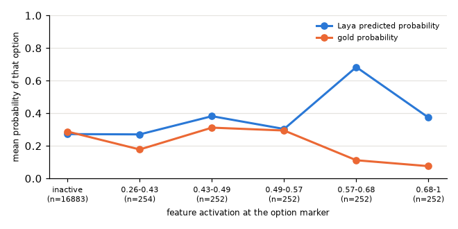

# Feature 3027

Critérios em que aparece: corr_error_stratified, attribution_toward_wrong

**Interpretação (preencher):** 

---

## Maiores ativações

**tr_security_incidents_000058 / disposition** (choice, security_incidents) | ativação 2.457 em `estado` | opções ['close_benign', 'contain', 'investigate', 'monitor'] | Laya: **monitor** [0.187, 0.119, 0.124, 0.57] | gabarito: **investigate**

```
<bos> choice question: How should this security alert be dispositioned?<eos>
▸ <mask> close_benign: Expected, explainable activity; close without analyst time.
▸ <mask> contain: Contain the host or account immediately; do not wait for triage.
▸ <mask> investigate: Warrants an analyst opening an investigation.
▸ <mask> monitor: Not clearly malicious, but worth watching for recurrence.

<eos>

 {"alert": {"description": "an unusual volume of files read in a short window", "evidence": "From 09:41 to 09:46 UTC on 2026-05-18, process explorer.exe on FIN-ADMIN-⟦1⟧12 opened 1,204 files under D:\\Shared\\Finance\\Q1, including q1-ledger.xlsx and payroll-2026-04.csv, after a successful MFA logon for admin account fin_admin from 203.0.113.47. A change window for FIN-ADMIN-112 was open from 09:00 to 12:00 UTC, and the account's credentials were last rotated 14 days ago. The source IP was outside the registered corporate address ranges.", "rule": "mass_download"}, "context": {"asset_criticality": "low", "change_window_active": true, "source_on_allowlist": false}, "history": {"credential_rotation_days_ago": 14, "distinct_countries_30d": 4, "logins_30d": 1055, "prior_alerts_90d": 0}, "principal": {"mfa_enrolled": true, "name": "usr-infra-171", "privileges": ["deploy:production", "secrets:read"], "type": "admin"}}<eos>
```

**tr_security_incidents_000058 / true_positive** (noul, security_incidents) | ativação 2.408 em `estado` | opções ['false', 'true'] | Laya: **true** [0.422, 0.578] | gabarito: **false**

```
<bos> noul question: This alert reflects genuinely malicious or unauthorised activity.<eos>
▸ <mask> false: Benign activity, a misconfiguration, or a known false positive.
▸ <mask> true: The underlying behaviour is malicious or unauthorised.

<eos>

 {"alert": {"description": "an unusual volume of files read in a short window", "evidence": "From 09:41 to 09:46 UTC on 2026-05-18, process explorer.exe on FIN-ADMIN-⟦1⟧12 opened 1,204 files under D:\\Shared\\Finance\\Q1, including q1-ledger.xlsx and payroll-2026-04.csv, after a successful MFA logon for admin account fin_admin from 203.0.113.47. A change window for FIN-ADMIN-112 was open from 09:00 to 12:00 UTC, and the account's credentials were last rotated 14 days ago. The source IP was outside the registered corporate address ranges.", "rule": "mass_download"}, "context": {"asset_criticality": "low", "change_window_active": true, "source_on_allowlist": false}, "history": {"credential_rotation_days_ago": 14, "distinct_countries_30d": 4, "logins_30d": 1055, "prior_alerts_90d": 0}, "principal": {"mfa_enrolled": true, "name": "usr-infra-171", "privileges": ["deploy:production", "secrets:read"], "type": "admin"}}<eos>
```

**tr_security_incidents_000058 / credential_compromise** (noul, security_incidents) | ativação 2.365 em `estado` | opções ['false', 'true'] | Laya: **false** [0.913, 0.087] | gabarito: **false**

```
<bos> noul question: The evidence indicates a credential or account has been compromised.<eos>
▸ <mask> false: no, the statement does not hold
▸ <mask> true: yes, the statement holds

<eos>

 {"alert": {"description": "an unusual volume of files read in a short window", "evidence": "From 09:41 to 09:46 UTC on 2026-05-18, process explorer.exe on FIN-ADMIN-⟦1⟧12 opened 1,204 files under D:\\Shared\\Finance\\Q1, including q1-ledger.xlsx and payroll-2026-04.csv, after a successful MFA logon for admin account fin_admin from 203.0.113.47. A change window for FIN-ADMIN-112 was open from 09:00 to 12:00 UTC, and the account's credentials were last rotated 14 days ago. The source IP was outside the registered corporate address ranges.", "rule": "mass_download"}, "context": {"asset_criticality": "low", "change_window_active": true, "source_on_allowlist": false}, "history": {"credential_rotation_days_ago": 14, "distinct_countries_30d": 4, "logins_30d": 1055, "prior_alerts_90d": 0}, "principal": {"mfa_enrolled": true, "name": "usr-infra-171", "privileges": ["deploy:production", "secrets:read"], "type": "admin"}}<eos>
```

**tr_security_incidents_000058 / severity** (score, security_incidents) | ativação 2.357 em `estado` | opções ['0', '1', '2', '3', '4'] | Laya: **1** [0.031, 0.522, 0.299, 0.123, 0.026] | gabarito: **2**

```
<bos> score question: How severe is the potential impact if this alert is real?<eos>
▸ <mask> level 0: Negligible: no access to anything sensitive.
▸ <mask> level 1: Low: limited access, easily reversed.
▸ <mask> level 2: Moderate: access to internal systems or non-public data.
▸ <mask> level 3: High: access to production, secrets or customer data.
▸ <mask> level 4: Critical: active compromise of crown-jewel systems.

<eos>

 {"alert": {"description": "an unusual volume of files read in a short window", "evidence": "From 09:41 to 09:46 UTC on 2026-05-18, process explorer.exe on FIN-ADMIN-⟦1⟧12 opened 1,204 files under D:\\Shared\\Finance\\Q1, including q1-ledger.xlsx and payroll-2026-04.csv, after a successful MFA logon for admin account fin_admin from 203.0.113.47. A change window for FIN-ADMIN-112 was open from 09:00 to 12:00 UTC, and the account's credentials were last rotated 14 days ago. The source IP was outside the registered corporate address ranges.", "rule": "mass_download"}, "context": {"asset_criticality": "low", "change_window_active": true, "source_on_allowlist": false}, "history": {"credential_rotation_days_ago": 14, "distinct_countries_30d": 4, "logins_30d": 1055, "prior_alerts_90d": 0}, "principal": {"mfa_enrolled": true, "name": "usr-infra-171", "privileges": ["deploy:production", "secrets:read"], "type": "admin"}}<eos>
```

**tr_security_incidents_000058 / urgency** (score, security_incidents) | ativação 2.348 em `estado` | opções ['0', '1', '2', '3'] | Laya: **3** [0.058, 0.268, 0.208, 0.466] | gabarito: **3**

```
<bos> score question: How quickly must a responder act on this alert?<eos>
▸ <mask> level 0: No time pressure; can wait indefinitely.
▸ <mask> level 1: Routine; handle within the normal queue.
▸ <mask> level 2: Elevated; should be handled within the same week.
▸ <mask> level 3: Critical; requires action within the same day.

<eos>

 {"alert": {"description": "an unusual volume of files read in a short window", "evidence": "From 09:41 to 09:46 UTC on 2026-05-18, process explorer.exe on FIN-ADMIN-⟦1⟧12 opened 1,204 files under D:\\Shared\\Finance\\Q1, including q1-ledger.xlsx and payroll-2026-04.csv, after a successful MFA logon for admin account fin_admin from 203.0.113.47. A change window for FIN-ADMIN-112 was open from 09:00 to 12:00 UTC, and the account's credentials were last rotated 14 days ago. The source IP was outside the registered corporate address ranges.", "rule": "mass_download"}, "context": {"asset_criticality": "low", "change_window_active": true, "source_on_allowlist": false}, "history": {"credential_rotation_days_ago": 14, "distinct_countries_30d": 4, "logins_30d": 1055, "prior_alerts_90d": 0}, "principal": {"mfa_enrolled": true, "name": "usr-infra-171", "privileges": ["deploy:production", "secrets:read"], "type": "admin"}}<eos>
```

## Ativações medianas (faixa 40-60%, mediana 0.626)

**tr_customer_service_000132 / churn_risk** (score, customer_service) | ativação 0.665 em `opção` | opções ['0', '1', '2', '3'] | Laya: **2** [0.03, 0.109, 0.845, 0.015] | gabarito: **1**

```
<bos> score question: How likely is this customer to stop doing business with us because of this interaction?<eos>
▸ <mask> level 0: No sign of dissatisfaction.
▸ <mask> level 1: Mild frustration, but the relationship is intact.
▸ <mask> level 2: Clearly unhappy; repeat problems or explicit complaints.
▸ <mask> level 3: Imminent: threatening to cancel, dispute⟦ or⟧ leave.

<eos>

 {"account": {"lifetime_value_usd": 222, "prior_tickets_90d": 0, "seats": 1, "tenure_months": 3, "tier": "free"}, "thread": [{"role": "customer", "text": "Hi there, I just opened the package from my recent order and, unfortunately, the item arrived with a noticeable crack on the side. Could you let me know what the next steps are?"}, {"role": "agent", "text": "I’m sorry to hear that the product was damaged. Could you please share a photo of the crack and confirm the order number so I can look into this for you?"}, {"role": "customer", "text": "Sure, I’ve attached a picture and the order number is #4521. I’d appreciate any guidance on how we can move forward."}]}<eos>
```

**tr_invoice_processing_000019 / discrepancy_severity** (score, invoice_processing) | ativação 0.608 em `estado` | opções ['0', '1', '2', '3'] | Laya: **2** [0.049, 0.328, 0.543, 0.08] | gabarito: **0**

```
<bos> score question: How material is any discrepancy between the invoice, the order and the delivery?<eos>
▸ <mask> level 0: None: everything reconciles.
▸ <mask> level 1: Trivial: rounding or a cosmetic difference.
▸ <mask> level 2: Moderate: a real difference worth confirming.
▸ <mask> level 3: Material: a large or unexplained difference.

<eos>

 {"delivery": {"condition": "accepted", "date": "2026-03-18", "received_qty": 100}, "invoice": {"currency": "USD", "id": "INV-2026-9033", "lines": [{"qty": 100, "sku": "SKU-538", "total_usd": 1456.0, "unit_usd": 14.56}], "total_usd": 1456.0, "vendor": "Acme Fabrication"}, "payment": {"days_until_due": 5, "discount_expires_in_days": null, "early_payment_discount_pct": null, "status": "scheduled", "terms": "net 30"}, "purchase_order": {"freight⟦_⟧terms": "freight prepaid by vendor, not separately billable", "id": "PO-3023", "lines": [{"qty": 100, "unit_usd": 14.56}], "total_usd": 1456.0}, "vendor_history": {"disputes_12m": 0, "invoices_12m": 34, "prior_invoice_ids": ["INV-2026-9033", "INV-2026-3488", "INV-2026-5999", "INV-2026-7520"]}}<eos>
```

**tr_invoice_processing_000284 / urgency** (score, invoice_processing) | ativação 0.642 em `estado` | opções ['0', '1', '2', '3'] | Laya: **1** [0.086, 0.554, 0.204, 0.156] | gabarito: **1**

```
<bos> score question: How time-sensitive is processing this invoice?<eos>
▸ <mask> level 0: No time pressure; can wait indefinitely.
▸ <mask> level 1: Routine; handle within the normal queue.
▸ <mask> level 2: Elevated; should be handled within the same week.
▸ <mask> level 3: Critical; requires action within the same day.

<eos>

 {"delivery": {"condition": "accepted", "date": "2026-03-20", "received_qty": 1000}, "invoice": {"currency": "USD", "id": "INV-2026-7786", "lines": [{"qty": 1000, "sku": "SKU-874", "total_usd": 320730.0, "unit_usd": 320.73}], "total_usd": 320730.0, "vendor": "Kestrel Supply"}, "payment": {"days_until_due": ⟦1⟧1, "discount_expires_in_days": null, "early_payment_discount_pct": null, "status": "scheduled", "terms": "net 15"}, "purchase_order": {"freight_terms": "freight prepaid by vendor, not separately billable", "id": "PO-7733", "lines": [{"qty": 1000, "unit_usd": 320.73}], "total_usd": 320730.0}, "vendor_history": {"disputes_12m": 1, "invoices_12m": 31, "prior_invoice_ids": ["INV-2026-3295", "INV-2026-5889", "INV-2026-7594"]}}<eos>
```

**tr_customer_service_000254 / churn_risk** (score, customer_service) | ativação 0.719 em `estado` | opções ['0', '1', '2', '3'] | Laya: **2** [0.068, 0.215, 0.584, 0.133] | gabarito: **2**

```
<bos> score question: How likely is this customer to stop doing business with us because of this interaction?<eos>
▸ <mask> level 0: No sign of dissatisfaction.
▸ <mask> level 1: Mild frustration, but the relationship is intact.
▸ <mask> level 2: Clearly unhappy; repeat problems or explicit complaints.
▸ <mask> level 3: Imminent: threatening to cancel, dispute or leave.

<eos>

 {"account": {"lifetime_value_usd": 3273, "prior_tickets_90d": 0, "seats": 1, "tenure_months": 49, "tier": "free"}, "thread": [{"role": "customer", "text": "The export tool is completely broken and I have a hard deadline tonight. I’ve been using this free plan for 49 months and never seen it this bad."}, {"role": "agent", "text": "I am sorry to hear you are having trouble with the export tool. Could you please describe what happens exactly when you click the export button?"}, {"role": "customer", "text": "It just hangs indefinitely. I click it, the wheel spins,⟦ and⟧ nothing ever downloads."}, {"role": "agent", "text": "Thank you for clarifying. Are you seeing any notifications or pop-ups appear in the corner of your browser when the process stalls?"}, {"role": "customer", "text": "No, it’s just dead silence. Nothing happens at all, and I'm losing time."}, {"role": "agent", "text": "I appreciate you checking that. Which browser and version are you currently using to access the site?"}, {"role": "customer", "text": "I'm on Chrome, version 124. Get this moving, please."}]}<eos>
```

**tr_invoice_processing_000267 / duplicate** (noul, invoice_processing) | ativação 0.636 em `estado` | opções ['false', 'true'] | Laya: **true** [0.018, 0.982] | gabarito: **false**

```
<bos> noul question: This invoice appears to duplicate an invoice already submitted.<eos>
▸ <mask> false: no, the statement does not hold
▸ <mask> true: yes, the statement holds

<eos>

 {"delivery": {"condition": "accepted", "date": "2026-03-04", "received_qty": 250}, "invoice": {"currency": "USD", "id": "INV-2026-4915", "lines": [{"qty": 250, "sku": "SKU-624", "total_usd": 59980.0, "unit_usd": 239.92}], "total_usd": 59980.0, "vendor": "Kestrel Supply"}, "payment": {"days_until_due": 44, "discount_expires_in_days": 4, "early_payment_discount_pct": 2.0, "status": "scheduled", "terms": "net 15"}, "purchase_order": {"freight_terms": "freight prepaid by vendor, not separately billable", "id": null, "lines": [{"qty": 250, "unit_usd": 239.92}], "total_usd": 59980.0}, "vendor_history": {"disputes_12m": 0, "invoices_⟦1⟧2m": 29, "prior_invoice_ids": ["INV-2026-6690", "INV-2026-1352", "INV-2026-1118", "INV-2026-2984"]}}<eos>
```

## Estatísticas (conjunto de descoberta, dev e teste)

**pred / error**

| split | decisões | ativas | ativas e Laya errou | taxa | lift | q (BH) | OR (CMH) | q (CMH) |
|---|---|---|---|---|---|---|---|---|
| discovery | 5100 | 578 | 504 | 0.872 | 1.35 | 3.8e-37 | 1.27 | 0.613 |
| dev | 900 | 99 | 93 | 0.939 | 1.40 | 1.09e-08 | 1.75 | 0.758 |
| test | 2000 | 231 | 201 | 0.870 | 1.34 | 1.49e-13 | 2.06 | 0.343 |

**corr / error**

| split | decisões | ativas | ativas e Laya errou | taxa | lift | q (BH) | OR (CMH) | q (CMH) |
|---|---|---|---|---|---|---|---|---|
| discovery | 5100 | 220 | 146 | 0.664 | 1.03 | 0.627 | 3.66 | 0.000259 |
| dev | 900 | 25 | 19 | 0.760 | 1.13 | 0.604 | 6.89 | 0.221 |
| test | 2000 | 72 | 42 | 0.583 | 0.90 | 0.327 | 0.82 | 0.904 |

**state / error**

| split | decisões | ativas | ativas e Laya errou | taxa | lift | q (BH) | OR (CMH) | q (CMH) |
|---|---|---|---|---|---|---|---|---|
| discovery | 5100 | 4049 | 2523 | 0.623 | 0.97 | 2.29e-08 | 0.79 | 0.187 |
| dev | 900 | 732 | 477 | 0.652 | 0.97 | 0.135 | 0.51 | 0.193 |
| test | 2000 | 1582 | 1012 | 0.640 | 0.98 | 0.215 | 0.94 | 0.908 |

**pred / probe_right_laya_wrong**

| split | decisões | ativas | ativas e Laya errou | taxa | lift | q (BH) | OR (CMH) | q (CMH) |
|---|---|---|---|---|---|---|---|---|
| discovery | 2819 | 312 | 283 | 0.907 | 1.40 | 4.01e-27 | 1.62 | 0.323 |
| dev | 520 | 51 | 48 | 0.941 | 1.39 | 3.68e-05 | 3.47 | 0.33 |
| test | 1106 | 124 | 110 | 0.887 | 1.40 | 4.04e-10 | 1.62 | 0.656 |

**corr / probe_right_laya_wrong**

| split | decisões | ativas | ativas e Laya errou | taxa | lift | q (BH) | OR (CMH) | q (CMH) |
|---|---|---|---|---|---|---|---|---|
| discovery | 2819 | 77 | 48 | 0.623 | 0.96 | 0.799 | 4.90 | 0.0998 |
| dev | 520 | 9 | 6 | 0.667 | 0.99 | nan | nan | nan |
| test | 1106 | 27 | 13 | 0.481 | 0.76 | 0.187 | 0.28 | 0.571 |

**state / probe_right_laya_wrong**

| split | decisões | ativas | ativas e Laya errou | taxa | lift | q (BH) | OR (CMH) | q (CMH) |
|---|---|---|---|---|---|---|---|---|
| discovery | 2819 | 2320 | 1445 | 0.623 | 0.96 | 4.97e-08 | 0.70 | 0.13 |
| dev | 520 | 429 | 279 | 0.650 | 0.96 | 0.12 | 0.56 | 0.381 |
| test | 1106 | 928 | 574 | 0.619 | 0.98 | 0.108 | 0.89 | 0.827 |

Confusão mais sobre-representada (pred): `action|3>1` (n=110, lift 8.74, p=0). Formato `pergunta|índice previsto>índice correto`.

Confusão mais sobre-representada (corr): `action|3>2` (n=102, lift 20.56, p=0). Formato `pergunta|índice previsto>índice correto`.

Confusão mais sobre-representada (state): `duplicate|1>0` (n=217, lift 1.26, p=5.21e-23). Formato `pergunta|índice previsto>índice correto`.



