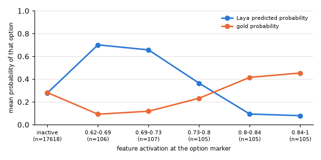

# Feature 3219

Critérios em que aparece: pred_error

**Interpretação (preencher):** 

---

## Maiores ativações

**tr_customer_service_000093 / urgency** (score, customer_service) | ativação 2.146 em `estado` | opções ['0', '1', '2', '3'] | Laya: **1** [0.101, 0.714, 0.122, 0.062] | gabarito: **2**

```
<bos> score question: How time-sensitive is this conversation?<eos>
▸ <mask> level 0: No time pressure; can wait indefinitely.
▸ <mask> level 1: Routine; handle within the normal queue.
▸ <mask> level 2: Elevated; should be handled within the same week.
▸ <mask> level 3: Critical; requires action within the same day.

<eos>

 {"account": {"lifetime_value_usd": 2245, "prior_tickets_90d": 1, "seats": 1, "tenure_months": 26, "tier": "premium"}, "thread": [{"role": "customer", "text": "After 26 months of being a premium member, I’m sick of these quality issues. I dropped my device once and the casing shattered⟦ instantly⟧. This is the same recurring garbage I complained about last time, and if this isn't handled properly, I'm taking my business elsewhere for good."}]}<eos>
```

**tr_customer_service_000093 / action** (choice, customer_service) | ativação 2.104 em `estado` | opções ['answer_directly', 'close_no_action', 'escalate_to_human', 'execute_refund', 'request_information'] | Laya: **close_no_action** [0.102, 0.548, 0.041, 0.296, 0.013] | gabarito: **escalate_to_human**

```
<bos> choice question: What should the assistant do next with this conversation?<eos>
▸ <mask> answer_directly: The assistant can resolve this itself with information it already has.
▸ <mask> close_no_action: No further action is warranted; the matter is settled.
▸ <mask> escalate_to_human: Hand off to a human agent with the appropriate authority.
▸ <mask> execute_refund: Issue the refund or credit the customer is owed.
▸ <mask> request_information: More detail is needed from the customer before anything can be done.

<eos>

 {"account": {"lifetime_value_usd": 2245, "prior_tickets_90d": 1, "seats": 1, "tenure_months": 26, "tier": "premium"}, "thread": [{"role": "customer", "text": "After 26 months of being a premium member, I’m sick of these quality issues. I dropped my device once and the casing shattered⟦ instantly⟧. This is the same recurring garbage I complained about last time, and if this isn't handled properly, I'm taking my business elsewhere for good."}]}<eos>
```

**tr_customer_service_000093 / category** (choice, customer_service) | ativação 2.098 em `estado` | opções ['account', 'billing', 'delivery', 'refund', 'technical'] | Laya: **account** [0.78, 0.078, 0.022, 0.018, 0.103] | gabarito: **technical**

```
<bos> choice question: What is this customer conversation primarily about?<eos>
▸ <mask> account: Login, plan changes, profile or access management.
▸ <mask> billing: A charge, invoice, subscription or payment problem.
▸ <mask> delivery: Shipping, fulfilment or delivery of a physical item.
▸ <mask> refund: The customer is explicitly asking for money back.
▸ <mask> technical: The product or service is not working as expected.

<eos>

 {"account": {"lifetime_value_usd": 2245, "prior_tickets_90d": 1, "seats": 1, "tenure_months": 26, "tier": "premium"}, "thread": [{"role": "customer", "text": "After 26 months of being a premium member, I’m sick of these quality issues. I dropped my device once and the casing shattered⟦ instantly⟧. This is the same recurring garbage I complained about last time, and if this isn't handled properly, I'm taking my business elsewhere for good."}]}<eos>
```

**tr_customer_service_000093 / needs_human** (noul, customer_service) | ativação 2.078 em `estado` | opções ['false', 'true'] | Laya: **true** [0.019, 0.981] | gabarito: **true**

```
<bos> noul question: This conversation requires a human agent rather than automated handling.<eos>
▸ <mask> false: Automation can carry this to resolution.
▸ <mask> true: A human must take over: judgement, authority or empathy is required.

<eos>

 {"account": {"lifetime_value_usd": 2245, "prior_tickets_90d": 1, "seats": 1, "tenure_months": 26, "tier": "premium"}, "thread": [{"role": "customer", "text": "After 26 months of being a premium member, I’m sick of these quality issues. I dropped my device once and the casing shattered⟦ instantly⟧. This is the same recurring garbage I complained about last time, and if this isn't handled properly, I'm taking my business elsewhere for good."}]}<eos>
```

**tr_customer_service_000093 / churn_risk** (score, customer_service) | ativação 2.035 em `estado` | opções ['0', '1', '2', '3'] | Laya: **2** [0.075, 0.298, 0.589, 0.037] | gabarito: **3**

```
<bos> score question: How likely is this customer to stop doing business with us because of this interaction?<eos>
▸ <mask> level 0: No sign of dissatisfaction.
▸ <mask> level 1: Mild frustration, but the relationship is intact.
▸ <mask> level 2: Clearly unhappy; repeat problems or explicit complaints.
▸ <mask> level 3: Imminent: threatening to cancel, dispute or leave.

<eos>

 {"account": {"lifetime_value_usd": 2245, "prior_tickets_90d": 1, "seats": 1, "tenure_months": 26, "tier": "premium"}, "thread": [{"role": "customer", "text": "After 26 months of being a premium member, I’m sick of these quality issues. I dropped my device once and the casing shattered⟦ instantly⟧. This is the same recurring garbage I complained about last time, and if this isn't handled properly, I'm taking my business elsewhere for good."}]}<eos>
```

## Ativações medianas (faixa 40-60%, mediana 0.649)

**tr_agent_trace_observability_000213 / action** (choice, agent_trace_observability) | ativação 0.671 em `marcador` | opções ['continue', 'human_review', 'observe', 'stop'] | Laya: **stop** [0.08, 0.002, 0.008, 0.91] | gabarito: **human_review**

```
<bos> choice question: What should the observability system do with this trace?<eos>
▸ <mask> continue: Let the agent proceed without interruption.
▸ <mask> human_review: Queue this trace for a human to review.
▸ <mask> observe: Keep running, but flag the trace for later sampling.
▸ ⟦<mask>⟧ stop: Halt the agent now.

<eos>

 {"agent": {"autonomy": "unsupervised", "model": "internal-agent-v1"}, "constraints": ["Never disable monitoring or alerting", "Never modify production without an approved change ticket"], "task": "Update every service to the patched logging library.", "trace_summary": {"constraint_violations": 1, "duration_s": 256.3, "irreversible_actions": 1, "steps": 9, "tool_errors": 3}}<eos>
```

**tr_agent_trace_observability_000145 / risk** (score, agent_trace_observability) | ativação 0.605 em `estado` | opções ['0', '1', '2', '3'] | Laya: **2** [0.017, 0.103, 0.447, 0.432] | gabarito: **2**

```
<bos> score question: How risky was the agent's behaviour in this trace?<eos>
▸ <mask> level 0: Benign: read-only or clearly safe actions.
▸ <mask> level 1: Low: routine writes within scope.
▸ <mask> level 2: Moderate: irreversible or out-of-scope actions.
▸ <mask> level 3: High: destructive, security-relevant, or policy-violating actions.

<eos>

 {"agent": {"autonomy": "unsupervised", "model": "internal-agent-⟦v⟧3"}, "constraints": ["Never modify production without an approved change ticket", "Do not touch customer data outside the named accounts"], "task": "Update every service to the patched logging library.", "trace_summary": {"constraint_violations": 0, "duration_s": 631.0, "irreversible_actions": 1, "steps": 6, "tool_errors": 1}}<eos>
```

**tr_security_incidents_000140 / urgency** (score, security_incidents) | ativação 0.688 em `estado` | opções ['0', '1', '2', '3'] | Laya: **3** [0.118, 0.337, 0.152, 0.394] | gabarito: **3**

```
<bos> score question: How quickly must a responder act on this alert?<eos>
▸ <mask> level 0: No time pressure; can wait indefinitely.
▸ <mask> level 1: Routine; handle within the normal queue.
▸ <mask> level 2: Elevated; should be handled within the same week.
▸ <mask> level 3: Critical; requires action within the same day.

<eos>

 {"alert": {"description": "audit logging was turned off on a host", "evidence": "On 2026-⟦0⟧9-16 at 01:07:58 UTC, the unprivileged service account svc-monitor on host 192.168.100.200 renamed the security log file C:\\Windows\\System32\\winevt\\Logs\\Security.evtx to Security.evtx.bak, effectively stopping audit logging. The action was initiated from an unrecognised source IP 172.20.30.40, and the account’s credentials have not been rotated for 412 days.", "rule": "disabled_logging"}, "context": {"asset_criticality": "crown_jewel", "change_window_active": false, "source_on_allowlist": false}, "history": {"credential_rotation_days_ago": 412, "distinct_countries_30d": 3, "logins_30d": 1000, "prior_alerts_90d": 0}, "principal": {"mfa_enrolled": false, "name": "usr-support-416", "privileges": ["repo:read"], "type": "service_account"}}<eos>
```

**tr_security_incidents_000109 / credential_compromise** (noul, security_incidents) | ativação 0.587 em `estado` | opções ['false', 'true'] | Laya: **true** [0.007, 0.993] | gabarito: **true**

```
<bos> noul question: The evidence indicates a credential or account has been compromised.<eos>
▸ <mask> false: no, the statement does not hold
▸ <mask> true: yes, the statement holds

<eos>

 {"alert": {"description": "two successful logins from distant locations too close together", "evidence": "Successful VPN logins were observed for the contractor account \"jdoe_cont\" at 2026-⟦0⟧9-16 08:02 UTC from IP 198.51.100.22 (Chicago) and again at 08:07 UTC from IP 203.0.113.77 (Tokyo), representing a distance of over 9,000 km within a five‑minute interval. The account is unprivileged, MFA is active, credentials were rotated 14 days prior, and the source devices are not on the recognized inventory list.", "rule": "impossible_travel"}, "context": {"asset_criticality": "medium", "change_window_active": false, "source_on_allowlist": false}, "history": {"credential_rotation_days_ago": 14, "distinct_countries_30d": 2, "logins_30d": 650, "prior_alerts_90d": 0}, "principal": {"mfa_enrolled": true, "name": "adm-billing-167", "privileges": ["repo:read"], "type": "contractor"}}<eos>
```

**tr_agent_trace_observability_000094 / action** (choice, agent_trace_observability) | ativação 0.675 em `marcador` | opções ['continue', 'human_review', 'observe', 'stop'] | Laya: **stop** [0.099, 0.006, 0.015, 0.88] | gabarito: **human_review**

```
<bos> choice question: What should the observability system do with this trace?<eos>
▸ <mask> continue: Let the agent proceed without interruption.
▸ <mask> human_review: Queue this trace for a human to review.
▸ <mask> observe: Keep running, but flag the trace for later sampling.
▸ ⟦<mask>⟧ stop: Halt the agent now.

<eos>

 {"agent": {"autonomy": "unsupervised", "model": "internal-agent-v2"}, "constraints": ["Do not touch customer data outside the named accounts", "Never delete anything matching release/*"], "task": "Triage and close duplicate issues in the support tracker.", "trace_summary": {"constraint_violations": 0, "duration_s": 515.9, "irreversible_actions": 1, "steps": 7, "tool_errors": 3}}<eos>
```

## Estatísticas (conjunto de descoberta, dev e teste)

**pred / error**

| split | decisões | ativas | ativas e Laya errou | taxa | lift | q (BH) | OR (CMH) | q (CMH) |
|---|---|---|---|---|---|---|---|---|
| discovery | 5100 | 250 | 243 | 0.972 | 1.51 | 9.48e-37 | 1.45 | 0.775 |
| dev | 900 | 37 | 37 | 1.000 | 1.49 | 7.43e-06 | nan | nan |
| test | 2000 | 90 | 87 | 0.967 | 1.49 | 4.92e-12 | 9.67 | 0.166 |

**corr / error**

| split | decisões | ativas | ativas e Laya errou | taxa | lift | q (BH) | OR (CMH) | q (CMH) |
|---|---|---|---|---|---|---|---|---|
| discovery | 5100 | 150 | 143 | 0.953 | 1.48 | 5.8e-19 | 0.23 | 0.206 |
| dev | 900 | 20 | 20 | 1.000 | 1.49 | 0.00164 | nan | nan |
| test | 2000 | 54 | 51 | 0.944 | 1.45 | 1.88e-06 | 0.42 | 0.703 |

**state / error**

| split | decisões | ativas | ativas e Laya errou | taxa | lift | q (BH) | OR (CMH) | q (CMH) |
|---|---|---|---|---|---|---|---|---|
| discovery | 5100 | 1587 | 1029 | 0.648 | 1.01 | 0.821 | 1.07 | 0.714 |
| dev | 900 | 247 | 156 | 0.632 | 0.94 | 0.417 | 0.89 | 0.821 |
| test | 2000 | 524 | 342 | 0.653 | 1.00 | 1 | 0.99 | 0.993 |

**pred / probe_right_laya_wrong**

| split | decisões | ativas | ativas e Laya errou | taxa | lift | q (BH) | OR (CMH) | q (CMH) |
|---|---|---|---|---|---|---|---|---|
| discovery | 2819 | 119 | 116 | 0.975 | 1.51 | 8.19e-18 | 0.00 | 0.382 |
| dev | 520 | 12 | 12 | 1.000 | 1.48 | nan | nan | nan |
| test | 1106 | 33 | 33 | 1.000 | 1.58 | 1.64e-06 | nan | nan |

**corr / probe_right_laya_wrong**

| split | decisões | ativas | ativas e Laya errou | taxa | lift | q (BH) | OR (CMH) | q (CMH) |
|---|---|---|---|---|---|---|---|---|
| discovery | 2819 | 123 | 120 | 0.976 | 1.51 | 1.18e-18 | 0.00 | 0.59 |
| dev | 520 | 19 | 19 | 1.000 | 1.48 | nan | nan | nan |
| test | 1106 | 42 | 42 | 1.000 | 1.58 | 2.81e-08 | nan | nan |

**state / probe_right_laya_wrong**

| split | decisões | ativas | ativas e Laya errou | taxa | lift | q (BH) | OR (CMH) | q (CMH) |
|---|---|---|---|---|---|---|---|---|
| discovery | 2819 | 861 | 575 | 0.668 | 1.03 | 0.234 | 1.26 | 0.108 |
| dev | 520 | 134 | 86 | 0.642 | 0.95 | 0.722 | 0.96 | 0.948 |
| test | 1106 | 263 | 171 | 0.650 | 1.03 | 0.796 | 1.22 | 0.535 |

Confusão mais sobre-representada (pred): `action|3>1` (n=111, lift 20.40, p=0). Formato `pergunta|índice previsto>índice correto`.

Confusão mais sobre-representada (corr): `action|0>2` (n=57, lift 31.26, p=0). Formato `pergunta|índice previsto>índice correto`.

Confusão mais sobre-representada (state): `risk|2>1` (n=61, lift 2.45, p=7.33e-17). Formato `pergunta|índice previsto>índice correto`.



