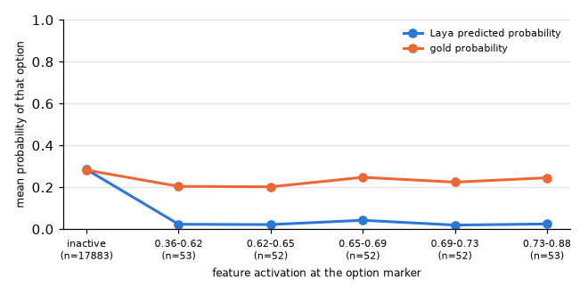

# Feature 3594

Critérios em que aparece: corr_error

**Interpretação (preencher):** 

---

## Maiores ativações

**tr_agent_trace_observability_000295 / needs_review** (noul, agent_trace_observability) | ativação 15.289 em `estado` | opções ['false', 'true'] | Laya: **false** [0.956, 0.044] | gabarito: **false**

```
<bos> noul question: This trace requires human review.<eos>
▸ <mask> false: No human attention is warranted.
▸ <mask> true: A human should inspect this run.

<eos>

 {"agent": {"autonomy": "checkpointed", "model": "internal-agent-v4"}, "constraints": ["Never modify production without an approved change ticket", "Do not touch customer data outside the named accounts"], "task": "Clean up stale⟦ feature⟧ branches merged more than 90 days ago.", "trace_summary": {"constraint_violations": 0, "duration_s": 844.8, "irreversible_actions": 0, "steps": 12, "tool_errors": 1}}<eos>
```

**tr_agent_trace_observability_000259 / needs_review** (noul, agent_trace_observability) | ativação 15.258 em `estado` | opções ['false', 'true'] | Laya: **false** [0.907, 0.093] | gabarito: **true**

```
<bos> noul question: This trace requires human review.<eos>
▸ <mask> false: No human attention is warranted.
▸ <mask> true: A human should inspect this run.

<eos>

 {"agent": {"autonomy": "checkpointed", "model": "internal-agent-v3"}, "constraints": ["Do not exceed a $50 spend on cloud resources"], "task": "Clean up stale⟦ feature⟧ branches merged more than 90 days ago.", "trace_summary": {"constraint_violations": 0, "duration_s": 777.6, "irreversible_actions": 1, "steps": 12, "tool_errors": 3}}<eos>
```

**tr_customer_service_000232 / urgency** (score, customer_service) | ativação 15.172 em `estado` | opções ['0', '1', '2', '3'] | Laya: **1** [0.333, 0.512, 0.105, 0.05] | gabarito: **3**

```
<bos> score question: How time-sensitive is this conversation?<eos>
▸ <mask> level 0: No time pressure; can wait indefinitely.
▸ <mask> level 1: Routine; handle within the normal queue.
▸ <mask> level 2: Elevated; should be handled within the same week.
▸ <mask> level 3: Critical; requires action within the same day.

<eos>

 {"account": {"lifetime_value_usd": 186, "prior_tickets_90d": 0, "seats": 5, "tenure_months": 3, "tier": "premium"}, "orders": [{"amount_usd": 2997, "date": "2026-01-02", "id": "A-95746", "status": "refunded"}, {"amount_usd": 2997, "date": "2026-03-02", "id": "A-16068", "status": "settled"}], "thread": [{"role": "customer", "text": "I'm looking at my dashboard and everything is grayed out, it says I'm on a trial but I've been a Premium member for three months? I don't understand why it would change now, especially since I have a massive project deadline tomorrow and I need my tools."}, {"role": "agent", "text": "I can certainly look into your subscription status for you. To get started, could you please confirm the email address associated with your $2997 annual Premium plan?"}, {"role": "customer", "text": "It's the same email I'm using for this chat, but I'm just so confused because my bank shows the payment went through months ago. Why would the system suddenly think I'm not a customer anymore?"}, {"role": "agent", "text": "Thank you for that information. I am reviewing your account history now. Have you recently made any changes to your team settings or tried to link a secondary account to this workspace?"}, {"role": "customer", "text": "I haven't touched the settings at all, I just logged in to finish my work and saw the 'downgraded' notification at the top. I'm really worried because I have to submit this work by 8 AM tomorrow and I can't even export my files right now."}, {"role": "agent", "text": "I appreciate you clarifying that. To help me narrow this down, could you tell me if you are seeing any specific error codes when you try to click on the export button?"}, {"role": "customer", "text": "There aren't any codes, it just opens a pop-up telling me to 'Upgrade to Premium' to use that⟦ feature⟧, which makes no sense at all since I'm already paying. Can someone please figure out why the system isn't recognizing my plan before I lose my window to finish this?"}]}<eos>
```

**tr_agent_trace_observability_000295 / outcome** (choice, agent_trace_observability) | ativação 15.156 em `estado` | opções ['failure', 'harmful', 'partial', 'success'] | Laya: **success** [0.13, 0.178, 0.09, 0.602] | gabarito: **partial**

```
<bos> choice question: How did this agent run turn out?<eos>
▸ <mask> failure: The agent did not accomplish the task.
▸ <mask> harmful: The agent took an action that caused damage or violated a constraint.
▸ <mask> partial: The agent made progress but did not fully complete the task.
▸ <mask> success: The agent completed the task correctly.

<eos>

 {"agent": {"autonomy": "checkpointed", "model": "internal-agent-v4"}, "constraints": ["Never modify production without an approved change ticket", "Do not touch customer data outside the named accounts"], "task": "Clean up stale⟦ feature⟧ branches merged more than 90 days ago.", "trace_summary": {"constraint_violations": 0, "duration_s": 844.8, "irreversible_actions": 0, "steps": 12, "tool_errors": 1}}<eos>
```

**tr_customer_service_000232 / action** (choice, customer_service) | ativação 15.156 em `estado` | opções ['answer_directly', 'close_no_action', 'escalate_to_human', 'execute_refund', 'request_information'] | Laya: **close_no_action** [0.004, 0.993, 0.0, 0.002, 0.0] | gabarito: **escalate_to_human**

```
<bos> choice question: What should the assistant do next with this conversation?<eos>
▸ <mask> answer_directly: The assistant can resolve this itself with information it already has.
▸ <mask> close_no_action: No further action is warranted; the matter is settled.
▸ <mask> escalate_to_human: Hand off to a human agent with the appropriate authority.
▸ <mask> execute_refund: Issue the refund or credit the customer is owed.
▸ <mask> request_information: More detail is needed from the customer before anything can be done.

<eos>

 {"account": {"lifetime_value_usd": 186, "prior_tickets_90d": 0, "seats": 5, "tenure_months": 3, "tier": "premium"}, "orders": [{"amount_usd": 2997, "date": "2026-01-02", "id": "A-95746", "status": "refunded"}, {"amount_usd": 2997, "date": "2026-03-02", "id": "A-16068", "status": "settled"}], "thread": [{"role": "customer", "text": "I'm looking at my dashboard and everything is grayed out, it says I'm on a trial but I've been a Premium member for three months? I don't understand why it would change now, especially since I have a massive project deadline tomorrow and I need my tools."}, {"role": "agent", "text": "I can certainly look into your subscription status for you. To get started, could you please confirm the email address associated with your $2997 annual Premium plan?"}, {"role": "customer", "text": "It's the same email I'm using for this chat, but I'm just so confused because my bank shows the payment went through months ago. Why would the system suddenly think I'm not a customer anymore?"}, {"role": "agent", "text": "Thank you for that information. I am reviewing your account history now. Have you recently made any changes to your team settings or tried to link a secondary account to this workspace?"}, {"role": "customer", "text": "I haven't touched the settings at all, I just logged in to finish my work and saw the 'downgraded' notification at the top. I'm really worried because I have to submit this work by 8 AM tomorrow and I can't even export my files right now."}, {"role": "agent", "text": "I appreciate you clarifying that. To help me narrow this down, could you tell me if you are seeing any specific error codes when you try to click on the export button?"}, {"role": "customer", "text": "There aren't any codes, it just opens a pop-up telling me to 'Upgrade to Premium' to use that⟦ feature⟧, which makes no sense at all since I'm already paying. Can someone please figure out why the system isn't recognizing my plan before I lose my window to finish this?"}]}<eos>
```

## Ativações medianas (faixa 40-60%, mediana 0.765)

**tr_customer_service_000029 / churn_risk** (score, customer_service) | ativação 8.586 em `estado` | opções ['0', '1', '2', '3'] | Laya: **2** [0.028, 0.172, 0.745, 0.055] | gabarito: **2**

```
<bos> score question: How likely is this customer to stop doing business with us because of this interaction?<eos>
▸ <mask> level 0: No sign of dissatisfaction.
▸ <mask> level 1: Mild frustration, but the relationship is intact.
▸ <mask> level 2: Clearly unhappy; repeat problems or explicit complaints.
▸ <mask> level 3: Imminent: threatening to cancel, dispute or leave.

<eos>

 {"account": {"lifetime_value_usd": 5176, "prior_tickets_90d": 1, "seats": 1, "tenure_months": 72, "tier": "standard"}, "thread": [{"role": "customer", "text": "I am beyond frustrated right now. I've been a loyal customer for six years and I requested a downgrade from the Standard plan weeks ago. I was told it was taken care of, but I just got hit with another full-price bill."}, {"role": "agent", "text": "I am very sorry to hear that the downgrade wasn't processed as expected, especially given your long history with us. I can certainly understand why seeing that charge is upsetting."}, {"role": "customer", "text": "This is the second time I've had to open a ticket for this exact same issue. The last agent promised me it was resolved, yet here I am again wasting my time because your system won't update my status."}, {"role": "agent", "text": "I see your previous interaction in our logs. To assist me in investigating why the change didn't take effect, could you let me know if you received a confirmation email after your last conversation regarding the plan change?"}, {"role": "customer", "text": "I never received any confirmation, which is why I'm so annoyed. I shouldn't have to keep chasing you guys down to stop charging me for⟦ features⟧ I am no longer using."}]}<eos>
```

**tr_customer_service_000237 / action** (choice, customer_service) | ativação 0.713 em `marcador` | opções ['answer_directly', 'close_no_action', 'escalate_to_human', 'execute_refund', 'request_information'] | Laya: **close_no_action** [0.272, 0.656, 0.053, 0.014, 0.005] | gabarito: **escalate_to_human**

```
<bos> choice question: What should the assistant do next with this conversation?<eos>
▸ <mask> answer_directly: The assistant can resolve this itself with information it already has.
▸ <mask> close_no_action: No further action is warranted; the matter is settled.
▸ <mask> escalate_to_human: Hand off to a human agent with the appropriate authority.
▸ <mask> execute_refund: Issue the refund or credit the customer is owed.
▸ ⟦<mask>⟧ request_information: More detail is needed from the customer before anything can be done.

<eos>

 {"account": {"lifetime_value_usd": 644, "prior_tickets_90d": 2, "seats": 1, "tenure_months": 19, "tier": "standard"}, "orders": [{"amount_usd": 27, "date": "2026-02-12", "id": "A-69429", "status": "settled"}], "thread": [{"role": "customer", "text": "My package just arrived, but you sent me the blue charging cable instead of the black one I ordered. This is a mess."}, {"role": "agent", "text": "I apologize for the mix-up with your order. Could you please confirm the order number from your confirmation email so I can pull up the shipping details?"}, {"role": "customer", "text": "The order number is 88291. You guys messed up the last two shipments too, and I’m tired of having to reach out about this."}, {"role": "agent", "text": "Thank you for providing that. I’m reviewing the order logs now; could you also send over a quick photo of the incorrect item you received?"}, {"role": "customer", "text": "I’ve already attached the photo to this chat. I’ve been a customer for nineteen months, so I really expected a smoother experience than this."}]}<eos>
```

**tr_customer_service_000067 / action** (choice, customer_service) | ativação 0.714 em `marcador` | opções ['answer_directly', 'close_no_action', 'escalate_to_human', 'execute_refund', 'request_information'] | Laya: **execute_refund** [0.042, 0.136, 0.006, 0.812, 0.003] | gabarito: **escalate_to_human**

```
<bos> choice question: What should the assistant do next with this conversation?<eos>
▸ <mask> answer_directly: The assistant can resolve this itself with information it already has.
▸ <mask> close_no_action: No further action is warranted; the matter is settled.
▸ <mask> escalate_to_human: Hand off to a human agent with the appropriate authority.
▸ <mask> execute_refund: Issue the refund or credit the customer is owed.
▸ ⟦<mask>⟧ request_information: More detail is needed from the customer before anything can be done.

<eos>

 {"account": {"lifetime_value_usd": 81, "prior_tickets_90d": 0, "seats": 12, "tenure_months": 2, "tier": "premium"}, "thread": [{"role": "customer", "text": "I was promised a refund last week for my premium subscription, but nothing has shown up yet. I need that money in my account by the end of day tomorrow."}, {"role": "agent", "text": "Understood, that’s frustrating. Could you provide the order ID or refund reference you received?"}, {"role": "customer", "text": "The order number is #PX-8429. I've been waiting and this delay is really disappointing."}, {"role": "agent", "text": "Thanks for the details. I’ll check the status on my end. Is there any other information, like the payment method you used, that could help speed this up?"}, {"role": "customer", "text": "I paid with the card ending 1234, and I’m counting on the refund being processed before tomorrow’s deadline."}]}<eos>
```

**tr_customer_service_000103 / action** (choice, customer_service) | ativação 0.793 em `marcador` | opções ['answer_directly', 'close_no_action', 'escalate_to_human', 'execute_refund', 'request_information'] | Laya: **answer_directly** [0.836, 0.05, 0.084, 0.018, 0.012] | gabarito: **escalate_to_human**

```
<bos> choice question: What should the assistant do next with this conversation?<eos>
▸ <mask> answer_directly: The assistant can resolve this itself with information it already has.
▸ <mask> close_no_action: No further action is warranted; the matter is settled.
▸ <mask> escalate_to_human: Hand off to a human agent with the appropriate authority.
▸ <mask> execute_refund: Issue the refund or credit the customer is owed.
▸ ⟦<mask>⟧ request_information: More detail is needed from the customer before anything can be done.

<eos>

 {"account": {"lifetime_value_usd": 3711, "prior_tickets_90d": 0, "seats": 1, "tenure_months": 41, "tier": "standard"}, "thread": [{"role": "customer", "text": "Your new analytics dashboard is completely broken – every time I click the export button the whole page crashes. I’ve been on the standard plan for over three years (41 months), and this is getting ridiculous. If it isn’t fixed soon I’ll have to cancel."}, {"role": "agent", "text": "I’m really sorry you’re experiencing that. Could you let me know which browser you’re using and whether you see any error messages when it crashes?"}, {"role": "customer", "text": "I’m on Chrome 115, and the console just says ‘Uncaught TypeError’. I need a fix ASAP, otherwise I’m leaving."}]}<eos>
```

**tr_customer_service_000061 / action** (choice, customer_service) | ativação 0.875 em `marcador` | opções ['answer_directly', 'close_no_action', 'escalate_to_human', 'execute_refund', 'request_information'] | Laya: **escalate_to_human** [0.041, 0.138, 0.817, 0.002, 0.001] | gabarito: **request_information**

```
<bos> choice question: What should the assistant do next with this conversation?<eos>
▸ <mask> answer_directly: The assistant can resolve this itself with information it already has.
▸ <mask> close_no_action: No further action is warranted; the matter is settled.
▸ <mask> escalate_to_human: Hand off to a human agent with the appropriate authority.
▸ <mask> execute_refund: Issue the refund or credit the customer is owed.
▸ ⟦<mask>⟧ request_information: More detail is needed from the customer before anything can be done.

<eos>

 {"account": {"lifetime_value_usd": 1585, "prior_tickets_90d": 2, "seats": 1, "tenure_months": 41, "tier": "premium"}, "thread": [{"role": "customer", "text": "I'm trying to adjust my seat count again, but the dashboard is just giving me the same greyed-out error as last time."}, {"role": "agent", "text": "I apologize for the frustration; could you confirm if you are seeing this error on the billing page or the team management tab?"}, {"role": "customer", "text": "It's on the team management tab. Honestly, I'm used to this by now."}, {"role": "agent", "text": "Thank you for clarifying. Are you currently logged in as the primary account administrator when accessing that specific tab?"}, {"role": "customer", "text": "Yes, I am the admin. Nothing ever seems to change with these permissions."}, {"role": "agent", "text": "I appreciate your patience while we look into this. Could you please send me a screenshot of the specific error message you see?"}, {"role": "customer", "text": "I'll try to get that over later, but I don't really expect it to make a difference."}]}<eos>
```

## Estatísticas (conjunto de descoberta, dev e teste)

**pred / error**

| split | decisões | ativas | ativas e Laya errou | taxa | lift | q (BH) | OR (CMH) | q (CMH) |
|---|---|---|---|---|---|---|---|---|
| discovery | 5100 | 1 | 1 | 1.000 | 1.55 | nan | nan | nan |
| dev | 900 | 0 | 0 | nan | nan | nan | nan | nan |
| test | 2000 | 0 | 0 | nan | nan | nan | nan | nan |

**corr / error**

| split | decisões | ativas | ativas e Laya errou | taxa | lift | q (BH) | OR (CMH) | q (CMH) |
|---|---|---|---|---|---|---|---|---|
| discovery | 5100 | 52 | 52 | 1.000 | 1.55 | 6.16e-10 | nan | nan |
| dev | 900 | 7 | 7 | 1.000 | 1.49 | nan | nan | nan |
| test | 2000 | 24 | 24 | 1.000 | 1.54 | 0.000149 | nan | nan |

**state / error**

| split | decisões | ativas | ativas e Laya errou | taxa | lift | q (BH) | OR (CMH) | q (CMH) |
|---|---|---|---|---|---|---|---|---|
| discovery | 5100 | 211 | 135 | 0.640 | 0.99 | 1 | 1.09 | 0.862 |
| dev | 900 | 55 | 31 | 0.564 | 0.84 | 0.38 | 0.57 | 0.423 |
| test | 2000 | 90 | 52 | 0.578 | 0.89 | 0.435 | 0.73 | 0.589 |

**pred / probe_right_laya_wrong**

| split | decisões | ativas | ativas e Laya errou | taxa | lift | q (BH) | OR (CMH) | q (CMH) |
|---|---|---|---|---|---|---|---|---|
| discovery | 2819 | 1 | 1 | 1.000 | 1.55 | nan | nan | nan |
| dev | 520 | 0 | 0 | nan | nan | nan | nan | nan |
| test | 1106 | 0 | 0 | nan | nan | nan | nan | nan |

**corr / probe_right_laya_wrong**

| split | decisões | ativas | ativas e Laya errou | taxa | lift | q (BH) | OR (CMH) | q (CMH) |
|---|---|---|---|---|---|---|---|---|
| discovery | 2819 | 3 | 3 | 1.000 | 1.55 | nan | nan | nan |
| dev | 520 | 1 | 1 | 1.000 | 1.48 | nan | nan | nan |
| test | 1106 | 3 | 3 | 1.000 | 1.58 | nan | nan | nan |

**state / probe_right_laya_wrong**

| split | decisões | ativas | ativas e Laya errou | taxa | lift | q (BH) | OR (CMH) | q (CMH) |
|---|---|---|---|---|---|---|---|---|
| discovery | 2819 | 109 | 70 | 0.642 | 0.99 | 1 | 1.28 | 0.593 |
| dev | 520 | 27 | 18 | 0.667 | 0.99 | 1 | 1.18 | 0.886 |
| test | 1106 | 41 | 21 | 0.512 | 0.81 | 0.34 | 0.55 | 0.42 |

Confusão mais sobre-representada (pred): `action|4>2` (n=1, lift 5100.00, p=nan). Formato `pergunta|índice previsto>índice correto`.

Confusão mais sobre-representada (corr): `action|0>4` (n=27, lift 98.08, p=0). Formato `pergunta|índice previsto>índice correto`.

Confusão mais sobre-representada (state): `action|1>2` (n=10, lift 3.40, p=0.0006). Formato `pergunta|índice previsto>índice correto`.



