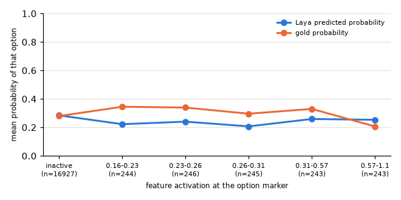

# Feature 3632

Critérios em que aparece: corr_error_stratified

**Interpretação (preencher):** 

---

## Maiores ativações

**tr_customer_service_000297 / urgency** (score, customer_service) | ativação 3.098 em `estado` | opções ['0', '1', '2', '3'] | Laya: **1** [0.059, 0.474, 0.381, 0.086] | gabarito: **2**

```
<bos> score question: How time-sensitive is this conversation?<eos>
▸ <mask> level 0: No time pressure; can wait indefinitely.
▸ <mask> level 1: Routine; handle within the normal queue.
▸ <mask> level 2: Elevated; should be handled within the same week.
▸ <mask> level 3: Critical; requires action within the same day.

<eos>

 {"account": {"lifetime_value_usd": 581, "prior_tickets_90d": 2, "seats": 40, "tenure_months": 11, "tier": "enterprise"}, "orders": [{"amount_usd": 299, "date": "2026-03-03", "id": "A-90996", "status": "settled"}], "thread": [{"role": "customer", "text": "I just opened the box and the hardware is cracked, but I'm not sure if this happened during shipping or if it was like this already? I have a hard deadline this Friday and really need this working."}, {"role": "agent", "text": "I'm sorry to hear about the damage. To help me look into this, could you please provide your order number and upload a few photos of the packaging?"}, {"role": "customer", "text": "I think I sent photos in my last two tickets, but I can't remember if they actually saw them.⟦ Where⟧ do I upload them again?"}]}<eos>
```

**tr_customer_service_000297 / action** (choice, customer_service) | ativação 2.947 em `estado` | opções ['answer_directly', 'close_no_action', 'escalate_to_human', 'execute_refund', 'request_information'] | Laya: **answer_directly** [0.508, 0.205, 0.246, 0.017, 0.024] | gabarito: **answer_directly**

```
<bos> choice question: What should the assistant do next with this conversation?<eos>
▸ <mask> answer_directly: The assistant can resolve this itself with information it already has.
▸ <mask> close_no_action: No further action is warranted; the matter is settled.
▸ <mask> escalate_to_human: Hand off to a human agent with the appropriate authority.
▸ <mask> execute_refund: Issue the refund or credit the customer is owed.
▸ <mask> request_information: More detail is needed from the customer before anything can be done.

<eos>

 {"account": {"lifetime_value_usd": 581, "prior_tickets_90d": 2, "seats": 40, "tenure_months": 11, "tier": "enterprise"}, "orders": [{"amount_usd": 299, "date": "2026-03-03", "id": "A-90996", "status": "settled"}], "thread": [{"role": "customer", "text": "I just opened the box and the hardware is cracked, but I'm not sure if this happened during shipping or if it was like this already? I have a hard deadline this Friday and really need this working."}, {"role": "agent", "text": "I'm sorry to hear about the damage. To help me look into this, could you please provide your order number and upload a few photos of the packaging?"}, {"role": "customer", "text": "I think I sent photos in my last two tickets, but I can't remember if they actually saw them.⟦ Where⟧ do I upload them again?"}]}<eos>
```

**tr_customer_service_000297 / churn_risk** (score, customer_service) | ativação 2.928 em `estado` | opções ['0', '1', '2', '3'] | Laya: **1** [0.2, 0.608, 0.167, 0.024] | gabarito: **1**

```
<bos> score question: How likely is this customer to stop doing business with us because of this interaction?<eos>
▸ <mask> level 0: No sign of dissatisfaction.
▸ <mask> level 1: Mild frustration, but the relationship is intact.
▸ <mask> level 2: Clearly unhappy; repeat problems or explicit complaints.
▸ <mask> level 3: Imminent: threatening to cancel, dispute or leave.

<eos>

 {"account": {"lifetime_value_usd": 581, "prior_tickets_90d": 2, "seats": 40, "tenure_months": 11, "tier": "enterprise"}, "orders": [{"amount_usd": 299, "date": "2026-03-03", "id": "A-90996", "status": "settled"}], "thread": [{"role": "customer", "text": "I just opened the box and the hardware is cracked, but I'm not sure if this happened during shipping or if it was like this already? I have a hard deadline this Friday and really need this working."}, {"role": "agent", "text": "I'm sorry to hear about the damage. To help me look into this, could you please provide your order number and upload a few photos of the packaging?"}, {"role": "customer", "text": "I think I sent photos in my last two tickets, but I can't remember if they actually saw them.⟦ Where⟧ do I upload them again?"}]}<eos>
```

**tr_customer_service_000297 / needs_human** (noul, customer_service) | ativação 2.920 em `estado` | opções ['false', 'true'] | Laya: **false** [0.883, 0.117] | gabarito: **true**

```
<bos> noul question: This conversation requires a human agent rather than automated handling.<eos>
▸ <mask> false: Automation can carry this to resolution.
▸ <mask> true: A human must take over: judgement, authority or empathy is required.

<eos>

 {"account": {"lifetime_value_usd": 581, "prior_tickets_90d": 2, "seats": 40, "tenure_months": 11, "tier": "enterprise"}, "orders": [{"amount_usd": 299, "date": "2026-03-03", "id": "A-90996", "status": "settled"}], "thread": [{"role": "customer", "text": "I just opened the box and the hardware is cracked, but I'm not sure if this happened during shipping or if it was like this already? I have a hard deadline this Friday and really need this working."}, {"role": "agent", "text": "I'm sorry to hear about the damage. To help me look into this, could you please provide your order number and upload a few photos of the packaging?"}, {"role": "customer", "text": "I think I sent photos in my last two tickets, but I can't remember if they actually saw them.⟦ Where⟧ do I upload them again?"}]}<eos>
```

**tr_customer_service_000297 / category** (choice, customer_service) | ativação 2.840 em `estado` | opções ['account', 'billing', 'delivery', 'refund', 'technical'] | Laya: **delivery** [0.008, 0.037, 0.947, 0.002, 0.007] | gabarito: **delivery**

```
<bos> choice question: What is this customer conversation primarily about?<eos>
▸ <mask> account: Login, plan changes, profile or access management.
▸ <mask> billing: A charge, invoice, subscription or payment problem.
▸ <mask> delivery: Shipping, fulfilment or delivery of a physical item.
▸ <mask> refund: The customer is explicitly asking for money back.
▸ <mask> technical: The product or service is not working as expected.

<eos>

 {"account": {"lifetime_value_usd": 581, "prior_tickets_90d": 2, "seats": 40, "tenure_months": 11, "tier": "enterprise"}, "orders": [{"amount_usd": 299, "date": "2026-03-03", "id": "A-90996", "status": "settled"}], "thread": [{"role": "customer", "text": "I just opened the box and the hardware is cracked, but I'm not sure if this happened during shipping or if it was like this already? I have a hard deadline this Friday and really need this working."}, {"role": "agent", "text": "I'm sorry to hear about the damage. To help me look into this, could you please provide your order number and upload a few photos of the packaging?"}, {"role": "customer", "text": "I think I sent photos in my last two tickets, but I can't remember if they actually saw them.⟦ Where⟧ do I upload them again?"}]}<eos>
```

## Ativações medianas (faixa 40-60%, mediana 0.340)

**tr_agent_trace_observability_000112 / urgency** (score, agent_trace_observability) | ativação 0.322 em `marcador` | opções ['0', '1', '2', '3'] | Laya: **3** [0.112, 0.296, 0.099, 0.492] | gabarito: **1**

```
<bos> score question: How quickly does this trace need attention?<eos>
▸ <mask> level 0: No time pressure; can wait indefinitely.
▸ <mask> level 1: Routine; handle within the normal queue.
▸ ⟦<mask>⟧ level 2: Elevated; should be handled within the same week.
▸ <mask> level 3: Critical; requires action within the same day.

<eos>

 {"agent": {"autonomy": "unsupervised", "model": "internal-agent-v4"}, "constraints": ["Do not touch customer data outside the named accounts", "Do not exceed a $50 spend on cloud resources", "Never disable monitoring or alerting"], "task": "Update every service to the patched logging library.", "trace_summary": {"constraint_violations": 0, "duration_s": 583.2, "irreversible_actions": 0, "steps": 4, "tool_errors": 1}}<eos>
```

**tr_customer_service_000038 / urgency** (score, customer_service) | ativação 0.302 em `marcador` | opções ['0', '1', '2', '3'] | Laya: **1** [0.288, 0.427, 0.221, 0.063] | gabarito: **1**

```
<bos> score question: How time-sensitive is this conversation?<eos>
▸ <mask> level 0: No time pressure; can wait indefinitely.
▸ <mask> level 1: Routine; handle within the normal queue.
▸ ⟦<mask>⟧ level 2: Elevated; should be handled within the same week.
▸ <mask> level 3: Critical; requires action within the same day.

<eos>

 {"account": {"lifetime_value_usd": 316, "prior_tickets_90d": 1, "seats": 1, "tenure_months": 11, "tier": "free"}, "thread": [{"role": "customer", "text": "Hello, I am checking on the status of my order. It has been a bit longer than the expected delivery window, and I was wondering if you could provide an update?"}, {"role": "agent", "text": "I apologize for the delay. Could you please provide your order number so I can check the current tracking status for you?"}, {"role": "customer", "text": "Certainly, the order number is 44556. I appreciate you looking into this."}, {"role": "agent", "text": "Thank you. I am looking into the shipment details now; could you confirm the shipping address provided during checkout?"}, {"role": "customer", "text": "Yes, it is 123 Maple Street, Apartment 4B. Please let me know what you find."}]}<eos>
```

**tr_security_incidents_000095 / disposition** (choice, security_incidents) | ativação 0.419 em `opção` | opções ['close_benign', 'contain', 'investigate', 'monitor'] | Laya: **monitor** [0.296, 0.136, 0.227, 0.341] | gabarito: **investigate**

```
<bos> choice question: How should this security alert be dispositioned?<eos>
▸ <mask> close_benign: Expected, explainable activity; close without analyst time.
▸ <mask> contain: Contain the host⟦ or⟧ account immediately; do not wait for triage.
▸ <mask> investigate: Warrants an analyst opening an investigation.
▸ <mask> monitor: Not clearly malicious, but worth watching for recurrence.

<eos>

 {"alert": {"description": "a security group was opened to the public internet", "evidence": "An unprivileged admin principal modified the security group 'sg-0a1b2c3d' to permit inbound traffic from 0.0.0.0/0 at 21:08:44. This configuration change was initiated from an unrecognized external IP address and did not correlate with an active change window. The principal's credentials were last rotated 180 days ago, though multi-factor authentication was present for the session.", "rule": "config_drift"}, "context": {"asset_criticality": "low", "change_window_active": false, "source_on_allowlist": false}, "history": {"credential_rotation_days_ago": 180, "distinct_countries_30d": 2, "logins_30d": 1207, "prior_alerts_90d": 25}, "principal": {"mfa_enrolled": true, "name": "usr-deploy-183", "privileges": ["repo:read"], "type": "admin"}}<eos>
```

**tr_agent_trace_observability_000251 / urgency** (score, agent_trace_observability) | ativação 0.322 em `marcador` | opções ['0', '1', '2', '3'] | Laya: **3** [0.195, 0.271, 0.148, 0.386] | gabarito: **1**

```
<bos> score question: How quickly does this trace need attention?<eos>
▸ <mask> level 0: No time pressure; can wait indefinitely.
▸ <mask> level 1: Routine; handle within the normal queue.
▸ ⟦<mask>⟧ level 2: Elevated; should be handled within the same week.
▸ <mask> level 3: Critical; requires action within the same day.

<eos>

 {"agent": {"autonomy": "dry_run", "model": "internal-agent-v4"}, "constraints": ["Do not exceed a $50 spend on cloud resources", "Never modify production without an approved change ticket"], "task": "Backfill missing analytics events for the last seven days.", "trace_summary": {"constraint_violations": 0, "duration_s": 602.1, "irreversible_actions": 1, "steps": 5, "tool_errors": 3}}<eos>
```

**tr_security_incidents_000063 / urgency** (score, security_incidents) | ativação 0.407 em `opção` | opções ['0', '1', '2', '3'] | Laya: **1** [0.052, 0.722, 0.067, 0.159] | gabarito: **1**

```
<bos> score question: How quickly must a responder act on this alert?<eos>
▸ <mask> level 0:⟦ No⟧ time pressure; can wait indefinitely.
▸ <mask> level 1: Routine; handle within the normal queue.
▸ <mask> level 2: Elevated; should be handled within the same week.
▸ <mask> level 3: Critical; requires action within the same day.

<eos>

 {"alert": {"description": "a first-ever sign-in from an unfamiliar country", "evidence": "At 2026-09-15 03:42:11 UTC, the CI runner \"ci-runner-42\" authenticated from IP 203.0.113.78, which maps to Nairobi, Kenya, a country with no prior successful logins for this principal. MFA was successfully verified for the session, and the source IP is on the allowlist; the account's credentials were last rotated 365 days ago.", "rule": "new_country_login"}, "context": {"asset_criticality": "medium", "change_window_active": false, "source_on_allowlist": true}, "history": {"credential_rotation_days_ago": 365, "distinct_countries_30d": 2, "logins_30d": 1410, "prior_alerts_90d": 0}, "principal": {"mfa_enrolled": true, "name": "adm-analytics-641", "privileges": ["repo:read"], "type": "ci_runner"}}<eos>
```

## Estatísticas (conjunto de descoberta, dev e teste)

**pred / error**

| split | decisões | ativas | ativas e Laya errou | taxa | lift | q (BH) | OR (CMH) | q (CMH) |
|---|---|---|---|---|---|---|---|---|
| discovery | 5100 | 159 | 92 | 0.579 | 0.90 | 0.137 | 0.98 | 0.988 |
| dev | 900 | 25 | 10 | 0.400 | 0.60 | 0.0247 | 1.00 | 1 |
| test | 2000 | 49 | 27 | 0.551 | 0.85 | 0.248 | 2.00 | 0.66 |

**corr / error**

| split | decisões | ativas | ativas e Laya errou | taxa | lift | q (BH) | OR (CMH) | q (CMH) |
|---|---|---|---|---|---|---|---|---|
| discovery | 5100 | 343 | 276 | 0.805 | 1.25 | 8.72e-11 | 3.28 | 6.89e-25 |
| dev | 900 | 62 | 47 | 0.758 | 1.13 | 0.253 | 2.98 | 0.000434 |
| test | 2000 | 144 | 122 | 0.847 | 1.30 | 3.52e-07 | 3.80 | 3.59e-10 |

**state / error**

| split | decisões | ativas | ativas e Laya errou | taxa | lift | q (BH) | OR (CMH) | q (CMH) |
|---|---|---|---|---|---|---|---|---|
| discovery | 5100 | 144 | 91 | 0.632 | 0.98 | 0.948 | 1.15 | 0.868 |
| dev | 900 | 23 | 12 | 0.522 | 0.78 | 0.505 | 0.42 | 0.64 |
| test | 2000 | 78 | 56 | 0.718 | 1.10 | 0.531 | 1.72 | 0.492 |

**pred / probe_right_laya_wrong**

| split | decisões | ativas | ativas e Laya errou | taxa | lift | q (BH) | OR (CMH) | q (CMH) |
|---|---|---|---|---|---|---|---|---|
| discovery | 2819 | 83 | 46 | 0.554 | 0.86 | 0.122 | 1.54 | 0.644 |
| dev | 520 | 12 | 6 | 0.500 | 0.74 | nan | nan | nan |
| test | 1106 | 26 | 13 | 0.500 | 0.79 | 0.298 | 0.32 | 0.691 |

**corr / probe_right_laya_wrong**

| split | decisões | ativas | ativas e Laya errou | taxa | lift | q (BH) | OR (CMH) | q (CMH) |
|---|---|---|---|---|---|---|---|---|
| discovery | 2819 | 150 | 113 | 0.753 | 1.16 | 0.00779 | 2.80 | 8.08e-10 |
| dev | 520 | 28 | 22 | 0.786 | 1.16 | 0.378 | 3.18 | 0.0126 |
| test | 1106 | 57 | 44 | 0.772 | 1.22 | 0.0452 | 2.62 | 0.0026 |

**state / probe_right_laya_wrong**

| split | decisões | ativas | ativas e Laya errou | taxa | lift | q (BH) | OR (CMH) | q (CMH) |
|---|---|---|---|---|---|---|---|---|
| discovery | 2819 | 72 | 43 | 0.597 | 0.92 | 0.578 | 1.32 | 0.766 |
| dev | 520 | 13 | 6 | 0.462 | 0.68 | nan | nan | nan |
| test | 1106 | 33 | 20 | 0.606 | 0.96 | 1 | 0.87 | 0.949 |

Confusão mais sobre-representada (pred): `urgency|2>1` (n=33, lift 29.40, p=0). Formato `pergunta|índice previsto>índice correto`.

Confusão mais sobre-representada (corr): `urgency|1>2` (n=192, lift 13.66, p=0). Formato `pergunta|índice previsto>índice correto`.

Confusão mais sobre-representada (state): `action|1>2` (n=8, lift 3.99, p=0.000786). Formato `pergunta|índice previsto>índice correto`.



