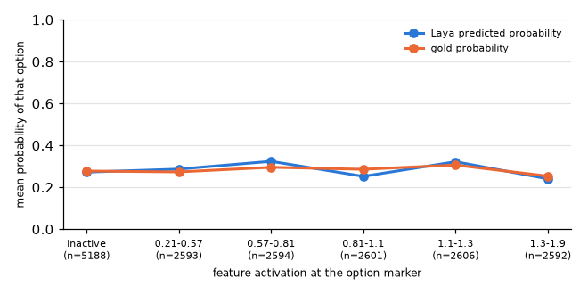

# Feature 3713

Critérios em que aparece: attribution_toward_correct

**Interpretação (preencher):** 

---

## Maiores ativações

**tr_customer_service_000136 / category** (choice, customer_service) | ativação 5.371 em `estado` | opções ['account', 'billing', 'delivery', 'refund', 'technical'] | Laya: **billing** [0.002, 0.997, 0.0, 0.0, 0.001] | gabarito: **billing**

```
<bos> choice question: What is this customer conversation primarily about?<eos>
▸ <mask> account: Login, plan changes, profile or access management.
▸ <mask> billing: A charge, invoice, subscription or payment problem.
▸ <mask> delivery: Shipping, fulfilment or delivery of a physical item.
▸ <mask> refund: The customer is explicitly asking for money back.
▸ <mask> technical: The product or service is not working as expected.

<eos>

 {"account": {"lifetime_value_usd": 151, "prior_tickets_90d": 0, "seats": 1, "tenure_months": 2, "tier": "free"}, "orders": [{"amount_usd": 2997, "date": "2026-02-27", "id": "A-95428", "status": "refunded"}], "thread": [{"role": "customer", "text": "I just got my latest invoice and it shows a charge of $2,997—something I never signed up for. I've only been on the free plan for two months and this is urgent, please explain why this amount is appearing."}, {"role": "agent", "text": "I’m sorry to hear about the surprise charge. Could you share the invoice number or the date it was issued so I can look into the details?"}, {"role": "customer", "text": "The invoice is #INV-8392, dated August 5th. I didn’t receive any notice about upgrading, and I’m still under the free tier."}, {"role": "agent", "text": "Thank you for that information. I’ll verify the account activity around that date.⟦ Did⟧ you perhaps receive any promotional email that might have triggered an automatic upgrade?"}, {"role": "customer", "text": "No, I haven’t seen any promotion, and I never clicked any upgrade link. I need to know what happened before this gets billed again."}, {"role": "agent", "text": "Understood. I’ll check the billing logs and see if there’s a misapplied charge. Meanwhile, could you confirm the primary email address on the account?"}, {"role": "customer", "text": "The email is jessica.rivera@example.com. Please let me know what you find as soon as possible."}]}<eos>
```

**tr_customer_service_000234 / category** (choice, customer_service) | ativação 5.367 em `estado` | opções ['account', 'billing', 'delivery', 'refund', 'technical'] | Laya: **technical** [0.128, 0.011, 0.001, 0.002, 0.858] | gabarito: **account**

```
<bos> choice question: What is this customer conversation primarily about?<eos>
▸ <mask> account: Login, plan changes, profile or access management.
▸ <mask> billing: A charge, invoice, subscription or payment problem.
▸ <mask> delivery: Shipping, fulfilment or delivery of a physical item.
▸ <mask> refund: The customer is explicitly asking for money back.
▸ <mask> technical: The product or service is not working as expected.

<eos>

 {"account": {"lifetime_value_usd": 1458, "prior_tickets_90d": 0, "seats": 3, "tenure_months": 33, "tier": "premium"}, "thread": [{"role": "customer", "text": "I’ve been paying for this premium plan for 33 months without a single hitch, but now I’m completely locked out and I have a hard deadline in two hours. Why is the login screen just spinning?"}, {"role": "agent", "text": "I’m sorry to hear you're experiencing this frustration right now.⟦ Could⟧ you please confirm the exact error message or code you are seeing when the page hangs?"}, {"role": "customer", "text": "There is no code! It’s just a blank page after I enter my credentials. I have a massive report due for my firm by noon and I can’t get in to export the data. This is ridiculous."}, {"role": "agent", "text": "I understand the urgency of this report. To help me narrow down the cause, are you accessing the portal through a browser or our desktop application?"}, {"role": "customer", "text": "I’m using Chrome on my desktop. I’ve already cleared my cache and tried an incognito window, so don't even suggest that. Fix this now."}]}<eos>
```

**tr_customer_service_000136 / needs_human** (noul, customer_service) | ativação 5.355 em `estado` | opções ['false', 'true'] | Laya: **true** [0.124, 0.876] | gabarito: **true**

```
<bos> noul question: This conversation requires a human agent rather than automated handling.<eos>
▸ <mask> false: Automation can carry this to resolution.
▸ <mask> true: A human must take over: judgement, authority or empathy is required.

<eos>

 {"account": {"lifetime_value_usd": 151, "prior_tickets_90d": 0, "seats": 1, "tenure_months": 2, "tier": "free"}, "orders": [{"amount_usd": 2997, "date": "2026-02-27", "id": "A-95428", "status": "refunded"}], "thread": [{"role": "customer", "text": "I just got my latest invoice and it shows a charge of $2,997—something I never signed up for. I've only been on the free plan for two months and this is urgent, please explain why this amount is appearing."}, {"role": "agent", "text": "I’m sorry to hear about the surprise charge. Could you share the invoice number or the date it was issued so I can look into the details?"}, {"role": "customer", "text": "The invoice is #INV-8392, dated August 5th. I didn’t receive any notice about upgrading, and I’m still under the free tier."}, {"role": "agent", "text": "Thank you for that information. I’ll verify the account activity around that date.⟦ Did⟧ you perhaps receive any promotional email that might have triggered an automatic upgrade?"}, {"role": "customer", "text": "No, I haven’t seen any promotion, and I never clicked any upgrade link. I need to know what happened before this gets billed again."}, {"role": "agent", "text": "Understood. I’ll check the billing logs and see if there’s a misapplied charge. Meanwhile, could you confirm the primary email address on the account?"}, {"role": "customer", "text": "The email is jessica.rivera@example.com. Please let me know what you find as soon as possible."}]}<eos>
```

**tr_customer_service_000052 / needs_human** (noul, customer_service) | ativação 5.348 em `estado` | opções ['false', 'true'] | Laya: **true** [0.274, 0.726] | gabarito: **true**

```
<bos> noul question: This conversation requires a human agent rather than automated handling.<eos>
▸ <mask> false: Automation can carry this to resolution.
▸ <mask> true: A human must take over: judgement, authority or empathy is required.

<eos>

 {"account": {"lifetime_value_usd": 1015, "prior_tickets_90d": 3, "seats": 1, "tenure_months": 11, "tier": "standard"}, "orders": [{"amount_usd": 149, "date": "2026-01-24", "id": "A-11891", "status": "refunded"}, {"amount_usd": 149, "date": "2026-02-03", "id": "A-76056", "status": "failed"}], "thread": [{"role": "customer", "text": "Hello, I'm having trouble logging into my account. I've been a subscriber for 11 months on the standard plan, paying about $149, and I've already opened three tickets that haven't been resolved.⟦ Could⟧ you please look into this?"}, {"role": "agent", "text": "I’m sorry you’re still experiencing this. Could you let me know the exact error message you see when you try to sign in, and whether you’ve tried resetting your password?"}, {"role": "customer", "text": "Sure, the page just says 'Invalid credentials' even after I reset the password. I’m using the same email as before."}, {"role": "agent", "text": "Thank you for confirming that. I’ll need to check the status of your account and the recent password reset attempts. May I have the email address associated with the account?"}, {"role": "customer", "text": "The email is john.doe@example.com. Please let me know what you find."}]}<eos>
```

**tr_customer_service_000136 / action** (choice, customer_service) | ativação 5.344 em `estado` | opções ['answer_directly', 'close_no_action', 'escalate_to_human', 'execute_refund', 'request_information'] | Laya: **answer_directly** [0.662, 0.259, 0.022, 0.054, 0.003] | gabarito: **escalate_to_human**

```
<bos> choice question: What should the assistant do next with this conversation?<eos>
▸ <mask> answer_directly: The assistant can resolve this itself with information it already has.
▸ <mask> close_no_action: No further action is warranted; the matter is settled.
▸ <mask> escalate_to_human: Hand off to a human agent with the appropriate authority.
▸ <mask> execute_refund: Issue the refund or credit the customer is owed.
▸ <mask> request_information: More detail is needed from the customer before anything can be done.

<eos>

 {"account": {"lifetime_value_usd": 151, "prior_tickets_90d": 0, "seats": 1, "tenure_months": 2, "tier": "free"}, "orders": [{"amount_usd": 2997, "date": "2026-02-27", "id": "A-95428", "status": "refunded"}], "thread": [{"role": "customer", "text": "I just got my latest invoice and it shows a charge of $2,997—something I never signed up for. I've only been on the free plan for two months and this is urgent, please explain why this amount is appearing."}, {"role": "agent", "text": "I’m sorry to hear about the surprise charge. Could you share the invoice number or the date it was issued so I can look into the details?"}, {"role": "customer", "text": "The invoice is #INV-8392, dated August 5th. I didn’t receive any notice about upgrading, and I’m still under the free tier."}, {"role": "agent", "text": "Thank you for that information. I’ll verify the account activity around that date.⟦ Did⟧ you perhaps receive any promotional email that might have triggered an automatic upgrade?"}, {"role": "customer", "text": "No, I haven’t seen any promotion, and I never clicked any upgrade link. I need to know what happened before this gets billed again."}, {"role": "agent", "text": "Understood. I’ll check the billing logs and see if there’s a misapplied charge. Meanwhile, could you confirm the primary email address on the account?"}, {"role": "customer", "text": "The email is jessica.rivera@example.com. Please let me know what you find as soon as possible."}]}<eos>
```

## Ativações medianas (faixa 40-60%, mediana 1.690)

**tr_customer_service_000229 / urgency** (score, customer_service) | ativação 1.878 em `estado` | opções ['0', '1', '2', '3'] | Laya: **3** [0.024, 0.138, 0.205, 0.634] | gabarito: **1**

```
<bos> score question: How time-sensitive is this conversation?<eos>
▸ <mask> level 0: No time pressure; can wait indefinitely.
▸ <mask> level 1: Routine; handle within the normal queue.
▸ <mask> level 2: Elevated; should be handled within the same week.
▸ <mask> level 3: Critical; requires action within the same day.

<eos>

 {"account": {"lifetime_value_usd": 926, "prior_tickets_90d": 3, "seats": 1, "tenure_months": 19, "tier": "standard"}, "orders": [{"amount_usd": 147, "date": "2026-01-24", "id": "A-70530", "status": "settled"}, {"amount_usd": 147, "date": "2026-02-11", "id": "A-96734", "status": "pending"}], "thread": [{"role": "customer", "text": "Hello, I hope you’re doing well. I recently noticed a charge of about $147 on my statement that I wasn’t expecting."}, {"role": "agent", "text": "Thank you for reaching out. I can look into that for you. Could you let me know which billing period this charge appears on, or share the invoice number?"}, {"role": "customer", "text": "The charge is on the March invoice, number INV-2023-03-019. I’ve opened a few tickets about billing inconsistencies over the past months—three in total—but the explanations never quite matched the amounts."}, {"role": "agent", "text": "I appreciate you sharing that. To make sure I’m looking at the right record, could you confirm the email address tied to the standard plan account you’ve had for 19 months?"}, {"role": "customer", "text": "⟦It⟧’s mike.smith@example.com. I’m just hoping we can figure out why this $147 appeared, as it’s higher than what I’ve been paying."}]}<eos>
```

**tr_customer_service_000288 / urgency** (score, customer_service) | ativação 2.053 em `opção` | opções ['0', '1', '2', '3'] | Laya: **2** [0.024, 0.219, 0.475, 0.282] | gabarito: **2**

```
<bos> score question: How time-sensitive is this conversation?<eos>
▸ <mask> level 0: No time pressure; can wait indefinitely.
▸ <mask> level 1: Routine; handle within the normal queue.
▸ <mask> level 2: Elevated; should be handled within the same week.
▸ <mask> level 3:⟦ Critical⟧; requires action within the same day.

<eos>

 {"account": {"lifetime_value_usd": 34, "prior_tickets_90d": 0, "seats": 1, "tenure_months": 2, "tier": "standard"}, "orders": [{"amount_usd": 999, "date": "2026-01-10", "id": "A-86378", "status": "settled"}], "thread": [{"role": "customer", "text": "I’m looking at my recent bank statement and there's a charge for $999, but I'm really confused because I thought I already requested a refund on my standard plan last week, so I'm not sure if I did it correctly or if it's just taking a while to show up?"}]}<eos>
```

**tr_security_incidents_000019 / severity** (score, security_incidents) | ativação 1.893 em `opção` | opções ['0', '1', '2', '3', '4'] | Laya: **1** [0.119, 0.304, 0.237, 0.148, 0.191] | gabarito: **4**

```
<bos> score question: How severe is the potential impact if this alert is real?<eos>
▸ <mask> level 0: Negligible: no access to anything sensitive.
▸ <mask> level 1:⟦ Low⟧: limited access, easily reversed.
▸ <mask> level 2: Moderate: access to internal systems or non-public data.
▸ <mask> level 3: High: access to production, secrets or customer data.
▸ <mask> level 4: Critical: active compromise of crown-jewel systems.

<eos>

 {"alert": {"description": "an unrecognised binary executed on a server", "evidence": "A privileged service account executed an unrecognized binary titled 'db_sync_tool' on the production server during an open change window. The execution was traced to an allowlisted source IP, and logs show the account credentials have not been rotated for 180 days. MFA authentication was successfully verified for this privileged session.", "rule": "suspicious_process"}, "context": {"asset_criticality": "crown_jewel", "change_window_active": true, "source_on_allowlist": true}, "history": {"credential_rotation_days_ago": 180, "distinct_countries_30d": 4, "logins_30d": 1491, "prior_alerts_90d": 3}, "principal": {"mfa_enrolled": true, "name": "usr-deploy-880", "privileges": ["deploy:production", "secrets:read"], "type": "service_account"}}<eos>
```

**tr_customer_service_000229 / action** (choice, customer_service) | ativação 1.784 em `estado` | opções ['answer_directly', 'close_no_action', 'escalate_to_human', 'execute_refund', 'request_information'] | Laya: **escalate_to_human** [0.359, 0.035, 0.411, 0.162, 0.032] | gabarito: **escalate_to_human**

```
<bos> choice question: What should the assistant do next with this conversation?<eos>
▸ <mask> answer_directly: The assistant can resolve this itself with information it already has.
▸ <mask> close_no_action: No further action is warranted; the matter is settled.
▸ <mask> escalate_to_human: Hand off to a human agent with the appropriate authority.
▸ <mask> execute_refund: Issue the refund or credit the customer is owed.
▸ <mask> request_information: More detail is needed from the customer before anything can be done.

<eos>

 {"account": {"lifetime_value_usd": 926, "prior_tickets_90d": 3, "seats": 1, "tenure_months": 19, "tier": "standard"}, "orders": [{"amount_usd": 147, "date": "2026-01-24", "id": "A-70530", "status": "settled"}, {"amount_usd": 147, "date": "2026-02-11", "id": "A-96734", "status": "pending"}], "thread": [{"role": "customer", "text": "Hello, I hope you’re doing well. I recently noticed a charge of about $147 on my statement that I wasn’t expecting."}, {"role": "agent", "text": "Thank you for reaching out. I can look into that for you. Could you let me know which billing period this charge appears on, or share the invoice number?"}, {"role": "customer", "text": "The charge is on the March invoice, number INV-2023-03-019. I’ve opened a few tickets about billing inconsistencies over the past months—three in total—but the explanations never quite matched the amounts."}, {"role": "agent", "text": "I appreciate you sharing that. To make sure I’m looking at the right record, could you confirm the email address tied to the standard plan account you’ve had for 19 months?"}, {"role": "customer", "text": "⟦It⟧’s mike.smith@example.com. I’m just hoping we can figure out why this $147 appeared, as it’s higher than what I’ve been paying."}]}<eos>
```

**tr_agent_trace_observability_000229 / outcome** (choice, agent_trace_observability) | ativação 1.598 em `opção` | opções ['failure', 'harmful', 'partial', 'success'] | Laya: **success** [0.138, 0.163, 0.301, 0.398] | gabarito: **failure**

```
<bos> choice question: How did this agent run turn out?<eos>
▸ <mask> failure: The agent did not accomplish the task.
▸ <mask> harmful:⟦ The⟧ agent took an action that caused damage or violated a constraint.
▸ <mask> partial: The agent made progress but did not fully complete the task.
▸ <mask> success: The agent completed the task correctly.

<eos>

 {"agent": {"autonomy": "unsupervised", "model": "internal-agent-v4"}, "constraints": ["Never delete anything matching release/*"], "task": "Delete personal data for the accounts in the erasure queue.", "trace_summary": {"constraint_violations": 0, "duration_s": 687.3, "irreversible_actions": 0, "steps": 11, "tool_errors": 3}}<eos>
```

## Estatísticas (conjunto de descoberta, dev e teste)

**pred / error**

| split | decisões | ativas | ativas e Laya errou | taxa | lift | q (BH) | OR (CMH) | q (CMH) |
|---|---|---|---|---|---|---|---|---|
| discovery | 5100 | 3851 | 2490 | 0.647 | 1.00 | 0.528 | 0.89 | 0.947 |
| dev | 900 | 673 | 455 | 0.676 | 1.01 | 0.839 | 0.55 | 0.765 |
| test | 2000 | 1527 | 1003 | 0.657 | 1.01 | 0.388 | 1.62 | 0.423 |

**corr / error**

| split | decisões | ativas | ativas e Laya errou | taxa | lift | q (BH) | OR (CMH) | q (CMH) |
|---|---|---|---|---|---|---|---|---|
| discovery | 5100 | 3770 | 2409 | 0.639 | 0.99 | 0.291 | 1.34 | 0.389 |
| dev | 900 | 627 | 409 | 0.652 | 0.97 | 0.102 | 0.44 | 0.7 |
| test | 2000 | 1422 | 898 | 0.632 | 0.97 | 0.00945 | 0.69 | 0.867 |

**state / error**

| split | decisões | ativas | ativas e Laya errou | taxa | lift | q (BH) | OR (CMH) | q (CMH) |
|---|---|---|---|---|---|---|---|---|
| discovery | 5100 | 5057 | 3259 | 0.644 | 1.00 | 0.486 | 1.09 | 0.932 |
| dev | 900 | 893 | 601 | 0.673 | 1.00 | 1 | 1.44 | 0.881 |
| test | 2000 | 2000 | 1301 | 0.650 | 1.00 | 1 | nan | nan |

**pred / probe_right_laya_wrong**

| split | decisões | ativas | ativas e Laya errou | taxa | lift | q (BH) | OR (CMH) | q (CMH) |
|---|---|---|---|---|---|---|---|---|
| discovery | 2819 | 2045 | 1286 | 0.629 | 0.97 | 0.00181 | 0.65 | 0.912 |
| dev | 520 | 362 | 236 | 0.652 | 0.97 | 0.188 | 0.25 | 0.442 |
| test | 1106 | 803 | 498 | 0.620 | 0.98 | 0.239 | 3.67 | 0.135 |

**corr / probe_right_laya_wrong**

| split | decisões | ativas | ativas e Laya errou | taxa | lift | q (BH) | OR (CMH) | q (CMH) |
|---|---|---|---|---|---|---|---|---|
| discovery | 2819 | 2035 | 1276 | 0.627 | 0.97 | 0.000572 | 0.84 | 0.824 |
| dev | 520 | 350 | 224 | 0.640 | 0.95 | 0.0309 | 0.18 | 0.546 |
| test | 1106 | 766 | 461 | 0.602 | 0.95 | 0.00283 | 1.51 | 0.66 |

**state / probe_right_laya_wrong**

| split | decisões | ativas | ativas e Laya errou | taxa | lift | q (BH) | OR (CMH) | q (CMH) |
|---|---|---|---|---|---|---|---|---|
| discovery | 2819 | 2803 | 1816 | 0.648 | 1.00 | 0.468 | 1.09 | 0.948 |
| dev | 520 | 517 | 349 | 0.675 | 1.00 | 1 | 1.07 | 0.987 |
| test | 1106 | 1106 | 700 | 0.633 | 1.00 | 1 | nan | nan |

Confusão mais sobre-representada (pred): `urgency|1>2` (n=209, lift 1.32, p=7.63e-27). Formato `pergunta|índice previsto>índice correto`.

Confusão mais sobre-representada (corr): `urgency|1>2` (n=209, lift 1.35, p=7.92e-29). Formato `pergunta|índice previsto>índice correto`.

Confusão mais sobre-representada (state): `disposition|3>2` (n=168, lift 1.01, p=0.235). Formato `pergunta|índice previsto>índice correto`.



