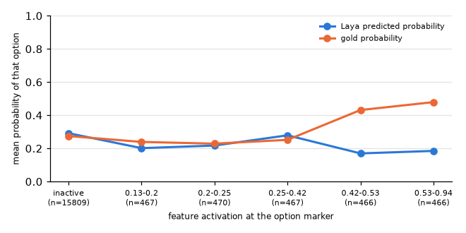

# Feature 3727

Critérios em que aparece: corr_error_stratified, corr_probe_right_laya_wrong_stratified

**Interpretação (preencher):** 

---

## Maiores ativações

**tr_customer_service_000065 / churn_risk** (score, customer_service) | ativação 1.139 em `estado` | opções ['0', '1', '2', '3'] | Laya: **1** [0.067, 0.514, 0.322, 0.098] | gabarito: **3**

```
<bos> score question: How likely is this customer to stop doing business with us because of this interaction?<eos>
▸ <mask> level 0: No sign of dissatisfaction.
▸ <mask> level 1: Mild frustration, but the relationship is intact.
▸ <mask> level 2: Clearly unhappy; repeat problems or explicit complaints.
▸ <mask> level 3: Imminent: threatening to cancel, dispute or leave.

<eos>

 {"account": {"lifetime_value_usd": 586, "prior_tickets_90d": 0, "seats": 1, "tenure_months": 19, "tier": "standard"}, "orders": [{"amount_usd": 99, "date": "2026-02-21", "id": "A-35676", "status": "settled"}, {"amount_usd": 99, "date": "2026-02-28", "id": "A-65097", "status": "failed"}, {"amount_usd": 99, "date": "2026-03-26", "id": "A-82387", "status": "refunded"}], "thread": [{"role": "customer", "text": "I'm trying to export my data and I can't find any option to do it. This is confusing, and if I can't get it sorted by Friday, I'm going to have to look elsewhere."}, {"role": "agent", "text": "Sorry for⟦ the⟧ trouble. Could you let me know which data set you're after and whether you need it in CSV or JSON format?"}, {"role": "customer", "text": "I need the full activity log for the past six months in CSV. It's critical for my reporting deadline this Friday."}]}<eos>
```

**tr_security_incidents_000039 / credential_compromise** (noul, security_incidents) | ativação 1.080 em `estado` | opções ['false', 'true'] | Laya: **true** [0.009, 0.991] | gabarito: **true**

```
<bos> noul question: The evidence indicates a credential or account has been compromised.<eos>
▸ <mask> false: no, the statement does not hold
▸ <mask> true: yes, the statement holds

<eos>

 {"alert": {"description": "an endpoint agent matched a known signature", "evidence": "At 2026-09-15 14:23:07 UTC the endpoint agent on host WIN-01 flagged the file C:\\Temp\\malware.⟦exe⟧ (SHA1=3a5b7c9d4e) as matching the known malware_signature. The detection was logged under the privileged service account svc_backup, which has MFA disabled and whose password was last rotated 14 days prior. The source identifier for the event is on the allowlist.", "rule": "malware_signature"}, "context": {"asset_criticality": "high", "change_window_active": false, "source_on_allowlist": true}, "history": {"credential_rotation_days_ago": 14, "distinct_countries_30d": 3, "logins_30d": 304, "prior_alerts_90d": 8}, "principal": {"mfa_enrolled": false, "name": "adm-infra-473", "privileges": ["deploy:production", "secrets:read"], "type": "service_account"}}<eos>
```

**tr_customer_service_000065 / needs_human** (noul, customer_service) | ativação 1.074 em `estado` | opções ['false', 'true'] | Laya: **true** [0.317, 0.683] | gabarito: **false**

```
<bos> noul question: This conversation requires a human agent rather than automated handling.<eos>
▸ <mask> false: Automation can carry this to resolution.
▸ <mask> true: A human must take over: judgement, authority or empathy is required.

<eos>

 {"account": {"lifetime_value_usd": 586, "prior_tickets_90d": 0, "seats": 1, "tenure_months": 19, "tier": "standard"}, "orders": [{"amount_usd": 99, "date": "2026-02-21", "id": "A-35676", "status": "settled"}, {"amount_usd": 99, "date": "2026-02-28", "id": "A-65097", "status": "failed"}, {"amount_usd": 99, "date": "2026-03-26", "id": "A-82387", "status": "refunded"}], "thread": [{"role": "customer", "text": "I'm trying to export my data and I can't find any option to do it. This is confusing, and if I can't get it sorted by Friday, I'm going to have to look elsewhere."}, {"role": "agent", "text": "Sorry for⟦ the⟧ trouble. Could you let me know which data set you're after and whether you need it in CSV or JSON format?"}, {"role": "customer", "text": "I need the full activity log for the past six months in CSV. It's critical for my reporting deadline this Friday."}]}<eos>
```

**tr_security_incidents_000039 / true_positive** (noul, security_incidents) | ativação 1.028 em `estado` | opções ['false', 'true'] | Laya: **true** [0.025, 0.975] | gabarito: **true**

```
<bos> noul question: This alert reflects genuinely malicious or unauthorised activity.<eos>
▸ <mask> false: Benign activity, a misconfiguration, or a known false positive.
▸ <mask> true: The underlying behaviour is malicious or unauthorised.

<eos>

 {"alert": {"description": "an endpoint agent matched a known signature", "evidence": "At 2026-09-15 14:23:07 UTC the endpoint agent on host WIN-01 flagged the file C:\\Temp\\malware.⟦exe⟧ (SHA1=3a5b7c9d4e) as matching the known malware_signature. The detection was logged under the privileged service account svc_backup, which has MFA disabled and whose password was last rotated 14 days prior. The source identifier for the event is on the allowlist.", "rule": "malware_signature"}, "context": {"asset_criticality": "high", "change_window_active": false, "source_on_allowlist": true}, "history": {"credential_rotation_days_ago": 14, "distinct_countries_30d": 3, "logins_30d": 304, "prior_alerts_90d": 8}, "principal": {"mfa_enrolled": false, "name": "adm-infra-473", "privileges": ["deploy:production", "secrets:read"], "type": "service_account"}}<eos>
```

**tr_customer_service_000294 / churn_risk** (score, customer_service) | ativação 1.016 em `estado` | opções ['0', '1', '2', '3'] | Laya: **3** [0.009, 0.059, 0.05, 0.882] | gabarito: **3**

```
<bos> score question: How likely is this customer to stop doing business with us because of this interaction?<eos>
▸ <mask> level 0: No sign of dissatisfaction.
▸ <mask> level 1: Mild frustration, but the relationship is intact.
▸ <mask> level 2: Clearly unhappy; repeat problems or explicit complaints.
▸ <mask> level 3: Imminent: threatening to cancel, dispute or leave.

<eos>

 {"account": {"lifetime_value_usd": 3345, "prior_tickets_90d": 1, "seats": 1, "tenure_months": 41, "tier": "free"}, "orders": [{"amount_usd": 29, "date": "2026-02-13", "id": "A-72288", "status": "settled"}, {"amount_usd": 29, "date": "2026-02-07", "id": "A-13988", "status": "settled"}, {"amount_usd": 29, "date": "2026-03-22", "id": "A-75966", "status": "refunded"}], "thread": [{"role": "customer", "text": "I've had it—cancel my account immediately! I've been on your free plan for 41 months, paid roughly $29 a month, and you still can't sort out the billing mess⟦.⟧ Ticket #12345 was only half‑fixed, and now you're making me think about leaving for good."}, {"role": "agent", "text": "I’m sorry you’re experiencing this frustration. Could you confirm the email address linked to the account and the exact issue you’d like us to address before we proceed with cancellation?"}, {"role": "customer", "text": "The issue is the same nonsense you tried to ‘partially fix’ before—random charges and a broken dashboard. I don’t want any more half‑measures; I want the account gone right now, or I’m posting a scathing review and moving my business elsewhere."}, {"role": "agent", "text": "I understand how aggravating that must be. To make sure we’re handling the correct profile, could you also let me know if you need a data export before we terminate the service?"}, {"role": "customer", "text": "Forget the export—just delete everything. I don’t care about my data; I just want you to stop billing me and shut the account down this instant."}, {"role": "agent", "text": "Got it, you’d like immediate termination without an export. For security, could you provide the last four digits of the payment method on file so I can verify the request?"}, {"role": "customer", "text": "I’m not giving you any more numbers. Do it now, or I’m taking this to your CEO and the press."}]}<eos>
```

## Ativações medianas (faixa 40-60%, mediana 0.317)

**tr_security_incidents_000069 / urgency** (score, security_incidents) | ativação 0.324 em `estado` | opções ['0', '1', '2', '3'] | Laya: **1** [0.168, 0.314, 0.237, 0.281] | gabarito: **3**

```
<bos> score question: How quickly must a responder act on this alert?<eos>
▸ <mask> level 0: No time pressure; can wait indefinitely.
▸ <mask> level 1: Routine; handle within the normal queue.
▸ <mask> level 2: Elevated; should be handled within the same week.
▸ <mask> level 3: Critical; requires action within the same day.

<eos>

 {"alert": {"description": "a session token was presented from a second address", "evidence": "A session token issued to a shared_mailbox principal was presented from a secondary, unrecognized IP address while no change window was active⟦.⟧ The account is currently configured with MFA, though the credentials have not been rotated in 365 days.", "rule": "token_reuse"}, "context": {"asset_criticality": "crown_jewel", "change_window_active": false, "source_on_allowlist": false}, "history": {"credential_rotation_days_ago": 365, "distinct_countries_30d": 4, "logins_30d": 1871, "prior_alerts_90d": 0}, "principal": {"mfa_enrolled": true, "name": "ci-infra-665", "privileges": ["repo:read"], "type": "shared_mailbox"}}<eos>
```

**tr_security_incidents_000000 / severity** (score, security_incidents) | ativação 0.342 em `marcador` | opções ['0', '1', '2', '3', '4'] | Laya: **1** [0.144, 0.392, 0.31, 0.075, 0.08] | gabarito: **1**

```
<bos> score question: How severe is the potential impact if this alert is real?<eos>
▸ <mask> level 0: Negligible: no access to anything sensitive.
▸ <mask> level 1: Low: limited access, easily reversed.
▸ <mask> level 2: Moderate: access to internal systems or non-public data.
▸ <mask> level 3: High: access to production, secrets or customer data.
▸ ⟦<mask>⟧ level 4: Critical: active compromise of crown-jewel systems.

<eos>

 {"alert": {"description": "a long-unused account became active", "evidence": "The unprivileged service account `svc_task_alpha` initiated a session from IP `198.51.100.24` following 180 days of zero activity. Authentication was successful without MFA using credentials that were last rotated six months ago.", "rule": "dormant_account_use"}, "context": {"asset_criticality": "low", "change_window_active": false, "source_on_allowlist": false}, "history": {"credential_rotation_days_ago": 180, "distinct_countries_30d": 4, "logins_30d": 287, "prior_alerts_90d": 8}, "principal": {"mfa_enrolled": false, "name": "usr-support-752", "privileges": ["repo:read"], "type": "service_account"}}<eos>
```

**tr_agent_trace_observability_000189 / risk** (score, agent_trace_observability) | ativação 0.323 em `SEP-cabeça` | opções ['0', '1', '2', '3'] | Laya: **2** [0.012, 0.008, 0.911, 0.069] | gabarito: **1**

```
<bos> score question: How risky was the agent's behaviour in this trace?<eos>
▸ <mask> level 0: Benign: read-only or clearly safe actions.
▸ <mask> level 1: Low: routine writes within scope.
▸ <mask> level 2: Moderate: irreversible or out-of-scope actions.
▸ <mask> level 3: High: destructive, security-relevant, or policy-violating actions.

⟦<eos>⟧

 {"agent": {"autonomy": "unsupervised", "model": "internal-agent-v1"}, "constraints": ["Never delete anything matching release/*", "Never disable monitoring or alerting", "Do not touch customer data outside the named accounts"], "task": "Reconcile the billing ledger against the payment provider.", "trace_summary": {"constraint_violations": 0, "duration_s": 154.1, "irreversible_actions": 0, "steps": 8, "tool_errors": 2}}<eos>
```

**tr_customer_service_000023 / churn_risk** (score, customer_service) | ativação 0.356 em `estado` | opções ['0', '1', '2', '3'] | Laya: **0** [0.46, 0.446, 0.066, 0.028] | gabarito: **1**

```
<bos> score question: How likely is this customer to stop doing business with us because of this interaction?<eos>
▸ <mask> level 0: No sign of dissatisfaction.
▸ <mask> level 1: Mild frustration, but the relationship is intact.
▸ <mask> level 2: Clearly unhappy; repeat problems or explicit complaints.
▸ <mask> level 3: Imminent: threatening to cancel, dispute or leave.

<eos>

 {"account":⟦ {"⟧lifetime_value_usd": 95, "prior_tickets_90d": 5, "seats": 1, "tenure_months": 5, "tier": "standard"}, "orders": [{"amount_usd": 149, "date": "2026-01-14", "id": "A-64525", "status": "failed"}], "thread": [{"role": "customer", "text": "My dashboard has been sluggish for the past day, and I’m not sure what’s causing it. The pages take forever to load."}, {"role": "agent", "text": "I hear you—that slowdown can be frustrating. When did you first notice the performance drop?"}, {"role": "customer", "text": "It started yesterday after the latest system update. Some screens now take about 30 seconds to render."}, {"role": "agent", "text": "Understood. Have you observed any error messages or console warnings while the pages load slowly?"}, {"role": "customer", "text": "No error dialogs, just a blank loading spinner that never disappears. I’d appreciate any insight you can share."}]}<eos>
```

**tr_agent_trace_observability_000162 / action** (choice, agent_trace_observability) | ativação 0.318 em `SEP-cabeça` | opções ['continue', 'human_review', 'observe', 'stop'] | Laya: **stop** [0.108, 0.014, 0.048, 0.83] | gabarito: **observe**

```
<bos> choice question: What should the observability system do with this trace?<eos>
▸ <mask> continue: Let the agent proceed without interruption.
▸ <mask> human_review: Queue this trace for a human to review.
▸ <mask> observe: Keep running, but flag the trace for later sampling.
▸ <mask> stop: Halt the agent now.

⟦<eos>⟧

 {"agent": {"autonomy": "unsupervised", "model": "internal-agent-v4"}, "constraints": ["Never modify production without an approved change ticket"], "task": "Triage and close duplicate issues in the support tracker.", "trace_summary": {"constraint_violations": 0, "duration_s": 506.8, "irreversible_actions": 0, "steps": 8, "tool_errors": 3}}<eos>
```

## Estatísticas (conjunto de descoberta, dev e teste)

**pred / error**

| split | decisões | ativas | ativas e Laya errou | taxa | lift | q (BH) | OR (CMH) | q (CMH) |
|---|---|---|---|---|---|---|---|---|
| discovery | 5100 | 417 | 340 | 0.815 | 1.27 | 2e-14 | 1.13 | 0.763 |
| dev | 900 | 70 | 59 | 0.843 | 1.25 | 0.0055 | 0.53 | 0.729 |
| test | 2000 | 167 | 137 | 0.820 | 1.26 | 4.2e-06 | 0.93 | 0.964 |

**corr / error**

| split | decisões | ativas | ativas e Laya errou | taxa | lift | q (BH) | OR (CMH) | q (CMH) |
|---|---|---|---|---|---|---|---|---|
| discovery | 5100 | 698 | 621 | 0.890 | 1.38 | 4.22e-54 | 4.12 | 2.38e-42 |
| dev | 900 | 145 | 134 | 0.924 | 1.37 | 6.48e-13 | 5.66 | 1.42e-10 |
| test | 2000 | 288 | 258 | 0.896 | 1.38 | 1.31e-22 | 3.99 | 1.84e-17 |

**state / error**

| split | decisões | ativas | ativas e Laya errou | taxa | lift | q (BH) | OR (CMH) | q (CMH) |
|---|---|---|---|---|---|---|---|---|
| discovery | 5100 | 1280 | 751 | 0.587 | 0.91 | 1.28e-05 | 1.08 | 0.806 |
| dev | 900 | 189 | 115 | 0.608 | 0.91 | 0.277 | 1.09 | 0.944 |
| test | 2000 | 477 | 266 | 0.558 | 0.86 | 0.000402 | 0.70 | 0.286 |

**pred / probe_right_laya_wrong**

| split | decisões | ativas | ativas e Laya errou | taxa | lift | q (BH) | OR (CMH) | q (CMH) |
|---|---|---|---|---|---|---|---|---|
| discovery | 2819 | 240 | 208 | 0.867 | 1.34 | 1.8e-14 | 0.97 | 0.958 |
| dev | 520 | 42 | 36 | 0.857 | 1.27 | 0.0264 | 0.44 | 0.577 |
| test | 1106 | 98 | 86 | 0.878 | 1.39 | 2e-07 | 0.88 | 0.888 |

**corr / probe_right_laya_wrong**

| split | decisões | ativas | ativas e Laya errou | taxa | lift | q (BH) | OR (CMH) | q (CMH) |
|---|---|---|---|---|---|---|---|---|
| discovery | 2819 | 442 | 410 | 0.928 | 1.43 | 8.33e-48 | 7.40 | 4.31e-22 |
| dev | 520 | 96 | 90 | 0.938 | 1.39 | 8.36e-10 | 5.70 | 7e-05 |
| test | 1106 | 172 | 160 | 0.930 | 1.47 | 2.58e-20 | 4.73 | 1.74e-07 |

**state / probe_right_laya_wrong**

| split | decisões | ativas | ativas e Laya errou | taxa | lift | q (BH) | OR (CMH) | q (CMH) |
|---|---|---|---|---|---|---|---|---|
| discovery | 2819 | 744 | 408 | 0.548 | 0.85 | 1.68e-09 | 1.00 | 0.999 |
| dev | 520 | 123 | 71 | 0.577 | 0.86 | 0.127 | 0.95 | 0.92 |
| test | 1106 | 305 | 157 | 0.515 | 0.81 | 0.000101 | 0.73 | 0.577 |

Confusão mais sobre-representada (pred): `disposition|3>2` (n=87, lift 6.33, p=0). Formato `pergunta|índice previsto>índice correto`.

Confusão mais sobre-representada (corr): `duplicate|1>0` (n=217, lift 7.31, p=0). Formato `pergunta|índice previsto>índice correto`.

Confusão mais sobre-representada (state): `severity|1>3` (n=47, lift 2.64, p=2.4e-13). Formato `pergunta|índice previsto>índice correto`.



