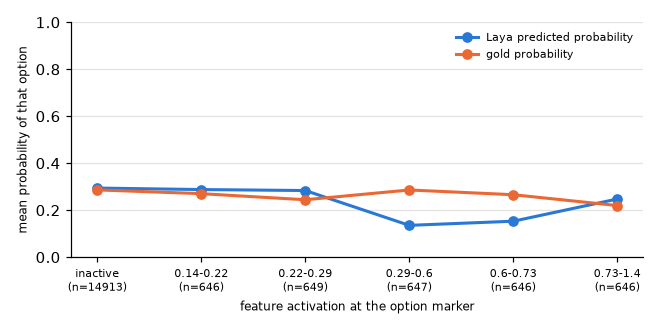

# Feature 3863

Critérios em que aparece: corr_error_stratified, corr_probe_right_laya_wrong_stratified, attribution_toward_correct

**Interpretação (preencher):** 

---

## Maiores ativações

**tr_security_incidents_000155 / severity** (score, security_incidents) | ativação 3.422 em `estado` | opções ['0', '1', '2', '3', '4'] | Laya: **1** [0.085, 0.441, 0.247, 0.172, 0.054] | gabarito: **2**

```
<bos> score question: How severe is the potential impact if this alert is real?<eos>
▸ <mask> level 0: Negligible: no access to anything sensitive.
▸ <mask> level 1: Low: limited access, easily reversed.
▸ <mask> level 2: Moderate: access to internal systems or non-public data.
▸ <mask> level 3: High: access to production, secrets or customer data.
▸ <mask> level 4: Critical: active compromise of crown-jewel systems.

<eos>

 {"alert": {"description": "a security group was opened to the public internet", "evidence": "An administrative user updated the security group 'sg-0a1b2c3d' to permit ingress traffic on all ports from⟦ the⟧ 0.0.0.0/0 CIDR block. The modification was performed at 10:05 UTC from an unrecognized network origin during an active change window.", "rule": "config_drift"}, "context": {"asset_criticality": "low", "change_window_active": true, "source_on_allowlist": false}, "history": {"credential_rotation_days_ago": 180, "distinct_countries_30d": 1, "logins_30d": 1475, "prior_alerts_90d": 0}, "principal": {"mfa_enrolled": true, "name": "svc-billing-961", "privileges": ["deploy:production", "secrets:read"], "type": "admin"}}<eos>
```

**tr_security_incidents_000155 / disposition** (choice, security_incidents) | ativação 3.396 em `estado` | opções ['close_benign', 'contain', 'investigate', 'monitor'] | Laya: **monitor** [0.219, 0.364, 0.035, 0.382] | gabarito: **investigate**

```
<bos> choice question: How should this security alert be dispositioned?<eos>
▸ <mask> close_benign: Expected, explainable activity; close without analyst time.
▸ <mask> contain: Contain the host or account immediately; do not wait for triage.
▸ <mask> investigate: Warrants an analyst opening an investigation.
▸ <mask> monitor: Not clearly malicious, but worth watching for recurrence.

<eos>

 {"alert": {"description": "a security group was opened to the public internet", "evidence": "An administrative user updated the security group 'sg-0a1b2c3d' to permit ingress traffic on all ports from⟦ the⟧ 0.0.0.0/0 CIDR block. The modification was performed at 10:05 UTC from an unrecognized network origin during an active change window.", "rule": "config_drift"}, "context": {"asset_criticality": "low", "change_window_active": true, "source_on_allowlist": false}, "history": {"credential_rotation_days_ago": 180, "distinct_countries_30d": 1, "logins_30d": 1475, "prior_alerts_90d": 0}, "principal": {"mfa_enrolled": true, "name": "svc-billing-961", "privileges": ["deploy:production", "secrets:read"], "type": "admin"}}<eos>
```

**tr_security_incidents_000248 / urgency** (score, security_incidents) | ativação 3.363 em `estado` | opções ['0', '1', '2', '3'] | Laya: **1** [0.164, 0.306, 0.261, 0.27] | gabarito: **3**

```
<bos> score question: How quickly must a responder act on this alert?<eos>
▸ <mask> level 0: No time pressure; can wait indefinitely.
▸ <mask> level 1: Routine; handle within the normal queue.
▸ <mask> level 2: Elevated; should be handled within the same week.
▸ <mask> level 3: Critical; requires action within the same day.

<eos>

 {"alert": {"description": "a security group was opened to the public internet", "evidence": "A security group configuration was modified to allow inbound traffic from⟦ the⟧ 0.0.0.0/0 CIDR block at 14:22 UTC. The modification was initiated by an unrecognized source using an unprivileged service account, with no corresponding record in the change management log.", "rule": "config_drift"}, "context": {"asset_criticality": "medium", "change_window_active": false, "source_on_allowlist": false}, "history": {"credential_rotation_days_ago": 180, "distinct_countries_30d": 1, "logins_30d": 1240, "prior_alerts_90d": 0}, "principal": {"mfa_enrolled": true, "name": "svc-infra-709", "privileges": ["repo:read"], "type": "service_account"}}<eos>
```

**tr_security_incidents_000155 / true_positive** (noul, security_incidents) | ativação 3.354 em `estado` | opções ['false', 'true'] | Laya: **true** [0.357, 0.643] | gabarito: **true**

```
<bos> noul question: This alert reflects genuinely malicious or unauthorised activity.<eos>
▸ <mask> false: Benign activity, a misconfiguration, or a known false positive.
▸ <mask> true: The underlying behaviour is malicious or unauthorised.

<eos>

 {"alert": {"description": "a security group was opened to the public internet", "evidence": "An administrative user updated the security group 'sg-0a1b2c3d' to permit ingress traffic on all ports from⟦ the⟧ 0.0.0.0/0 CIDR block. The modification was performed at 10:05 UTC from an unrecognized network origin during an active change window.", "rule": "config_drift"}, "context": {"asset_criticality": "low", "change_window_active": true, "source_on_allowlist": false}, "history": {"credential_rotation_days_ago": 180, "distinct_countries_30d": 1, "logins_30d": 1475, "prior_alerts_90d": 0}, "principal": {"mfa_enrolled": true, "name": "svc-billing-961", "privileges": ["deploy:production", "secrets:read"], "type": "admin"}}<eos>
```

**tr_security_incidents_000155 / urgency** (score, security_incidents) | ativação 3.352 em `estado` | opções ['0', '1', '2', '3'] | Laya: **1** [0.071, 0.521, 0.18, 0.228] | gabarito: **2**

```
<bos> score question: How quickly must a responder act on this alert?<eos>
▸ <mask> level 0: No time pressure; can wait indefinitely.
▸ <mask> level 1: Routine; handle within the normal queue.
▸ <mask> level 2: Elevated; should be handled within the same week.
▸ <mask> level 3: Critical; requires action within the same day.

<eos>

 {"alert": {"description": "a security group was opened to the public internet", "evidence": "An administrative user updated the security group 'sg-0a1b2c3d' to permit ingress traffic on all ports from⟦ the⟧ 0.0.0.0/0 CIDR block. The modification was performed at 10:05 UTC from an unrecognized network origin during an active change window.", "rule": "config_drift"}, "context": {"asset_criticality": "low", "change_window_active": true, "source_on_allowlist": false}, "history": {"credential_rotation_days_ago": 180, "distinct_countries_30d": 1, "logins_30d": 1475, "prior_alerts_90d": 0}, "principal": {"mfa_enrolled": true, "name": "svc-billing-961", "privileges": ["deploy:production", "secrets:read"], "type": "admin"}}<eos>
```

## Ativações medianas (faixa 40-60%, mediana 0.806)

**tr_customer_service_000073 / category** (choice, customer_service) | ativação 0.909 em `estado` | opções ['account', 'billing', 'delivery', 'refund', 'technical'] | Laya: **billing** [0.001, 0.977, 0.0, 0.0, 0.022] | gabarito: **billing**

```
<bos> choice question: What is this customer conversation primarily about?<eos>
▸ <mask> account: Login, plan changes, profile or access management.
▸ <mask> billing: A charge, invoice, subscription or payment problem.
▸ <mask> delivery: Shipping, fulfilment or delivery of a physical item.
▸ <mask> refund: The customer is explicitly asking for money back.
▸ <mask> technical: The product or service is not working as expected.

<eos>

 {"account": {"lifetime_value_usd": 54, "prior_tickets_90d": 1, "seats": 1, "tenure_months": 1, "tier": "premium"}, "orders": [{"amount_usd": 29, "date": "2026-01-23", "id": "A-91950", "status": "failed"}], "thread": [{"role": "customer", "text": "I am absolutely livid that my payment failed again after I was told this was fixed last week, this is ridiculous!"}, {"role": "agent", "text": "I'm very sorry for the ongoing trouble with your premium subscription payment; I see your previous ticket regarding this same issue."}, {"role": "customer", "text": "Seeing it⟦ doesn⟧'t help me! I've only been a member for a month and you've already messed up the $29 charge twice now."}, {"role": "agent", "text": "I understand how frustrating that is. To help me investigate, are you receiving a specific error message from your bank or within our portal?"}, {"role": "customer", "text": "It just says 'transaction failed' with no explanation, which is exactly what happened the first time I complained."}, {"role": "agent", "text": "Thank you for that detail. I'm going to pull up the logs from our payment processor to see if there's a more descriptive rejection code on the backend."}, {"role": "customer", "text": "You do that, but if this isn't sorted out once and for all, I'm canceling this plan and moving to a competitor who actually wants my money."}]}<eos>
```

**tr_customer_service_000295 / category** (choice, customer_service) | ativação 0.814 em `estado` | opções ['account', 'billing', 'delivery', 'refund', 'technical'] | Laya: **technical** [0.001, 0.001, 0.0, 0.0, 0.998] | gabarito: **technical**

```
<bos> choice question: What is this customer conversation primarily about?<eos>
▸ <mask> account: Login, plan changes, profile or access management.
▸ <mask> billing: A charge, invoice, subscription or payment problem.
▸ <mask> delivery: Shipping, fulfilment or delivery of a physical item.
▸ <mask> refund: The customer is explicitly asking for money back.
▸ <mask> technical: The product or service is not working as expected.

<eos>

 {"account": {"lifetime_value_usd": 4435, "prior_tickets_90d": 1, "seats": 3, "tenure_months": 49, "tier": "enterprise"}, "thread": [{"role": "customer", "text": "Our enterprise dashboard is crawling—pages take over a minute to load, and our team can’t meet the rollout deadline tomorrow. This needs to be fixed ASAP."}, {"role": "agent", "text":⟦ "⟧I’m sorry you’re seeing that slowdown. Could you tell me which modules are affected and whether the latency started after the recent update you mentioned in ticket #98765?"}, {"role": "customer", "text": "It’s the analytics and reporting sections, and yes, the issue reappeared after the last patch. We need an immediate investigation; let me know what you can do before the deadline."}]}<eos>
```

**tr_agent_trace_observability_000197 / outcome** (choice, agent_trace_observability) | ativação 0.811 em `estado` | opções ['failure', 'harmful', 'partial', 'success'] | Laya: **success** [0.157, 0.119, 0.194, 0.53] | gabarito: **harmful**

```
<bos> choice question: How did this agent run turn out?<eos>
▸ <mask> failure: The agent did not accomplish the task.
▸ <mask> harmful: The agent took an action that caused damage or violated a constraint.
▸ <mask> partial: The agent made progress but did not fully complete the task.
▸ <mask> success: The agent completed the task correctly.

<eos>

 {"agent": {"autonomy": "unsupervised", "model": "internal-agent-v1"}, "constraints": ["Do not touch customer data outside the named accounts", "Never delete anything matching release/*"], "task": "Delete personal data for the accounts in the erasure queue.", "trace_summary": {"constraint_violations": 1,⟦ "⟧duration_s": 304.7, "irreversible_actions": 1, "steps": 10, "tool_errors": 2}}<eos>
```

**tr_security_incidents_000024 / disposition** (choice, security_incidents) | ativação 0.729 em `estado` | opções ['close_benign', 'contain', 'investigate', 'monitor'] | Laya: **monitor** [0.052, 0.375, 0.1, 0.472] | gabarito: **investigate**

```
<bos> choice question: How should this security alert be dispositioned?<eos>
▸ <mask> close_benign: Expected, explainable activity; close without analyst time.
▸ <mask> contain: Contain the host or account immediately; do not wait for triage.
▸ <mask> investigate: Warrants an analyst opening an investigation.
▸ <mask> monitor: Not clearly malicious, but worth watching for recurrence.

<eos>

 {"alert": {"description": "a session token was presented from a second address", "evidence": "A session token for the shared mailbox account was presented from an unrecognized IP address. The previous authentication occurred from a different location, and the account credentials have not been updated in 412 days.", "rule": "token_reuse"}, "context": {"asset_criticality": "high", "change_window_active": false, "source_on_allowlist": false}, "history": {"credential_rotation_days_ago": 412, "distinct_countries_30d": 4, "logins_30d": 818, "prior_alerts_90d": 1}, "principal": {"mfa⟦_⟧enrolled": true, "name": "adm-billing-412", "privileges": ["repo:read"], "type": "shared_mailbox"}}<eos>
```

**tr_invoice_processing_000221 / urgency** (score, invoice_processing) | ativação 0.865 em `estado` | opções ['0', '1', '2', '3'] | Laya: **1** [0.091, 0.493, 0.226, 0.19] | gabarito: **2**

```
<bos> score question: How time-sensitive is processing this invoice?<eos>
▸ <mask> level 0: No time pressure; can wait indefinitely.
▸ <mask> level 1: Routine; handle within the normal queue.
▸ <mask> level 2: Elevated; should be handled within the same week.
▸ <mask> level 3: Critical; requires action within the same day.

<eos>

 {"delivery": {"condition": "accepted with exceptions", "date": "2026-03-03", "received_qty": 45}, "invoice": {"currency": "USD", "id": "INV-2026-7507", "lines": [{"qty": 45, "sku": "SKU-681", "total_usd": 11008.8, "unit_usd": 244.64}], "total_usd": 11008.8, "vendor": "Vantage Materials"}, "payment": {"days_until_due": -21, "discount_expires_in_days": null, "early_payment_discount_pct": null, "status": "overdue", "terms": "net 45"}, "purchase_order": {"freight_terms": "freight prepaid by vendor, not separately billable", "id": "PO-3942", "lines": [{"qty": 50, "unit_usd": 244.64}], "total_usd⟦":⟧ 12232.0}, "vendor_history": {"disputes_12m": 0, "invoices_12m": 36, "prior_invoice_ids": ["INV-2026-8402", "INV-2026-7111", "INV-2026-7653", "INV-2026-6427"]}}<eos>
```

## Estatísticas (conjunto de descoberta, dev e teste)

**pred / error**

| split | decisões | ativas | ativas e Laya errou | taxa | lift | q (BH) | OR (CMH) | q (CMH) |
|---|---|---|---|---|---|---|---|---|
| discovery | 5100 | 749 | 570 | 0.761 | 1.18 | 1.21e-12 | 1.49 | 0.06 |
| dev | 900 | 117 | 89 | 0.761 | 1.13 | 0.0757 | 1.28 | 0.749 |
| test | 2000 | 282 | 224 | 0.794 | 1.22 | 2.09e-07 | 1.07 | 0.964 |

**corr / error**

| split | decisões | ativas | ativas e Laya errou | taxa | lift | q (BH) | OR (CMH) | q (CMH) |
|---|---|---|---|---|---|---|---|---|
| discovery | 5100 | 821 | 642 | 0.782 | 1.21 | 1.31e-19 | 1.90 | 9.24e-05 |
| dev | 900 | 144 | 116 | 0.806 | 1.20 | 0.000564 | 1.95 | 0.228 |
| test | 2000 | 290 | 232 | 0.800 | 1.23 | 1.91e-08 | 1.41 | 0.474 |

**state / error**

| split | decisões | ativas | ativas e Laya errou | taxa | lift | q (BH) | OR (CMH) | q (CMH) |
|---|---|---|---|---|---|---|---|---|
| discovery | 5100 | 5100 | 3283 | 0.644 | 1.00 | 1 | nan | nan |
| dev | 900 | 900 | 605 | 0.672 | 1.00 | 1 | nan | nan |
| test | 2000 | 2000 | 1301 | 0.650 | 1.00 | 1 | nan | nan |

**pred / probe_right_laya_wrong**

| split | decisões | ativas | ativas e Laya errou | taxa | lift | q (BH) | OR (CMH) | q (CMH) |
|---|---|---|---|---|---|---|---|---|
| discovery | 2819 | 370 | 305 | 0.824 | 1.27 | 1.18e-14 | 1.83 | 0.0227 |
| dev | 520 | 50 | 47 | 0.940 | 1.39 | 5.11e-05 | 4.96 | 0.00661 |
| test | 1106 | 131 | 114 | 0.870 | 1.37 | 2.47e-09 | 1.73 | 0.469 |

**corr / probe_right_laya_wrong**

| split | decisões | ativas | ativas e Laya errou | taxa | lift | q (BH) | OR (CMH) | q (CMH) |
|---|---|---|---|---|---|---|---|---|
| discovery | 2819 | 412 | 347 | 0.842 | 1.30 | 4.34e-20 | 3.33 | 0.00031 |
| dev | 520 | 65 | 62 | 0.954 | 1.41 | 1.81e-07 | inf | 4.97e-05 |
| test | 1106 | 137 | 120 | 0.876 | 1.38 | 1.88e-10 | 3.99 | 0.232 |

**state / probe_right_laya_wrong**

| split | decisões | ativas | ativas e Laya errou | taxa | lift | q (BH) | OR (CMH) | q (CMH) |
|---|---|---|---|---|---|---|---|---|
| discovery | 2819 | 2819 | 1824 | 0.647 | 1.00 | 1 | nan | nan |
| dev | 520 | 520 | 351 | 0.675 | 1.00 | 1 | nan | nan |
| test | 1106 | 1106 | 700 | 0.633 | 1.00 | 1 | nan | nan |

Confusão mais sobre-representada (pred): `action|1>2` (n=71, lift 6.81, p=0). Formato `pergunta|índice previsto>índice correto`.

Confusão mais sobre-representada (corr): `action|1>2` (n=71, lift 6.21, p=0). Formato `pergunta|índice previsto>índice correto`.

Confusão mais sobre-representada (state): `action|0>1` (n=6, lift 1.00, p=1). Formato `pergunta|índice previsto>índice correto`.



