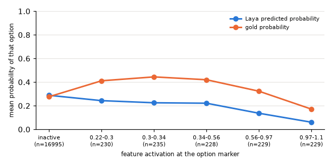

# Feature 3869

Critérios em que aparece: corr_error_stratified, corr_probe_right_laya_wrong_stratified

**Interpretação (preencher):** 

---

## Maiores ativações

**tr_customer_service_000044 / action** (choice, customer_service) | ativação 2.242 em `estado` | opções ['answer_directly', 'close_no_action', 'escalate_to_human', 'execute_refund', 'request_information'] | Laya: **answer_directly** [0.622, 0.291, 0.072, 0.004, 0.01] | gabarito: **escalate_to_human**

```
<bos> choice question: What should the assistant do next with this conversation?<eos>
▸ <mask> answer_directly: The assistant can resolve this itself with information it already has.
▸ <mask> close_no_action: No further action is warranted; the matter is settled.
▸ <mask> escalate_to_human: Hand off to a human agent with the appropriate authority.
▸ <mask> execute_refund: Issue the refund or credit the customer is owed.
▸ <mask> request_information: More detail is needed from the customer before anything can be done.

<eos>

 {"account": {"lifetime_value_usd": 754, "prior_tickets_90d": 0, "seats": 1, "tenure_months": 8, "tier": "free"}, "orders": [{"amount_usd": 897, "date": "2026-03-17", "id": "A-13529", "status": "pending"}], "thread": [{"role": "customer", "text": "I've been trying to downgrade my account to the free tier for over an hour now and the dashboard just keeps looping me back to the billing page without saving the changes. I've already spent nearly $900 with you guys over the last eight months, and I shouldn't have to jump⟦ through⟧ hoops just to stop being charged."}, {"role": "agent", "text": "I'm sorry for the frustration you're experiencing with the downgrade process. To help me investigate why the system isn't processing your request, could you please specify if you're receiving a particular error code or if the page simply refreshes without an update?"}, {"role": "customer", "text": "There's no error code, it just flashes a message saying 'Action could not be completed at this time' and stays on the paid plan. It's ridiculous because I can see the $897 total in my billing history, so the system clearly knows who I am, but it won't let me move to the free plan."}, {"role": "agent", "text": "Thank you for clarifying that for me. I'll need to look into the back-end logs for your account to see what's triggering that message. Could you tell me which browser and version you are currently using, and if you have attempted the change from a different device?"}, {"role": "customer", "text": "I'm on the latest version of Chrome and I've already tried it on my phone too with the exact same result. I just want someone to actually look at my account and explain why the downgrade isn't sticking when I've been a customer here for months."}]}<eos>
```

**tr_customer_service_000044 / category** (choice, customer_service) | ativação 2.205 em `estado` | opções ['account', 'billing', 'delivery', 'refund', 'technical'] | Laya: **technical** [0.025, 0.019, 0.0, 0.001, 0.955] | gabarito: **account**

```
<bos> choice question: What is this customer conversation primarily about?<eos>
▸ <mask> account: Login, plan changes, profile or access management.
▸ <mask> billing: A charge, invoice, subscription or payment problem.
▸ <mask> delivery: Shipping, fulfilment or delivery of a physical item.
▸ <mask> refund: The customer is explicitly asking for money back.
▸ <mask> technical: The product or service is not working as expected.

<eos>

 {"account": {"lifetime_value_usd": 754, "prior_tickets_90d": 0, "seats": 1, "tenure_months": 8, "tier": "free"}, "orders": [{"amount_usd": 897, "date": "2026-03-17", "id": "A-13529", "status": "pending"}], "thread": [{"role": "customer", "text": "I've been trying to downgrade my account to the free tier for over an hour now and the dashboard just keeps looping me back to the billing page without saving the changes. I've already spent nearly $900 with you guys over the last eight months, and I shouldn't have to jump⟦ through⟧ hoops just to stop being charged."}, {"role": "agent", "text": "I'm sorry for the frustration you're experiencing with the downgrade process. To help me investigate why the system isn't processing your request, could you please specify if you're receiving a particular error code or if the page simply refreshes without an update?"}, {"role": "customer", "text": "There's no error code, it just flashes a message saying 'Action could not be completed at this time' and stays on the paid plan. It's ridiculous because I can see the $897 total in my billing history, so the system clearly knows who I am, but it won't let me move to the free plan."}, {"role": "agent", "text": "Thank you for clarifying that for me. I'll need to look into the back-end logs for your account to see what's triggering that message. Could you tell me which browser and version you are currently using, and if you have attempted the change from a different device?"}, {"role": "customer", "text": "I'm on the latest version of Chrome and I've already tried it on my phone too with the exact same result. I just want someone to actually look at my account and explain why the downgrade isn't sticking when I've been a customer here for months."}]}<eos>
```

**tr_customer_service_000044 / needs_human** (noul, customer_service) | ativação 2.201 em `estado` | opções ['false', 'true'] | Laya: **true** [0.376, 0.624] | gabarito: **true**

```
<bos> noul question: This conversation requires a human agent rather than automated handling.<eos>
▸ <mask> false: Automation can carry this to resolution.
▸ <mask> true: A human must take over: judgement, authority or empathy is required.

<eos>

 {"account": {"lifetime_value_usd": 754, "prior_tickets_90d": 0, "seats": 1, "tenure_months": 8, "tier": "free"}, "orders": [{"amount_usd": 897, "date": "2026-03-17", "id": "A-13529", "status": "pending"}], "thread": [{"role": "customer", "text": "I've been trying to downgrade my account to the free tier for over an hour now and the dashboard just keeps looping me back to the billing page without saving the changes. I've already spent nearly $900 with you guys over the last eight months, and I shouldn't have to jump⟦ through⟧ hoops just to stop being charged."}, {"role": "agent", "text": "I'm sorry for the frustration you're experiencing with the downgrade process. To help me investigate why the system isn't processing your request, could you please specify if you're receiving a particular error code or if the page simply refreshes without an update?"}, {"role": "customer", "text": "There's no error code, it just flashes a message saying 'Action could not be completed at this time' and stays on the paid plan. It's ridiculous because I can see the $897 total in my billing history, so the system clearly knows who I am, but it won't let me move to the free plan."}, {"role": "agent", "text": "Thank you for clarifying that for me. I'll need to look into the back-end logs for your account to see what's triggering that message. Could you tell me which browser and version you are currently using, and if you have attempted the change from a different device?"}, {"role": "customer", "text": "I'm on the latest version of Chrome and I've already tried it on my phone too with the exact same result. I just want someone to actually look at my account and explain why the downgrade isn't sticking when I've been a customer here for months."}]}<eos>
```

**tr_customer_service_000044 / churn_risk** (score, customer_service) | ativação 2.186 em `estado` | opções ['0', '1', '2', '3'] | Laya: **2** [0.023, 0.353, 0.43, 0.194] | gabarito: **2**

```
<bos> score question: How likely is this customer to stop doing business with us because of this interaction?<eos>
▸ <mask> level 0: No sign of dissatisfaction.
▸ <mask> level 1: Mild frustration, but the relationship is intact.
▸ <mask> level 2: Clearly unhappy; repeat problems or explicit complaints.
▸ <mask> level 3: Imminent: threatening to cancel, dispute or leave.

<eos>

 {"account": {"lifetime_value_usd": 754, "prior_tickets_90d": 0, "seats": 1, "tenure_months": 8, "tier": "free"}, "orders": [{"amount_usd": 897, "date": "2026-03-17", "id": "A-13529", "status": "pending"}], "thread": [{"role": "customer", "text": "I've been trying to downgrade my account to the free tier for over an hour now and the dashboard just keeps looping me back to the billing page without saving the changes. I've already spent nearly $900 with you guys over the last eight months, and I shouldn't have to jump⟦ through⟧ hoops just to stop being charged."}, {"role": "agent", "text": "I'm sorry for the frustration you're experiencing with the downgrade process. To help me investigate why the system isn't processing your request, could you please specify if you're receiving a particular error code or if the page simply refreshes without an update?"}, {"role": "customer", "text": "There's no error code, it just flashes a message saying 'Action could not be completed at this time' and stays on the paid plan. It's ridiculous because I can see the $897 total in my billing history, so the system clearly knows who I am, but it won't let me move to the free plan."}, {"role": "agent", "text": "Thank you for clarifying that for me. I'll need to look into the back-end logs for your account to see what's triggering that message. Could you tell me which browser and version you are currently using, and if you have attempted the change from a different device?"}, {"role": "customer", "text": "I'm on the latest version of Chrome and I've already tried it on my phone too with the exact same result. I just want someone to actually look at my account and explain why the downgrade isn't sticking when I've been a customer here for months."}]}<eos>
```

**tr_customer_service_000044 / urgency** (score, customer_service) | ativação 2.172 em `estado` | opções ['0', '1', '2', '3'] | Laya: **3** [0.143, 0.328, 0.184, 0.344] | gabarito: **2**

```
<bos> score question: How time-sensitive is this conversation?<eos>
▸ <mask> level 0: No time pressure; can wait indefinitely.
▸ <mask> level 1: Routine; handle within the normal queue.
▸ <mask> level 2: Elevated; should be handled within the same week.
▸ <mask> level 3: Critical; requires action within the same day.

<eos>

 {"account": {"lifetime_value_usd": 754, "prior_tickets_90d": 0, "seats": 1, "tenure_months": 8, "tier": "free"}, "orders": [{"amount_usd": 897, "date": "2026-03-17", "id": "A-13529", "status": "pending"}], "thread": [{"role": "customer", "text": "I've been trying to downgrade my account to the free tier for over an hour now and the dashboard just keeps looping me back to the billing page without saving the changes. I've already spent nearly $900 with you guys over the last eight months, and I shouldn't have to jump⟦ through⟧ hoops just to stop being charged."}, {"role": "agent", "text": "I'm sorry for the frustration you're experiencing with the downgrade process. To help me investigate why the system isn't processing your request, could you please specify if you're receiving a particular error code or if the page simply refreshes without an update?"}, {"role": "customer", "text": "There's no error code, it just flashes a message saying 'Action could not be completed at this time' and stays on the paid plan. It's ridiculous because I can see the $897 total in my billing history, so the system clearly knows who I am, but it won't let me move to the free plan."}, {"role": "agent", "text": "Thank you for clarifying that for me. I'll need to look into the back-end logs for your account to see what's triggering that message. Could you tell me which browser and version you are currently using, and if you have attempted the change from a different device?"}, {"role": "customer", "text": "I'm on the latest version of Chrome and I've already tried it on my phone too with the exact same result. I just want someone to actually look at my account and explain why the downgrade isn't sticking when I've been a customer here for months."}]}<eos>
```

## Ativações medianas (faixa 40-60%, mediana 0.585)

**tr_customer_service_000060 / needs_human** (noul, customer_service) | ativação 0.651 em `estado` | opções ['false', 'true'] | Laya: **true** [0.053, 0.946] | gabarito: **true**

```
<bos> noul question: This conversation requires a human agent rather than automated handling.<eos>
▸ <mask> false: Automation can carry this to resolution.
▸ <mask> true: A human must take over: judgement, authority or empathy is required.

<eos>

 {"account": {"lifetime_value_usd": 353, "prior_tickets_90d": 1, "seats": 1, "tenure_months": 14, "tier": "free"}, "orders": [{"amount_usd": 9, "date": "2026-01-20", "id": "A-47491", "status": "failed"}, {"amount_usd": 9, "date": "2026-01-15", "id": "A-49344", "status": "failed"}], "thread": [{"role": "customer", "text": "I just opened my package and the item is completely shattered,⟦ which⟧ is pathetic considering how much I paid for shipping."}, {"role": "agent", "text": "I am very sorry to hear that the item arrived in that condition; could you please provide a few photos of the damage and the packaging?"}, {"role": "customer", "text": "Why do you need photos when it's obvious it was packed poorly? I've been waiting on my last issue for weeks and now this happens."}]}<eos>
```

**tr_customer_service_000205 / action** (choice, customer_service) | ativação 0.536 em `pergunta` | opções ['answer_directly', 'close_no_action', 'escalate_to_human', 'execute_refund', 'request_information'] | Laya: **close_no_action** [0.057, 0.803, 0.002, 0.129, 0.009] | gabarito: **escalate_to_human**

```
<bos>⟦ choice⟧ question: What should the assistant do next with this conversation?<eos>
▸ <mask> answer_directly: The assistant can resolve this itself with information it already has.
▸ <mask> close_no_action: No further action is warranted; the matter is settled.
▸ <mask> escalate_to_human: Hand off to a human agent with the appropriate authority.
▸ <mask> execute_refund: Issue the refund or credit the customer is owed.
▸ <mask> request_information: More detail is needed from the customer before anything can be done.

<eos>

 {"account": {"lifetime_value_usd": 264, "prior_tickets_90d": 5, "seats": 1, "tenure_months": 3, "tier": "free"}, "orders": [{"amount_usd": 897, "date": "2026-02-17", "id": "A-64161", "status": "refunded"}, {"amount_usd": 897, "date": "2026-02-28", "id": "A-55118", "status": "settled"}], "thread": [{"role": "customer", "text": "I'm looking for the invoice for the $897 charge again. It isn't in my inbox or the dashboard, which seems to happen every time there is a billing cycle."}, {"role": "agent", "text": "I understand you're looking for a missing invoice. To ensure I'm looking at the right record, could you confirm the date the transaction appeared on your statement?"}, {"role": "customer", "text": "It was processed on the 12th. This is the fifth time I've had to reach out for the same basic document, and I just don't know why the automated system won't send it to me."}, {"role": "agent", "text": "I see the history of your previous inquiries regarding this. When you check your billing tab, does the invoice show as 'Paid' or is the entry missing entirely from the list?"}, {"role": "customer", "text": "The entry is there and says paid, but when I click the link to download the PDF, it just opens a blank page and nothing happens."}]}<eos>
```

**tr_agent_trace_observability_000230 / outcome** (choice, agent_trace_observability) | ativação 0.600 em `estado` | opções ['failure', 'harmful', 'partial', 'success'] | Laya: **success** [0.046, 0.066, 0.086, 0.802] | gabarito: **partial**

```
<bos> choice question: How did this agent run turn out?<eos>
▸ <mask> failure: The agent did not accomplish the task.
▸ <mask> harmful: The agent took an action that caused damage or violated a constraint.
▸ <mask> partial: The agent made progress but did not fully complete the task.
▸ <mask> success: The agent completed the task correctly.

<eos>

 {"agent": {"autonomy": "dry_run", "model": "internal-agent-v1"}, "constraints": ["Never delete anything matching release/*", "Do not force-push to any branch"], "task": "Migrate the user table to the new schema without downtime.", "trace_summary": {"constraint_violations": 0, "duration_s": 759.3, "irre⟦versible⟧_actions": 0, "steps": 12, "tool_errors": 2}}<eos>
```

**tr_security_incidents_000037 / disposition** (choice, security_incidents) | ativação 0.526 em `opção` | opções ['close_benign', 'contain', 'investigate', 'monitor'] | Laya: **monitor** [0.071, 0.052, 0.061, 0.817] | gabarito: **contain**

```
<bos> choice question: How should this security alert be dispositioned?<eos>
▸ <mask> close_benign: Expected, explainable activity; close without analyst time.
▸ <mask> contain: Contain the host or account immediately; do not wait⟦ for⟧ triage.
▸ <mask> investigate: Warrants an analyst opening an investigation.
▸ <mask> monitor: Not clearly malicious, but worth watching for recurrence.

<eos>

 {"alert": {"description": "a security group was opened to the public internet", "evidence": "On 2026-09-14 22:07:05 UTC, the security group \"Finance_ReadOnly\" was modified to include the built‑in \"Everyone\" principal, effectively exposing the group to the public internet. The change was executed by a shared mailbox identity with MFA enabled, originating from an unrecognised source, and the credentials for that identity were last rotated 412 days ago.", "rule": "config_drift"}, "context": {"asset_criticality": "crown_jewel", "change_window_active": false, "source_on_allowlist": false}, "history": {"credential_rotation_days_ago": 412, "distinct_countries_30d": 4, "logins_30d": 884, "prior_alerts_90d": 8}, "principal": {"mfa_enrolled": true, "name": "adm-analytics-779", "privileges": ["repo:read"], "type": "shared_mailbox"}}<eos>
```

**tr_invoice_processing_000204 / urgency** (score, invoice_processing) | ativação 0.562 em `estado` | opções ['0', '1', '2', '3'] | Laya: **1** [0.118, 0.432, 0.262, 0.189] | gabarito: **1**

```
<bos> score question: How time-sensitive is processing this invoice?<eos>
▸ <mask> level 0: No time pressure; can wait indefinitely.
▸ <mask> level 1: Routine; handle within the normal queue.
▸ <mask> level 2: Elevated; should be handled within the same week.
▸ <mask> level 3: Critical; requires action within the same day.

<eos>

 {"delivery": {"condition": "accepted", "date": null, "received_qty": 0}, "invoice": {"currency": "USD", "id": "INV-2026-9161", "lines": [{"qty": 250, "sku": "SKU-⟦8⟧30", "total_usd": 11167.5, "unit_usd": 44.67}], "total_usd": 11167.5, "vendor": "Kestrel Supply"}, "payment": {"days_until_due": 18, "discount_expires_in_days": null, "early_payment_discount_pct": null, "status": "scheduled", "terms": "net 60"}, "purchase_order": {"freight_terms": "freight prepaid by vendor, not separately billable", "id": "PO-1261", "lines": [{"qty": 250, "unit_usd": 44.67}], "total_usd": 11167.5}, "vendor_history": {"disputes_12m": 0, "invoices_12m": 39, "prior_invoice_ids": ["INV-2026-1929"]}}<eos>
```

## Estatísticas (conjunto de descoberta, dev e teste)

**pred / error**

| split | decisões | ativas | ativas e Laya errou | taxa | lift | q (BH) | OR (CMH) | q (CMH) |
|---|---|---|---|---|---|---|---|---|
| discovery | 5100 | 174 | 84 | 0.483 | 0.75 | 3.89e-05 | 0.81 | 0.598 |
| dev | 900 | 30 | 17 | 0.567 | 0.84 | 0.419 | 1.30 | 0.729 |
| test | 2000 | 75 | 38 | 0.507 | 0.78 | 0.0225 | 1.01 | 0.964 |

**corr / error**

| split | decisões | ativas | ativas e Laya errou | taxa | lift | q (BH) | OR (CMH) | q (CMH) |
|---|---|---|---|---|---|---|---|---|
| discovery | 5100 | 410 | 320 | 0.780 | 1.21 | 1.9e-09 | 3.24 | 5.75e-26 |
| dev | 900 | 89 | 76 | 0.854 | 1.27 | 0.000283 | 4.84 | 9.78e-09 |
| test | 2000 | 175 | 138 | 0.789 | 1.21 | 0.000123 | 4.54 | 5.75e-18 |

**state / error**

| split | decisões | ativas | ativas e Laya errou | taxa | lift | q (BH) | OR (CMH) | q (CMH) |
|---|---|---|---|---|---|---|---|---|
| discovery | 5100 | 4242 | 2713 | 0.640 | 0.99 | 0.326 | 1.10 | 0.771 |
| dev | 900 | 697 | 461 | 0.661 | 0.98 | 0.564 | 1.14 | 0.87 |
| test | 2000 | 1618 | 1039 | 0.642 | 0.99 | 0.349 | 1.00 | 0.982 |

**pred / probe_right_laya_wrong**

| split | decisões | ativas | ativas e Laya errou | taxa | lift | q (BH) | OR (CMH) | q (CMH) |
|---|---|---|---|---|---|---|---|---|
| discovery | 2819 | 101 | 58 | 0.574 | 0.89 | 0.181 | 1.09 | 0.796 |
| dev | 520 | 20 | 10 | 0.500 | 0.74 | 0.245 | 0.40 | 0.394 |
| test | 1106 | 49 | 29 | 0.592 | 0.94 | 0.742 | 2.29 | 0.184 |

**corr / probe_right_laya_wrong**

| split | decisões | ativas | ativas e Laya errou | taxa | lift | q (BH) | OR (CMH) | q (CMH) |
|---|---|---|---|---|---|---|---|---|
| discovery | 2819 | 177 | 134 | 0.757 | 1.17 | 0.00236 | 4.29 | 9.9e-22 |
| dev | 520 | 46 | 36 | 0.783 | 1.16 | 0.197 | 3.20 | 0.000181 |
| test | 1106 | 79 | 59 | 0.747 | 1.18 | 0.0506 | 6.56 | 1.16e-13 |

**state / probe_right_laya_wrong**

| split | decisões | ativas | ativas e Laya errou | taxa | lift | q (BH) | OR (CMH) | q (CMH) |
|---|---|---|---|---|---|---|---|---|
| discovery | 2819 | 2318 | 1463 | 0.631 | 0.98 | 0.000764 | 0.98 | 0.97 |
| dev | 520 | 394 | 258 | 0.655 | 0.97 | 0.386 | 0.81 | 0.91 |
| test | 1106 | 867 | 529 | 0.610 | 0.96 | 0.0229 | 0.81 | 0.864 |

Confusão mais sobre-representada (pred): `needs_review|0>1` (n=48, lift 13.40, p=1.96e-44). Formato `pergunta|índice previsto>índice correto`.

Confusão mais sobre-representada (corr): `matches_order|1>0` (n=108, lift 11.29, p=0). Formato `pergunta|índice previsto>índice correto`.

Confusão mais sobre-representada (state): `action|3>1` (n=111, lift 1.20, p=1.03e-09). Formato `pergunta|índice previsto>índice correto`.



