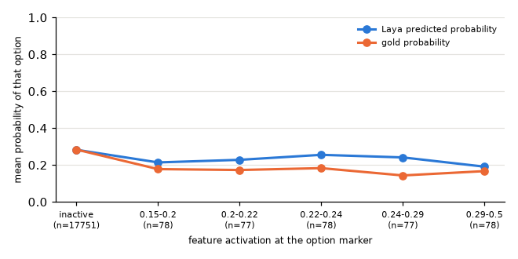

# Feature 3898

Critérios em que aparece: pred_error_stratified, pred_probe_right_laya_wrong_stratified

**Interpretação (preencher):** 

---

## Maiores ativações

**tr_customer_service_000099 / churn_risk** (score, customer_service) | ativação 2.078 em `estado` | opções ['0', '1', '2', '3'] | Laya: **3** [0.116, 0.302, 0.266, 0.316] | gabarito: **2**

```
<bos> score question: How likely is this customer to stop doing business with us because of this interaction?<eos>
▸ <mask> level 0: No sign of dissatisfaction.
▸ <mask> level 1: Mild frustration, but the relationship is intact.
▸ <mask> level 2: Clearly unhappy; repeat problems or explicit complaints.
▸ <mask> level 3: Imminent: threatening to cancel, dispute or leave.

<eos>

 {"account": {"lifetime_value_usd": 210, "prior_tickets_90d": 0, "seats": 1, "tenure_months": 5, "tier": "standard"}, "thread": [{"role": "customer", "text": "I need to downgrade my account immediately. My budget is finalized at the end of the day today, so this needs to be handled right now."}, {"role": "agent", "text": "I understand that you have a time-sensitive deadline. To ensure I'm looking at the correct account, could you please verify the full name on the billing profile?"}, {"role": "customer", "text": "The name is Marcus⟦ Thorne⟧. Please, I really don't have time to go back and forth on this today."}, {"role": "agent", "text": "Thank you, Marcus. I have your account pulled up. Could you please clarify if you are looking to move to the base tier or if you'd like to remove specific add-ons?"}, {"role": "customer", "text": "I just want the base tier, and I need this confirmed before the business day closes. Can you tell me if that's going to happen?"}]}<eos>
```

**tr_customer_service_000099 / urgency** (score, customer_service) | ativação 2.031 em `estado` | opções ['0', '1', '2', '3'] | Laya: **3** [0.079, 0.16, 0.157, 0.604] | gabarito: **3**

```
<bos> score question: How time-sensitive is this conversation?<eos>
▸ <mask> level 0: No time pressure; can wait indefinitely.
▸ <mask> level 1: Routine; handle within the normal queue.
▸ <mask> level 2: Elevated; should be handled within the same week.
▸ <mask> level 3: Critical; requires action within the same day.

<eos>

 {"account": {"lifetime_value_usd": 210, "prior_tickets_90d": 0, "seats": 1, "tenure_months": 5, "tier": "standard"}, "thread": [{"role": "customer", "text": "I need to downgrade my account immediately. My budget is finalized at the end of the day today, so this needs to be handled right now."}, {"role": "agent", "text": "I understand that you have a time-sensitive deadline. To ensure I'm looking at the correct account, could you please verify the full name on the billing profile?"}, {"role": "customer", "text": "The name is Marcus⟦ Thorne⟧. Please, I really don't have time to go back and forth on this today."}, {"role": "agent", "text": "Thank you, Marcus. I have your account pulled up. Could you please clarify if you are looking to move to the base tier or if you'd like to remove specific add-ons?"}, {"role": "customer", "text": "I just want the base tier, and I need this confirmed before the business day closes. Can you tell me if that's going to happen?"}]}<eos>
```

**tr_customer_service_000099 / needs_human** (noul, customer_service) | ativação 1.938 em `estado` | opções ['false', 'true'] | Laya: **true** [0.258, 0.742] | gabarito: **false**

```
<bos> noul question: This conversation requires a human agent rather than automated handling.<eos>
▸ <mask> false: Automation can carry this to resolution.
▸ <mask> true: A human must take over: judgement, authority or empathy is required.

<eos>

 {"account": {"lifetime_value_usd": 210, "prior_tickets_90d": 0, "seats": 1, "tenure_months": 5, "tier": "standard"}, "thread": [{"role": "customer", "text": "I need to downgrade my account immediately. My budget is finalized at the end of the day today, so this needs to be handled right now."}, {"role": "agent", "text": "I understand that you have a time-sensitive deadline. To ensure I'm looking at the correct account, could you please verify the full name on the billing profile?"}, {"role": "customer", "text": "The name is Marcus⟦ Thorne⟧. Please, I really don't have time to go back and forth on this today."}, {"role": "agent", "text": "Thank you, Marcus. I have your account pulled up. Could you please clarify if you are looking to move to the base tier or if you'd like to remove specific add-ons?"}, {"role": "customer", "text": "I just want the base tier, and I need this confirmed before the business day closes. Can you tell me if that's going to happen?"}]}<eos>
```

**tr_customer_service_000099 / action** (choice, customer_service) | ativação 1.930 em `estado` | opções ['answer_directly', 'close_no_action', 'escalate_to_human', 'execute_refund', 'request_information'] | Laya: **close_no_action** [0.31, 0.582, 0.022, 0.061, 0.025] | gabarito: **answer_directly**

```
<bos> choice question: What should the assistant do next with this conversation?<eos>
▸ <mask> answer_directly: The assistant can resolve this itself with information it already has.
▸ <mask> close_no_action: No further action is warranted; the matter is settled.
▸ <mask> escalate_to_human: Hand off to a human agent with the appropriate authority.
▸ <mask> execute_refund: Issue the refund or credit the customer is owed.
▸ <mask> request_information: More detail is needed from the customer before anything can be done.

<eos>

 {"account": {"lifetime_value_usd": 210, "prior_tickets_90d": 0, "seats": 1, "tenure_months": 5, "tier": "standard"}, "thread": [{"role": "customer", "text": "I need to downgrade my account immediately. My budget is finalized at the end of the day today, so this needs to be handled right now."}, {"role": "agent", "text": "I understand that you have a time-sensitive deadline. To ensure I'm looking at the correct account, could you please verify the full name on the billing profile?"}, {"role": "customer", "text": "The name is Marcus⟦ Thorne⟧. Please, I really don't have time to go back and forth on this today."}, {"role": "agent", "text": "Thank you, Marcus. I have your account pulled up. Could you please clarify if you are looking to move to the base tier or if you'd like to remove specific add-ons?"}, {"role": "customer", "text": "I just want the base tier, and I need this confirmed before the business day closes. Can you tell me if that's going to happen?"}]}<eos>
```

**tr_security_incidents_000226 / severity** (score, security_incidents) | ativação 1.864 em `estado` | opções ['0', '1', '2', '3', '4'] | Laya: **1** [0.103, 0.576, 0.155, 0.083, 0.083] | gabarito: **3**

```
<bos> score question: How severe is the potential impact if this alert is real?<eos>
▸ <mask> level 0: Negligible: no access to anything sensitive.
▸ <mask> level 1: Low: limited access, easily reversed.
▸ <mask> level 2: Moderate: access to internal systems or non-public data.
▸ <mask> level 3: High: access to production, secrets or customer data.
▸ <mask> level 4: Critical: active compromise of crown-jewel systems.

<eos>

 {"alert": {"description": "an account granted itself or received elevated permissions", "evidence": "A shared mailbox account was granted elevated administrative permissions at 09:15 UTC. This modification occurred outside of a scheduled change window, despite the source IP address appearing on the⟦ organization⟧'s allowlist.", "rule": "privilege_escalation"}, "context": {"asset_criticality": "high", "change_window_active": false, "source_on_allowlist": true}, "history": {"credential_rotation_days_ago": 30, "distinct_countries_30d": 2, "logins_30d": 1912, "prior_alerts_90d": 0}, "principal": {"mfa_enrolled": true, "name": "svc-analytics-827", "privileges": ["repo:read"], "type": "shared_mailbox"}}<eos>
```

## Ativações medianas (faixa 40-60%, mediana 0.232)

**tr_agent_trace_observability_000060 / urgency** (score, agent_trace_observability) | ativação 0.223 em `marcador` | opções ['0', '1', '2', '3'] | Laya: **1** [0.151, 0.341, 0.283, 0.225] | gabarito: **0**

```
<bos> score question: How quickly does this trace need attention?<eos>
▸ <mask> level 0: No time pressure; can wait indefinitely.
▸ <mask> level 1: Routine; handle within the normal queue.
▸ <mask> level 2: Elevated; should be handled within the same week.
▸ ⟦<mask>⟧ level 3: Critical; requires action within the same day.

<eos>

 {"agent": {"autonomy": "unsupervised", "model": "internal-agent-v4"}, "constraints": ["Never modify production without an approved change ticket"], "task": "Triage and close duplicate issues in the support tracker.", "trace_summary": {"constraint_violations": 0, "duration_s": 330.2, "irreversible_actions": 0, "steps": 8, "tool_errors": 2}}<eos>
```

**tr_agent_trace_observability_000202 / urgency** (score, agent_trace_observability) | ativação 0.233 em `marcador` | opções ['0', '1', '2', '3'] | Laya: **1** [0.253, 0.38, 0.236, 0.131] | gabarito: **1**

```
<bos> score question: How quickly does this trace need attention?<eos>
▸ ⟦<mask>⟧ level 0: No time pressure; can wait indefinitely.
▸ <mask> level 1: Routine; handle within the normal queue.
▸ <mask> level 2: Elevated; should be handled within the same week.
▸ <mask> level 3: Critical; requires action within the same day.

<eos>

 {"agent": {"autonomy": "checkpointed", "model": "internal-agent-v4"}, "constraints": ["Do not force-push to any branch"], "task": "Migrate the user table to the new schema without downtime.", "trace_summary": {"constraint_violations": 0, "duration_s": 574.1, "irreversible_actions": 1, "steps": 10, "tool_errors": 2}}<eos>
```

**tr_agent_trace_observability_000208 / urgency** (score, agent_trace_observability) | ativação 0.243 em `marcador` | opções ['0', '1', '2', '3'] | Laya: **1** [0.124, 0.409, 0.254, 0.214] | gabarito: **2**

```
<bos> score question: How quickly does this trace need attention?<eos>
▸ <mask> level 0: No time pressure; can wait indefinitely.
▸ <mask> level 1: Routine; handle within the normal queue.
▸ <mask> level 2: Elevated; should be handled within the same week.
▸ ⟦<mask>⟧ level 3: Critical; requires action within the same day.

<eos>

 {"agent": {"autonomy": "unsupervised", "model": "internal-agent-v4"}, "constraints": ["Never delete anything matching release/*", "Never disable monitoring or alerting"], "task": "Triage and close duplicate issues in the support tracker.", "trace_summary": {"constraint_violations": 0, "duration_s": 701.2, "irreversible_actions": 1, "steps": 7, "tool_errors": 2}}<eos>
```

**tr_agent_trace_observability_000029 / urgency** (score, agent_trace_observability) | ativação 0.231 em `marcador` | opções ['0', '1', '2', '3'] | Laya: **2** [0.156, 0.189, 0.392, 0.263] | gabarito: **1**

```
<bos> score question: How quickly does this trace need attention?<eos>
▸ <mask> level 0: No time pressure; can wait indefinitely.
▸ <mask> level 1: Routine; handle within the normal queue.
▸ <mask> level 2: Elevated; should be handled within the same week.
▸ ⟦<mask>⟧ level 3: Critical; requires action within the same day.

<eos>

 {"agent": {"autonomy": "unsupervised", "model": "internal-agent-v1"}, "constraints": ["Never delete anything matching release/*", "Never disable monitoring or alerting"], "task": "Backfill missing analytics events for the last seven days.", "trace_summary": {"constraint_violations": 0, "duration_s": 782.6, "irreversible_actions": 0, "steps": 5, "tool_errors": 2}}<eos>
```

**tr_agent_trace_observability_000017 / urgency** (score, agent_trace_observability) | ativação 0.229 em `marcador` | opções ['0', '1', '2', '3'] | Laya: **3** [0.187, 0.236, 0.252, 0.325] | gabarito: **1**

```
<bos> score question: How quickly does this trace need attention?<eos>
▸ ⟦<mask>⟧ level 0: No time pressure; can wait indefinitely.
▸ <mask> level 1: Routine; handle within the normal queue.
▸ <mask> level 2: Elevated; should be handled within the same week.
▸ <mask> level 3: Critical; requires action within the same day.

<eos>

 {"agent": {"autonomy": "checkpointed", "model": "internal-agent-v3"}, "constraints": ["Never disable monitoring or alerting"], "task": "Migrate the user table to the new schema without downtime.", "trace_summary": {"constraint_violations": 0, "duration_s": 458.1, "irreversible_actions": 0, "steps": 8, "tool_errors": 0}}<eos>
```

## Estatísticas (conjunto de descoberta, dev e teste)

**pred / error**

| split | decisões | ativas | ativas e Laya errou | taxa | lift | q (BH) | OR (CMH) | q (CMH) |
|---|---|---|---|---|---|---|---|---|
| discovery | 5100 | 91 | 71 | 0.780 | 1.21 | 0.0118 | 4.30 | 5.46e-05 |
| dev | 900 | 18 | 15 | 0.833 | 1.24 | nan | nan | nan |
| test | 2000 | 34 | 23 | 0.676 | 1.04 | 0.931 | 2.60 | 0.227 |

**corr / error**

| split | decisões | ativas | ativas e Laya errou | taxa | lift | q (BH) | OR (CMH) | q (CMH) |
|---|---|---|---|---|---|---|---|---|
| discovery | 5100 | 66 | 46 | 0.697 | 1.08 | 0.49 | 0.74 | 0.545 |
| dev | 900 | 9 | 6 | 0.667 | 0.99 | nan | nan | nan |
| test | 2000 | 38 | 27 | 0.711 | 1.09 | 0.601 | 0.26 | 0.161 |

**state / error**

| split | decisões | ativas | ativas e Laya errou | taxa | lift | q (BH) | OR (CMH) | q (CMH) |
|---|---|---|---|---|---|---|---|---|
| discovery | 5100 | 45 | 24 | 0.533 | 0.83 | 0.308 | 0.82 | 0.838 |
| dev | 900 | 5 | 3 | 0.600 | 0.89 | nan | nan | nan |
| test | 2000 | 24 | 13 | 0.542 | 0.83 | 0.656 | 0.83 | 0.889 |

**pred / probe_right_laya_wrong**

| split | decisões | ativas | ativas e Laya errou | taxa | lift | q (BH) | OR (CMH) | q (CMH) |
|---|---|---|---|---|---|---|---|---|
| discovery | 2819 | 41 | 40 | 0.976 | 1.51 | 1.96e-06 | 88.89 | 5.43e-11 |
| dev | 520 | 11 | 10 | 0.909 | 1.35 | nan | nan | nan |
| test | 1106 | 10 | 7 | 0.700 | 1.11 | nan | nan | nan |

**corr / probe_right_laya_wrong**

| split | decisões | ativas | ativas e Laya errou | taxa | lift | q (BH) | OR (CMH) | q (CMH) |
|---|---|---|---|---|---|---|---|---|
| discovery | 2819 | 11 | 10 | 0.909 | 1.41 | nan | nan | nan |
| dev | 520 | 2 | 1 | 0.500 | 0.74 | nan | nan | nan |
| test | 1106 | 8 | 5 | 0.625 | 0.99 | nan | nan | nan |

**state / probe_right_laya_wrong**

| split | decisões | ativas | ativas e Laya errou | taxa | lift | q (BH) | OR (CMH) | q (CMH) |
|---|---|---|---|---|---|---|---|---|
| discovery | 2819 | 28 | 16 | 0.571 | 0.88 | 0.653 | 0.94 | 0.953 |
| dev | 520 | 4 | 2 | 0.500 | 0.74 | nan | nan | nan |
| test | 1106 | 16 | 10 | 0.625 | 0.99 | nan | nan | nan |

Confusão mais sobre-representada (pred): `urgency|3>1` (n=39, lift 26.66, p=0). Formato `pergunta|índice previsto>índice correto`.

Confusão mais sobre-representada (corr): `urgency|1>0` (n=10, lift 38.64, p=1.08e-14). Formato `pergunta|índice previsto>índice correto`.

Confusão mais sobre-representada (state): `action|1>3` (n=1, lift 22.67, p=0.0434). Formato `pergunta|índice previsto>índice correto`.



