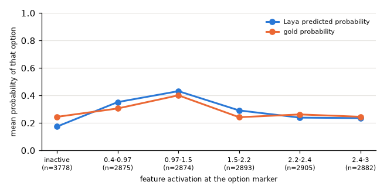

# Feature 3929

Critérios em que aparece: attribution_toward_correct

**Interpretação (preencher):** 

---

## Maiores ativações

**tr_security_incidents_000004 / disposition** (choice, security_incidents) | ativação 3.898 em `estado` | opções ['close_benign', 'contain', 'investigate', 'monitor'] | Laya: **monitor** [0.027, 0.127, 0.098, 0.748] | gabarito: **investigate**

```
<bos> choice question: How should this security alert be dispositioned?<eos>
▸ <mask> close_benign: Expected, explainable activity; close without analyst time.
▸ <mask> contain: Contain the host or account immediately; do not wait for triage.
▸ <mask> investigate: Warrants an analyst opening an investigation.
▸ <mask> monitor: Not clearly malicious, but worth watching for recurrence.

<eos>

 {"alert": {"description": "many failed authentications followed by a success", "evidence": "Between 03:12 and 03:20 UTC on 2026-09-15, 27 failed login attempts were logged from IP 203.0.113.45 targeting the CI runner service, followed by a successful authentication from the same IP at 03:21 UTC. The principal is an unprivileged CI runner with MFA enabled, operating from an unrecognised source⟦,⟧ and the credentials were last rotated 30 days ago. No change window was defined for this period.", "rule": "brute_force"}, "context": {"asset_criticality": "high", "change_window_active": false, "source_on_allowlist": false}, "history": {"credential_rotation_days_ago": 30, "distinct_countries_30d": 1, "logins_30d": 502, "prior_alerts_90d": 0}, "principal": {"mfa_enrolled": true, "name": "usr-analytics-977", "privileges": ["repo:read"], "type": "ci_runner"}}<eos>
```

**tr_security_incidents_000004 / true_positive** (noul, security_incidents) | ativação 3.879 em `estado` | opções ['false', 'true'] | Laya: **true** [0.044, 0.956] | gabarito: **true**

```
<bos> noul question: This alert reflects genuinely malicious or unauthorised activity.<eos>
▸ <mask> false: Benign activity, a misconfiguration, or a known false positive.
▸ <mask> true: The underlying behaviour is malicious or unauthorised.

<eos>

 {"alert": {"description": "many failed authentications followed by a success", "evidence": "Between 03:12 and 03:20 UTC on 2026-09-15, 27 failed login attempts were logged from IP 203.0.113.45 targeting the CI runner service, followed by a successful authentication from the same IP at 03:21 UTC. The principal is an unprivileged CI runner with MFA enabled, operating from an unrecognised source⟦,⟧ and the credentials were last rotated 30 days ago. No change window was defined for this period.", "rule": "brute_force"}, "context": {"asset_criticality": "high", "change_window_active": false, "source_on_allowlist": false}, "history": {"credential_rotation_days_ago": 30, "distinct_countries_30d": 1, "logins_30d": 502, "prior_alerts_90d": 0}, "principal": {"mfa_enrolled": true, "name": "usr-analytics-977", "privileges": ["repo:read"], "type": "ci_runner"}}<eos>
```

**tr_security_incidents_000004 / credential_compromise** (noul, security_incidents) | ativação 3.875 em `estado` | opções ['false', 'true'] | Laya: **true** [0.004, 0.996] | gabarito: **true**

```
<bos> noul question: The evidence indicates a credential or account has been compromised.<eos>
▸ <mask> false: no, the statement does not hold
▸ <mask> true: yes, the statement holds

<eos>

 {"alert": {"description": "many failed authentications followed by a success", "evidence": "Between 03:12 and 03:20 UTC on 2026-09-15, 27 failed login attempts were logged from IP 203.0.113.45 targeting the CI runner service, followed by a successful authentication from the same IP at 03:21 UTC. The principal is an unprivileged CI runner with MFA enabled, operating from an unrecognised source⟦,⟧ and the credentials were last rotated 30 days ago. No change window was defined for this period.", "rule": "brute_force"}, "context": {"asset_criticality": "high", "change_window_active": false, "source_on_allowlist": false}, "history": {"credential_rotation_days_ago": 30, "distinct_countries_30d": 1, "logins_30d": 502, "prior_alerts_90d": 0}, "principal": {"mfa_enrolled": true, "name": "usr-analytics-977", "privileges": ["repo:read"], "type": "ci_runner"}}<eos>
```

**tr_security_incidents_000004 / severity** (score, security_incidents) | ativação 3.818 em `estado` | opções ['0', '1', '2', '3', '4'] | Laya: **2** [0.115, 0.225, 0.312, 0.111, 0.236] | gabarito: **3**

```
<bos> score question: How severe is the potential impact if this alert is real?<eos>
▸ <mask> level 0: Negligible: no access to anything sensitive.
▸ <mask> level 1: Low: limited access, easily reversed.
▸ <mask> level 2: Moderate: access to internal systems or non-public data.
▸ <mask> level 3: High: access to production, secrets or customer data.
▸ <mask> level 4: Critical: active compromise of crown-jewel systems.

<eos>

 {"alert": {"description": "many failed authentications followed by a success", "evidence": "Between 03:12 and 03:20 UTC on 2026-09-15, 27 failed login attempts were logged from IP 203.0.113.45 targeting the CI runner service, followed by a successful authentication from the same IP at 03:21 UTC. The principal is an unprivileged CI runner with MFA enabled, operating from an unrecognised source⟦,⟧ and the credentials were last rotated 30 days ago. No change window was defined for this period.", "rule": "brute_force"}, "context": {"asset_criticality": "high", "change_window_active": false, "source_on_allowlist": false}, "history": {"credential_rotation_days_ago": 30, "distinct_countries_30d": 1, "logins_30d": 502, "prior_alerts_90d": 0}, "principal": {"mfa_enrolled": true, "name": "usr-analytics-977", "privileges": ["repo:read"], "type": "ci_runner"}}<eos>
```

**tr_security_incidents_000004 / urgency** (score, security_incidents) | ativação 3.729 em `estado` | opções ['0', '1', '2', '3'] | Laya: **3** [0.071, 0.191, 0.194, 0.544] | gabarito: **3**

```
<bos> score question: How quickly must a responder act on this alert?<eos>
▸ <mask> level 0: No time pressure; can wait indefinitely.
▸ <mask> level 1: Routine; handle within the normal queue.
▸ <mask> level 2: Elevated; should be handled within the same week.
▸ <mask> level 3: Critical; requires action within the same day.

<eos>

 {"alert": {"description": "many failed authentications followed by a success", "evidence": "Between 03:12 and 03:20 UTC on 2026-09-15, 27 failed login attempts were logged from IP 203.0.113.45 targeting the CI runner service, followed by a successful authentication from the same IP at 03:21 UTC. The principal is an unprivileged CI runner with MFA enabled, operating from an unrecognised source⟦,⟧ and the credentials were last rotated 30 days ago. No change window was defined for this period.", "rule": "brute_force"}, "context": {"asset_criticality": "high", "change_window_active": false, "source_on_allowlist": false}, "history": {"credential_rotation_days_ago": 30, "distinct_countries_30d": 1, "logins_30d": 502, "prior_alerts_90d": 0}, "principal": {"mfa_enrolled": true, "name": "usr-analytics-977", "privileges": ["repo:read"], "type": "ci_runner"}}<eos>
```

## Ativações medianas (faixa 40-60%, mediana 1.389)

**tr_security_incidents_000102 / credential_compromise** (noul, security_incidents) | ativação 1.114 em `marcador` | opções ['false', 'true'] | Laya: **true** [0.01, 0.99] | gabarito: **false**

```
<bos> noul question: The evidence indicates a credential or account has been compromised.<eos>
▸ ⟦<mask>⟧ false: no, the statement does not hold
▸ <mask> true: yes, the statement holds

<eos>

 {"alert": {"description": "a long-unused account became active", "evidence": "The employee account \"e12345\" generated a successful interactive logon from IP 10.12.45.8 at 2026-09-15T03:41:27Z. The source host (hostname \"WORKSTN-12\") is listed in the approved allowlist and MFA verification succeeded. The account's password was last rotated on 2026-09-01 (14 days prior).", "rule": "dormant_account_use"}, "context": {"asset_criticality": "medium", "change_window_active": false, "source_on_allowlist": true}, "history": {"credential_rotation_days_ago": 14, "distinct_countries_30d": 2, "logins_30d": 1715, "prior_alerts_90d": 0}, "principal": {"mfa_enrolled": true, "name": "usr-deploy-604", "privileges": ["repo:read"], "type": "employee"}}<eos>
```

**tr_customer_service_000240 / category** (choice, customer_service) | ativação 1.132 em `marcador` | opções ['account', 'billing', 'delivery', 'refund', 'technical'] | Laya: **billing** [0.012, 0.983, 0.0, 0.001, 0.004] | gabarito: **account**

```
<bos> choice question: What is this customer conversation primarily about?<eos>
▸ <mask> account: Login, plan changes, profile or access management.
▸ <mask> billing: A charge, invoice, subscription or payment problem.
▸ <mask> delivery: Shipping, fulfilment or delivery of a physical item.
▸ <mask> refund: The customer is explicitly asking for money back.
▸ ⟦<mask>⟧ technical: The product or service is not working as expected.

<eos>

 {"account": {"lifetime_value_usd": 363, "prior_tickets_90d": 0, "seats": 1, "tenure_months": 5, "tier": "standard"}, "thread": [{"role": "customer", "text": "I’d like to move my account from the Premium tier to the Standard tier, effective as of the 15th of next month."}, {"role": "agent", "text": "I understand you want to downgrade to Standard on that date. Could you confirm the email associated with the account so we can pull up the details?"}, {"role": "customer", "text": "The email is jane.doe@example.com, and I’ve been on the Premium plan for the past five months."}, {"role": "agent", "text": "Got it, Jane. Just to be clear, are there any additional services or add‑ons you’d like to keep after the downgrade?"}, {"role": "customer", "text": "No, I only need the core features that come with Standard. I also need to make sure my billing reflects the change by the deadline."}, {"role": "agent", "text": "Understood. To proceed, could you let me know if there are any outstanding invoices or credit balances we should account for before the switch?"}, {"role": "customer", "text": "There are no pending invoices; the last payment was processed last week. Please confirm the downgrade will be in place by the 15th."}]}<eos>
```

**tr_security_incidents_000288 / severity** (score, security_incidents) | ativação 1.236 em `estado` | opções ['0', '1', '2', '3', '4'] | Laya: **1** [0.1, 0.442, 0.248, 0.1, 0.11] | gabarito: **1**

```
<bos> score question: How severe is the potential impact if this alert is real?<eos>
▸ <mask> level 0: Negligible: no access to anything sensitive.
▸ <mask> level 1: Low: limited access, easily reversed.
▸ <mask> level 2: Moderate: access to internal systems or non-public data.
▸ <mask> level 3: High: access to production, secrets or customer data.
▸ <mask> level 4: Critical: active compromise of crown-jewel systems.

<eos>

 {"alert": {"description": "a first-ever sign-in from an unfamiliar country", "evidence": "At 2026-09-15 02:13:47 UTC a sign‑in originated from IP 203.0.113.45 (detected as Brazil), which is the first login for the ci_runner_42 principal from that country. The account is unprivileged⟦,⟧ has MFA enabled, and the credentials were last rotated on 2026-09-01; the sign‑in occurred while a change window was active and the source was not on the allowlist.", "rule": "new_country_login"}, "context": {"asset_criticality": "low", "change_window_active": true, "source_on_allowlist": false}, "history": {"credential_rotation_days_ago": 14, "distinct_countries_30d": 1, "logins_30d": 454, "prior_alerts_90d": 0}, "principal": {"mfa_enrolled": true, "name": "svc-billing-208", "privileges": ["repo:read"], "type": "ci_runner"}}<eos>
```

**tr_customer_service_000206 / urgency** (score, customer_service) | ativação 1.938 em `marcador` | opções ['0', '1', '2', '3'] | Laya: **1** [0.106, 0.512, 0.28, 0.102] | gabarito: **2**

```
<bos> score question: How time-sensitive is this conversation?<eos>
▸ <mask> level 0: No time pressure; can wait indefinitely.
▸ ⟦<mask>⟧ level 1: Routine; handle within the normal queue.
▸ <mask> level 2: Elevated; should be handled within the same week.
▸ <mask> level 3: Critical; requires action within the same day.

<eos>

 {"account": {"lifetime_value_usd": 152, "prior_tickets_90d": 3, "seats": 1, "tenure_months": 5, "tier": "standard"}, "orders": [{"amount_usd": 297, "date": "2026-03-11", "id": "A-35334", "status": "settled"}], "thread": [{"role": "customer", "text": "I just got an email saying my $297 payment failed, but I don't understand why because I haven't changed any of my bank settings."}, {"role": "agent", "text": "I can certainly look into that billing notification for you. Have you recently updated any of the security features on your credit card, such as a new expiration date or CVV?"}, {"role": "customer", "text": "No, everything is exactly the same as it was when it worked two months ago. This same thing happened back in June and then it just started working again for no reason."}, {"role": "agent", "text": "I see that we've had a few intermittent issues with this account in the past. Are you getting a specific error message when you try to manually process the payment through the 'Pay Now' button?"}, {"role": "customer", "text": "It just gives me a red box that says 'Transaction Denied' and tells me to contact my administrator, but I am the administrator."}, {"role": "agent", "text": "That is definitely confusing. Could you tell me if you are trying to process this through a VPN or a restricted corporate network, as that can sometimes trigger a decline?"}, {"role": "customer", "text": "I'm just using my home Wi-Fi like I always do, so I don't think it's a network problem on my end."}]}<eos>
```

**tr_agent_trace_observability_000217 / urgency** (score, agent_trace_observability) | ativação 1.874 em `marcador` | opções ['0', '1', '2', '3'] | Laya: **1** [0.118, 0.486, 0.218, 0.178] | gabarito: **1**

```
<bos> score question: How quickly does this trace need attention?<eos>
▸ ⟦<mask>⟧ level 0: No time pressure; can wait indefinitely.
▸ <mask> level 1: Routine; handle within the normal queue.
▸ <mask> level 2: Elevated; should be handled within the same week.
▸ <mask> level 3: Critical; requires action within the same day.

<eos>

 {"agent": {"autonomy": "unsupervised", "model": "internal-agent-v2"}, "constraints": ["Do not force-push to any branch"], "task": "Reduce the nightly report job's runtime below fifteen minutes.", "trace_summary": {"constraint_violations": 0, "duration_s": 425.6, "irreversible_actions": 1, "steps": 11, "tool_errors": 2}}<eos>
```

## Estatísticas (conjunto de descoberta, dev e teste)

**pred / error**

| split | decisões | ativas | ativas e Laya errou | taxa | lift | q (BH) | OR (CMH) | q (CMH) |
|---|---|---|---|---|---|---|---|---|
| discovery | 5100 | 4466 | 2837 | 0.635 | 0.99 | 0.00166 | 0.63 | 0.485 |
| dev | 900 | 808 | 537 | 0.665 | 0.99 | 0.294 | 0.29 | 0.729 |
| test | 2000 | 1751 | 1145 | 0.654 | 1.01 | 0.514 | 0.91 | 0.964 |

**corr / error**

| split | decisões | ativas | ativas e Laya errou | taxa | lift | q (BH) | OR (CMH) | q (CMH) |
|---|---|---|---|---|---|---|---|---|
| discovery | 5100 | 4121 | 2492 | 0.605 | 0.94 | 8.92e-34 | 0.64 | 0.113 |
| dev | 900 | 736 | 465 | 0.632 | 0.94 | 1.35e-07 | 0.62 | 0.836 |
| test | 2000 | 1614 | 1008 | 0.625 | 0.96 | 1.73e-06 | 1.18 | 0.654 |

**state / error**

| split | decisões | ativas | ativas e Laya errou | taxa | lift | q (BH) | OR (CMH) | q (CMH) |
|---|---|---|---|---|---|---|---|---|
| discovery | 5100 | 1746 | 1028 | 0.589 | 0.91 | 8.1e-08 | 1.06 | 0.759 |
| dev | 900 | 298 | 186 | 0.624 | 0.93 | 0.254 | 1.09 | 0.867 |
| test | 2000 | 649 | 388 | 0.598 | 0.92 | 0.0169 | 0.91 | 0.779 |

**pred / probe_right_laya_wrong**

| split | decisões | ativas | ativas e Laya errou | taxa | lift | q (BH) | OR (CMH) | q (CMH) |
|---|---|---|---|---|---|---|---|---|
| discovery | 2819 | 2469 | 1582 | 0.641 | 0.99 | 0.0908 | 0.09 | 0.00208 |
| dev | 520 | 467 | 308 | 0.660 | 0.98 | 0.0671 | 0.07 | 0.21 |
| test | 1106 | 983 | 628 | 0.639 | 1.01 | 0.369 | 0.26 | 0.793 |

**corr / probe_right_laya_wrong**

| split | decisões | ativas | ativas e Laya errou | taxa | lift | q (BH) | OR (CMH) | q (CMH) |
|---|---|---|---|---|---|---|---|---|
| discovery | 2819 | 2233 | 1346 | 0.603 | 0.93 | 2.97e-22 | 1.11 | 0.957 |
| dev | 520 | 426 | 267 | 0.627 | 0.93 | 1.3e-06 | nan | nan |
| test | 1106 | 877 | 522 | 0.595 | 0.94 | 9.42e-07 | 2.42 | 0.397 |

**state / probe_right_laya_wrong**

| split | decisões | ativas | ativas e Laya errou | taxa | lift | q (BH) | OR (CMH) | q (CMH) |
|---|---|---|---|---|---|---|---|---|
| discovery | 2819 | 1025 | 579 | 0.565 | 0.87 | 1.63e-10 | 1.18 | 0.343 |
| dev | 520 | 177 | 107 | 0.605 | 0.90 | 0.158 | 1.27 | 0.606 |
| test | 1106 | 387 | 219 | 0.566 | 0.89 | 0.0105 | 1.08 | 0.837 |

Confusão mais sobre-representada (pred): `duplicate|1>0` (n=217, lift 1.14, p=1.58e-13). Formato `pergunta|índice previsto>índice correto`.

Confusão mais sobre-representada (corr): `duplicate|1>0` (n=217, lift 1.24, p=2.65e-21). Formato `pergunta|índice previsto>índice correto`.

Confusão mais sobre-representada (state): `needs_human|0>1` (n=51, lift 2.76, p=8.34e-21). Formato `pergunta|índice previsto>índice correto`.



