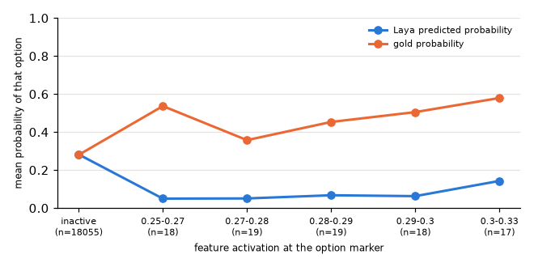

# Feature 4043

Critérios em que aparece: corr_error

**Interpretação (preencher):** 

---

## Maiores ativações

**tr_customer_service_000041 / urgency** (score, customer_service) | ativação 2.775 em `estado` | opções ['0', '1', '2', '3'] | Laya: **0** [0.664, 0.161, 0.042, 0.133] | gabarito: **3**

```
<bos> score question: How time-sensitive is this conversation?<eos>
▸ <mask> level 0: No time pressure; can wait indefinitely.
▸ <mask> level 1: Routine; handle within the normal queue.
▸ <mask> level 2: Elevated; should be handled within the same week.
▸ <mask> level 3: Critical; requires action within the same day.

<eos>

 {"account": {"lifetime_value_usd": 446, "prior_tickets_90d": 1, "seats": 1, "tenure_months": 5, "tier": "free"}, "orders": [{"amount_usd": 999, "date": "2026-01-24", "id": "A-86387", "status": "pending"}, {"amount_usd": 999, "date": "2026-03-10", "id": "A-88077", "status": "settled"}, {"amount_usd": 999, "date": "2026-01-19", "id": "A-21190", "status": "settled"}], "thread": [{"role": "customer", "text": "I thought my order was supposed to arrive last week, but nothing’s here yet. I need it for the event on Friday and I’m completely confused."}, {"role": "agent", "text": "I understand how frustrating that can be. Could you share the order number so I can look into the shipping status?"}, {"role": "customer", "text": "It’s #A12345. The tracking just says ‘in⟦ transit⟧’ and I’ve got no idea where it is."}, {"role": "agent", "text": "Thanks for that. Do you know which carrier was selected for the shipment? That will help me pinpoint the delay."}, {"role": "customer", "text": "It was supposed to be UPS, but I’m not sure if they even have it. I really need it before Friday, can anything be done?"}]}<eos>
```

**tr_customer_service_000041 / action** (choice, customer_service) | ativação 2.746 em `estado` | opções ['answer_directly', 'close_no_action', 'escalate_to_human', 'execute_refund', 'request_information'] | Laya: **close_no_action** [0.241, 0.742, 0.007, 0.003, 0.007] | gabarito: **escalate_to_human**

```
<bos> choice question: What should the assistant do next with this conversation?<eos>
▸ <mask> answer_directly: The assistant can resolve this itself with information it already has.
▸ <mask> close_no_action: No further action is warranted; the matter is settled.
▸ <mask> escalate_to_human: Hand off to a human agent with the appropriate authority.
▸ <mask> execute_refund: Issue the refund or credit the customer is owed.
▸ <mask> request_information: More detail is needed from the customer before anything can be done.

<eos>

 {"account": {"lifetime_value_usd": 446, "prior_tickets_90d": 1, "seats": 1, "tenure_months": 5, "tier": "free"}, "orders": [{"amount_usd": 999, "date": "2026-01-24", "id": "A-86387", "status": "pending"}, {"amount_usd": 999, "date": "2026-03-10", "id": "A-88077", "status": "settled"}, {"amount_usd": 999, "date": "2026-01-19", "id": "A-21190", "status": "settled"}], "thread": [{"role": "customer", "text": "I thought my order was supposed to arrive last week, but nothing’s here yet. I need it for the event on Friday and I’m completely confused."}, {"role": "agent", "text": "I understand how frustrating that can be. Could you share the order number so I can look into the shipping status?"}, {"role": "customer", "text": "It’s #A12345. The tracking just says ‘in⟦ transit⟧’ and I’ve got no idea where it is."}, {"role": "agent", "text": "Thanks for that. Do you know which carrier was selected for the shipment? That will help me pinpoint the delay."}, {"role": "customer", "text": "It was supposed to be UPS, but I’m not sure if they even have it. I really need it before Friday, can anything be done?"}]}<eos>
```

**tr_customer_service_000041 / category** (choice, customer_service) | ativação 2.699 em `estado` | opções ['account', 'billing', 'delivery', 'refund', 'technical'] | Laya: **delivery** [0.002, 0.005, 0.971, 0.002, 0.019] | gabarito: **delivery**

```
<bos> choice question: What is this customer conversation primarily about?<eos>
▸ <mask> account: Login, plan changes, profile or access management.
▸ <mask> billing: A charge, invoice, subscription or payment problem.
▸ <mask> delivery: Shipping, fulfilment or delivery of a physical item.
▸ <mask> refund: The customer is explicitly asking for money back.
▸ <mask> technical: The product or service is not working as expected.

<eos>

 {"account": {"lifetime_value_usd": 446, "prior_tickets_90d": 1, "seats": 1, "tenure_months": 5, "tier": "free"}, "orders": [{"amount_usd": 999, "date": "2026-01-24", "id": "A-86387", "status": "pending"}, {"amount_usd": 999, "date": "2026-03-10", "id": "A-88077", "status": "settled"}, {"amount_usd": 999, "date": "2026-01-19", "id": "A-21190", "status": "settled"}], "thread": [{"role": "customer", "text": "I thought my order was supposed to arrive last week, but nothing’s here yet. I need it for the event on Friday and I’m completely confused."}, {"role": "agent", "text": "I understand how frustrating that can be. Could you share the order number so I can look into the shipping status?"}, {"role": "customer", "text": "It’s #A12345. The tracking just says ‘in⟦ transit⟧’ and I’ve got no idea where it is."}, {"role": "agent", "text": "Thanks for that. Do you know which carrier was selected for the shipment? That will help me pinpoint the delay."}, {"role": "customer", "text": "It was supposed to be UPS, but I’m not sure if they even have it. I really need it before Friday, can anything be done?"}]}<eos>
```

**tr_customer_service_000041 / needs_human** (noul, customer_service) | ativação 2.633 em `estado` | opções ['false', 'true'] | Laya: **false** [0.874, 0.126] | gabarito: **true**

```
<bos> noul question: This conversation requires a human agent rather than automated handling.<eos>
▸ <mask> false: Automation can carry this to resolution.
▸ <mask> true: A human must take over: judgement, authority or empathy is required.

<eos>

 {"account": {"lifetime_value_usd": 446, "prior_tickets_90d": 1, "seats": 1, "tenure_months": 5, "tier": "free"}, "orders": [{"amount_usd": 999, "date": "2026-01-24", "id": "A-86387", "status": "pending"}, {"amount_usd": 999, "date": "2026-03-10", "id": "A-88077", "status": "settled"}, {"amount_usd": 999, "date": "2026-01-19", "id": "A-21190", "status": "settled"}], "thread": [{"role": "customer", "text": "I thought my order was supposed to arrive last week, but nothing’s here yet. I need it for the event on Friday and I’m completely confused."}, {"role": "agent", "text": "I understand how frustrating that can be. Could you share the order number so I can look into the shipping status?"}, {"role": "customer", "text": "It’s #A12345. The tracking just says ‘in⟦ transit⟧’ and I’ve got no idea where it is."}, {"role": "agent", "text": "Thanks for that. Do you know which carrier was selected for the shipment? That will help me pinpoint the delay."}, {"role": "customer", "text": "It was supposed to be UPS, but I’m not sure if they even have it. I really need it before Friday, can anything be done?"}]}<eos>
```

**tr_customer_service_000041 / churn_risk** (score, customer_service) | ativação 2.605 em `estado` | opções ['0', '1', '2', '3'] | Laya: **1** [0.138, 0.416, 0.239, 0.207] | gabarito: **2**

```
<bos> score question: How likely is this customer to stop doing business with us because of this interaction?<eos>
▸ <mask> level 0: No sign of dissatisfaction.
▸ <mask> level 1: Mild frustration, but the relationship is intact.
▸ <mask> level 2: Clearly unhappy; repeat problems or explicit complaints.
▸ <mask> level 3: Imminent: threatening to cancel, dispute or leave.

<eos>

 {"account": {"lifetime_value_usd": 446, "prior_tickets_90d": 1, "seats": 1, "tenure_months": 5, "tier": "free"}, "orders": [{"amount_usd": 999, "date": "2026-01-24", "id": "A-86387", "status": "pending"}, {"amount_usd": 999, "date": "2026-03-10", "id": "A-88077", "status": "settled"}, {"amount_usd": 999, "date": "2026-01-19", "id": "A-21190", "status": "settled"}], "thread": [{"role": "customer", "text": "I thought my order was supposed to arrive last week, but nothing’s here yet. I need it for the event on Friday and I’m completely confused."}, {"role": "agent", "text": "I understand how frustrating that can be. Could you share the order number so I can look into the shipping status?"}, {"role": "customer", "text": "It’s #A12345. The tracking just says ‘in⟦ transit⟧’ and I’ve got no idea where it is."}, {"role": "agent", "text": "Thanks for that. Do you know which carrier was selected for the shipment? That will help me pinpoint the delay."}, {"role": "customer", "text": "It was supposed to be UPS, but I’m not sure if they even have it. I really need it before Friday, can anything be done?"}]}<eos>
```

## Ativações medianas (faixa 40-60%, mediana 0.296)

**tr_invoice_processing_000100 / matches_order** (noul, invoice_processing) | ativação 0.297 em `marcador` | opções ['false', 'true'] | Laya: **true** [0.039, 0.961] | gabarito: **true**

```
<bos> noul question: The invoice reconciles with the purchase order and the recorded delivery.<eos>
▸ ⟦<mask>⟧ false: There is a discrepancy against the order or the delivery.
▸ <mask> true: Line items, quantities and amounts reconcile.

<eos>

 {"delivery": {"condition": "accepted", "date": "2026-03-06", "received_qty": 25}, "invoice": {"currency": "USD", "id": "INV-2026-3933", "lines": [{"qty": 25, "sku": "SKU-346", "total_usd": 5973.25, "unit_usd": 238.93}], "total_usd": 5973.25, "vendor": "Acme Fabrication"}, "payment": {"days_until_due": 44, "discount_expires_in_days": 3, "early_payment_discount_pct": 2.0, "status": "scheduled", "terms": "net 30"}, "purchase_order": {"freight_terms": "freight prepaid by vendor, not separately billable", "id": null, "lines": [{"qty": 25, "unit_usd": 238.93}], "total_usd": 5973.25}, "vendor_history": {"disputes_12m": 1, "invoices_12m": 6, "prior_invoice_ids": ["INV-2026-7649"]}}<eos>
```

**tr_invoice_processing_000245 / matches_order** (noul, invoice_processing) | ativação 0.307 em `marcador` | opções ['false', 'true'] | Laya: **true** [0.04, 0.96] | gabarito: **true**

```
<bos> noul question: The invoice reconciles with the purchase order and the recorded delivery.<eos>
▸ ⟦<mask>⟧ false: There is a discrepancy against the order or the delivery.
▸ <mask> true: Line items, quantities and amounts reconcile.

<eos>

 {"delivery": {"condition": "accepted", "date": "2026-03-14", "received_qty": 1000}, "invoice": {"currency": "EUR", "id": "INV-2026-4696", "lines": [{"qty": 1000, "sku": "SKU-228", "total_usd": 175820.0, "unit_usd": 175.82}], "total_usd": 175820.0, "vendor": "Orbit Logistics"}, "payment": {"days_until_due": -3, "discount_expires_in_days": null, "early_payment_discount_pct": null, "status": "overdue", "terms": "net 15"}, "purchase_order": {"freight_terms": "freight prepaid by vendor, not separately billable", "id": "PO-4111", "lines": [{"qty": 1000, "unit_usd": 175.82}], "total_usd": 175820.0}, "vendor_history": {"disputes_12m": 0, "invoices_12m": 48, "prior_invoice_ids": ["INV-2026-6883", "INV-2026-3464"]}}<eos>
```

**tr_invoice_processing_000279 / matches_order** (noul, invoice_processing) | ativação 0.290 em `marcador` | opções ['false', 'true'] | Laya: **true** [0.033, 0.967] | gabarito: **false**

```
<bos> noul question: The invoice reconciles with the purchase order and the recorded delivery.<eos>
▸ ⟦<mask>⟧ false: There is a discrepancy against the order or the delivery.
▸ <mask> true: Line items, quantities and amounts reconcile.

<eos>

 {"delivery": {"condition": "accepted", "date": "2026-03-09", "received_qty": 250}, "invoice": {"currency": "USD", "id": "INV-2026-8442", "lines": [{"qty": 250, "sku": "SKU-335", "total_usd": 60245.0, "unit_usd": 240.98}], "total_usd": 60245.0, "vendor": "Acme Fabrication"}, "payment": {"days_until_due": 5, "discount_expires_in_days": 1, "early_payment_discount_pct": 2.0, "status": "scheduled", "terms": "net 30"}, "purchase_order": {"freight_terms": "freight prepaid by vendor, not separately billable", "id": "PO-8153", "lines": [{"qty": 250, "unit_usd": 215.16}], "total_usd": 53790.0}, "vendor_history": {"disputes_12m": 1, "invoices_12m": 36, "prior_invoice_ids": ["INV-2026-1204"]}}<eos>
```

**tr_invoice_processing_000107 / matches_order** (noul, invoice_processing) | ativação 0.296 em `marcador` | opções ['false', 'true'] | Laya: **true** [0.057, 0.943] | gabarito: **false**

```
<bos> noul question: The invoice reconciles with the purchase order and the recorded delivery.<eos>
▸ ⟦<mask>⟧ false: There is a discrepancy against the order or the delivery.
▸ <mask> true: Line items, quantities and amounts reconcile.

<eos>

 {"delivery": {"condition": "accepted", "date": "2026-03-03", "received_qty": 400}, "invoice": {"currency": "USD", "id": "INV-2026-6485", "lines": [{"qty": 420, "sku": "SKU-773", "total_usd": 54856.2, "unit_usd": 130.61}], "total_usd": 54856.2, "vendor": "Acme Fabrication"}, "payment": {"days_until_due": 27, "discount_expires_in_days": null, "early_payment_discount_pct": null, "status": "scheduled", "terms": "net 60"}, "purchase_order": {"freight_terms": "freight prepaid by vendor, not separately billable", "id": "PO-3208", "lines": [{"qty": 400, "unit_usd": 130.61}], "total_usd": 52244.0}, "vendor_history": {"disputes_12m": 0, "invoices_12m": 21, "prior_invoice_ids": ["INV-2026-8502"]}}<eos>
```

**tr_invoice_processing_000128 / matches_order** (noul, invoice_processing) | ativação 0.287 em `marcador` | opções ['false', 'true'] | Laya: **true** [0.052, 0.948] | gabarito: **true**

```
<bos> noul question: The invoice reconciles with the purchase order and the recorded delivery.<eos>
▸ ⟦<mask>⟧ false: There is a discrepancy against the order or the delivery.
▸ <mask> true: Line items, quantities and amounts reconcile.

<eos>

 {"delivery": {"condition": "accepted", "date": "2026-03-03", "received_qty": 10}, "invoice": {"currency": "USD", "id": "INV-2026-1573", "lines": [{"qty": 10, "sku": "SKU-688", "total_usd": 4081.5, "unit_usd": 408.15}], "total_usd": 4081.5, "vendor": "Acme Fabrication"}, "payment": {"days_until_due": -9, "discount_expires_in_days": null, "early_payment_discount_pct": null, "status": "overdue", "terms": "net 45"}, "purchase_order": {"freight_terms": "freight prepaid by vendor, not separately billable", "id": "PO-6996", "lines": [{"qty": 10, "unit_usd": 408.15}], "total_usd": 4081.5}, "vendor_history": {"disputes_12m": 0, "invoices_12m": 27, "prior_invoice_ids": ["INV-2026-1107", "INV-2026-4586", "INV-2026-5918"]}}<eos>
```

## Estatísticas (conjunto de descoberta, dev e teste)

**pred / error**

| split | decisões | ativas | ativas e Laya errou | taxa | lift | q (BH) | OR (CMH) | q (CMH) |
|---|---|---|---|---|---|---|---|---|
| discovery | 5100 | 2 | 2 | 1.000 | 1.55 | nan | nan | nan |
| dev | 900 | 0 | 0 | nan | nan | nan | nan | nan |
| test | 2000 | 1 | 1 | 1.000 | 1.54 | nan | nan | nan |

**corr / error**

| split | decisões | ativas | ativas e Laya errou | taxa | lift | q (BH) | OR (CMH) | q (CMH) |
|---|---|---|---|---|---|---|---|---|
| discovery | 5100 | 43 | 43 | 1.000 | 1.55 | 2.88e-08 | inf | 0.421 |
| dev | 900 | 9 | 9 | 1.000 | 1.49 | nan | nan | nan |
| test | 2000 | 16 | 16 | 1.000 | 1.54 | nan | nan | nan |

**state / error**

| split | decisões | ativas | ativas e Laya errou | taxa | lift | q (BH) | OR (CMH) | q (CMH) |
|---|---|---|---|---|---|---|---|---|
| discovery | 5100 | 39 | 31 | 0.795 | 1.23 | 0.15 | 3.16 | 0.0804 |
| dev | 900 | 6 | 5 | 0.833 | 1.24 | nan | nan | nan |
| test | 2000 | 8 | 6 | 0.750 | 1.15 | nan | nan | nan |

**pred / probe_right_laya_wrong**

| split | decisões | ativas | ativas e Laya errou | taxa | lift | q (BH) | OR (CMH) | q (CMH) |
|---|---|---|---|---|---|---|---|---|
| discovery | 2819 | 2 | 2 | 1.000 | 1.55 | nan | nan | nan |
| dev | 520 | 0 | 0 | nan | nan | nan | nan | nan |
| test | 1106 | 1 | 1 | 1.000 | 1.58 | nan | nan | nan |

**corr / probe_right_laya_wrong**

| split | decisões | ativas | ativas e Laya errou | taxa | lift | q (BH) | OR (CMH) | q (CMH) |
|---|---|---|---|---|---|---|---|---|
| discovery | 2819 | 23 | 23 | 1.000 | 1.55 | 0.000141 | inf | 0.719 |
| dev | 520 | 3 | 3 | 1.000 | 1.48 | nan | nan | nan |
| test | 1106 | 7 | 7 | 1.000 | 1.58 | nan | nan | nan |

**state / probe_right_laya_wrong**

| split | decisões | ativas | ativas e Laya errou | taxa | lift | q (BH) | OR (CMH) | q (CMH) |
|---|---|---|---|---|---|---|---|---|
| discovery | 2819 | 22 | 14 | 0.636 | 0.98 | 1 | 1.51 | 0.691 |
| dev | 520 | 4 | 3 | 0.750 | 1.11 | nan | nan | nan |
| test | 1106 | 7 | 5 | 0.714 | 1.13 | nan | nan | nan |

Confusão mais sobre-representada (pred): `true_positive|0>1` (n=1, lift 115.91, p=nan). Formato `pergunta|índice previsto>índice correto`.

Confusão mais sobre-representada (corr): `matches_order|1>0` (n=37, lift 36.88, p=0). Formato `pergunta|índice previsto>índice correto`.

Confusão mais sobre-representada (state): `disposition|2>1` (n=2, lift 43.59, p=0.000838). Formato `pergunta|índice previsto>índice correto`.



