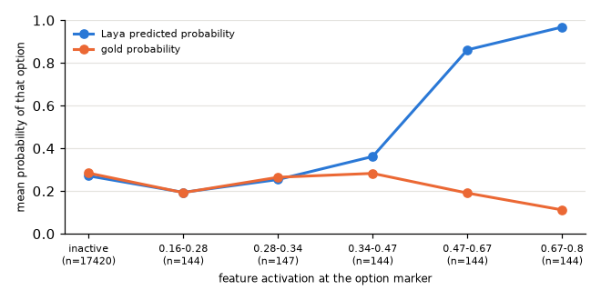

# Feature 4069

Critérios em que aparece: pred_probe_right_laya_wrong_stratified

**Interpretação (preencher):** 

---

## Maiores ativações

**tr_customer_service_000073 / churn_risk** (score, customer_service) | ativação 2.885 em `estado` | opções ['0', '1', '2', '3'] | Laya: **2** [0.043, 0.303, 0.402, 0.252] | gabarito: **3**

```
<bos> score question: How likely is this customer to stop doing business with us because of this interaction?<eos>
▸ <mask> level 0: No sign of dissatisfaction.
▸ <mask> level 1: Mild frustration, but the relationship is intact.
▸ <mask> level 2: Clearly unhappy; repeat problems or explicit complaints.
▸ <mask> level 3: Imminent: threatening to cancel, dispute or leave.

<eos>

 {"account": {"lifetime_value_usd": 54, "prior_tickets_90d": 1, "seats": 1, "tenure_months": 1, "tier": "premium"}, "orders": [{"amount_usd": 29, "date": "2026-01-23", "id": "A-91950", "status": "failed"}], "thread": [{"role": "customer", "text": "I am absolutely livid that my payment failed again after I was told this was fixed last week, this is ridiculous!"}, {"role": "agent", "text": "I'm very sorry for the ongoing trouble with your premium subscription payment; I see your previous ticket regarding this same issue."}, {"role": "customer", "text": "Seeing it doesn't help me! I've only been a member for a month and you've already messed up the $29 charge twice now."}, {"role": "agent", "text": "I understand how frustrating that is⟦.⟧ To help me investigate, are you receiving a specific error message from your bank or within our portal?"}, {"role": "customer", "text": "It just says 'transaction failed' with no explanation, which is exactly what happened the first time I complained."}, {"role": "agent", "text": "Thank you for that detail. I'm going to pull up the logs from our payment processor to see if there's a more descriptive rejection code on the backend."}, {"role": "customer", "text": "You do that, but if this isn't sorted out once and for all, I'm canceling this plan and moving to a competitor who actually wants my money."}]}<eos>
```

**tr_customer_service_000142 / action** (choice, customer_service) | ativação 2.871 em `estado` | opções ['answer_directly', 'close_no_action', 'escalate_to_human', 'execute_refund', 'request_information'] | Laya: **execute_refund** [0.274, 0.114, 0.034, 0.558, 0.019] | gabarito: **answer_directly**

```
<bos> choice question: What should the assistant do next with this conversation?<eos>
▸ <mask> answer_directly: The assistant can resolve this itself with information it already has.
▸ <mask> close_no_action: No further action is warranted; the matter is settled.
▸ <mask> escalate_to_human: Hand off to a human agent with the appropriate authority.
▸ <mask> execute_refund: Issue the refund or credit the customer is owed.
▸ <mask> request_information: More detail is needed from the customer before anything can be done.

<eos>

 {"account": {"lifetime_value_usd": 195, "prior_tickets_90d": 1, "seats": 1, "tenure_months": 5, "tier": "standard"}, "orders": [{"amount_usd": 598, "date": "2026-03-05", "id": "A-28205", "status": "settled"}], "thread": [{"role": "customer", "text": "Hello, I am having trouble accessing my account this morning. I have tried resetting my password, but the verification email never arrives."}, {"role": "agent", "text": "I apologize for the frustration this is causing you⟦.⟧ Could you please confirm the email address associated with your account so I can verify its status on our server?"}, {"role": "customer", "text": "Certainly, it is j.smith@provider.com. I really need to access my dashboard to manage my $598 subscription."}]}<eos>
```

**tr_customer_service_000142 / churn_risk** (score, customer_service) | ativação 2.838 em `estado` | opções ['0', '1', '2', '3'] | Laya: **3** [0.025, 0.255, 0.35, 0.37] | gabarito: **1**

```
<bos> score question: How likely is this customer to stop doing business with us because of this interaction?<eos>
▸ <mask> level 0: No sign of dissatisfaction.
▸ <mask> level 1: Mild frustration, but the relationship is intact.
▸ <mask> level 2: Clearly unhappy; repeat problems or explicit complaints.
▸ <mask> level 3: Imminent: threatening to cancel, dispute or leave.

<eos>

 {"account": {"lifetime_value_usd": 195, "prior_tickets_90d": 1, "seats": 1, "tenure_months": 5, "tier": "standard"}, "orders": [{"amount_usd": 598, "date": "2026-03-05", "id": "A-28205", "status": "settled"}], "thread": [{"role": "customer", "text": "Hello, I am having trouble accessing my account this morning. I have tried resetting my password, but the verification email never arrives."}, {"role": "agent", "text": "I apologize for the frustration this is causing you⟦.⟧ Could you please confirm the email address associated with your account so I can verify its status on our server?"}, {"role": "customer", "text": "Certainly, it is j.smith@provider.com. I really need to access my dashboard to manage my $598 subscription."}]}<eos>
```

**tr_customer_service_000142 / category** (choice, customer_service) | ativação 2.795 em `estado` | opções ['account', 'billing', 'delivery', 'refund', 'technical'] | Laya: **account** [0.662, 0.294, 0.0, 0.021, 0.022] | gabarito: **account**

```
<bos> choice question: What is this customer conversation primarily about?<eos>
▸ <mask> account: Login, plan changes, profile or access management.
▸ <mask> billing: A charge, invoice, subscription or payment problem.
▸ <mask> delivery: Shipping, fulfilment or delivery of a physical item.
▸ <mask> refund: The customer is explicitly asking for money back.
▸ <mask> technical: The product or service is not working as expected.

<eos>

 {"account": {"lifetime_value_usd": 195, "prior_tickets_90d": 1, "seats": 1, "tenure_months": 5, "tier": "standard"}, "orders": [{"amount_usd": 598, "date": "2026-03-05", "id": "A-28205", "status": "settled"}], "thread": [{"role": "customer", "text": "Hello, I am having trouble accessing my account this morning. I have tried resetting my password, but the verification email never arrives."}, {"role": "agent", "text": "I apologize for the frustration this is causing you⟦.⟧ Could you please confirm the email address associated with your account so I can verify its status on our server?"}, {"role": "customer", "text": "Certainly, it is j.smith@provider.com. I really need to access my dashboard to manage my $598 subscription."}]}<eos>
```

**tr_customer_service_000181 / category** (choice, customer_service) | ativação 2.783 em `estado` | opções ['account', 'billing', 'delivery', 'refund', 'technical'] | Laya: **account** [0.426, 0.161, 0.042, 0.008, 0.363] | gabarito: **account**

```
<bos> choice question: What is this customer conversation primarily about?<eos>
▸ <mask> account: Login, plan changes, profile or access management.
▸ <mask> billing: A charge, invoice, subscription or payment problem.
▸ <mask> delivery: Shipping, fulfilment or delivery of a physical item.
▸ <mask> refund: The customer is explicitly asking for money back.
▸ <mask> technical: The product or service is not working as expected.

<eos>

 {"account": {"lifetime_value_usd": 120, "prior_tickets_90d": 1, "seats": 40, "tenure_months": 3, "tier": "premium"}, "orders": [{"amount_usd": 1998, "date": "2026-02-21", "id": "A-46555", "status": "refunded"}], "thread": [{"role": "customer", "text": "Hello, could you please help me export all of my account’s transaction data for the last fiscal year? I’d like it in CSV format."}, {"role": "agent", "text": "Certainly, I can look into that for you⟦.⟧ May I have your account number so I can locate the right records?"}, {"role": "customer", "text": "My account is 987654321. I opened a ticket about this a week ago (Ticket #1122) and was told the export would be ready shortly, but I haven’t received anything yet."}, {"role": "agent", "text": "I apologize for the delay. To make sure we pull the correct dataset, could you confirm the date range you need, from January 1 to December 31 of the most recent fiscal year?"}, {"role": "customer", "text": "That’s correct – Jan 1 2023 through Dec 31 2023. I’d appreciate it if you could send the file as soon as possible."}]}<eos>
```

## Ativações medianas (faixa 40-60%, mediana 0.603)

**tr_agent_trace_observability_000093 / outcome** (choice, agent_trace_observability) | ativação 0.575 em `opção` | opções ['failure', 'harmful', 'partial', 'success'] | Laya: **success** [0.157, 0.017, 0.262, 0.564] | gabarito: **harmful**

```
<bos> choice question: How did this agent run turn out?<eos>
▸ <mask> failure: The agent did not accomplish the task.
▸ <mask> harmful: The agent took an action that caused damage or violated a constraint.
▸ <mask> partial: The agent made progress but did not fully complete the task⟦.⟧
▸ <mask> success: The agent completed the task correctly.

<eos>

 {"agent": {"autonomy": "unsupervised", "model": "internal-agent-v2"}, "constraints": ["Do not force-push to any branch"], "task": "Triage and close duplicate issues in the support tracker.", "trace_summary": {"constraint_violations": 1, "duration_s": 347.5, "irreversible_actions": 1, "steps": 12, "tool_errors": 1}}<eos>
```

**tr_customer_service_000068 / urgency** (score, customer_service) | ativação 0.670 em `estado` | opções ['0', '1', '2', '3'] | Laya: **1** [0.239, 0.514, 0.147, 0.1] | gabarito: **2**

```
<bos> score question: How time-sensitive is this conversation?<eos>
▸ <mask> level 0: No time pressure; can wait indefinitely.
▸ <mask> level 1: Routine; handle within the normal queue.
▸ <mask> level 2: Elevated; should be handled within the same week.
▸ <mask> level 3: Critical; requires action within the same day.

<eos>

 {"account": {"lifetime_value_usd": 1781, "prior_tickets_90d": 1, "seats": 1, "tenure_months": 19, "tier": "standard"}, "orders": [{"amount_usd": 999, "date": "2026-03-09", "id": "A-22295", "status": "pending"}, {"amount_usd": 999, "date": "2026-03-17", "id": "A-32594", "status": "refunded"}, {"amount_usd": 999, "date": "2026-03-04", "id": "A-42545", "status": "refunded"}], "thread": [{"role": "customer", "text": "Hello, I’ve been on the standard plan for about 19 months now (roughly $999 total) and I’m experiencing unusually slow performance across the board. I opened a ticket a while back that never got resolved, and I really need this sorted out before my project deadline this Friday."}, {"role": "agent", "text": "I’m sorry to hear that you’re still seeing slow speeds⟦.⟧ Could you let me know when the slowdown first became noticeable and which specific features or tasks are most affected?"}, {"role": "customer", "text": "It started about two days ago, especially when I try to load the dashboard or run the monthly reports—everything takes double the usual time. With the deadline looming, any insight you can share would be appreciated."}]}<eos>
```

**tr_customer_service_000008 / action** (choice, customer_service) | ativação 0.524 em `estado` | opções ['answer_directly', 'close_no_action', 'escalate_to_human', 'execute_refund', 'request_information'] | Laya: **answer_directly** [0.886, 0.049, 0.02, 0.03, 0.016] | gabarito: **request_information**

```
<bos> choice question: What should the assistant do next with this conversation?<eos>
▸ <mask> answer_directly: The assistant can resolve this itself with information it already has.
▸ <mask> close_no_action: No further action is warranted; the matter is settled.
▸ <mask> escalate_to_human: Hand off to a human agent with the appropriate authority.
▸ <mask> execute_refund: Issue the refund or credit the customer is owed.
▸ <mask> request_information: More detail is needed from the customer before anything can be done.

<eos>

 {"account": {"lifetime_value_usd": 72, "prior_tickets_90d": 3, "seats": 1, "tenure_months": 3, "tier": "standard"}, "orders": [{"amount_usd": 87, "date": "2026-03-21", "id": "A-17904", "status": "settled"}, {"amount_usd": 87, "date": "2026-01-08", "id": "A-81775", "status": "settled"}, {"amount_usd": 87, "date": "2026-02-15", "id": "A-95492", "status": "failed"}], "thread": [{"role": "customer", "text": "Looking at my account, I need to add five more seats to the team before tomorrow’s rollout. This is my third ticket on the same issue, and I’m still on the $87 standard plan after three months."}, {"role": "agent", "text": "Got it, I see the previous tickets. Could you confirm the email addresses you’d like the new seats assigned to?"}, {"role": "customer", "text": "The emails are alice@example.com, bob@example.com, carol@example.com, dave@example.com, and eve@example.com. I need all five active by end of day tomorrow."}, {"role": "agent", "text": "Thanks for the list. Are any of the current seats being de‑provisioned, or should we simply expand the total count?"}, {"role": "customer", "text": "No removals, just add the five on top of the current three seats."}, {"role": "agent", "text": "Understood⟦.⟧ I’ll look into why the previous attempts didn’t stick. What verification method would you prefer for the new seats—email link or admin console?"}, {"role": "customer", "text": "Send the email links; I’ll forward them right away. Please make sure the seats are live before the 5 PM deadline."}]}<eos>
```

**tr_invoice_processing_000188 / urgency** (score, invoice_processing) | ativação 0.586 em `opção` | opções ['0', '1', '2', '3'] | Laya: **1** [0.089, 0.536, 0.227, 0.149] | gabarito: **2**

```
<bos> score question: How time-sensitive is processing this invoice?<eos>
▸ <mask> level 0: No time pressure; can wait indefinitely⟦.⟧
▸ <mask> level 1: Routine; handle within the normal queue.
▸ <mask> level 2: Elevated; should be handled within the same week.
▸ <mask> level 3: Critical; requires action within the same day.

<eos>

 {"delivery": {"condition": "accepted", "date": "2026-03-15", "received_qty": 100}, "invoice": {"currency": "USD", "id": "INV-2026-3653", "lines": [{"qty": 105, "sku": "SKU-202", "total_usd": 18433.8, "unit_usd": 175.56}], "total_usd": 18433.8, "vendor": "Vantage Materials"}, "payment": {"days_until_due": -9, "discount_expires_in_days": null, "early_payment_discount_pct": null, "status": "overdue", "terms": "net 30"}, "purchase_order": {"freight_terms": "freight prepaid by vendor, not separately billable", "id": "PO-4680", "lines": [{"qty": 100, "unit_usd": 175.56}], "total_usd": 17556.0}, "vendor_history": {"disputes_12m": 0, "invoices_12m": 13, "prior_invoice_ids": ["INV-2026-6119", "INV-2026-3195", "INV-2026-6893", "INV-2026-4761"]}}<eos>
```

**tr_security_incidents_000065 / urgency** (score, security_incidents) | ativação 0.536 em `estado` | opções ['0', '1', '2', '3'] | Laya: **3** [0.137, 0.188, 0.319, 0.356] | gabarito: **2**

```
<bos> score question: How quickly must a responder act on this alert?<eos>
▸ <mask> level 0: No time pressure; can wait indefinitely.
▸ <mask> level 1: Routine; handle within the normal queue.
▸ <mask> level 2: Elevated; should be handled within the same week.
▸ <mask> level 3: Critical; requires action within the same day.

<eos>

 {"alert": {"description": "an unrecognised binary executed on a server", "evidence": "At 2026-09-15 14:23:08 UTC, an employee workstation \"workstation-12\" launched the unknown binary \"/tmp/lsass_helper\" (PID 5874) on server \"app-prod-01\" during an open change window. The execution originated from an unrecognised source IP 192⟦.⟧0.2.55, and the employee’s MFA token was validated. The user’s credentials were last rotated 90 days ago.", "rule": "suspicious_process"}, "context": {"asset_criticality": "low", "change_window_active": true, "source_on_allowlist": false}, "history": {"credential_rotation_days_ago": 90, "distinct_countries_30d": 4, "logins_30d": 1617, "prior_alerts_90d": 0}, "principal": {"mfa_enrolled": true, "name": "usr-billing-187", "privileges": ["repo:read"], "type": "employee"}}<eos>
```

## Estatísticas (conjunto de descoberta, dev e teste)

**pred / error**

| split | decisões | ativas | ativas e Laya errou | taxa | lift | q (BH) | OR (CMH) | q (CMH) |
|---|---|---|---|---|---|---|---|---|
| discovery | 5100 | 356 | 288 | 0.809 | 1.26 | 1.89e-11 | 1.62 | 0.259 |
| dev | 900 | 82 | 64 | 0.780 | 1.16 | 0.0757 | 0.45 | 0.559 |
| test | 2000 | 145 | 121 | 0.834 | 1.28 | 3.63e-06 | 2.13 | 0.284 |

**corr / error**

| split | decisões | ativas | ativas e Laya errou | taxa | lift | q (BH) | OR (CMH) | q (CMH) |
|---|---|---|---|---|---|---|---|---|
| discovery | 5100 | 133 | 65 | 0.489 | 0.76 | 0.000503 | 1.53 | 0.297 |
| dev | 900 | 28 | 10 | 0.357 | 0.53 | 0.00251 | 0.38 | 0.558 |
| test | 2000 | 52 | 28 | 0.538 | 0.83 | 0.156 | 0.98 | 0.926 |

**state / error**

| split | decisões | ativas | ativas e Laya errou | taxa | lift | q (BH) | OR (CMH) | q (CMH) |
|---|---|---|---|---|---|---|---|---|
| discovery | 5100 | 2496 | 1506 | 0.603 | 0.94 | 7.67e-08 | 1.12 | 0.456 |
| dev | 900 | 472 | 317 | 0.672 | 1.00 | 1 | 1.87 | 0.118 |
| test | 2000 | 1025 | 639 | 0.623 | 0.96 | 0.0855 | 1.17 | 0.585 |

**pred / probe_right_laya_wrong**

| split | decisões | ativas | ativas e Laya errou | taxa | lift | q (BH) | OR (CMH) | q (CMH) |
|---|---|---|---|---|---|---|---|---|
| discovery | 2819 | 287 | 270 | 0.941 | 1.45 | 4.39e-33 | 3.25 | 0.00758 |
| dev | 520 | 69 | 61 | 0.884 | 1.31 | 0.000247 | 0.42 | 0.523 |
| test | 1106 | 121 | 112 | 0.926 | 1.46 | 2.57e-13 | 2.16 | 0.401 |

**corr / probe_right_laya_wrong**

| split | decisões | ativas | ativas e Laya errou | taxa | lift | q (BH) | OR (CMH) | q (CMH) |
|---|---|---|---|---|---|---|---|---|
| discovery | 2819 | 39 | 22 | 0.564 | 0.87 | 0.401 | 2.20 | 0.3 |
| dev | 520 | 12 | 4 | 0.333 | 0.49 | nan | nan | nan |
| test | 1106 | 22 | 13 | 0.591 | 0.93 | 0.885 | 1.40 | 0.834 |

**state / probe_right_laya_wrong**

| split | decisões | ativas | ativas e Laya errou | taxa | lift | q (BH) | OR (CMH) | q (CMH) |
|---|---|---|---|---|---|---|---|---|
| discovery | 2819 | 1404 | 829 | 0.590 | 0.91 | 6.45e-09 | 1.54 | 0.00117 |
| dev | 520 | 275 | 176 | 0.640 | 0.95 | 0.353 | 1.85 | 0.12 |
| test | 1106 | 590 | 345 | 0.585 | 0.92 | 0.00662 | 1.59 | 0.0926 |

Confusão mais sobre-representada (pred): `duplicate|1>0` (n=217, lift 14.33, p=0). Formato `pergunta|índice previsto>índice correto`.

Confusão mais sobre-representada (corr): `needs_human|1>0` (n=37, lift 23.26, p=4.2e-45). Formato `pergunta|índice previsto>índice correto`.

Confusão mais sobre-representada (state): `action|1>2` (n=70, lift 2.01, p=4.27e-21). Formato `pergunta|índice previsto>índice correto`.



