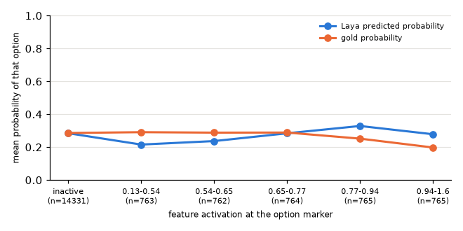

# Feature 4130

Critérios em que aparece: attribution_toward_correct

**Interpretação (preencher):** 

---

## Maiores ativações

**tr_customer_service_000164 / category** (choice, customer_service) | ativação 3.988 em `pergunta` | opções ['account', 'billing', 'delivery', 'refund', 'technical'] | Laya: **delivery** [0.001, 0.002, 0.98, 0.001, 0.016] | gabarito: **delivery**

```
<bos> choice question:⟦ What⟧ is this customer conversation primarily about?<eos>
▸ <mask> account: Login, plan changes, profile or access management.
▸ <mask> billing: A charge, invoice, subscription or payment problem.
▸ <mask> delivery: Shipping, fulfilment or delivery of a physical item.
▸ <mask> refund: The customer is explicitly asking for money back.
▸ <mask> technical: The product or service is not working as expected.

<eos>

 {"account": {"lifetime_value_usd": 1212, "prior_tickets_90d": 0, "seats": 1, "tenure_months": 33, "tier": "standard"}, "thread": [{"role": "customer", "text": "I’m looking at this shipment I just opened and the casing is completely cracked. It looks like it was tossed around in a warehouse for a week before getting here. This is ridiculous."}, {"role": "agent", "text": "I am very sorry to hear that your item arrived in that condition. Could you please provide your order number so I can pull up the shipping details?"}, {"role": "customer", "text": "The order number is 88492. I’ve been a loyal customer for nearly three years, and honestly, I’ve never seen something packaged so poorly."}, {"role": "agent", "text": "Thank you for sharing that information. I see your account history here. To better understand what happened, could you please send over a few photos of the damaged casing and the box it arrived in?"}, {"role": "customer", "text": "I shouldn't have to jump through hoops just because your shipping team is incompetent. Do you really need me to go through the trouble of uploading pictures?"}, {"role": "agent", "text": "I understand your frustration, and I apologize for the inconvenience. The photos are a standard requirement for our quality control team to document transit damage."}, {"role": "customer", "text": "Fine, I’ll get them to you, but I expect someone to actually look at this instead of just pushing it aside."}]}<eos>
```

**tr_customer_service_000164 / action** (choice, customer_service) | ativação 3.740 em `pergunta` | opções ['answer_directly', 'close_no_action', 'escalate_to_human', 'execute_refund', 'request_information'] | Laya: **escalate_to_human** [0.002, 0.003, 0.993, 0.001, 0.0] | gabarito: **request_information**

```
<bos> choice question:⟦ What⟧ should the assistant do next with this conversation?<eos>
▸ <mask> answer_directly: The assistant can resolve this itself with information it already has.
▸ <mask> close_no_action: No further action is warranted; the matter is settled.
▸ <mask> escalate_to_human: Hand off to a human agent with the appropriate authority.
▸ <mask> execute_refund: Issue the refund or credit the customer is owed.
▸ <mask> request_information: More detail is needed from the customer before anything can be done.

<eos>

 {"account": {"lifetime_value_usd": 1212, "prior_tickets_90d": 0, "seats": 1, "tenure_months": 33, "tier": "standard"}, "thread": [{"role": "customer", "text": "I’m looking at this shipment I just opened and the casing is completely cracked. It looks like it was tossed around in a warehouse for a week before getting here. This is ridiculous."}, {"role": "agent", "text": "I am very sorry to hear that your item arrived in that condition. Could you please provide your order number so I can pull up the shipping details?"}, {"role": "customer", "text": "The order number is 88492. I’ve been a loyal customer for nearly three years, and honestly, I’ve never seen something packaged so poorly."}, {"role": "agent", "text": "Thank you for sharing that information. I see your account history here. To better understand what happened, could you please send over a few photos of the damaged casing and the box it arrived in?"}, {"role": "customer", "text": "I shouldn't have to jump through hoops just because your shipping team is incompetent. Do you really need me to go through the trouble of uploading pictures?"}, {"role": "agent", "text": "I understand your frustration, and I apologize for the inconvenience. The photos are a standard requirement for our quality control team to document transit damage."}, {"role": "customer", "text": "Fine, I’ll get them to you, but I expect someone to actually look at this instead of just pushing it aside."}]}<eos>
```

**tr_customer_service_000033 / action** (choice, customer_service) | ativação 3.686 em `pergunta` | opções ['answer_directly', 'close_no_action', 'escalate_to_human', 'execute_refund', 'request_information'] | Laya: **close_no_action** [0.067, 0.893, 0.015, 0.015, 0.01] | gabarito: **escalate_to_human**

```
<bos> choice question:⟦ What⟧ should the assistant do next with this conversation?<eos>
▸ <mask> answer_directly: The assistant can resolve this itself with information it already has.
▸ <mask> close_no_action: No further action is warranted; the matter is settled.
▸ <mask> escalate_to_human: Hand off to a human agent with the appropriate authority.
▸ <mask> execute_refund: Issue the refund or credit the customer is owed.
▸ <mask> request_information: More detail is needed from the customer before anything can be done.

<eos>

 {"account": {"lifetime_value_usd": 972, "prior_tickets_90d": 3, "seats": 1, "tenure_months": 49, "tier": "free"}, "orders": [{"amount_usd": 999, "date": "2026-03-06", "id": "A-72271", "status": "settled"}, {"amount_usd": 999, "date": "2026-02-16", "id": "A-14198", "status": "settled"}, {"amount_usd": 999, "date": "2026-01-05", "id": "A-90678", "status": "settled"}], "thread": [{"role": "customer", "text": "I've been trying to downgrade to the free plan for three days now and the website just keeps looping me back to the dashboard. This is incredibly annoying given I've been a loyal user for over four years."}, {"role": "agent", "text": "I'm sorry for the frustration the downgrade process is causing. Could you tell me if you are seeing any specific error codes or pop-up messages when the page refreshes?"}, {"role": "customer", "text": "There are no codes, it just fails silently. I've spent almost a thousand dollars with you guys over 49 months, and after having three previous tickets only 'partially' addressed, I really expected a simple plan change to actually work."}, {"role": "agent", "text": "I appreciate your long-term history with us. To help me investigate the account block, would you mind specifying which features from those three previous tickets are still causing you issues on your current plan?"}, {"role": "customer", "text": "The seat management and the data exports never worked right, which is why I'm trying to scale back. I'm just tired of paying for a service that feels broken every time I try to adjust my settings."}]}<eos>
```

**tr_customer_service_000220 / action** (choice, customer_service) | ativação 3.668 em `pergunta` | opções ['answer_directly', 'close_no_action', 'escalate_to_human', 'execute_refund', 'request_information'] | Laya: **close_no_action** [0.202, 0.728, 0.022, 0.032, 0.016] | gabarito: **request_information**

```
<bos> choice question:⟦ What⟧ should the assistant do next with this conversation?<eos>
▸ <mask> answer_directly: The assistant can resolve this itself with information it already has.
▸ <mask> close_no_action: No further action is warranted; the matter is settled.
▸ <mask> escalate_to_human: Hand off to a human agent with the appropriate authority.
▸ <mask> execute_refund: Issue the refund or credit the customer is owed.
▸ <mask> request_information: More detail is needed from the customer before anything can be done.

<eos>

 {"account": {"lifetime_value_usd": 94, "prior_tickets_90d": 0, "seats": 1, "tenure_months": 1, "tier": "standard"}, "orders": [{"amount_usd": 9, "date": "2026-01-18", "id": "A-69685", "status": "settled"}, {"amount_usd": 9, "date": "2026-03-15", "id": "A-58214", "status": "settled"}, {"amount_usd": 9, "date": "2026-02-06", "id": "A-56446", "status": "failed"}], "thread": [{"role": "customer", "text": "I’ve been trying to log into my account for the past hour and it keeps throwing an error. I have a major presentation due in two hours and this is beyond frustrating. Why is this happening?"}, {"role": "agent", "text": "I’m sorry to hear you're experiencing trouble accessing your account right before your deadline. Could you please provide the specific error message or code you are seeing on your screen?"}, {"role": "customer", "text": "It just says 'Authentication Failed' no matter how many times I reset my password. I don't have time for this nonsense, I need access now."}, {"role": "agent", "text": "Thank you for that information. To help me investigate further, are you attempting to log in via a web browser or our mobile application?"}, {"role": "customer", "text": "I am using Chrome on my laptop, just like I do every single day. Just fix it, I have people waiting on these files."}]}<eos>
```

**tr_customer_service_000073 / action** (choice, customer_service) | ativação 3.645 em `pergunta` | opções ['answer_directly', 'close_no_action', 'escalate_to_human', 'execute_refund', 'request_information'] | Laya: **close_no_action** [0.184, 0.794, 0.004, 0.017, 0.0] | gabarito: **escalate_to_human**

```
<bos> choice question:⟦ What⟧ should the assistant do next with this conversation?<eos>
▸ <mask> answer_directly: The assistant can resolve this itself with information it already has.
▸ <mask> close_no_action: No further action is warranted; the matter is settled.
▸ <mask> escalate_to_human: Hand off to a human agent with the appropriate authority.
▸ <mask> execute_refund: Issue the refund or credit the customer is owed.
▸ <mask> request_information: More detail is needed from the customer before anything can be done.

<eos>

 {"account": {"lifetime_value_usd": 54, "prior_tickets_90d": 1, "seats": 1, "tenure_months": 1, "tier": "premium"}, "orders": [{"amount_usd": 29, "date": "2026-01-23", "id": "A-91950", "status": "failed"}], "thread": [{"role": "customer", "text": "I am absolutely livid that my payment failed again after I was told this was fixed last week, this is ridiculous!"}, {"role": "agent", "text": "I'm very sorry for the ongoing trouble with your premium subscription payment; I see your previous ticket regarding this same issue."}, {"role": "customer", "text": "Seeing it doesn't help me! I've only been a member for a month and you've already messed up the $29 charge twice now."}, {"role": "agent", "text": "I understand how frustrating that is. To help me investigate, are you receiving a specific error message from your bank or within our portal?"}, {"role": "customer", "text": "It just says 'transaction failed' with no explanation, which is exactly what happened the first time I complained."}, {"role": "agent", "text": "Thank you for that detail. I'm going to pull up the logs from our payment processor to see if there's a more descriptive rejection code on the backend."}, {"role": "customer", "text": "You do that, but if this isn't sorted out once and for all, I'm canceling this plan and moving to a competitor who actually wants my money."}]}<eos>
```

## Ativações medianas (faixa 40-60%, mediana 0.849)

**tr_customer_service_000288 / needs_human** (noul, customer_service) | ativação 0.892 em `pergunta` | opções ['false', 'true'] | Laya: **true** [0.419, 0.581] | gabarito: **true**

```
<bos> noul question: This conversation requires a human agent rather than⟦ automated⟧ handling.<eos>
▸ <mask> false: Automation can carry this to resolution.
▸ <mask> true: A human must take over: judgement, authority or empathy is required.

<eos>

 {"account": {"lifetime_value_usd": 34, "prior_tickets_90d": 0, "seats": 1, "tenure_months": 2, "tier": "standard"}, "orders": [{"amount_usd": 999, "date": "2026-01-10", "id": "A-86378", "status": "settled"}], "thread": [{"role": "customer", "text": "I’m looking at my recent bank statement and there's a charge for $999, but I'm really confused because I thought I already requested a refund on my standard plan last week, so I'm not sure if I did it correctly or if it's just taking a while to show up?"}]}<eos>
```

**tr_invoice_processing_000181 / disposition** (choice, invoice_processing) | ativação 0.791 em `pergunta` | opções ['approve', 'hold', 'manual_review', 'reject'] | Laya: **reject** [0.401, 0.122, 0.018, 0.458] | gabarito: **hold**

```
<bos> choice question:⟦ How⟧ should this vendor invoice be dispositioned?<eos>
▸ <mask> approve: Matches the order and delivery; approve for payment.
▸ <mask> hold: Something needs confirming before payment; hold pending clarification.
▸ <mask> manual_review: A human in finance must review the discrepancy.
▸ <mask> reject: Should not be paid: duplicate, unauthorised or materially wrong.

<eos>

 {"delivery": {"condition": "accepted with exceptions", "date": "2026-03-27", "received_qty": 1000}, "invoice": {"currency": "USD", "id": "INV-2026-4638", "lines": [{"qty": 1000, "sku": "SKU-503", "total_usd": 151490.0, "unit_usd": 151.49}], "total_usd": 151490.0, "vendor": "Acme Fabrication"}, "payment": {"days_until_due": 2, "discount_expires_in_days": null, "early_payment_discount_pct": null, "status": "scheduled", "terms": "net 30"}, "purchase_order": {"freight_terms": "freight prepaid by vendor, not separately billable", "id": "PO-2215", "lines": [{"qty": 1000, "unit_usd": 151.49}], "total_usd": 151490.0}, "vendor_history": {"disputes_12m": 5, "invoices_12m": 12, "prior_invoice_ids": ["INV-2026-4638", "INV-2026-9285", "INV-2026-4100", "INV-2026-2909"]}}<eos>
```

**tr_customer_service_000253 / urgency** (score, customer_service) | ativação 0.910 em `opção` | opções ['0', '1', '2', '3'] | Laya: **1** [0.175, 0.546, 0.213, 0.066] | gabarito: **3**

```
<bos> score question: How time-sensitive is this conversation?<eos>
▸ <mask> level 0: No time pressure; can wait indefinitely.
▸ <mask> level 1: Routine; handle within the normal queue.
▸ <mask> level⟦ ⟧2: Elevated; should be handled within the same week.
▸ <mask> level 3: Critical; requires action within the same day.

<eos>

 {"account": {"lifetime_value_usd": 4869, "prior_tickets_90d": 1, "seats": 40, "tenure_months": 60, "tier": "premium"}, "thread": [{"role": "customer", "text": "My premium package is late yet again. I’ve been a loyal customer for 60 months, and frankly, I’m tired of dealing with these same logistical failures."}, {"role": "agent", "text": "I understand your frustration regarding this delay. To help me investigate the status of your shipment, could you please provide your order reference number?"}, {"role": "customer", "text": "It’s 8829-X. You guys had this issue last year, and here we are repeating the exact same problem."}, {"role": "agent", "text": "Thank you for that information. I am checking the current tracking status for you now; could you verify if the address listed on your account is the one where the delivery was expected?"}, {"role": "customer", "text": "Yes, it is the same address as always. Just tell me where the package is instead of making me repeat myself."}]}<eos>
```

**tr_customer_service_000136 / category** (choice, customer_service) | ativação 0.914 em `pergunta` | opções ['account', 'billing', 'delivery', 'refund', 'technical'] | Laya: **billing** [0.002, 0.997, 0.0, 0.0, 0.001] | gabarito: **billing**

```
<bos> choice question: What is this customer conversation primarily about?⟦<eos>⟧
▸ <mask> account: Login, plan changes, profile or access management.
▸ <mask> billing: A charge, invoice, subscription or payment problem.
▸ <mask> delivery: Shipping, fulfilment or delivery of a physical item.
▸ <mask> refund: The customer is explicitly asking for money back.
▸ <mask> technical: The product or service is not working as expected.

<eos>

 {"account": {"lifetime_value_usd": 151, "prior_tickets_90d": 0, "seats": 1, "tenure_months": 2, "tier": "free"}, "orders": [{"amount_usd": 2997, "date": "2026-02-27", "id": "A-95428", "status": "refunded"}], "thread": [{"role": "customer", "text": "I just got my latest invoice and it shows a charge of $2,997—something I never signed up for. I've only been on the free plan for two months and this is urgent, please explain why this amount is appearing."}, {"role": "agent", "text": "I’m sorry to hear about the surprise charge. Could you share the invoice number or the date it was issued so I can look into the details?"}, {"role": "customer", "text": "The invoice is #INV-8392, dated August 5th. I didn’t receive any notice about upgrading, and I’m still under the free tier."}, {"role": "agent", "text": "Thank you for that information. I’ll verify the account activity around that date. Did you perhaps receive any promotional email that might have triggered an automatic upgrade?"}, {"role": "customer", "text": "No, I haven’t seen any promotion, and I never clicked any upgrade link. I need to know what happened before this gets billed again."}, {"role": "agent", "text": "Understood. I’ll check the billing logs and see if there’s a misapplied charge. Meanwhile, could you confirm the primary email address on the account?"}, {"role": "customer", "text": "The email is jessica.rivera@example.com. Please let me know what you find as soon as possible."}]}<eos>
```

**tr_customer_service_000203 / category** (choice, customer_service) | ativação 0.952 em `opção` | opções ['account', 'billing', 'delivery', 'refund', 'technical'] | Laya: **account** [0.995, 0.0, 0.0, 0.0, 0.004] | gabarito: **technical**

```
<bos> choice question: What is this customer conversation primarily about?<eos>
▸ <mask> account⟦:⟧ Login, plan changes, profile or access management.
▸ <mask> billing: A charge, invoice, subscription or payment problem.
▸ <mask> delivery: Shipping, fulfilment or delivery of a physical item.
▸ <mask> refund: The customer is explicitly asking for money back.
▸ <mask> technical: The product or service is not working as expected.

<eos>

 {"account": {"lifetime_value_usd": 303, "prior_tickets_90d": 1, "seats": 12, "tenure_months": 5, "tier": "premium"}, "thread": [{"role": "customer", "text": "Since the last update, the sync process has been taking around 15 minutes for a few megabytes, which is much slower than before."}]}<eos>
```

## Estatísticas (conjunto de descoberta, dev e teste)

**pred / error**

| split | decisões | ativas | ativas e Laya errou | taxa | lift | q (BH) | OR (CMH) | q (CMH) |
|---|---|---|---|---|---|---|---|---|
| discovery | 5100 | 1019 | 637 | 0.625 | 0.97 | 0.224 | 0.93 | 0.838 |
| dev | 900 | 163 | 107 | 0.656 | 0.98 | 0.817 | 0.96 | 0.957 |
| test | 2000 | 385 | 255 | 0.662 | 1.02 | 0.685 | 0.70 | 0.423 |

**corr / error**

| split | decisões | ativas | ativas e Laya errou | taxa | lift | q (BH) | OR (CMH) | q (CMH) |
|---|---|---|---|---|---|---|---|---|
| discovery | 5100 | 1009 | 627 | 0.621 | 0.97 | 0.13 | 0.94 | 0.747 |
| dev | 900 | 169 | 113 | 0.669 | 0.99 | 1 | 0.97 | 0.982 |
| test | 2000 | 382 | 252 | 0.660 | 1.01 | 0.774 | 0.70 | 0.394 |

**state / error**

| split | decisões | ativas | ativas e Laya errou | taxa | lift | q (BH) | OR (CMH) | q (CMH) |
|---|---|---|---|---|---|---|---|---|
| discovery | 5100 | 638 | 367 | 0.575 | 0.89 | 0.000953 | 1.08 | 0.809 |
| dev | 900 | 95 | 63 | 0.663 | 0.99 | 1 | 1.88 | 0.293 |
| test | 2000 | 233 | 144 | 0.618 | 0.95 | 0.594 | 1.18 | 0.736 |

**pred / probe_right_laya_wrong**

| split | decisões | ativas | ativas e Laya errou | taxa | lift | q (BH) | OR (CMH) | q (CMH) |
|---|---|---|---|---|---|---|---|---|
| discovery | 2819 | 507 | 313 | 0.617 | 0.95 | 0.168 | 1.00 | 0.996 |
| dev | 520 | 80 | 55 | 0.688 | 1.02 | 0.999 | 1.51 | 0.354 |
| test | 1106 | 195 | 129 | 0.662 | 1.05 | 0.511 | 1.81 | 0.295 |

**corr / probe_right_laya_wrong**

| split | decisões | ativas | ativas e Laya errou | taxa | lift | q (BH) | OR (CMH) | q (CMH) |
|---|---|---|---|---|---|---|---|---|
| discovery | 2819 | 502 | 308 | 0.614 | 0.95 | 0.117 | 1.30 | 0.498 |
| dev | 520 | 84 | 59 | 0.702 | 1.04 | 0.765 | 2.23 | 0.731 |
| test | 1106 | 199 | 133 | 0.668 | 1.06 | 0.338 | 2.72 | 0.24 |

**state / probe_right_laya_wrong**

| split | decisões | ativas | ativas e Laya errou | taxa | lift | q (BH) | OR (CMH) | q (CMH) |
|---|---|---|---|---|---|---|---|---|
| discovery | 2819 | 344 | 184 | 0.535 | 0.83 | 4.53e-05 | 1.37 | 0.191 |
| dev | 520 | 58 | 34 | 0.586 | 0.87 | 0.482 | 1.60 | 0.52 |
| test | 1106 | 140 | 82 | 0.586 | 0.93 | 0.486 | 1.91 | 0.128 |

Confusão mais sobre-representada (pred): `action|1>2` (n=70, lift 4.93, p=0). Formato `pergunta|índice previsto>índice correto`.

Confusão mais sobre-representada (corr): `action|1>2` (n=67, lift 4.77, p=5.04e-43). Formato `pergunta|índice previsto>índice correto`.

Confusão mais sobre-representada (state): `needs_human|0>1` (n=37, lift 5.48, p=9.1e-22). Formato `pergunta|índice previsto>índice correto`.



