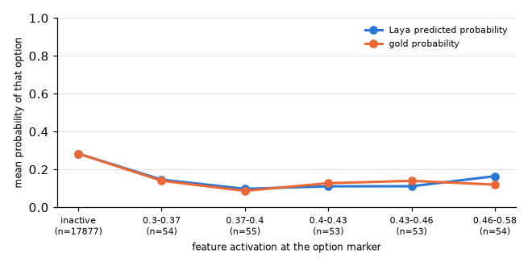

# Feature 4131

Critérios em que aparece: corr_error_stratified

**Interpretação (preencher):** 

---

## Maiores ativações

**tr_customer_service_000024 / category** (choice, customer_service) | ativação 6.664 em `estado` | opções ['account', 'billing', 'delivery', 'refund', 'technical'] | Laya: **billing** [0.018, 0.98, 0.001, 0.0, 0.001] | gabarito: **billing**

```
<bos> choice question: What is this customer conversation primarily about?<eos>
▸ <mask> account: Login, plan changes, profile or access management.
▸ <mask> billing: A charge, invoice, subscription or payment problem.
▸ <mask> delivery: Shipping, fulfilment or delivery of a physical item.
▸ <mask> refund: The customer is explicitly asking for money back.
▸ <mask> technical: The product or service is not working as expected.

<eos>

 {"account": {"lifetime_value_usd": 635, "prior_tickets_90d": 0, "seats": 12, "tenure_months": 8, "tier": "enterprise"}, "thread": [{"role": "customer", "text": "I need the invoice for our Enterprise account immediately! We are in the middle⟦ of⟧ a major audit and I cannot find the records in the dashboard anywhere."}, {"role": "agent", "text": "I understand the urgency of this request for your audit. Could you please specify which billing periods you are looking for?"}, {"role": "customer", "text": "I need every single statement from the last eight months. We've been with you guys since the start of the year and I need these documents sent to my email right now."}, {"role": "agent", "text": "Thank you for clarifying the timeframe. To make sure I am accessing the right files, can you confirm the primary billing email address listed on the account?"}, {"role": "customer", "text": "It's the admin address I'm using to send this! Please, just get me those PDFs, I'm under a lot of pressure to get this filed."}]}<eos>
```

**tr_customer_service_000024 / action** (choice, customer_service) | ativação 6.367 em `estado` | opções ['answer_directly', 'close_no_action', 'escalate_to_human', 'execute_refund', 'request_information'] | Laya: **answer_directly** [0.463, 0.316, 0.03, 0.094, 0.097] | gabarito: **answer_directly**

```
<bos> choice question: What should the assistant do next with this conversation?<eos>
▸ <mask> answer_directly: The assistant can resolve this itself with information it already has.
▸ <mask> close_no_action: No further action is warranted; the matter is settled.
▸ <mask> escalate_to_human: Hand off to a human agent with the appropriate authority.
▸ <mask> execute_refund: Issue the refund or credit the customer is owed.
▸ <mask> request_information: More detail is needed from the customer before anything can be done.

<eos>

 {"account": {"lifetime_value_usd": 635, "prior_tickets_90d": 0, "seats": 12, "tenure_months": 8, "tier": "enterprise"}, "thread": [{"role": "customer", "text": "I need the invoice for our Enterprise account immediately! We are in the middle⟦ of⟧ a major audit and I cannot find the records in the dashboard anywhere."}, {"role": "agent", "text": "I understand the urgency of this request for your audit. Could you please specify which billing periods you are looking for?"}, {"role": "customer", "text": "I need every single statement from the last eight months. We've been with you guys since the start of the year and I need these documents sent to my email right now."}, {"role": "agent", "text": "Thank you for clarifying the timeframe. To make sure I am accessing the right files, can you confirm the primary billing email address listed on the account?"}, {"role": "customer", "text": "It's the admin address I'm using to send this! Please, just get me those PDFs, I'm under a lot of pressure to get this filed."}]}<eos>
```

**tr_customer_service_000024 / needs_human** (noul, customer_service) | ativação 6.301 em `estado` | opções ['false', 'true'] | Laya: **true** [0.192, 0.808] | gabarito: **false**

```
<bos> noul question: This conversation requires a human agent rather than automated handling.<eos>
▸ <mask> false: Automation can carry this to resolution.
▸ <mask> true: A human must take over: judgement, authority or empathy is required.

<eos>

 {"account": {"lifetime_value_usd": 635, "prior_tickets_90d": 0, "seats": 12, "tenure_months": 8, "tier": "enterprise"}, "thread": [{"role": "customer", "text": "I need the invoice for our Enterprise account immediately! We are in the middle⟦ of⟧ a major audit and I cannot find the records in the dashboard anywhere."}, {"role": "agent", "text": "I understand the urgency of this request for your audit. Could you please specify which billing periods you are looking for?"}, {"role": "customer", "text": "I need every single statement from the last eight months. We've been with you guys since the start of the year and I need these documents sent to my email right now."}, {"role": "agent", "text": "Thank you for clarifying the timeframe. To make sure I am accessing the right files, can you confirm the primary billing email address listed on the account?"}, {"role": "customer", "text": "It's the admin address I'm using to send this! Please, just get me those PDFs, I'm under a lot of pressure to get this filed."}]}<eos>
```

**tr_customer_service_000024 / urgency** (score, customer_service) | ativação 6.090 em `estado` | opções ['0', '1', '2', '3'] | Laya: **3** [0.137, 0.264, 0.155, 0.444] | gabarito: **3**

```
<bos> score question: How time-sensitive is this conversation?<eos>
▸ <mask> level 0: No time pressure; can wait indefinitely.
▸ <mask> level 1: Routine; handle within the normal queue.
▸ <mask> level 2: Elevated; should be handled within the same week.
▸ <mask> level 3: Critical; requires action within the same day.

<eos>

 {"account": {"lifetime_value_usd": 635, "prior_tickets_90d": 0, "seats": 12, "tenure_months": 8, "tier": "enterprise"}, "thread": [{"role": "customer", "text": "I need the invoice for our Enterprise account immediately! We are in the middle⟦ of⟧ a major audit and I cannot find the records in the dashboard anywhere."}, {"role": "agent", "text": "I understand the urgency of this request for your audit. Could you please specify which billing periods you are looking for?"}, {"role": "customer", "text": "I need every single statement from the last eight months. We've been with you guys since the start of the year and I need these documents sent to my email right now."}, {"role": "agent", "text": "Thank you for clarifying the timeframe. To make sure I am accessing the right files, can you confirm the primary billing email address listed on the account?"}, {"role": "customer", "text": "It's the admin address I'm using to send this! Please, just get me those PDFs, I'm under a lot of pressure to get this filed."}]}<eos>
```

**tr_customer_service_000085 / category** (choice, customer_service) | ativação 5.934 em `estado` | opções ['account', 'billing', 'delivery', 'refund', 'technical'] | Laya: **delivery** [0.029, 0.098, 0.846, 0.002, 0.026] | gabarito: **billing**

```
<bos> choice question: What is this customer conversation primarily about?<eos>
▸ <mask> account: Login, plan changes, profile or access management.
▸ <mask> billing: A charge, invoice, subscription or payment problem.
▸ <mask> delivery: Shipping, fulfilment or delivery of a physical item.
▸ <mask> refund: The customer is explicitly asking for money back.
▸ <mask> technical: The product or service is not working as expected.

<eos>

 {"account": {"lifetime_value_usd": 62, "prior_tickets_90d": 3, "seats": 1, "tenure_months": 1, "tier": "standard"}, "thread": [{"role": "customer", "text": "I still haven't gotten a copy⟦ of⟧ my invoice for this month, even after three tickets. I need it by Friday for my accounting."}, {"role": "agent", "text": "I understand how inconvenient that is. Could you confirm the email address linked to your account so I can verify where the invoice was sent?"}, {"role": "customer", "text": "It's the same john.doe@example.com you have on file. Please just send the PDF; I can't wait any longer."}, {"role": "agent", "text": "Thanks for confirming. I’ll check the sending logs and resend the document. Is there any specific format you prefer, or will a standard PDF work?"}, {"role": "customer", "text": "A standard PDF is fine, but make sure it actually arrives this time—my deadline is this Friday and I can’t afford another delay."}]}<eos>
```

## Ativações medianas (faixa 40-60%, mediana 1.301)

**tr_customer_service_000254 / needs_human** (noul, customer_service) | ativação 1.129 em `estado` | opções ['false', 'true'] | Laya: **true** [0.033, 0.967] | gabarito: **true**

```
<bos> noul question: This conversation requires a human agent rather than automated handling.<eos>
▸ <mask> false: Automation can carry this to resolution.
▸ <mask> true: A human must take over: judgement, authority or empathy is required.

<eos>

 {"account": {"lifetime_value_usd": 3273, "prior_tickets_90d": 0, "seats": 1, "tenure_months": 49, "tier": "free"}, "thread": [{"role": "customer", "text": "The export tool is completely broken and I have a hard deadline tonight. I’ve been using this free plan for 49 months and never seen it this bad."}, {"role": "agent", "text": "I am sorry to hear you are having trouble with the export tool. Could you please describe what happens exactly when you click the export button?"}, {"role": "customer", "text": "It just hangs indefinitely. I click it, the wheel spins, and nothing ever downloads."}, {"role": "agent", "text": "Thank you for clarifying. Are you seeing any notifications or pop-ups appear in the corner of your browser when the process stalls?"}, {"role": "customer", "text": "No, it’s just dead silence. Nothing happens⟦ at⟧ all, and I'm losing time."}, {"role": "agent", "text": "I appreciate you checking that. Which browser and version are you currently using to access the site?"}, {"role": "customer", "text": "I'm on Chrome, version 124. Get this moving, please."}]}<eos>
```

**tr_security_incidents_000173 / severity** (score, security_incidents) | ativação 0.962 em `opção` | opções ['0', '1', '2', '3', '4'] | Laya: **1** [0.138, 0.536, 0.197, 0.056, 0.072] | gabarito: **1**

```
<bos> score question: How severe is the potential impact if this alert is real?<eos>
▸ <mask> level 0: Negligible: no access to anything sensitive.
▸ <mask> level 1: Low: limited access, easily reversed.
▸ <mask> level 2: Moderate: access to internal systems or non-public data.
▸ <mask> level 3: High: access⟦ to⟧ production, secrets or customer data.
▸ <mask> level 4: Critical: active compromise of crown-jewel systems.

<eos>

 {"alert": {"description": "a session token was presented from a second address", "evidence": "An active session token belonging to an unprivileged employee was observed being utilized by a second allowlisted network address during an open change window. The account involved has MFA active and reached a credential age of 90 days at the time of the duplicate session presentation.", "rule": "token_reuse"}, "context": {"asset_criticality": "low", "change_window_active": true, "source_on_allowlist": true}, "history": {"credential_rotation_days_ago": 90, "distinct_countries_30d": 4, "logins_30d": 474, "prior_alerts_90d": 0}, "principal": {"mfa_enrolled": true, "name": "svc-analytics-220", "privileges": ["repo:read"], "type": "employee"}}<eos>
```

**tr_security_incidents_000086 / severity** (score, security_incidents) | ativação 0.986 em `opção` | opções ['0', '1', '2', '3', '4'] | Laya: **2** [0.146, 0.261, 0.385, 0.11, 0.097] | gabarito: **3**

```
<bos> score question: How severe is the potential impact if this alert is real?<eos>
▸ <mask> level 0: Negligible: no access⟦ to⟧ anything sensitive.
▸ <mask> level 1: Low: limited access, easily reversed.
▸ <mask> level 2: Moderate: access to internal systems or non-public data.
▸ <mask> level 3: High: access to production, secrets or customer data.
▸ <mask> level 4: Critical: active compromise of crown-jewel systems.

<eos>

 {"alert": {"description": "a large transfer to an external destination", "evidence": "The privileged shared mailbox account initiated a data transfer of 4.2GB to an external destination at 14:22 UTC. Although the source IP is present on the internal allowlist, this egress volume exceeds the daily baseline for this account, which last rotated its credentials 90 days ago.", "rule": "data_egress"}, "context": {"asset_criticality": "high", "change_window_active": false, "source_on_allowlist": true}, "history": {"credential_rotation_days_ago": 90, "distinct_countries_30d": 1, "logins_30d": 1156, "prior_alerts_90d": 8}, "principal": {"mfa_enrolled": true, "name": "ci-billing-330", "privileges": ["deploy:production", "secrets:read"], "type": "shared_mailbox"}}<eos>
```

**tr_customer_service_000067 / needs_human** (noul, customer_service) | ativação 1.471 em `estado` | opções ['false', 'true'] | Laya: **true** [0.197, 0.803] | gabarito: **true**

```
<bos> noul question: This conversation requires a human agent rather than automated handling.<eos>
▸ <mask> false: Automation can carry this to resolution.
▸ <mask> true: A human must take over: judgement, authority or empathy is required.

<eos>

 {"account": {"lifetime_value_usd": 81, "prior_tickets_90d": 0, "seats": 12, "tenure_months": 2, "tier": "premium"}, "thread": [{"role": "customer", "text": "I was promised a refund last week for my premium subscription, but nothing has shown up yet. I need that money in my account by the end⟦ of⟧ day tomorrow."}, {"role": "agent", "text": "Understood, that’s frustrating. Could you provide the order ID or refund reference you received?"}, {"role": "customer", "text": "The order number is #PX-8429. I've been waiting and this delay is really disappointing."}, {"role": "agent", "text": "Thanks for the details. I’ll check the status on my end. Is there any other information, like the payment method you used, that could help speed this up?"}, {"role": "customer", "text": "I paid with the card ending 1234, and I’m counting on the refund being processed before tomorrow’s deadline."}]}<eos>
```

**tr_security_incidents_000241 / disposition** (choice, security_incidents) | ativação 1.103 em `estado` | opções ['close_benign', 'contain', 'investigate', 'monitor'] | Laya: **monitor** [0.203, 0.237, 0.104, 0.457] | gabarito: **investigate**

```
<bos> choice question: How should this security alert be dispositioned?<eos>
▸ <mask> close_benign: Expected, explainable activity; close without analyst time.
▸ <mask> contain: Contain the host or account immediately; do not wait for triage.
▸ <mask> investigate: Warrants an analyst opening an investigation.
▸ <mask> monitor: Not clearly malicious, but worth watching for recurrence.

<eos>

 {"alert": {"description": "audit logging was turned off on a host", "evidence": "A service account disabled audit logging on the host, an action performed outside⟦ of⟧ any defined change window. While the activity originated from an allowlisted source, the account lacks MFA and has not rotated credentials in 180 days.", "rule": "disabled_logging"}, "context": {"asset_criticality": "medium", "change_window_active": false, "source_on_allowlist": true}, "history": {"credential_rotation_days_ago": 180, "distinct_countries_30d": 3, "logins_30d": 613, "prior_alerts_90d": 0}, "principal": {"mfa_enrolled": false, "name": "adm-infra-357", "privileges": ["repo:read"], "type": "service_account"}}<eos>
```

## Estatísticas (conjunto de descoberta, dev e teste)

**pred / error**

| split | decisões | ativas | ativas e Laya errou | taxa | lift | q (BH) | OR (CMH) | q (CMH) |
|---|---|---|---|---|---|---|---|---|
| discovery | 5100 | 12 | 11 | 0.917 | 1.42 | nan | nan | nan |
| dev | 900 | 4 | 4 | 1.000 | 1.49 | nan | nan | nan |
| test | 2000 | 3 | 3 | 1.000 | 1.54 | nan | nan | nan |

**corr / error**

| split | decisões | ativas | ativas e Laya errou | taxa | lift | q (BH) | OR (CMH) | q (CMH) |
|---|---|---|---|---|---|---|---|---|
| discovery | 5100 | 26 | 25 | 0.962 | 1.49 | 0.000534 | 99.31 | 1.68e-10 |
| dev | 900 | 5 | 5 | 1.000 | 1.49 | nan | nan | nan |
| test | 2000 | 3 | 3 | 1.000 | 1.54 | nan | nan | nan |

**state / error**

| split | decisões | ativas | ativas e Laya errou | taxa | lift | q (BH) | OR (CMH) | q (CMH) |
|---|---|---|---|---|---|---|---|---|
| discovery | 5100 | 1389 | 833 | 0.600 | 0.93 | 0.000505 | 1.04 | 0.869 |
| dev | 900 | 225 | 129 | 0.573 | 0.85 | 0.0437 | 0.78 | 0.576 |
| test | 2000 | 560 | 347 | 0.620 | 0.95 | 0.273 | 1.09 | 0.801 |

**pred / probe_right_laya_wrong**

| split | decisões | ativas | ativas e Laya errou | taxa | lift | q (BH) | OR (CMH) | q (CMH) |
|---|---|---|---|---|---|---|---|---|
| discovery | 2819 | 10 | 10 | 1.000 | 1.55 | nan | nan | nan |
| dev | 520 | 4 | 4 | 1.000 | 1.48 | nan | nan | nan |
| test | 1106 | 1 | 1 | 1.000 | 1.58 | nan | nan | nan |

**corr / probe_right_laya_wrong**

| split | decisões | ativas | ativas e Laya errou | taxa | lift | q (BH) | OR (CMH) | q (CMH) |
|---|---|---|---|---|---|---|---|---|
| discovery | 2819 | 0 | 0 | nan | nan | nan | nan | nan |
| dev | 520 | 0 | 0 | nan | nan | nan | nan | nan |
| test | 1106 | 0 | 0 | nan | nan | nan | nan | nan |

**state / probe_right_laya_wrong**

| split | decisões | ativas | ativas e Laya errou | taxa | lift | q (BH) | OR (CMH) | q (CMH) |
|---|---|---|---|---|---|---|---|---|
| discovery | 2819 | 778 | 446 | 0.573 | 0.89 | 5.56e-06 | 1.22 | 0.248 |
| dev | 520 | 126 | 72 | 0.571 | 0.85 | 0.0934 | 1.18 | 0.756 |
| test | 1106 | 316 | 196 | 0.620 | 0.98 | 0.851 | 2.02 | 0.00619 |

Confusão mais sobre-representada (pred): `disposition|0>2` (n=10, lift 73.28, p=nan). Formato `pergunta|índice previsto>índice correto`.

Confusão mais sobre-representada (corr): `disposition|3>0` (n=16, lift 87.18, p=3.82e-30). Formato `pergunta|índice previsto>índice correto`.

Confusão mais sobre-representada (state): `needs_human|0>1` (n=45, lift 3.06, p=7.96e-18). Formato `pergunta|índice previsto>índice correto`.



