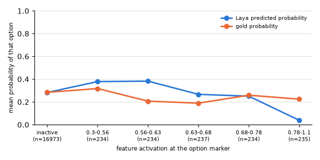

# Feature 4139

Critérios em que aparece: attribution_toward_wrong

**Interpretação (preencher):** 

---

## Maiores ativações

**tr_customer_service_000229 / category** (choice, customer_service) | ativação 2.510 em `estado` | opções ['account', 'billing', 'delivery', 'refund', 'technical'] | Laya: **billing** [0.0, 1.0, 0.0, 0.0, 0.0] | gabarito: **billing**

```
<bos> choice question: What is this customer conversation primarily about?<eos>
▸ <mask> account: Login, plan changes, profile or access management.
▸ <mask> billing: A charge, invoice, subscription or payment problem.
▸ <mask> delivery: Shipping, fulfilment or delivery of a physical item.
▸ <mask> refund: The customer is explicitly asking for money back.
▸ <mask> technical: The product or service is not working as expected.

<eos>

 {"account": {"lifetime_value_usd": 926, "prior_tickets_90d": 3, "seats": 1, "tenure_months": 19, "tier": "standard"}, "orders": [{"amount_usd": 147, "date": "2026-01-24", "id": "A-70530", "status": "settled"}, {"amount_usd": 147, "date": "2026-02-11", "id": "A-96734", "status": "pending"}], "thread": [{"role": "customer", "text": "Hello, I hope you’re doing well. I recently noticed a charge of about $147 on my statement that I wasn’t expecting."}, {"role": "agent", "text": "Thank you for reaching out. I can look into that for you. Could you let me know which billing period this charge appears on, or share the invoice number?"}, {"role": "customer", "text": "The charge is on the March invoice⟦,⟧ number INV-2023-03-019. I’ve opened a few tickets about billing inconsistencies over the past months—three in total—but the explanations never quite matched the amounts."}, {"role": "agent", "text": "I appreciate you sharing that. To make sure I’m looking at the right record, could you confirm the email address tied to the standard plan account you’ve had for 19 months?"}, {"role": "customer", "text": "It’s mike.smith@example.com. I’m just hoping we can figure out why this $147 appeared, as it’s higher than what I’ve been paying."}]}<eos>
```

**tr_customer_service_000229 / needs_human** (noul, customer_service) | ativação 2.441 em `estado` | opções ['false', 'true'] | Laya: **false** [0.914, 0.086] | gabarito: **false**

```
<bos> noul question: This conversation requires a human agent rather than automated handling.<eos>
▸ <mask> false: Automation can carry this to resolution.
▸ <mask> true: A human must take over: judgement, authority or empathy is required.

<eos>

 {"account": {"lifetime_value_usd": 926, "prior_tickets_90d": 3, "seats": 1, "tenure_months": 19, "tier": "standard"}, "orders": [{"amount_usd": 147, "date": "2026-01-24", "id": "A-70530", "status": "settled"}, {"amount_usd": 147, "date": "2026-02-11", "id": "A-96734", "status": "pending"}], "thread": [{"role": "customer", "text": "Hello, I hope you’re doing well. I recently noticed a charge of about $147 on my statement that I wasn’t expecting."}, {"role": "agent", "text": "Thank you for reaching out. I can look into that for you. Could you let me know which billing period this charge appears on, or share the invoice number?"}, {"role": "customer", "text": "The charge is on the March invoice⟦,⟧ number INV-2023-03-019. I’ve opened a few tickets about billing inconsistencies over the past months—three in total—but the explanations never quite matched the amounts."}, {"role": "agent", "text": "I appreciate you sharing that. To make sure I’m looking at the right record, could you confirm the email address tied to the standard plan account you’ve had for 19 months?"}, {"role": "customer", "text": "It’s mike.smith@example.com. I’m just hoping we can figure out why this $147 appeared, as it’s higher than what I’ve been paying."}]}<eos>
```

**tr_customer_service_000069 / category** (choice, customer_service) | ativação 2.426 em `opção` | opções ['account', 'billing', 'delivery', 'refund', 'technical'] | Laya: **technical** [0.076, 0.01, 0.009, 0.006, 0.899] | gabarito: **technical**

```
<bos> choice question: What is this customer conversation primarily about?<eos>
▸ <mask> account: Login, plan changes⟦,⟧ profile or access management.
▸ <mask> billing: A charge, invoice, subscription or payment problem.
▸ <mask> delivery: Shipping, fulfilment or delivery of a physical item.
▸ <mask> refund: The customer is explicitly asking for money back.
▸ <mask> technical: The product or service is not working as expected.

<eos>

 {"account": {"lifetime_value_usd": 1693, "prior_tickets_90d": 0, "seats": 1, "tenure_months": 26, "tier": "free"}, "thread": [{"role": "customer", "text": "I'm trying to pull our team's records into a CSV for a client deliverable and the export just spins. We're on the free plan, this has been going on for days, and I need the file by Friday at 5 p.m. It's our 26th month on the platform, so it's surprising how broken basic export is."}, {"role": "agent", "text": "Thanks for letting me know where you're at. Could you tell me whether the export fails during the initial request, after selecting the date range, or when the download file is supposed to start?"}, {"role": "customer", "text": "It fails right after I click generate. No error, just the spinner. I've tried Chrome and Safari, and I've even cleared cookies. The client deadline doesn't move, so I need someone to actually look at this before Friday."}, {"role": "agent", "text": "I understand the timing is tight. To help narrow it down, can you share the approximate number of records you're trying to export and whether you're exporting all projects or a subset?"}, {"role": "customer", "text": "It's roughly the whole workspace, but I can't get past the spinner to confirm. If it's an account limit or a backend issue, I need that explained by tomorrow, because Friday is non-negotiable."}]}<eos>
```

**tr_customer_service_000159 / category** (choice, customer_service) | ativação 2.396 em `opção` | opções ['account', 'billing', 'delivery', 'refund', 'technical'] | Laya: **account** [0.98, 0.003, 0.0, 0.002, 0.015] | gabarito: **account**

```
<bos> choice question: What is this customer conversation primarily about?<eos>
▸ <mask> account: Login⟦,⟧ plan changes, profile or access management.
▸ <mask> billing: A charge, invoice, subscription or payment problem.
▸ <mask> delivery: Shipping, fulfilment or delivery of a physical item.
▸ <mask> refund: The customer is explicitly asking for money back.
▸ <mask> technical: The product or service is not working as expected.

<eos>

 {"account": {"lifetime_value_usd": 89, "prior_tickets_90d": 1, "seats": 1, "tenure_months": 5, "tier": "enterprise"}, "orders": [{"amount_usd": 87, "date": "2026-01-01", "id": "A-56225", "status": "settled"}, {"amount_usd": 87, "date": "2026-03-06", "id": "A-51942", "status": "settled"}], "thread": [{"role": "customer", "text": "I’m really frustrated – I can’t log in and I have a client presentation in two hours. Every time I try, the system says my credentials are invalid."}, {"role": "agent", "text": "I’m sorry you’re dealing with this, especially with the deadline. Could you let me know if you’re using single‑sign‑on or the standard login, and whether you’ve cleared your cache recently?"}, {"role": "customer", "text": "I’m using the standard login, and I cleared the cache this morning, but the same message appears. I need this fixed before my meeting."}]}<eos>
```

**tr_customer_service_000229 / churn_risk** (score, customer_service) | ativação 2.393 em `estado` | opções ['0', '1', '2', '3'] | Laya: **2** [0.031, 0.254, 0.474, 0.241] | gabarito: **2**

```
<bos> score question: How likely is this customer to stop doing business with us because of this interaction?<eos>
▸ <mask> level 0: No sign of dissatisfaction.
▸ <mask> level 1: Mild frustration, but the relationship is intact.
▸ <mask> level 2: Clearly unhappy; repeat problems or explicit complaints.
▸ <mask> level 3: Imminent: threatening to cancel, dispute or leave.

<eos>

 {"account": {"lifetime_value_usd": 926, "prior_tickets_90d": 3, "seats": 1, "tenure_months": 19, "tier": "standard"}, "orders": [{"amount_usd": 147, "date": "2026-01-24", "id": "A-70530", "status": "settled"}, {"amount_usd": 147, "date": "2026-02-11", "id": "A-96734", "status": "pending"}], "thread": [{"role": "customer", "text": "Hello, I hope you’re doing well. I recently noticed a charge of about $147 on my statement that I wasn’t expecting."}, {"role": "agent", "text": "Thank you for reaching out. I can look into that for you. Could you let me know which billing period this charge appears on, or share the invoice number?"}, {"role": "customer", "text": "The charge is on the March invoice⟦,⟧ number INV-2023-03-019. I’ve opened a few tickets about billing inconsistencies over the past months—three in total—but the explanations never quite matched the amounts."}, {"role": "agent", "text": "I appreciate you sharing that. To make sure I’m looking at the right record, could you confirm the email address tied to the standard plan account you’ve had for 19 months?"}, {"role": "customer", "text": "It’s mike.smith@example.com. I’m just hoping we can figure out why this $147 appeared, as it’s higher than what I’ve been paying."}]}<eos>
```

## Ativações medianas (faixa 40-60%, mediana 0.672)

**tr_security_incidents_000147 / urgency** (score, security_incidents) | ativação 0.784 em `opção` | opções ['0', '1', '2', '3'] | Laya: **1** [0.192, 0.289, 0.271, 0.247] | gabarito: **3**

```
<bos> score question: How quickly must a responder act on this alert?<eos>
▸ <mask> level 0: No time pressure; can wait indefinitely.
▸ <mask> level 1: Routine⟦;⟧ handle within the normal queue.
▸ <mask> level 2: Elevated; should be handled within the same week.
▸ <mask> level 3: Critical; requires action within the same day.

<eos>

 {"alert": {"description": "a large transfer to an external destination", "evidence": "At 2026-09-14 03:12:07 UTC, a 78 GB file transfer was observed from internal host 10.2.5.23 to external address 203.0.113.45 over HTTPS. The operation was initiated by a contractor account with unprivileged rights, MFA disabled, and credentials that have not been rotated for 412 days; the source IP is listed on the allowlist and the activity occurred outside any defined change window.", "rule": "data_egress"}, "context": {"asset_criticality": "medium", "change_window_active": false, "source_on_allowlist": true}, "history": {"credential_rotation_days_ago": 412, "distinct_countries_30d": 2, "logins_30d": 1481, "prior_alerts_90d": 1}, "principal": {"mfa_enrolled": false, "name": "adm-billing-881", "privileges": ["repo:read"], "type": "contractor"}}<eos>
```

**tr_customer_service_000098 / category** (choice, customer_service) | ativação 0.729 em `marcador` | opções ['account', 'billing', 'delivery', 'refund', 'technical'] | Laya: **billing** [0.0, 1.0, 0.0, 0.0, 0.0] | gabarito: **account**

```
<bos> choice question: What is this customer conversation primarily about?<eos>
▸ ⟦<mask>⟧ account: Login, plan changes, profile or access management.
▸ <mask> billing: A charge, invoice, subscription or payment problem.
▸ <mask> delivery: Shipping, fulfilment or delivery of a physical item.
▸ <mask> refund: The customer is explicitly asking for money back.
▸ <mask> technical: The product or service is not working as expected.

<eos>

 {"account": {"lifetime_value_usd": 1673, "prior_tickets_90d": 1, "seats": 1, "tenure_months": 19, "tier": "free"}, "orders": [{"amount_usd": 29, "date": "2026-01-08", "id": "A-60719", "status": "settled"}, {"amount_usd": 29, "date": "2026-02-01", "id": "A-84709", "status": "pending"}], "thread": [{"role": "customer", "text": "I am beyond annoyed. I’ve been trying to downgrade my plan for weeks, yet you’re still charging me $29. I have an unresolved ticket sitting there and now you’re taking more money out of my account."}, {"role": "agent", "text": "I sincerely apologize for the frustration this billing issue has caused you. To help me pull up your account and review the status of your previous request, could you please share your account ID?"}, {"role": "customer", "text": "It’s 88392-AX. This has been going on for way too long and I’m tired of waiting for someone to actually help me with this."}]}<eos>
```

**tr_invoice_processing_000035 / urgency** (score, invoice_processing) | ativação 0.704 em `opção` | opções ['0', '1', '2', '3'] | Laya: **1** [0.086, 0.457, 0.271, 0.186] | gabarito: **2**

```
<bos> score question: How time-sensitive is processing this invoice?<eos>
▸ <mask> level 0: No time pressure; can wait indefinitely.
▸ <mask> level 1: Routine⟦;⟧ handle within the normal queue.
▸ <mask> level 2: Elevated; should be handled within the same week.
▸ <mask> level 3: Critical; requires action within the same day.

<eos>

 {"delivery": {"condition": "accepted", "date": "2026-03-03", "received_qty": 400}, "invoice": {"currency": "USD", "id": "INV-2026-5138", "lines": [{"qty": 400, "sku": "SKU-564", "total_usd": 107000.0, "unit_usd": 267.5}], "total_usd": 107000.0, "vendor": "Acme Fabrication"}, "payment": {"days_until_due": -3, "discount_expires_in_days": null, "early_payment_discount_pct": null, "status": "overdue", "terms": "net 60"}, "purchase_order": {"freight_terms": "freight prepaid by vendor, not separately billable", "id": "PO-4223", "lines": [{"qty": 400, "unit_usd": 267.5}], "total_usd": 107000.0}, "vendor_history": {"disputes_12m": 5, "invoices_12m": 22, "prior_invoice_ids": ["INV-2026-5241", "INV-2026-9263", "INV-2026-3455", "INV-2026-4358"]}}<eos>
```

**tr_security_incidents_000289 / true_positive** (noul, security_incidents) | ativação 0.569 em `pergunta` | opções ['false', 'true'] | Laya: **false** [0.742, 0.258] | gabarito: **false**

```
<bos> n⟦oul⟧ question: This alert reflects genuinely malicious or unauthorised activity.<eos>
▸ <mask> false: Benign activity, a misconfiguration, or a known false positive.
▸ <mask> true: The underlying behaviour is malicious or unauthorised.

<eos>

 {"alert": {"description": "a long-unused account became active", "evidence": "On 2026-09-14 18:42:09 UTC an admin‑type account (admin_user_7) that had no activity for the prior 180 days executed a successful console login. The login used MFA, the credentials were last rotated on 2026-08-15, and the source IP 198.51.100.22 is on the approved allowlist; no change window was configured at the time.", "rule": "dormant_account_use"}, "context": {"asset_criticality": "high", "change_window_active": false, "source_on_allowlist": true}, "history": {"credential_rotation_days_ago": 30, "distinct_countries_30d": 3, "logins_30d": 1275, "prior_alerts_90d": 0}, "principal": {"mfa_enrolled": true, "name": "ci-infra-189", "privileges": ["repo:read"], "type": "admin"}}<eos>
```

**tr_customer_service_000192 / category** (choice, customer_service) | ativação 0.635 em `marcador` | opções ['account', 'billing', 'delivery', 'refund', 'technical'] | Laya: **technical** [0.226, 0.166, 0.017, 0.04, 0.549] | gabarito: **technical**

```
<bos> choice question: What is this customer conversation primarily about?<eos>
▸ <mask> account: Login, plan changes, profile or access management.
▸ <mask> billing: A charge, invoice, subscription or payment problem.
▸ ⟦<mask>⟧ delivery: Shipping, fulfilment or delivery of a physical item.
▸ <mask> refund: The customer is explicitly asking for money back.
▸ <mask> technical: The product or service is not working as expected.

<eos>

 {"account": {"lifetime_value_usd": 212, "prior_tickets_90d": 1, "seats": 1, "tenure_months": 5, "tier": "standard"}, "thread": [{"role": "customer", "text": "I got the replacement you mailed last month, but it showed up with a shattered screen again, and I have to have a working unit by next Friday or my deadline will be missed."}, {"role": "agent", "text": "I’m sorry to hear that. Could you let me know the serial number on the device and whether you still have the original packaging?"}, {"role": "customer", "text": "The serial is XJ‑2024‑B7, and yes, I kept the box. This is the second time this has happened after the ticket I opened last quarter."}, {"role": "agent", "text": "Thanks for the details. Would you be able to send us a photo of the damage so we can see exactly what went wrong?"}, {"role": "customer", "text": "I’ll attach a picture right after this message. I really need this sorted before Friday, otherwise my client walks."}]}<eos>
```

## Estatísticas (conjunto de descoberta, dev e teste)

**pred / error**

| split | decisões | ativas | ativas e Laya errou | taxa | lift | q (BH) | OR (CMH) | q (CMH) |
|---|---|---|---|---|---|---|---|---|
| discovery | 5100 | 381 | 262 | 0.688 | 1.07 | 0.0985 | 0.63 | 0.463 |
| dev | 900 | 65 | 45 | 0.692 | 1.03 | 0.928 | 0.91 | 0.953 |
| test | 2000 | 134 | 94 | 0.701 | 1.08 | 0.303 | 1.82 | 0.514 |

**corr / error**

| split | decisões | ativas | ativas e Laya errou | taxa | lift | q (BH) | OR (CMH) | q (CMH) |
|---|---|---|---|---|---|---|---|---|
| discovery | 5100 | 264 | 145 | 0.549 | 0.85 | 0.00227 | 0.64 | 0.34 |
| dev | 900 | 36 | 16 | 0.444 | 0.66 | 0.0138 | 1.62 | 0.948 |
| test | 2000 | 106 | 66 | 0.623 | 0.96 | 0.653 | 3.36 | 0.161 |

**state / error**

| split | decisões | ativas | ativas e Laya errou | taxa | lift | q (BH) | OR (CMH) | q (CMH) |
|---|---|---|---|---|---|---|---|---|
| discovery | 5100 | 2243 | 1436 | 0.640 | 0.99 | 0.821 | 0.89 | 0.358 |
| dev | 900 | 375 | 269 | 0.717 | 1.07 | 0.187 | 1.33 | 0.377 |
| test | 2000 | 928 | 620 | 0.668 | 1.03 | 0.377 | 1.06 | 0.855 |

**pred / probe_right_laya_wrong**

| split | decisões | ativas | ativas e Laya errou | taxa | lift | q (BH) | OR (CMH) | q (CMH) |
|---|---|---|---|---|---|---|---|---|
| discovery | 2819 | 234 | 169 | 0.722 | 1.12 | 0.0187 | 0.14 | 0.0336 |
| dev | 520 | 43 | 32 | 0.744 | 1.10 | 0.529 | nan | nan |
| test | 1106 | 90 | 65 | 0.722 | 1.14 | 0.123 | 1.38 | 0.825 |

**corr / probe_right_laya_wrong**

| split | decisões | ativas | ativas e Laya errou | taxa | lift | q (BH) | OR (CMH) | q (CMH) |
|---|---|---|---|---|---|---|---|---|
| discovery | 2819 | 115 | 50 | 0.435 | 0.67 | 6.39e-06 | 1.05 | 0.957 |
| dev | 520 | 15 | 4 | 0.267 | 0.40 | nan | nan | nan |
| test | 1106 | 47 | 22 | 0.468 | 0.74 | 0.0394 | 5.59 | 0.397 |

**state / probe_right_laya_wrong**

| split | decisões | ativas | ativas e Laya errou | taxa | lift | q (BH) | OR (CMH) | q (CMH) |
|---|---|---|---|---|---|---|---|---|
| discovery | 2819 | 1278 | 844 | 0.660 | 1.02 | 0.303 | 0.95 | 0.78 |
| dev | 520 | 219 | 153 | 0.699 | 1.04 | 0.702 | 0.95 | 0.921 |
| test | 1106 | 504 | 327 | 0.649 | 1.03 | 0.593 | 0.90 | 0.755 |

Confusão mais sobre-representada (pred): `disposition|3>2` (n=133, lift 10.60, p=0). Formato `pergunta|índice previsto>índice correto`.

Confusão mais sobre-representada (corr): `action|0>4` (n=27, lift 19.32, p=5.14e-36). Formato `pergunta|índice previsto>índice correto`.

Confusão mais sobre-representada (state): `duplicate|1>0` (n=184, lift 1.93, p=5.72e-37). Formato `pergunta|índice previsto>índice correto`.



