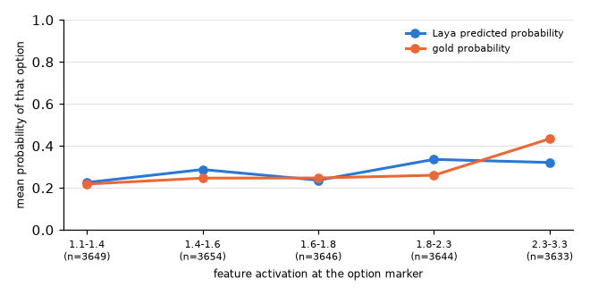

# Feature 4285

Critérios em que aparece: attribution_toward_correct

**Interpretação (preencher):** 

---

## Maiores ativações

**tr_security_incidents_000048 / disposition** (choice, security_incidents) | ativação 3.344 em `marcador` | opções ['close_benign', 'contain', 'investigate', 'monitor'] | Laya: **monitor** [0.044, 0.322, 0.197, 0.438] | gabarito: **investigate**

```
<bos> choice question: How should this security alert be dispositioned?<eos>
▸ <mask> close_benign: Expected, explainable activity; close without analyst time.
▸ <mask> contain: Contain the host or account immediately; do not wait for triage.
▸ ⟦<mask>⟧ investigate: Warrants an analyst opening an investigation.
▸ <mask> monitor: Not clearly malicious, but worth watching for recurrence.

<eos>

 {"alert": {"description": "a long-unused account became active", "evidence": "Administrative principal access was detected from an unrecognized source after 700 days of account inactivity. The privileged session was established using MFA during an active change window.", "rule": "dormant_account_use"}, "context": {"asset_criticality": "crown_jewel", "change_window_active": true, "source_on_allowlist": false}, "history": {"credential_rotation_days_ago": 700, "distinct_countries_30d": 3, "logins_30d": 503, "prior_alerts_90d": 8}, "principal": {"mfa_enrolled": true, "name": "svc-analytics-977", "privileges": ["deploy:production", "secrets:read"], "type": "admin"}}<eos>
```

**tr_invoice_processing_000199 / disposition** (choice, invoice_processing) | ativação 3.326 em `SEP-cabeça` | opções ['approve', 'hold', 'manual_review', 'reject'] | Laya: **approve** [0.524, 0.136, 0.027, 0.313] | gabarito: **approve**

```
<bos> choice question: How should this vendor invoice be dispositioned?<eos>
▸ <mask> approve: Matches the order and delivery; approve for payment.
▸ <mask> hold: Something needs confirming before payment; hold pending clarification.
▸ <mask> manual_review: A human in finance must review the discrepancy.
▸ <mask> reject: Should not be paid: duplicate, unauthorised or materially wrong.

⟦<eos>⟧

 {"delivery": {"condition": "accepted", "date": "2026-03-09", "received_qty": 1000}, "invoice": {"currency": "USD", "id": "INV-2026-1122", "lines": [{"qty": 1000, "sku": "SKU-843", "total_usd": 114150.0, "unit_usd": 114.15}], "total_usd": 114150.0, "vendor": "Orbit Logistics"}, "payment": {"days_until_due": 44, "discount_expires_in_days": 1, "early_payment_discount_pct": 2.0, "status": "scheduled", "terms": "net 30"}, "purchase_order": {"freight_terms": "freight prepaid by vendor, not separately billable", "id": "PO-5232", "lines": [{"qty": 1000, "unit_usd": 114.15}], "total_usd": 114150.0}, "vendor_history": {"disputes_12m": 5, "invoices_12m": 48, "prior_invoice_ids": ["INV-2026-1122", "INV-2026-2468", "INV-2026-5673", "INV-2026-6777"]}}<eos>
```

**tr_security_incidents_000040 / disposition** (choice, security_incidents) | ativação 3.324 em `marcador` | opções ['close_benign', 'contain', 'investigate', 'monitor'] | Laya: **monitor** [0.13, 0.211, 0.132, 0.527] | gabarito: **investigate**

```
<bos> choice question: How should this security alert be dispositioned?<eos>
▸ <mask> close_benign: Expected, explainable activity; close without analyst time.
▸ <mask> contain: Contain the host or account immediately; do not wait for triage.
▸ ⟦<mask>⟧ investigate: Warrants an analyst opening an investigation.
▸ <mask> monitor: Not clearly malicious, but worth watching for recurrence.

<eos>

 {"alert": {"description": "an account granted itself or received elevated permissions", "evidence": "Security logs on 2026-09-16 08:45:12 UTC show employee user jdoe being added to the local Administrators group on workstation LAPTOP-23. The account originally held unprivileged rights, MFA is enabled, and its credentials were refreshed 30 days earlier. The change originated from an allowlisted source.", "rule": "privilege_escalation"}, "context": {"asset_criticality": "medium", "change_window_active": false, "source_on_allowlist": true}, "history": {"credential_rotation_days_ago": 30, "distinct_countries_30d": 4, "logins_30d": 659, "prior_alerts_90d": 0}, "principal": {"mfa_enrolled": true, "name": "usr-deploy-272", "privileges": ["repo:read"], "type": "employee"}}<eos>
```

**tr_security_incidents_000257 / disposition** (choice, security_incidents) | ativação 3.322 em `marcador` | opções ['close_benign', 'contain', 'investigate', 'monitor'] | Laya: **monitor** [0.086, 0.244, 0.074, 0.595] | gabarito: **investigate**

```
<bos> choice question: How should this security alert be dispositioned?<eos>
▸ <mask> close_benign: Expected, explainable activity; close without analyst time.
▸ <mask> contain: Contain the host or account immediately; do not wait for triage.
▸ ⟦<mask>⟧ investigate: Warrants an analyst opening an investigation.
▸ <mask> monitor: Not clearly malicious, but worth watching for recurrence.

<eos>

 {"alert": {"description": "a first-ever sign-in from an unfamiliar country", "evidence": "The 'svc-deploy-01' service account authenticated from a previously unseen country via an allowlisted endpoint. This login occurred without multi-factor authentication using credentials rotated 3 days ago, and no official change window was in effect.", "rule": "new_country_login"}, "context": {"asset_criticality": "medium", "change_window_active": false, "source_on_allowlist": true}, "history": {"credential_rotation_days_ago": 3, "distinct_countries_30d": 1, "logins_30d": 1839, "prior_alerts_90d": 1}, "principal": {"mfa_enrolled": false, "name": "usr-support-915", "privileges": ["deploy:production", "secrets:read"], "type": "service_account"}}<eos>
```

**tr_invoice_processing_000055 / disposition** (choice, invoice_processing) | ativação 3.314 em `SEP-cabeça` | opções ['approve', 'hold', 'manual_review', 'reject'] | Laya: **approve** [0.53, 0.143, 0.018, 0.309] | gabarito: **approve**

```
<bos> choice question: How should this vendor invoice be dispositioned?<eos>
▸ <mask> approve: Matches the order and delivery; approve for payment.
▸ <mask> hold: Something needs confirming before payment; hold pending clarification.
▸ <mask> manual_review: A human in finance must review the discrepancy.
▸ <mask> reject: Should not be paid: duplicate, unauthorised or materially wrong.

⟦<eos>⟧

 {"delivery": {"condition": "accepted", "date": "2026-03-24", "received_qty": 10}, "invoice": {"currency": "USD", "id": "INV-2026-2278", "lines": [{"qty": 10, "sku": "SKU-174", "total_usd": 2565.3, "unit_usd": 256.53}], "total_usd": 2565.3, "vendor": "Orbit Logistics"}, "payment": {"days_until_due": 44, "discount_expires_in_days": null, "early_payment_discount_pct": null, "status": "scheduled", "terms": "net 15"}, "purchase_order": {"freight_terms": "freight prepaid by vendor, not separately billable", "id": "PO-1729", "lines": [{"qty": 10, "unit_usd": 256.53}], "total_usd": 2565.3}, "vendor_history": {"disputes_12m": 2, "invoices_12m": 35, "prior_invoice_ids": ["INV-2026-2466", "INV-2026-1629", "INV-2026-2511", "INV-2026-3620"]}}<eos>
```

## Ativações medianas (faixa 40-60%, mediana 1.774)

**tr_customer_service_000157 / action** (choice, customer_service) | ativação 1.808 em `marcador` | opções ['answer_directly', 'close_no_action', 'escalate_to_human', 'execute_refund', 'request_information'] | Laya: **close_no_action** [0.088, 0.864, 0.016, 0.016, 0.016] | gabarito: **escalate_to_human**

```
<bos> choice question: What should the assistant do next with this conversation?<eos>
▸ <mask> answer_directly: The assistant can resolve this itself with information it already has.
▸ <mask> close_no_action: No further action is warranted; the matter is settled.
▸ <mask> escalate_to_human: Hand off to a human agent with the appropriate authority.
▸ <mask> execute_refund: Issue the refund or credit the customer is owed.
▸ ⟦<mask>⟧ request_information: More detail is needed from the customer before anything can be done.

<eos>

 {"account": {"lifetime_value_usd": 3086, "prior_tickets_90d": 3, "seats": 1, "tenure_months": 49, "tier": "standard"}, "thread": [{"role": "customer", "text": "I need to get into my account right now – the login page just keeps looping back to the password screen and I can’t access anything."}, {"role": "agent", "text": "I understand the urgency. Could you share the exact error message you’re seeing, or let me know if you’ve tried resetting the password?"}, {"role": "customer", "text": "The message says “authentication failed” after I enter my credentials, and I’ve already tried the password reset twice with no luck."}]}<eos>
```

**tr_agent_trace_observability_000208 / outcome** (choice, agent_trace_observability) | ativação 1.894 em `marcador` | opções ['failure', 'harmful', 'partial', 'success'] | Laya: **success** [0.219, 0.066, 0.149, 0.567] | gabarito: **partial**

```
<bos> choice question: How did this agent run turn out?<eos>
▸ <mask> failure: The agent did not accomplish the task.
▸ <mask> harmful: The agent took an action that caused damage or violated a constraint.
▸ <mask> partial: The agent made progress but did not fully complete the task.
▸ ⟦<mask>⟧ success: The agent completed the task correctly.

<eos>

 {"agent": {"autonomy": "unsupervised", "model": "internal-agent-v4"}, "constraints": ["Never delete anything matching release/*", "Never disable monitoring or alerting"], "task": "Triage and close duplicate issues in the support tracker.", "trace_summary": {"constraint_violations": 0, "duration_s": 701.2, "irreversible_actions": 1, "steps": 7, "tool_errors": 2}}<eos>
```

**tr_agent_trace_observability_000140 / action** (choice, agent_trace_observability) | ativação 2.035 em `pergunta` | opções ['continue', 'human_review', 'observe', 'stop'] | Laya: **stop** [0.119, 0.004, 0.032, 0.845] | gabarito: **human_review**

```
<bos>⟦ choice⟧ question: What should the observability system do with this trace?<eos>
▸ <mask> continue: Let the agent proceed without interruption.
▸ <mask> human_review: Queue this trace for a human to review.
▸ <mask> observe: Keep running, but flag the trace for later sampling.
▸ <mask> stop: Halt the agent now.

<eos>

 {"agent": {"autonomy": "checkpointed", "model": "internal-agent-v4"}, "constraints": ["Do not force-push to any branch"], "task": "Reduce the nightly report job's runtime below fifteen minutes.", "trace_summary": {"constraint_violations": 1, "duration_s": 895.9, "irreversible_actions": 1, "steps": 10, "tool_errors": 0}}<eos>
```

**tr_invoice_processing_000157 / disposition** (choice, invoice_processing) | ativação 1.803 em `marcador` | opções ['approve', 'hold', 'manual_review', 'reject'] | Laya: **reject** [0.346, 0.079, 0.013, 0.562] | gabarito: **manual_review**

```
<bos> choice question: How should this vendor invoice be dispositioned?<eos>
▸ <mask> approve: Matches the order and delivery; approve for payment.
▸ <mask> hold: Something needs confirming before payment; hold pending clarification.
▸ ⟦<mask>⟧ manual_review: A human in finance must review the discrepancy.
▸ <mask> reject: Should not be paid: duplicate, unauthorised or materially wrong.

<eos>

 {"delivery": {"condition": "accepted with exceptions", "date": "2026-03-23", "received_qty": 50}, "invoice": {"currency": "USD", "id": "INV-2026-5230", "lines": [{"qty": 50, "sku": "SKU-951", "total_usd": 24145.0, "unit_usd": 482.9}], "total_usd": 24145.0, "vendor": "Kestrel Supply"}, "payment": {"days_until_due": 2, "discount_expires_in_days": null, "early_payment_discount_pct": null, "status": "scheduled", "terms": "net 15"}, "purchase_order": {"freight_terms": "freight prepaid by vendor, not separately billable", "id": "PO-1756", "lines": [{"qty": 50, "unit_usd": 431.16}], "total_usd": 21558.0}, "vendor_history": {"disputes_12m": 0, "invoices_12m": 15, "prior_invoice_ids": ["INV-2026-5413", "INV-2026-8200", "INV-2026-6317"]}}<eos>
```

**tr_customer_service_000297 / action** (choice, customer_service) | ativação 1.675 em `marcador` | opções ['answer_directly', 'close_no_action', 'escalate_to_human', 'execute_refund', 'request_information'] | Laya: **answer_directly** [0.508, 0.205, 0.246, 0.017, 0.024] | gabarito: **answer_directly**

```
<bos> choice question: What should the assistant do next with this conversation?<eos>
▸ ⟦<mask>⟧ answer_directly: The assistant can resolve this itself with information it already has.
▸ <mask> close_no_action: No further action is warranted; the matter is settled.
▸ <mask> escalate_to_human: Hand off to a human agent with the appropriate authority.
▸ <mask> execute_refund: Issue the refund or credit the customer is owed.
▸ <mask> request_information: More detail is needed from the customer before anything can be done.

<eos>

 {"account": {"lifetime_value_usd": 581, "prior_tickets_90d": 2, "seats": 40, "tenure_months": 11, "tier": "enterprise"}, "orders": [{"amount_usd": 299, "date": "2026-03-03", "id": "A-90996", "status": "settled"}], "thread": [{"role": "customer", "text": "I just opened the box and the hardware is cracked, but I'm not sure if this happened during shipping or if it was like this already? I have a hard deadline this Friday and really need this working."}, {"role": "agent", "text": "I'm sorry to hear about the damage. To help me look into this, could you please provide your order number and upload a few photos of the packaging?"}, {"role": "customer", "text": "I think I sent photos in my last two tickets, but I can't remember if they actually saw them. Where do I upload them again?"}]}<eos>
```

## Estatísticas (conjunto de descoberta, dev e teste)

**pred / error**

| split | decisões | ativas | ativas e Laya errou | taxa | lift | q (BH) | OR (CMH) | q (CMH) |
|---|---|---|---|---|---|---|---|---|
| discovery | 5100 | 5100 | 3283 | 0.644 | 1.00 | 1 | nan | nan |
| dev | 900 | 900 | 605 | 0.672 | 1.00 | 1 | nan | nan |
| test | 2000 | 2000 | 1301 | 0.650 | 1.00 | 1 | nan | nan |

**corr / error**

| split | decisões | ativas | ativas e Laya errou | taxa | lift | q (BH) | OR (CMH) | q (CMH) |
|---|---|---|---|---|---|---|---|---|
| discovery | 5100 | 5100 | 3283 | 0.644 | 1.00 | 1 | nan | nan |
| dev | 900 | 900 | 605 | 0.672 | 1.00 | 1 | nan | nan |
| test | 2000 | 2000 | 1301 | 0.650 | 1.00 | 1 | nan | nan |

**state / error**

| split | decisões | ativas | ativas e Laya errou | taxa | lift | q (BH) | OR (CMH) | q (CMH) |
|---|---|---|---|---|---|---|---|---|
| discovery | 5100 | 209 | 129 | 0.617 | 0.96 | 0.636 | 1.10 | 0.843 |
| dev | 900 | 41 | 22 | 0.537 | 0.80 | 0.346 | 0.71 | 0.704 |
| test | 2000 | 65 | 38 | 0.585 | 0.90 | 0.61 | 0.78 | 0.767 |

**pred / probe_right_laya_wrong**

| split | decisões | ativas | ativas e Laya errou | taxa | lift | q (BH) | OR (CMH) | q (CMH) |
|---|---|---|---|---|---|---|---|---|
| discovery | 2819 | 2819 | 1824 | 0.647 | 1.00 | 1 | nan | nan |
| dev | 520 | 520 | 351 | 0.675 | 1.00 | 1 | nan | nan |
| test | 1106 | 1106 | 700 | 0.633 | 1.00 | 1 | nan | nan |

**corr / probe_right_laya_wrong**

| split | decisões | ativas | ativas e Laya errou | taxa | lift | q (BH) | OR (CMH) | q (CMH) |
|---|---|---|---|---|---|---|---|---|
| discovery | 2819 | 2819 | 1824 | 0.647 | 1.00 | 1 | nan | nan |
| dev | 520 | 520 | 351 | 0.675 | 1.00 | 1 | nan | nan |
| test | 1106 | 1106 | 700 | 0.633 | 1.00 | 1 | nan | nan |

**state / probe_right_laya_wrong**

| split | decisões | ativas | ativas e Laya errou | taxa | lift | q (BH) | OR (CMH) | q (CMH) |
|---|---|---|---|---|---|---|---|---|
| discovery | 2819 | 116 | 64 | 0.552 | 0.85 | 0.0844 | 0.86 | 0.77 |
| dev | 520 | 20 | 11 | 0.550 | 0.81 | 0.656 | 0.80 | 0.842 |
| test | 1106 | 37 | 20 | 0.541 | 0.85 | 0.555 | 0.98 | 0.985 |

Confusão mais sobre-representada (pred): `action|0>1` (n=6, lift 1.00, p=1). Formato `pergunta|índice previsto>índice correto`.

Confusão mais sobre-representada (corr): `action|0>1` (n=6, lift 1.00, p=1). Formato `pergunta|índice previsto>índice correto`.

Confusão mais sobre-representada (state): `action|1>2` (n=12, lift 4.12, p=2.47e-05). Formato `pergunta|índice previsto>índice correto`.



