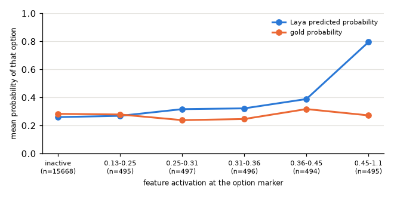

# Feature 4538

Critérios em que aparece: attribution_toward_wrong

**Interpretação (preencher):** 

---

## Maiores ativações

**tr_customer_service_000031 / needs_human** (noul, customer_service) | ativação 2.379 em `estado` | opções ['false', 'true'] | Laya: **false** [0.699, 0.301] | gabarito: **true**

```
<bos> noul question: This conversation requires a human agent rather than automated handling.<eos>
▸ <mask> false: Automation can carry this to resolution.
▸ <mask> true: A human must take over: judgement, authority or empathy is required.

<eos>

 {"account": {"lifetime_value_usd": 581, "prior_tickets_90d": 0, "seats": 3, "tenure_months": 14, "tier": "enterprise"}, "thread": [{"role": "customer", "text": "I noticed two identical charges on my bank statement for this month's enterprise subscription. I suppose I'm not surprised⟦,⟧ but I'd like to know why this happened."}, {"role": "agent", "text": "I am sorry to hear that you are seeing duplicate charges. To help me investigate this further, could you please share the transaction IDs associated with those charges?"}, {"role": "customer", "text": "I'm not sure where to find those IDs. I just see the two lines on my dashboard history that match the ones on my bank app."}, {"role": "agent", "text": "No problem at all. If you could send over a screenshot of your billing history page or the exact timestamps listed for those two transactions, I can start looking into the account logs."}, {"role": "customer", "text": "Here is the screenshot. It’s the same amount charged twice on the same day, which seems like a bit of a mess."}, {"role": "agent", "text": "Thank you for attaching that file. I’ve received the document, and I’m going to begin reviewing our payment processing records to see how these entries were generated."}, {"role": "customer", "text": "Alright, let me know what you find whenever you get around to it, I guess."}]}<eos>
```

**tr_customer_service_000016 / needs_human** (noul, customer_service) | ativação 2.354 em `estado` | opções ['false', 'true'] | Laya: **true** [0.394, 0.606] | gabarito: **true**

```
<bos> noul question: This conversation requires a human agent rather than automated handling.<eos>
▸ <mask> false: Automation can carry this to resolution.
▸ <mask> true: A human must take over: judgement, authority or empathy is required.

<eos>

 {"account": {"lifetime_value_usd": 1800, "prior_tickets_90d": 0, "seats": 1, "tenure_months": 41, "tier": "premium"}, "orders": [{"amount_usd": 87, "date": "2026-02-18", "id": "A-57523", "status": "settled"}, {"amount_usd": 87, "date": "2026-01-28", "id": "A-53386", "status": "settled"}, {"amount_usd": 87, "date": "2026-02-26", "id": "A-93511", "status": "failed"}], "thread": [{"role": "customer", "text": "I managed to drop my device on the tile floor this morning and the screen is completely shattered. I've been with you folks for over three years now, so I figured I’d reach out, though I know it’s likely my own fault."}, {"role": "agent", "text": "I am sorry to hear about the damage to your device. I see you are on our premium plan; could you please provide the serial number located on the back of the unit so I can review your account details?"}, {"role": "customer", "text": "I'll have to look for that in a minute. It’s an $87 model, so I suppose I should have been more careful with it. Is there anything that can even be done for something like this?"}, {"role": "agent", "text": "I understand your concern. To help me better assist you, could you describe the extent of the screen fracture and let me know if the device is still powering on at all?"}, {"role": "customer", "text": "It won't turn on. Everything is just dark. I don't know⟦,⟧ maybe it's just meant to be replaced, but I thought I'd ask before tossing it."}]}<eos>
```

**tr_customer_service_000050 / urgency** (score, customer_service) | ativação 2.338 em `estado` | opções ['0', '1', '2', '3'] | Laya: **1** [0.227, 0.508, 0.117, 0.148] | gabarito: **2**

```
<bos> score question: How time-sensitive is this conversation?<eos>
▸ <mask> level 0: No time pressure; can wait indefinitely.
▸ <mask> level 1: Routine; handle within the normal queue.
▸ <mask> level 2: Elevated; should be handled within the same week.
▸ <mask> level 3: Critical; requires action within the same day.

<eos>

 {"account": {"lifetime_value_usd": 577, "prior_tickets_90d": 0, "seats": 1, "tenure_months": 8, "tier": "free"}, "orders": [{"amount_usd": 298, "date": "2026-03-23", "id": "A-38807", "status": "failed"}, {"amount_usd": 298, "date": "2026-03-27", "id": "A-98913", "status": "failed"}], "thread": [{"role": "customer", "text": "My payment for $298 failed even though the funds are definitely in my account. This is incredibly annoying⟦,⟧ especially since I've been using this free plan for 8 months now."}, {"role": "agent", "text": "I am sorry to hear about the trouble with your transaction. Could you please provide the last four digits of the card you attempted to use so I can look into the status?"}, {"role": "customer", "text": "I’m not comfortable typing my card details here. Why can't you just see why the transaction was blocked on your end?"}]}<eos>
```

**tr_customer_service_000120 / needs_human** (noul, customer_service) | ativação 2.338 em `estado` | opções ['false', 'true'] | Laya: **true** [0.4, 0.6] | gabarito: **true**

```
<bos> noul question: This conversation requires a human agent rather than automated handling.<eos>
▸ <mask> false: Automation can carry this to resolution.
▸ <mask> true: A human must take over: judgement, authority or empathy is required.

<eos>

 {"account": {"lifetime_value_usd": 683, "prior_tickets_90d": 2, "seats": 1, "tenure_months": 8, "tier": "premium"}, "orders": [{"amount_usd": 29, "date": "2026-03-13", "id": "A-34569", "status": "pending"}, {"amount_usd": 29, "date": "2026-02-22", "id": "A-11297", "status": "refunded"}, {"amount_usd": 29, "date": "2026-01-21", "id": "A-20004", "status": "failed"}], "thread": [{"role": "customer", "text": "I am trying to remove two seats from my Premium plan, but the dashboard still shows them as active and billable for the next cycle. I've been a customer for eight months and this is the third time I've had to report this exact issue with the $29 per seat charge."}, {"role": "agent", "text": "I can certainly look into those seat settings for you. To clarify⟦,⟧ are these seats currently assigned to specific users, or are they currently vacant in your dashboard?"}, {"role": "customer", "text": "They are vacant. I unassigned the users last week, but the total seat count refuses to decrease when I try to update the subscription preferences."}, {"role": "agent", "text": "Thank you for that detail. When you attempt to reduce the count, are you receiving a specific error message, or does the page simply refresh without saving the changes?"}, {"role": "customer", "text": "The page just refreshes. I've already had two tickets about this in the past that were resolved temporarily, but the bug seems to have returned."}, {"role": "agent", "text": "I see the history here in your account. Could you please provide a screenshot of the billing page as it appears now so I can verify the current seat allocation against our backend records?"}, {"role": "customer", "text": "I'll attach the screenshot now. I just need to ensure I am not billed for these two extra seats again because I shouldn't be paying for capacity I'm not using."}]}<eos>
```

**tr_customer_service_000050 / needs_human** (noul, customer_service) | ativação 2.318 em `estado` | opções ['false', 'true'] | Laya: **true** [0.018, 0.982] | gabarito: **true**

```
<bos> noul question: This conversation requires a human agent rather than automated handling.<eos>
▸ <mask> false: Automation can carry this to resolution.
▸ <mask> true: A human must take over: judgement, authority or empathy is required.

<eos>

 {"account": {"lifetime_value_usd": 577, "prior_tickets_90d": 0, "seats": 1, "tenure_months": 8, "tier": "free"}, "orders": [{"amount_usd": 298, "date": "2026-03-23", "id": "A-38807", "status": "failed"}, {"amount_usd": 298, "date": "2026-03-27", "id": "A-98913", "status": "failed"}], "thread": [{"role": "customer", "text": "My payment for $298 failed even though the funds are definitely in my account. This is incredibly annoying⟦,⟧ especially since I've been using this free plan for 8 months now."}, {"role": "agent", "text": "I am sorry to hear about the trouble with your transaction. Could you please provide the last four digits of the card you attempted to use so I can look into the status?"}, {"role": "customer", "text": "I’m not comfortable typing my card details here. Why can't you just see why the transaction was blocked on your end?"}]}<eos>
```

## Ativações medianas (faixa 40-60%, mediana 0.592)

**tr_invoice_processing_000092 / disposition** (choice, invoice_processing) | ativação 0.521 em `estado` | opções ['approve', 'hold', 'manual_review', 'reject'] | Laya: **reject** [0.266, 0.088, 0.016, 0.63] | gabarito: **approve**

```
<bos> choice question: How should this vendor invoice be dispositioned?<eos>
▸ <mask> approve: Matches the order and delivery; approve for payment.
▸ <mask> hold: Something needs confirming before payment; hold pending clarification.
▸ <mask> manual_review: A human in finance must review the discrepancy.
▸ <mask> reject: Should not be paid: duplicate, unauthorised or materially wrong.

<eos>

 {"delivery": {"condition": "accepted with exceptions", "date": "2026-03-12", "received_qty": 400}, "invoice": {"currency": "USD", "id": "INV-2026-1498", "lines": [{"qty": 400, "sku": "SKU-530", "total_usd": 130404.0, "unit_usd": 326.01}], "total_usd": 130404.0, "vendor": "Kestrel Supply"}, "payment": {"days_until_due": -3, "discount_expires_in_days": null⟦,⟧ "early_payment_discount_pct": null, "status": "overdue", "terms": "net 45"}, "purchase_order": {"freight_terms": "freight prepaid by vendor, not separately billable", "id": "PO-9335", "lines": [{"qty": 400, "unit_usd": 326.01}], "total_usd": 130404.0}, "vendor_history": {"disputes_12m": 0, "invoices_12m": 35, "prior_invoice_ids": ["INV-2026-6617", "INV-2026-4776", "INV-2026-9752", "INV-2026-1479"]}}<eos>
```

**tr_agent_trace_observability_000174 / outcome** (choice, agent_trace_observability) | ativação 0.669 em `opção` | opções ['failure', 'harmful', 'partial', 'success'] | Laya: **failure** [0.705, 0.045, 0.13, 0.12] | gabarito: **partial**

```
<bos> choice question: How did this agent run turn out?<eos>
▸ <mask> failure: The agent did not accomplish the task.
▸ <mask> harmful: The agent took an action that caused damage or violated a constraint.
▸ <mask> partial: The agent made progress but did not fully complete the task⟦.⟧
▸ <mask> success: The agent completed the task correctly.

<eos>

 {"agent": {"autonomy": "checkpointed", "model": "internal-agent-v1"}, "constraints": ["Never delete anything matching release/*", "Do not exceed a $50 spend on cloud resources", "Do not force-push to any branch"], "task": "Backfill missing analytics events for the last seven days.", "trace_summary": {"constraint_violations": 0, "duration_s": 349.1, "irreversible_actions": 0, "steps": 5, "tool_errors": 1}}<eos>
```

**tr_customer_service_000111 / needs_human** (noul, customer_service) | ativação 0.636 em `opção` | opções ['false', 'true'] | Laya: **true** [0.43, 0.57] | gabarito: **false**

```
<bos> noul question: This conversation requires a human agent rather than automated handling.<eos>
▸ <mask> false: Automation can carry this to resolution⟦.⟧
▸ <mask> true: A human must take over: judgement, authority or empathy is required.

<eos>

 {"account": {"lifetime_value_usd": 181, "prior_tickets_90d": 0, "seats": 1, "tenure_months": 2, "tier": "free"}, "thread": [{"role": "customer", "text": "We have to add three more seats to our team right now, or we can't meet our client deadline tomorrow. If this isn't sorted immediately, we'll have to look for another service."}, {"role": "agent", "text": "Got it. Can you provide the account ID and let me know which usernames need the new seats?"}, {"role": "customer", "text": "We're on the free plan, account ID 98765. Please tell me what I need to do to get those seats added before 5 pm today."}]}<eos>
```

**tr_security_incidents_000068 / true_positive** (noul, security_incidents) | ativação 0.598 em `estado` | opções ['false', 'true'] | Laya: **true** [0.008, 0.992] | gabarito: **true**

```
<bos> noul question: This alert reflects genuinely malicious or unauthorised activity.<eos>
▸ <mask> false: Benign activity, a misconfiguration, or a known false positive.
▸ <mask> true: The underlying behaviour is malicious or unauthorised.

<eos>

 {"alert": {"description": "two successful logins from distant locations too close together", "evidence": "Two successful authentication events for the service account occurred 12 minutes apart from IP addresses located in London and Singapore. The account credentials have not been updated in⟦ ⟧412 days.", "rule": "impossible_travel"}, "context": {"asset_criticality": "high", "change_window_active": false, "source_on_allowlist": false}, "history": {"credential_rotation_days_ago": 412, "distinct_countries_30d": 1, "logins_30d": 521, "prior_alerts_90d": 8}, "principal": {"mfa_enrolled": true, "name": "adm-analytics-682", "privileges": ["deploy:production", "secrets:read"], "type": "service_account"}}<eos>
```

**tr_invoice_processing_000278 / discrepancy_severity** (score, invoice_processing) | ativação 0.631 em `pergunta` | opções ['0', '1', '2', '3'] | Laya: **2** [0.075, 0.276, 0.593, 0.056] | gabarito: **0**

```
<bos> score question⟦:⟧ How material is any discrepancy between the invoice, the order and the delivery?<eos>
▸ <mask> level 0: None: everything reconciles.
▸ <mask> level 1: Trivial: rounding or a cosmetic difference.
▸ <mask> level 2: Moderate: a real difference worth confirming.
▸ <mask> level 3: Material: a large or unexplained difference.

<eos>

 {"delivery": {"condition": "accepted", "date": "2026-03-20", "received_qty": 25}, "invoice": {"currency": "USD", "id": "INV-2026-7761", "lines": [{"qty": 25, "sku": "SKU-466", "total_usd": 8533.0, "unit_usd": 341.32}], "total_usd": 8533.0, "vendor": "Vantage Materials"}, "payment": {"days_until_due": 5, "discount_expires_in_days": null, "early_payment_discount_pct": null, "status": "scheduled", "terms": "net 45"}, "purchase_order": {"freight_terms": "freight prepaid by vendor, not separately billable", "id": "PO-3755", "lines": [{"qty": 25, "unit_usd": 341.32}], "total_usd": 8533.0}, "vendor_history": {"disputes_12m": 5, "invoices_12m": 51, "prior_invoice_ids": ["INV-2026-2143", "INV-2026-9910"]}}<eos>
```

## Estatísticas (conjunto de descoberta, dev e teste)

**pred / error**

| split | decisões | ativas | ativas e Laya errou | taxa | lift | q (BH) | OR (CMH) | q (CMH) |
|---|---|---|---|---|---|---|---|---|
| discovery | 5100 | 1221 | 792 | 0.649 | 1.01 | 0.754 | 0.73 | 0.277 |
| dev | 900 | 248 | 170 | 0.685 | 1.02 | 0.787 | 0.53 | 0.511 |
| test | 2000 | 484 | 348 | 0.719 | 1.11 | 0.000896 | 1.06 | 0.936 |

**corr / error**

| split | decisões | ativas | ativas e Laya errou | taxa | lift | q (BH) | OR (CMH) | q (CMH) |
|---|---|---|---|---|---|---|---|---|
| discovery | 5100 | 722 | 293 | 0.406 | 0.63 | 3.37e-43 | 0.79 | 0.459 |
| dev | 900 | 132 | 54 | 0.409 | 0.61 | 4.6e-10 | 0.60 | 0.78 |
| test | 2000 | 247 | 111 | 0.449 | 0.69 | 6.17e-11 | 0.80 | 0.87 |

**state / error**

| split | decisões | ativas | ativas e Laya errou | taxa | lift | q (BH) | OR (CMH) | q (CMH) |
|---|---|---|---|---|---|---|---|---|
| discovery | 5100 | 4661 | 2937 | 0.630 | 0.98 | 3e-10 | 0.73 | 0.14 |
| dev | 900 | 837 | 554 | 0.662 | 0.98 | 0.193 | 0.73 | 0.735 |
| test | 2000 | 1855 | 1183 | 0.638 | 0.98 | 0.0014 | 0.77 | 0.674 |

**pred / probe_right_laya_wrong**

| split | decisões | ativas | ativas e Laya errou | taxa | lift | q (BH) | OR (CMH) | q (CMH) |
|---|---|---|---|---|---|---|---|---|
| discovery | 2819 | 694 | 492 | 0.709 | 1.10 | 0.000164 | 0.58 | 0.225 |
| dev | 520 | 143 | 105 | 0.734 | 1.09 | 0.168 | 1.01 | 0.99 |
| test | 1106 | 257 | 193 | 0.751 | 1.19 | 2.12e-05 | 1.55 | 0.547 |

**corr / probe_right_laya_wrong**

| split | decisões | ativas | ativas e Laya errou | taxa | lift | q (BH) | OR (CMH) | q (CMH) |
|---|---|---|---|---|---|---|---|---|
| discovery | 2819 | 347 | 145 | 0.418 | 0.65 | 1.76e-19 | 0.84 | 0.777 |
| dev | 520 | 66 | 28 | 0.424 | 0.63 | 6.64e-05 | 1.41 | 0.791 |
| test | 1106 | 112 | 48 | 0.429 | 0.68 | 1.49e-05 | 1.02 | 0.995 |

**state / probe_right_laya_wrong**

| split | decisões | ativas | ativas e Laya errou | taxa | lift | q (BH) | OR (CMH) | q (CMH) |
|---|---|---|---|---|---|---|---|---|
| discovery | 2819 | 2593 | 1630 | 0.629 | 0.97 | 5.48e-12 | 0.51 | 0.00984 |
| dev | 520 | 492 | 327 | 0.665 | 0.98 | 0.259 | 0.66 | 0.728 |
| test | 1106 | 1043 | 647 | 0.620 | 0.98 | 0.00537 | 0.86 | 0.888 |

Confusão mais sobre-representada (pred): `duplicate|1>0` (n=217, lift 4.18, p=0). Formato `pergunta|índice previsto>índice correto`.

Confusão mais sobre-representada (corr): `urgency|3>1` (n=76, lift 6.55, p=0). Formato `pergunta|índice previsto>índice correto`.

Confusão mais sobre-representada (state): `duplicate|1>0` (n=217, lift 1.09, p=2.11e-09). Formato `pergunta|índice previsto>índice correto`.



