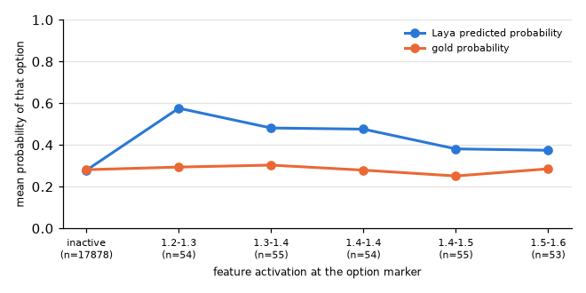

# Feature 4600

Critérios em que aparece: attribution_toward_wrong

**Interpretação (preencher):** 

---

## Maiores ativações

**tr_security_incidents_000118 / severity** (score, security_incidents) | ativação 2.021 em `estado` | opções ['0', '1', '2', '3', '4'] | Laya: **1** [0.176, 0.299, 0.199, 0.16, 0.165] | gabarito: **3**

```
<bos> score question: How severe is the potential impact if this alert is real?<eos>
▸ <mask> level 0: Negligible: no access to anything sensitive.
▸ <mask> level 1: Low: limited access, easily reversed.
▸ <mask> level 2: Moderate: access to internal systems or non-public data.
▸ <mask> level 3: High: access to production, secrets or customer data.
▸ <mask> level 4: Critical: active compromise of crown-jewel systems.

<eos>

 {"alert": {"description": "an unrecognised binary executed on a server", "evidence": "At 2026-09-15 22:05:41 UTC, admin user svc_admin launched the executable C:\\Temp\\unknown_7d9f.exe on server app01.company.com. The binary's⟦ SHA⟧‑256 hash 3a5f9c2e8b7d4e1a9c6f0b1d2e3a4c5d6e7f8a9b0c1d2e3f4a5b6c7d8e9f0a1b is not listed in the approved software inventory.", "rule": "suspicious_process"}, "context": {"asset_criticality": "medium", "change_window_active": false, "source_on_allowlist": true}, "history": {"credential_rotation_days_ago": 3, "distinct_countries_30d": 3, "logins_30d": 921, "prior_alerts_90d": 0}, "principal": {"mfa_enrolled": false, "name": "usr-support-888", "privileges": ["deploy:production", "secrets:read"], "type": "admin"}}<eos>
```

**tr_security_incidents_000118 / disposition** (choice, security_incidents) | ativação 2.014 em `estado` | opções ['close_benign', 'contain', 'investigate', 'monitor'] | Laya: **investigate** [0.049, 0.086, 0.463, 0.402] | gabarito: **investigate**

```
<bos> choice question: How should this security alert be dispositioned?<eos>
▸ <mask> close_benign: Expected, explainable activity; close without analyst time.
▸ <mask> contain: Contain the host or account immediately; do not wait for triage.
▸ <mask> investigate: Warrants an analyst opening an investigation.
▸ <mask> monitor: Not clearly malicious, but worth watching for recurrence.

<eos>

 {"alert": {"description": "an unrecognised binary executed on a server", "evidence": "At 2026-09-15 22:05:41 UTC, admin user svc_admin launched the executable C:\\Temp\\unknown_7d9f.exe on server app01.company.com. The binary's⟦ SHA⟧‑256 hash 3a5f9c2e8b7d4e1a9c6f0b1d2e3a4c5d6e7f8a9b0c1d2e3f4a5b6c7d8e9f0a1b is not listed in the approved software inventory.", "rule": "suspicious_process"}, "context": {"asset_criticality": "medium", "change_window_active": false, "source_on_allowlist": true}, "history": {"credential_rotation_days_ago": 3, "distinct_countries_30d": 3, "logins_30d": 921, "prior_alerts_90d": 0}, "principal": {"mfa_enrolled": false, "name": "usr-support-888", "privileges": ["deploy:production", "secrets:read"], "type": "admin"}}<eos>
```

**tr_security_incidents_000118 / credential_compromise** (noul, security_incidents) | ativação 2.002 em `estado` | opções ['false', 'true'] | Laya: **true** [0.008, 0.992] | gabarito: **false**

```
<bos> noul question: The evidence indicates a credential or account has been compromised.<eos>
▸ <mask> false: no, the statement does not hold
▸ <mask> true: yes, the statement holds

<eos>

 {"alert": {"description": "an unrecognised binary executed on a server", "evidence": "At 2026-09-15 22:05:41 UTC, admin user svc_admin launched the executable C:\\Temp\\unknown_7d9f.exe on server app01.company.com. The binary's⟦ SHA⟧‑256 hash 3a5f9c2e8b7d4e1a9c6f0b1d2e3a4c5d6e7f8a9b0c1d2e3f4a5b6c7d8e9f0a1b is not listed in the approved software inventory.", "rule": "suspicious_process"}, "context": {"asset_criticality": "medium", "change_window_active": false, "source_on_allowlist": true}, "history": {"credential_rotation_days_ago": 3, "distinct_countries_30d": 3, "logins_30d": 921, "prior_alerts_90d": 0}, "principal": {"mfa_enrolled": false, "name": "usr-support-888", "privileges": ["deploy:production", "secrets:read"], "type": "admin"}}<eos>
```

**tr_security_incidents_000118 / true_positive** (noul, security_incidents) | ativação 1.995 em `estado` | opções ['false', 'true'] | Laya: **true** [0.014, 0.986] | gabarito: **true**

```
<bos> noul question: This alert reflects genuinely malicious or unauthorised activity.<eos>
▸ <mask> false: Benign activity, a misconfiguration, or a known false positive.
▸ <mask> true: The underlying behaviour is malicious or unauthorised.

<eos>

 {"alert": {"description": "an unrecognised binary executed on a server", "evidence": "At 2026-09-15 22:05:41 UTC, admin user svc_admin launched the executable C:\\Temp\\unknown_7d9f.exe on server app01.company.com. The binary's⟦ SHA⟧‑256 hash 3a5f9c2e8b7d4e1a9c6f0b1d2e3a4c5d6e7f8a9b0c1d2e3f4a5b6c7d8e9f0a1b is not listed in the approved software inventory.", "rule": "suspicious_process"}, "context": {"asset_criticality": "medium", "change_window_active": false, "source_on_allowlist": true}, "history": {"credential_rotation_days_ago": 3, "distinct_countries_30d": 3, "logins_30d": 921, "prior_alerts_90d": 0}, "principal": {"mfa_enrolled": false, "name": "usr-support-888", "privileges": ["deploy:production", "secrets:read"], "type": "admin"}}<eos>
```

**tr_security_incidents_000118 / urgency** (score, security_incidents) | ativação 1.948 em `estado` | opções ['0', '1', '2', '3'] | Laya: **1** [0.232, 0.289, 0.232, 0.247] | gabarito: **3**

```
<bos> score question: How quickly must a responder act on this alert?<eos>
▸ <mask> level 0: No time pressure; can wait indefinitely.
▸ <mask> level 1: Routine; handle within the normal queue.
▸ <mask> level 2: Elevated; should be handled within the same week.
▸ <mask> level 3: Critical; requires action within the same day.

<eos>

 {"alert": {"description": "an unrecognised binary executed on a server", "evidence": "At 2026-09-15 22:05:41 UTC, admin user svc_admin launched the executable C:\\Temp\\unknown_7d9f.exe on server app01.company.com. The binary's⟦ SHA⟧‑256 hash 3a5f9c2e8b7d4e1a9c6f0b1d2e3a4c5d6e7f8a9b0c1d2e3f4a5b6c7d8e9f0a1b is not listed in the approved software inventory.", "rule": "suspicious_process"}, "context": {"asset_criticality": "medium", "change_window_active": false, "source_on_allowlist": true}, "history": {"credential_rotation_days_ago": 3, "distinct_countries_30d": 3, "logins_30d": 921, "prior_alerts_90d": 0}, "principal": {"mfa_enrolled": false, "name": "usr-support-888", "privileges": ["deploy:production", "secrets:read"], "type": "admin"}}<eos>
```

## Ativações medianas (faixa 40-60%, mediana 0.930)

**tr_invoice_processing_000228 / discrepancy_severity** (score, invoice_processing) | ativação 0.930 em `opção` | opções ['0', '1', '2', '3'] | Laya: **2** [0.11, 0.296, 0.486, 0.108] | gabarito: **2**

```
<bos> score question: How material is any discrepancy between the invoice, the order and the delivery?<eos>
▸ <mask> level 0: None: everything reconciles.
▸ <mask> level 1: Trivial:⟦ rounding⟧ or a cosmetic difference.
▸ <mask> level 2: Moderate: a real difference worth confirming.
▸ <mask> level 3: Material: a large or unexplained difference.

<eos>

 {"delivery": {"condition": "accepted with exceptions", "date": "2026-03-11", "received_qty": 10}, "invoice": {"currency": "USD", "id": "INV-2026-3406", "lines": [{"qty": 10, "sku": "SKU-285", "total_usd": 2730.8, "unit_usd": 273.08}], "total_usd": 2730.8, "vendor": "Pallas Industrial"}, "payment": {"days_until_due": 18, "discount_expires_in_days": null, "early_payment_discount_pct": null, "status": "scheduled", "terms": "net 30"}, "purchase_order": {"freight_terms": "freight prepaid by vendor, not separately billable", "id": "PO-9649", "lines": [{"qty": 10, "unit_usd": 273.08}], "total_usd": 2730.8}, "vendor_history": {"disputes_12m": 0, "invoices_12m": 30, "prior_invoice_ids": ["INV-2026-3283", "INV-2026-2676"]}}<eos>
```

**tr_invoice_processing_000097 / discrepancy_severity** (score, invoice_processing) | ativação 0.985 em `opção` | opções ['0', '1', '2', '3'] | Laya: **2** [0.066, 0.31, 0.557, 0.068] | gabarito: **3**

```
<bos> score question: How material is any discrepancy between the invoice, the order and the delivery?<eos>
▸ <mask> level 0: None: everything reconciles.
▸ <mask> level 1: Trivial:⟦ rounding⟧ or a cosmetic difference.
▸ <mask> level 2: Moderate: a real difference worth confirming.
▸ <mask> level 3: Material: a large or unexplained difference.

<eos>

 {"delivery": {"condition": "accepted with exceptions", "date": "2026-03-02", "received_qty": 50}, "invoice": {"currency": "USD", "id": "INV-2026-3793", "lines": [{"qty": 50, "sku": "SKU-905", "total_usd": 17279.5, "unit_usd": 345.59}], "total_usd": 17279.5, "vendor": "Orbit Logistics"}, "payment": {"days_until_due": 11, "discount_expires_in_days": null, "early_payment_discount_pct": null, "status": "scheduled", "terms": "net 30"}, "purchase_order": {"freight_terms": "freight prepaid by vendor, not separately billable", "id": "PO-8082", "lines": [{"qty": 50, "unit_usd": 345.59}], "total_usd": 17279.5}, "vendor_history": {"disputes_12m": 0, "invoices_12m": 60, "prior_invoice_ids": ["INV-2026-3793", "INV-2026-3886", "INV-2026-6555"]}}<eos>
```

**tr_invoice_processing_000218 / discrepancy_severity** (score, invoice_processing) | ativação 0.881 em `opção` | opções ['0', '1', '2', '3'] | Laya: **2** [0.047, 0.286, 0.612, 0.055] | gabarito: **3**

```
<bos> score question: How material is any discrepancy between the invoice, the order and the delivery?<eos>
▸ <mask> level 0: None: everything reconciles.
▸ <mask> level 1: Trivial:⟦ rounding⟧ or a cosmetic difference.
▸ <mask> level 2: Moderate: a real difference worth confirming.
▸ <mask> level 3: Material: a large or unexplained difference.

<eos>

 {"delivery": {"condition": "accepted", "date": "2026-03-06", "received_qty": 400}, "invoice": {"currency": "USD", "id": "INV-2026-2470", "lines": [{"qty": 450, "sku": "SKU-801", "total_usd": 65844.0, "unit_usd": 146.32}], "total_usd": 65844.0, "vendor": "Vantage Materials"}, "payment": {"days_until_due": 5, "discount_expires_in_days": 2, "early_payment_discount_pct": 2.0, "status": "scheduled", "terms": "net 30"}, "purchase_order": {"freight_terms": "freight prepaid by vendor, not separately billable", "id": "PO-9318", "lines": [{"qty": 400, "unit_usd": 146.32}], "total_usd": 58528.0}, "vendor_history": {"disputes_12m": 0, "invoices_12m": 22, "prior_invoice_ids": ["INV-2026-9482"]}}<eos>
```

**tr_invoice_processing_000251 / discrepancy_severity** (score, invoice_processing) | ativação 0.926 em `opção` | opções ['0', '1', '2', '3'] | Laya: **2** [0.057, 0.381, 0.511, 0.05] | gabarito: **0**

```
<bos> score question: How material is any discrepancy between the invoice, the order and the delivery?<eos>
▸ <mask> level 0: None: everything reconciles.
▸ <mask> level 1: Trivial:⟦ rounding⟧ or a cosmetic difference.
▸ <mask> level 2: Moderate: a real difference worth confirming.
▸ <mask> level 3: Material: a large or unexplained difference.

<eos>

 {"delivery": {"condition": "accepted", "date": "2026-03-10", "received_qty": 100}, "invoice": {"currency": "USD", "id": "INV-2026-9735", "lines": [{"qty": 100, "sku": "SKU-295", "total_usd": 1399.0, "unit_usd": 13.99}], "total_usd": 1399.0, "vendor": "Northwind Components"}, "payment": {"days_until_due": 44, "discount_expires_in_days": 8, "early_payment_discount_pct": 2.0, "status": "scheduled", "terms": "net 45"}, "purchase_order": {"freight_terms": "freight prepaid by vendor, not separately billable", "id": "PO-7774", "lines": [{"qty": 100, "unit_usd": 13.99}], "total_usd": 1399.0}, "vendor_history": {"disputes_12m": 5, "invoices_12m": 33, "prior_invoice_ids": ["INV-2026-2207", "INV-2026-7969", "INV-2026-9437"]}}<eos>
```

**tr_invoice_processing_000184 / discrepancy_severity** (score, invoice_processing) | ativação 0.930 em `opção` | opções ['0', '1', '2', '3'] | Laya: **2** [0.073, 0.308, 0.549, 0.07] | gabarito: **2**

```
<bos> score question: How material is any discrepancy between the invoice, the order and the delivery?<eos>
▸ <mask> level 0: None: everything reconciles.
▸ <mask> level 1: Trivial:⟦ rounding⟧ or a cosmetic difference.
▸ <mask> level 2: Moderate: a real difference worth confirming.
▸ <mask> level 3: Material: a large or unexplained difference.

<eos>

 {"delivery": {"condition": "accepted with exceptions", "date": "2026-03-25", "received_qty": 25}, "invoice": {"currency": "USD", "id": "INV-2026-6432", "lines": [{"qty": 25, "sku": "SKU-453", "total_usd": 8260.5, "unit_usd": 330.42}], "total_usd": 8260.5, "vendor": "Acme Fabrication"}, "payment": {"days_until_due": 27, "discount_expires_in_days": null, "early_payment_discount_pct": null, "status": "scheduled", "terms": "net 30"}, "purchase_order": {"freight_terms": "freight prepaid by vendor, not separately billable", "id": "PO-9538", "lines": [{"qty": 25, "unit_usd": 330.42}], "total_usd": 8260.5}, "vendor_history": {"disputes_12m": 0, "invoices_12m": 57, "prior_invoice_ids": ["INV-2026-8793"]}}<eos>
```

## Estatísticas (conjunto de descoberta, dev e teste)

**pred / error**

| split | decisões | ativas | ativas e Laya errou | taxa | lift | q (BH) | OR (CMH) | q (CMH) |
|---|---|---|---|---|---|---|---|---|
| discovery | 5100 | 172 | 131 | 0.762 | 1.18 | 0.00199 | nan | nan |
| dev | 900 | 23 | 15 | 0.652 | 0.97 | 1 | nan | nan |
| test | 2000 | 67 | 36 | 0.537 | 0.83 | 0.101 | nan | nan |

**corr / error**

| split | decisões | ativas | ativas e Laya errou | taxa | lift | q (BH) | OR (CMH) | q (CMH) |
|---|---|---|---|---|---|---|---|---|
| discovery | 5100 | 69 | 28 | 0.406 | 0.63 | 0.000156 | nan | nan |
| dev | 900 | 13 | 5 | 0.385 | 0.57 | nan | nan | nan |
| test | 2000 | 50 | 19 | 0.380 | 0.58 | 0.000317 | nan | nan |

**state / error**

| split | decisões | ativas | ativas e Laya errou | taxa | lift | q (BH) | OR (CMH) | q (CMH) |
|---|---|---|---|---|---|---|---|---|
| discovery | 5100 | 276 | 148 | 0.536 | 0.83 | 0.00121 | 1.11 | 0.796 |
| dev | 900 | 55 | 31 | 0.564 | 0.84 | 0.38 | 1.17 | 0.86 |
| test | 2000 | 89 | 46 | 0.517 | 0.79 | 0.0875 | 1.04 | 0.973 |

**pred / probe_right_laya_wrong**

| split | decisões | ativas | ativas e Laya errou | taxa | lift | q (BH) | OR (CMH) | q (CMH) |
|---|---|---|---|---|---|---|---|---|
| discovery | 2819 | 79 | 70 | 0.886 | 1.37 | 4.66e-06 | nan | nan |
| dev | 520 | 11 | 11 | 1.000 | 1.48 | nan | nan | nan |
| test | 1106 | 24 | 16 | 0.667 | 1.05 | 0.951 | nan | nan |

**corr / probe_right_laya_wrong**

| split | decisões | ativas | ativas e Laya errou | taxa | lift | q (BH) | OR (CMH) | q (CMH) |
|---|---|---|---|---|---|---|---|---|
| discovery | 2819 | 16 | 7 | 0.438 | 0.68 | nan | nan | nan |
| dev | 520 | 1 | 1 | 1.000 | 1.48 | nan | nan | nan |
| test | 1106 | 17 | 9 | 0.529 | 0.84 | nan | nan | nan |

**state / probe_right_laya_wrong**

| split | decisões | ativas | ativas e Laya errou | taxa | lift | q (BH) | OR (CMH) | q (CMH) |
|---|---|---|---|---|---|---|---|---|
| discovery | 2819 | 185 | 92 | 0.497 | 0.77 | 0.00014 | 1.07 | 0.878 |
| dev | 520 | 39 | 24 | 0.615 | 0.91 | 0.827 | 1.47 | 0.579 |
| test | 1106 | 59 | 26 | 0.441 | 0.70 | 0.0227 | 0.95 | 0.953 |

Confusão mais sobre-representada (pred): `outcome|3>1` (n=36, lift 29.65, p=0). Formato `pergunta|índice previsto>índice correto`.

Confusão mais sobre-representada (corr): `outcome|0>3` (n=26, lift 73.91, p=0). Formato `pergunta|índice previsto>índice correto`.

Confusão mais sobre-representada (state): `true_positive|1>0` (n=24, lift 6.34, p=5.54e-14). Formato `pergunta|índice previsto>índice correto`.



