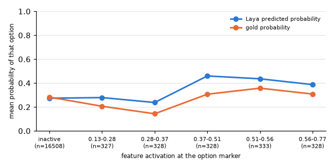

# Feature 4603

Critérios em que aparece: pred_error_stratified, pred_probe_right_laya_wrong_stratified

**Interpretação (preencher):** 

---

## Maiores ativações

**tr_customer_service_000113 / category** (choice, customer_service) | ativação 4.273 em `opção` | opções ['account', 'billing', 'delivery', 'refund', 'technical'] | Laya: **technical** [0.014, 0.008, 0.002, 0.004, 0.972] | gabarito: **technical**

```
<bos> choice question: What is this customer conversation primarily about?<eos>
▸ <mask> account: Login, plan changes, profile or access management.
▸ <mask> billing: A charge, invoice, subscription or payment problem.
▸ <mask> delivery: Shipping, fulfilment or delivery of a physical item.
▸ <mask> refund: The customer is explicitly asking for money back.
▸ <mask> technical: The⟦ product⟧ or service is not working as expected.

<eos>

 {"account": {"lifetime_value_usd": 47, "prior_tickets_90d": 0, "seats": 1, "tenure_months": 1, "tier": "standard"}, "orders": [{"amount_usd": 87, "date": "2026-01-11", "id": "A-32698", "status": "settled"}, {"amount_usd": 87, "date": "2026-03-25", "id": "A-92735", "status": "refunded"}], "thread": [{"role": "customer", "text": "Hi there! I've been using the standard plan for about a month now and I really enjoy the interface, but I've noticed the page load times are getting quite slow today. Is there anything I should check on my end?"}, {"role": "agent", "text": "Welcome to the platform! I'd be happy to help you look into those load times. Are you experiencing this slowness on all pages, or is it specifically when you try to generate reports?"}, {"role": "customer", "text": "It seems to be happening everywhere, especially when I try to save my work. I paid $87 for this month and I have a very important hard deadline this evening, so I'm a bit worried about getting everything finished in time."}, {"role": "agent", "text": "I understand the importance of meeting your deadline. Could you tell me which web browser you are currently using and if you have tried clearing your cache recently?"}, {"role": "customer", "text": "I'm using the latest version of Chrome and I did try clearing the cache, but the lag persists. I really need to have this project submitted by 5:00 PM today, so any guidance on how to speed things up would be greatly appreciated."}]}<eos>
```

**tr_customer_service_000246 / category** (choice, customer_service) | ativação 4.238 em `opção` | opções ['account', 'billing', 'delivery', 'refund', 'technical'] | Laya: **account** [0.492, 0.02, 0.002, 0.002, 0.484] | gabarito: **account**

```
<bos> choice question: What is this customer conversation primarily about?<eos>
▸ <mask> account: Login, plan changes, profile or access management.
▸ <mask> billing: A charge, invoice, subscription or payment problem.
▸ <mask> delivery: Shipping, fulfilment or delivery of a physical item.
▸ <mask> refund: The customer is explicitly asking for money back.
▸ <mask> technical: The⟦ product⟧ or service is not working as expected.

<eos>

 {"account": {"lifetime_value_usd": 2575, "prior_tickets_90d": 0, "seats": 1, "tenure_months": 60, "tier": "free"}, "orders": [{"amount_usd": 9, "date": "2026-01-21", "id": "A-12450", "status": "settled"}], "thread": [{"role": "customer", "text": "I need someone to help me right now, I'm completely locked out of my account and I have a major presentation starting in less than twenty minutes!"}, {"role": "agent", "text": "I understand the urgency of getting back into your account before your presentation. Could you tell me the exact error message you receive when you try to log in?"}, {"role": "customer", "text": "It just says 'Authentication Failed' over and over again, and I've already tried the password reset button three times but no email is showing up!"}, {"role": "agent", "text": "Thank you for that information. To help me narrow this down, are you attempting to log in through our desktop application or via a web browser?"}, {"role": "customer", "text": "I've tried Chrome, Safari, and the desktop app, and nothing is working; I'm starting to panic because all my files are in there and I can't get to them!"}, {"role": "agent", "text": "I see. Have you had a chance to check your junk or spam folders for that reset link, or are you using a corporate network that might have a strict firewall?"}, {"role": "customer", "text": "I've checked every folder and there is nothing, and I'm just on my home Wi-Fi, so please tell me what else I can try because I'm running out of time!"}]}<eos>
```

**tr_customer_service_000206 / category** (choice, customer_service) | ativação 4.199 em `opção` | opções ['account', 'billing', 'delivery', 'refund', 'technical'] | Laya: **billing** [0.088, 0.859, 0.001, 0.002, 0.051] | gabarito: **billing**

```
<bos> choice question: What is this customer conversation primarily about?<eos>
▸ <mask> account: Login, plan changes, profile or access management.
▸ <mask> billing: A charge, invoice, subscription or payment problem.
▸ <mask> delivery: Shipping, fulfilment or delivery of a physical item.
▸ <mask> refund: The customer is explicitly asking for money back.
▸ <mask> technical: The⟦ product⟧ or service is not working as expected.

<eos>

 {"account": {"lifetime_value_usd": 152, "prior_tickets_90d": 3, "seats": 1, "tenure_months": 5, "tier": "standard"}, "orders": [{"amount_usd": 297, "date": "2026-03-11", "id": "A-35334", "status": "settled"}], "thread": [{"role": "customer", "text": "I just got an email saying my $297 payment failed, but I don't understand why because I haven't changed any of my bank settings."}, {"role": "agent", "text": "I can certainly look into that billing notification for you. Have you recently updated any of the security features on your credit card, such as a new expiration date or CVV?"}, {"role": "customer", "text": "No, everything is exactly the same as it was when it worked two months ago. This same thing happened back in June and then it just started working again for no reason."}, {"role": "agent", "text": "I see that we've had a few intermittent issues with this account in the past. Are you getting a specific error message when you try to manually process the payment through the 'Pay Now' button?"}, {"role": "customer", "text": "It just gives me a red box that says 'Transaction Denied' and tells me to contact my administrator, but I am the administrator."}, {"role": "agent", "text": "That is definitely confusing. Could you tell me if you are trying to process this through a VPN or a restricted corporate network, as that can sometimes trigger a decline?"}, {"role": "customer", "text": "I'm just using my home Wi-Fi like I always do, so I don't think it's a network problem on my end."}]}<eos>
```

**tr_customer_service_000044 / category** (choice, customer_service) | ativação 4.168 em `opção` | opções ['account', 'billing', 'delivery', 'refund', 'technical'] | Laya: **technical** [0.025, 0.019, 0.0, 0.001, 0.955] | gabarito: **account**

```
<bos> choice question: What is this customer conversation primarily about?<eos>
▸ <mask> account: Login, plan changes, profile or access management.
▸ <mask> billing: A charge, invoice, subscription or payment problem.
▸ <mask> delivery: Shipping, fulfilment or delivery of a physical item.
▸ <mask> refund: The customer is explicitly asking for money back.
▸ <mask> technical: The⟦ product⟧ or service is not working as expected.

<eos>

 {"account": {"lifetime_value_usd": 754, "prior_tickets_90d": 0, "seats": 1, "tenure_months": 8, "tier": "free"}, "orders": [{"amount_usd": 897, "date": "2026-03-17", "id": "A-13529", "status": "pending"}], "thread": [{"role": "customer", "text": "I've been trying to downgrade my account to the free tier for over an hour now and the dashboard just keeps looping me back to the billing page without saving the changes. I've already spent nearly $900 with you guys over the last eight months, and I shouldn't have to jump through hoops just to stop being charged."}, {"role": "agent", "text": "I'm sorry for the frustration you're experiencing with the downgrade process. To help me investigate why the system isn't processing your request, could you please specify if you're receiving a particular error code or if the page simply refreshes without an update?"}, {"role": "customer", "text": "There's no error code, it just flashes a message saying 'Action could not be completed at this time' and stays on the paid plan. It's ridiculous because I can see the $897 total in my billing history, so the system clearly knows who I am, but it won't let me move to the free plan."}, {"role": "agent", "text": "Thank you for clarifying that for me. I'll need to look into the back-end logs for your account to see what's triggering that message. Could you tell me which browser and version you are currently using, and if you have attempted the change from a different device?"}, {"role": "customer", "text": "I'm on the latest version of Chrome and I've already tried it on my phone too with the exact same result. I just want someone to actually look at my account and explain why the downgrade isn't sticking when I've been a customer here for months."}]}<eos>
```

**tr_customer_service_000243 / category** (choice, customer_service) | ativação 4.117 em `opção` | opções ['account', 'billing', 'delivery', 'refund', 'technical'] | Laya: **technical** [0.0, 0.136, 0.0, 0.0, 0.864] | gabarito: **technical**

```
<bos> choice question: What is this customer conversation primarily about?<eos>
▸ <mask> account: Login, plan changes, profile or access management.
▸ <mask> billing: A charge, invoice, subscription or payment problem.
▸ <mask> delivery: Shipping, fulfilment or delivery of a physical item.
▸ <mask> refund: The customer is explicitly asking for money back.
▸ <mask> technical: The⟦ product⟧ or service is not working as expected.

<eos>

 {"account": {"lifetime_value_usd": 2942, "prior_tickets_90d": 0, "seats": 1, "tenure_months": 49, "tier": "standard"}, "orders": [{"amount_usd": 299, "date": "2026-01-20", "id": "A-16271", "status": "pending"}], "thread": [{"role": "customer", "text": "Look, I've been using this service for over four years now and I have never seen it this slow. Every time I try to load a report, the screen just hangs for nearly a minute. It’s making it impossible to get through my daily tasks."}, {"role": "agent", "text": "I understand how frustrating it is when the system isn't responsive. To better assist you, are you noticing this lag on all pages of the dashboard or just when running specific reports?"}, {"role": "customer", "text": "It’s pretty much everywhere, but the billing section is particularly painful. I spent almost $300 this month and I can't even view my own data without a massive delay. I've already tried restarting my router and it didn't help one bit."}, {"role": "agent", "text": "Thank you for that information. Could you please let me know if you are using a VPN or any specific browser extensions that might be active while you're accessing the site?"}, {"role": "customer", "text": "No VPN, just standard Chrome. I've even tried incognito mode and the performance is still abysmal. What are the next steps to get this actually looked at?"}]}<eos>
```

## Ativações medianas (faixa 40-60%, mediana 1.126)

**tr_customer_service_000253 / urgency** (score, customer_service) | ativação 1.181 em `opção` | opções ['0', '1', '2', '3'] | Laya: **1** [0.175, 0.546, 0.213, 0.066] | gabarito: **3**

```
<bos> score question: How time-sensitive is this conversation?<eos>
▸ <mask> level 0: No time pressure; can wait indefinitely.
▸ <mask> level 1: Routine; handle within the normal queue.
▸ <mask>⟦ level⟧ 2: Elevated; should be handled within the same week.
▸ <mask> level 3: Critical; requires action within the same day.

<eos>

 {"account": {"lifetime_value_usd": 4869, "prior_tickets_90d": 1, "seats": 40, "tenure_months": 60, "tier": "premium"}, "thread": [{"role": "customer", "text": "My premium package is late yet again. I’ve been a loyal customer for 60 months, and frankly, I’m tired of dealing with these same logistical failures."}, {"role": "agent", "text": "I understand your frustration regarding this delay. To help me investigate the status of your shipment, could you please provide your order reference number?"}, {"role": "customer", "text": "It’s 8829-X. You guys had this issue last year, and here we are repeating the exact same problem."}, {"role": "agent", "text": "Thank you for that information. I am checking the current tracking status for you now; could you verify if the address listed on your account is the one where the delivery was expected?"}, {"role": "customer", "text": "Yes, it is the same address as always. Just tell me where the package is instead of making me repeat myself."}]}<eos>
```

**tr_invoice_processing_000147 / urgency** (score, invoice_processing) | ativação 1.229 em `opção` | opções ['0', '1', '2', '3'] | Laya: **1** [0.123, 0.444, 0.274, 0.158] | gabarito: **1**

```
<bos> score question: How time-sensitive is processing this invoice?<eos>
▸ <mask> level 0: No time pressure; can wait indefinitely.
▸ <mask> level 1: Routine; handle within the normal queue.
▸ <mask> level 2:⟦ Elevated⟧; should be handled within the same week.
▸ <mask> level 3: Critical; requires action within the same day.

<eos>

 {"delivery": {"condition": "accepted", "date": "2026-03-01", "received_qty": 10}, "invoice": {"currency": "USD", "id": "INV-2026-5821", "lines": [{"qty": 10, "sku": "SKU-582", "total_usd": 1289.7, "unit_usd": 128.97}, {"qty": 1, "sku": "FREIGHT", "total_usd": 789.37, "unit_usd": 789.37}], "total_usd": 2079.07, "vendor": "Orbit Logistics"}, "payment": {"days_until_due": 11, "discount_expires_in_days": null, "early_payment_discount_pct": null, "status": "scheduled", "terms": "net 45"}, "purchase_order": {"freight_terms": "freight prepaid by vendor, not separately billable", "id": "PO-6078", "lines": [{"qty": 10, "unit_usd": 128.97}], "total_usd": 1289.7}, "vendor_history": {"disputes_12m": 0, "invoices_12m": 17, "prior_invoice_ids": ["INV-2026-8531", "INV-2026-5603", "INV-2026-2834", "INV-2026-2338"]}}<eos>
```

**tr_customer_service_000250 / category** (choice, customer_service) | ativação 1.252 em `pergunta` | opções ['account', 'billing', 'delivery', 'refund', 'technical'] | Laya: **billing** [0.001, 0.998, 0.0, 0.0, 0.0] | gabarito: **billing**

```
<bos> choice question: What is⟦ this⟧ customer conversation primarily about?<eos>
▸ <mask> account: Login, plan changes, profile or access management.
▸ <mask> billing: A charge, invoice, subscription or payment problem.
▸ <mask> delivery: Shipping, fulfilment or delivery of a physical item.
▸ <mask> refund: The customer is explicitly asking for money back.
▸ <mask> technical: The product or service is not working as expected.

<eos>

 {"account": {"lifetime_value_usd": 145, "prior_tickets_90d": 0, "seats": 1, "tenure_months": 2, "tier": "standard"}, "thread": [{"role": "customer", "text": "Could you please send me a copy of my latest invoice? Thank you!"}]}<eos>
```

**tr_agent_trace_observability_000290 / urgency** (score, agent_trace_observability) | ativação 1.273 em `opção` | opções ['0', '1', '2', '3'] | Laya: **1** [0.164, 0.296, 0.257, 0.283] | gabarito: **3**

```
<bos> score question: How quickly does this trace need attention?<eos>
▸ <mask> level 0: No time pressure; can wait indefinitely.
▸ <mask> level 1: Routine; handle within the normal queue.
▸ <mask> level 2: Elevated; should be handled within the same week.
▸ <mask> level 3⟦:⟧ Critical; requires action within the same day.

<eos>

 {"agent": {"autonomy": "dry_run", "model": "internal-agent-v4"}, "constraints": ["Do not force-push to any branch", "Never modify production without an approved change ticket"], "task": "Migrate the user table to the new schema without downtime.", "trace_summary": {"constraint_violations": 1, "duration_s": 590.2, "irreversible_actions": 1, "steps": 5, "tool_errors": 0}}<eos>
```

**tr_customer_service_000067 / churn_risk** (score, customer_service) | ativação 1.233 em `estado` | opções ['0', '1', '2', '3'] | Laya: **2** [0.063, 0.199, 0.653, 0.084] | gabarito: **2**

```
<bos> score question: How likely is this customer to stop doing business with us because of this interaction?<eos>
▸ <mask> level 0: No sign of dissatisfaction.
▸ <mask> level 1: Mild frustration, but the relationship is intact.
▸ <mask> level 2: Clearly unhappy; repeat problems or explicit complaints.
▸ <mask> level 3: Imminent: threatening to cancel, dispute or leave.

<eos>

 {"account": {"lifetime_value_usd": 81, "prior_tickets_90d": 0, "seats": 12, "ten⟦ure⟧_months": 2, "tier": "premium"}, "thread": [{"role": "customer", "text": "I was promised a refund last week for my premium subscription, but nothing has shown up yet. I need that money in my account by the end of day tomorrow."}, {"role": "agent", "text": "Understood, that’s frustrating. Could you provide the order ID or refund reference you received?"}, {"role": "customer", "text": "The order number is #PX-8429. I've been waiting and this delay is really disappointing."}, {"role": "agent", "text": "Thanks for the details. I’ll check the status on my end. Is there any other information, like the payment method you used, that could help speed this up?"}, {"role": "customer", "text": "I paid with the card ending 1234, and I’m counting on the refund being processed before tomorrow’s deadline."}]}<eos>
```

## Estatísticas (conjunto de descoberta, dev e teste)

**pred / error**

| split | decisões | ativas | ativas e Laya errou | taxa | lift | q (BH) | OR (CMH) | q (CMH) |
|---|---|---|---|---|---|---|---|---|
| discovery | 5100 | 627 | 363 | 0.579 | 0.90 | 0.000867 | 1.59 | 0.0257 |
| dev | 900 | 116 | 67 | 0.578 | 0.86 | 0.0654 | 1.05 | 0.95 |
| test | 2000 | 276 | 155 | 0.562 | 0.86 | 0.0031 | 1.08 | 0.962 |

**corr / error**

| split | decisões | ativas | ativas e Laya errou | taxa | lift | q (BH) | OR (CMH) | q (CMH) |
|---|---|---|---|---|---|---|---|---|
| discovery | 5100 | 430 | 166 | 0.386 | 0.60 | 1.65e-28 | 1.36 | 0.132 |
| dev | 900 | 83 | 34 | 0.410 | 0.61 | 3.47e-06 | 1.10 | 0.982 |
| test | 2000 | 186 | 65 | 0.349 | 0.54 | 6.85e-17 | 0.78 | 0.704 |

**state / error**

| split | decisões | ativas | ativas e Laya errou | taxa | lift | q (BH) | OR (CMH) | q (CMH) |
|---|---|---|---|---|---|---|---|---|
| discovery | 5100 | 5100 | 3283 | 0.644 | 1.00 | 1 | nan | nan |
| dev | 900 | 900 | 605 | 0.672 | 1.00 | 1 | nan | nan |
| test | 2000 | 2000 | 1301 | 0.650 | 1.00 | 1 | nan | nan |

**pred / probe_right_laya_wrong**

| split | decisões | ativas | ativas e Laya errou | taxa | lift | q (BH) | OR (CMH) | q (CMH) |
|---|---|---|---|---|---|---|---|---|
| discovery | 2819 | 336 | 175 | 0.521 | 0.80 | 1.47e-06 | 2.03 | 0.00645 |
| dev | 520 | 63 | 31 | 0.492 | 0.73 | 0.00708 | 1.24 | 0.63 |
| test | 1106 | 157 | 80 | 0.510 | 0.81 | 0.00178 | 2.25 | 0.11 |

**corr / probe_right_laya_wrong**

| split | decisões | ativas | ativas e Laya errou | taxa | lift | q (BH) | OR (CMH) | q (CMH) |
|---|---|---|---|---|---|---|---|---|
| discovery | 2819 | 225 | 64 | 0.284 | 0.44 | 2.86e-29 | 1.79 | 0.219 |
| dev | 520 | 44 | 12 | 0.273 | 0.40 | 2.38e-07 | 1.07 | 0.972 |
| test | 1106 | 103 | 26 | 0.252 | 0.40 | 4.67e-15 | 1.03 | 0.937 |

**state / probe_right_laya_wrong**

| split | decisões | ativas | ativas e Laya errou | taxa | lift | q (BH) | OR (CMH) | q (CMH) |
|---|---|---|---|---|---|---|---|---|
| discovery | 2819 | 2819 | 1824 | 0.647 | 1.00 | 1 | nan | nan |
| dev | 520 | 520 | 351 | 0.675 | 1.00 | 1 | nan | nan |
| test | 1106 | 1106 | 700 | 0.633 | 1.00 | 1 | nan | nan |

Confusão mais sobre-representada (pred): `disposition|0>2` (n=52, lift 7.29, p=1.35e-41). Formato `pergunta|índice previsto>índice correto`.

Confusão mais sobre-representada (corr): `needs_human|0>1` (n=34, lift 7.47, p=5.84e-24). Formato `pergunta|índice previsto>índice correto`.

Confusão mais sobre-representada (state): `action|0>1` (n=6, lift 1.00, p=1). Formato `pergunta|índice previsto>índice correto`.



