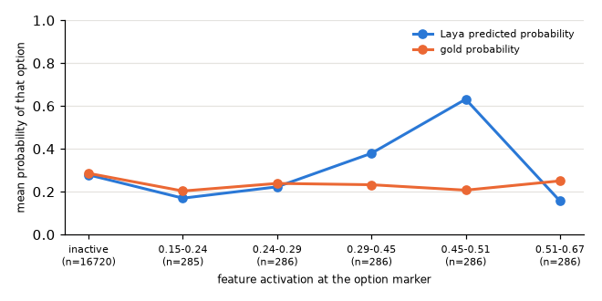

# Feature 4689

Critérios em que aparece: attribution_toward_wrong

**Interpretação (preencher):** 

---

## Maiores ativações

**tr_customer_service_000112 / churn_risk** (score, customer_service) | ativação 60.500 em `SEP-fim` | opções ['0', '1', '2', '3'] | Laya: **1** [0.047, 0.561, 0.311, 0.081] | gabarito: **2**

```
<bos> score question: How likely is this customer to stop doing business with us because of this interaction?<eos>
▸ <mask> level 0: No sign of dissatisfaction.
▸ <mask> level 1: Mild frustration, but the relationship is intact.
▸ <mask> level 2: Clearly unhappy; repeat problems or explicit complaints.
▸ <mask> level 3: Imminent: threatening to cancel, dispute or leave.

<eos>

 {"account": {"lifetime_value_usd": 2088, "prior_tickets_90d": 5, "seats": 5, "tenure_months": 72, "tier": "premium"}, "thread": [{"role": "customer", "text": "I'm looking at my bank statement and I see two separate charges for my premium subscription again. This is the sixth time I've had to reach out about this specific double-billing issue, and I'm just tired of having to repeat the same conversation every month."}, {"role": "agent", "text": "I'm sorry to hear that you're seeing a duplicate transaction on your account again. To help me investigate, could you please confirm if both charges appeared on the same date?"}, {"role": "customer", "text": "They both showed up on the 14th. I've been a customer for six years and I really expected that after five previous tickets, someone would have found a permanent solution to stop this from happening."}, {"role": "agent", "text": "I appreciate your long-standing loyalty to our service. I'm looking into your billing history now; are you seeing two different invoice numbers in your account portal, or just one?"}, {"role": "customer", "text": "There is only one invoice listed in the portal, but the money has definitely left my account twice. I just want to know why this keeps recurring when I was told last month it was finally handled."}]}⟦<eos>⟧
```

**tr_customer_service_000036 / churn_risk** (score, customer_service) | ativação 60.344 em `SEP-fim` | opções ['0', '1', '2', '3'] | Laya: **2** [0.063, 0.4, 0.45, 0.087] | gabarito: **1**

```
<bos> score question: How likely is this customer to stop doing business with us because of this interaction?<eos>
▸ <mask> level 0: No sign of dissatisfaction.
▸ <mask> level 1: Mild frustration, but the relationship is intact.
▸ <mask> level 2: Clearly unhappy; repeat problems or explicit complaints.
▸ <mask> level 3: Imminent: threatening to cancel, dispute or leave.

<eos>

 {"account": {"lifetime_value_usd": 1490, "prior_tickets_90d": 0, "seats": 1, "tenure_months": 41, "tier": "free"}, "orders": [{"amount_usd": 19, "date": "2026-01-27", "id": "A-60115", "status": "refunded"}], "thread": [{"role": "customer", "text": "Hi there. I've been using the free plan for 41 months now without any issues, but I'm currently unable to log into my account. I have a hard deadline for a project in two hours and I'm really worried about missing it."}, {"role": "agent", "text": "I understand the urgency of your situation. Could you please let me know if you are receiving a specific error message when you attempt to sign in?"}, {"role": "customer", "text": "It just says 'invalid credentials' even though I've already reset my password twice. I really need to get in before my presentation."}, {"role": "agent", "text": "Thank you for that information. To help me look into this further, could you provide the email address associated with your account?"}, {"role": "customer", "text": "Sure, it is user.test@example.com. Please let me know what we can do quickly, as I am running out of time."}]}⟦<eos>⟧
```

**tr_customer_service_000297 / churn_risk** (score, customer_service) | ativação 60.094 em `SEP-fim` | opções ['0', '1', '2', '3'] | Laya: **1** [0.2, 0.608, 0.167, 0.024] | gabarito: **1**

```
<bos> score question: How likely is this customer to stop doing business with us because of this interaction?<eos>
▸ <mask> level 0: No sign of dissatisfaction.
▸ <mask> level 1: Mild frustration, but the relationship is intact.
▸ <mask> level 2: Clearly unhappy; repeat problems or explicit complaints.
▸ <mask> level 3: Imminent: threatening to cancel, dispute or leave.

<eos>

 {"account": {"lifetime_value_usd": 581, "prior_tickets_90d": 2, "seats": 40, "tenure_months": 11, "tier": "enterprise"}, "orders": [{"amount_usd": 299, "date": "2026-03-03", "id": "A-90996", "status": "settled"}], "thread": [{"role": "customer", "text": "I just opened the box and the hardware is cracked, but I'm not sure if this happened during shipping or if it was like this already? I have a hard deadline this Friday and really need this working."}, {"role": "agent", "text": "I'm sorry to hear about the damage. To help me look into this, could you please provide your order number and upload a few photos of the packaging?"}, {"role": "customer", "text": "I think I sent photos in my last two tickets, but I can't remember if they actually saw them. Where do I upload them again?"}]}⟦<eos>⟧
```

**tr_customer_service_000025 / churn_risk** (score, customer_service) | ativação 60.000 em `SEP-fim` | opções ['0', '1', '2', '3'] | Laya: **3** [0.05, 0.145, 0.334, 0.472] | gabarito: **2**

```
<bos> score question: How likely is this customer to stop doing business with us because of this interaction?<eos>
▸ <mask> level 0: No sign of dissatisfaction.
▸ <mask> level 1: Mild frustration, but the relationship is intact.
▸ <mask> level 2: Clearly unhappy; repeat problems or explicit complaints.
▸ <mask> level 3: Imminent: threatening to cancel, dispute or leave.

<eos>

 {"account": {"lifetime_value_usd": 79, "prior_tickets_90d": 2, "seats": 1, "tenure_months": 5, "tier": "standard"}, "thread": [{"role": "customer", "text": "I am currently unable to log into my account. The system is rejecting my credentials even though they have not changed."}, {"role": "agent", "text": "I'm sorry to hear you're having trouble accessing the platform. Are you receiving a specific error message when you attempt to sign in?"}, {"role": "customer", "text": "It says 'Authentication Failed' in red text. This is the third time I've had to reach out about this same issue over the last five months, and it still isn't fixed."}, {"role": "agent", "text": "I see your previous tickets in the history. To help me narrow down the cause, have you tried clearing your browser cache or using an incognito window?"}, {"role": "customer", "text": "I have tried those steps and the result is the same. I have a hard deadline to submit my reports by the end of business today, so I need this resolved immediately."}, {"role": "agent", "text": "I understand the time constraint you are under. Could you tell me if you are using a VPN or a corporate firewall when trying to connect?"}, {"role": "customer", "text": "I am on a standard home network with no VPN. I am still locked out and I'm running out of time before my deadline."}]}⟦<eos>⟧
```

**tr_customer_service_000029 / category** (choice, customer_service) | ativação 59.938 em `SEP-fim` | opções ['account', 'billing', 'delivery', 'refund', 'technical'] | Laya: **technical** [0.011, 0.067, 0.001, 0.001, 0.92] | gabarito: **billing**

```
<bos> choice question: What is this customer conversation primarily about?<eos>
▸ <mask> account: Login, plan changes, profile or access management.
▸ <mask> billing: A charge, invoice, subscription or payment problem.
▸ <mask> delivery: Shipping, fulfilment or delivery of a physical item.
▸ <mask> refund: The customer is explicitly asking for money back.
▸ <mask> technical: The product or service is not working as expected.

<eos>

 {"account": {"lifetime_value_usd": 5176, "prior_tickets_90d": 1, "seats": 1, "tenure_months": 72, "tier": "standard"}, "thread": [{"role": "customer", "text": "I am beyond frustrated right now. I've been a loyal customer for six years and I requested a downgrade from the Standard plan weeks ago. I was told it was taken care of, but I just got hit with another full-price bill."}, {"role": "agent", "text": "I am very sorry to hear that the downgrade wasn't processed as expected, especially given your long history with us. I can certainly understand why seeing that charge is upsetting."}, {"role": "customer", "text": "This is the second time I've had to open a ticket for this exact same issue. The last agent promised me it was resolved, yet here I am again wasting my time because your system won't update my status."}, {"role": "agent", "text": "I see your previous interaction in our logs. To assist me in investigating why the change didn't take effect, could you let me know if you received a confirmation email after your last conversation regarding the plan change?"}, {"role": "customer", "text": "I never received any confirmation, which is why I'm so annoyed. I shouldn't have to keep chasing you guys down to stop charging me for features I am no longer using."}]}⟦<eos>⟧
```

## Ativações medianas (faixa 40-60%, mediana 4.105)

**tr_customer_service_000251 / churn_risk** (score, customer_service) | ativação 2.984 em `pergunta` | opções ['0', '1', '2', '3'] | Laya: **0** [0.739, 0.165, 0.089, 0.007] | gabarito: **1**

```
<bos> score question: How likely is this customer to stop doing business with us because of this interaction?⟦<eos>⟧
▸ <mask> level 0: No sign of dissatisfaction.
▸ <mask> level 1: Mild frustration, but the relationship is intact.
▸ <mask> level 2: Clearly unhappy; repeat problems or explicit complaints.
▸ <mask> level 3: Imminent: threatening to cancel, dispute or leave.

<eos>

 {"account": {"lifetime_value_usd": 173, "prior_tickets_90d": 0, "seats": 3, "tenure_months": 2, "tier": "enterprise"}, "orders": [{"amount_usd": 38, "date": "2026-02-05", "id": "A-71684", "status": "settled"}], "thread": [{"role": "customer", "text": "Our team’s been dealing with extremely slow load times on the dashboard for the past few days; everything feels laggy, and it’s hampering our workflow."}, {"role": "agent", "text": "I understand how frustrating that can be; can you tell me if the slowdown occurs on specific pages or across the entire platform?"}, {"role": "customer", "text": "It’s pretty much everywhere—reports, the analytics view, even the basic settings page takes ages to render."}, {"role": "agent", "text": "Got it. Have you noticed any pattern, like the issue worsening at certain times of day or after particular actions?"}, {"role": "customer", "text": "It seems constant, though it does feel a bit worse during our peak usage windows around 10 AM UTC."}, {"role": "agent", "text": "Thanks for that detail. Are you accessing the service via a VPN or any corporate proxy that might affect latency?"}, {"role": "customer", "text": "We use our standard corporate VPN, which we’ve used without problems before, so I’m not sure if that’s a factor."}]}<eos>
```

**tr_customer_service_000261 / action** (choice, customer_service) | ativação 3.033 em `estado` | opções ['answer_directly', 'close_no_action', 'escalate_to_human', 'execute_refund', 'request_information'] | Laya: **close_no_action** [0.026, 0.772, 0.12, 0.077, 0.005] | gabarito: **escalate_to_human**

```
<bos> choice question: What should the assistant do next with this conversation?<eos>
▸ <mask> answer_directly: The assistant can resolve this itself with information it already has.
▸ <mask> close_no_action: No further action is warranted; the matter is settled.
▸ <mask> escalate_to_human: Hand off to a human agent with the appropriate authority.
▸ <mask> execute_refund: Issue the refund or credit the customer is owed.
▸ <mask> request_information: More detail is needed from the customer before anything can be done.

<eos>

 {"account": {"lifetime_value_usd": 244, "prior_tickets_90d": 1, "seats": 40, "tenure_months": 5, "tier": "premium"}, "orders": [{"amount_usd": 57, "date": "2026-02-23", "id": "A-35156", "status": "refunded"}, {"amount_usd": 57, "date": "2026-01-11", "id": "A-26925", "status": "pending"}, {"amount_usd":⟦ ⟧57, "date": "2026-01-04", "id": "A-63187", "status": "failed"}], "thread": [{"role": "customer", "text": "I’ve been paying for the $57 Premium plan for five months now, and the reporting feature is still completely broken. I opened a ticket about this weeks ago and was told it’d be fixed, but nothing has changed. If this isn't working by my presentation tomorrow morning, I’m canceling my subscription and moving to a competitor."}, {"role": "agent", "text": "I understand how critical that reporting feature is for your upcoming presentation. To help me look into this further, could you please clarify if you're seeing a specific error message or if the data simply isn't loading when you attempt to run the report?"}, {"role": "customer", "text": "It just hangs on a white screen every single time. I don't have time for more 'clarifications'—I need someone to actually look at why my account is failing before I lose my client."}]}<eos>
```

**tr_security_incidents_000068 / credential_compromise** (noul, security_incidents) | ativação 4.766 em `SEP-cabeça` | opções ['false', 'true'] | Laya: **true** [0.009, 0.991] | gabarito: **true**

```
<bos> noul question: The evidence indicates a credential or account has been compromised.<eos>
▸ <mask> false: no, the statement does not hold
▸ <mask> true: yes, the statement holds

⟦<eos>⟧

 {"alert": {"description": "two successful logins from distant locations too close together", "evidence": "Two successful authentication events for the service account occurred 12 minutes apart from IP addresses located in London and Singapore. The account credentials have not been updated in 412 days.", "rule": "impossible_travel"}, "context": {"asset_criticality": "high", "change_window_active": false, "source_on_allowlist": false}, "history": {"credential_rotation_days_ago": 412, "distinct_countries_30d": 1, "logins_30d": 521, "prior_alerts_90d": 8}, "principal": {"mfa_enrolled": true, "name": "adm-analytics-682", "privileges": ["deploy:production", "secrets:read"], "type": "service_account"}}<eos>
```

**tr_security_incidents_000114 / disposition** (choice, security_incidents) | ativação 4.699 em `pergunta` | opções ['close_benign', 'contain', 'investigate', 'monitor'] | Laya: **close_benign** [0.416, 0.134, 0.034, 0.416] | gabarito: **investigate**

```
<bos> choice question: How should this security alert be dispositioned?⟦<eos>⟧
▸ <mask> close_benign: Expected, explainable activity; close without analyst time.
▸ <mask> contain: Contain the host or account immediately; do not wait for triage.
▸ <mask> investigate: Warrants an analyst opening an investigation.
▸ <mask> monitor: Not clearly malicious, but worth watching for recurrence.

<eos>

 {"alert": {"description": "a session token was presented from a second address", "evidence": "At 2026-09-15 08:42:10 UTC a session token (ID 5F4A9C) was presented from IP 10.12.5.23, which had previously been used from the allow‑listed address 172.31.4.9 at 2026-09-15 08:37:02 UTC. The employee account is unprivileged, has MFA enabled, and the associated credentials were last rotated 412 days ago.", "rule": "token_reuse"}, "context": {"asset_criticality": "high", "change_window_active": false, "source_on_allowlist": true}, "history": {"credential_rotation_days_ago": 412, "distinct_countries_30d": 4, "logins_30d": 912, "prior_alerts_90d": 0}, "principal": {"mfa_enrolled": true, "name": "svc-support-904", "privileges": ["repo:read"], "type": "employee"}}<eos>
```

**tr_invoice_processing_000289 / duplicate** (noul, invoice_processing) | ativação 2.807 em `estado` | opções ['false', 'true'] | Laya: **true** [0.039, 0.96] | gabarito: **false**

```
<bos> noul question: This invoice appears to duplicate an invoice already submitted.<eos>
▸ <mask> false: no, the statement does not hold
▸ <mask> true: yes, the statement holds

<eos>

 {"delivery": {"condition": "accepted with exceptions", "date": "2026-03-27", "received_qty": 100}, "invoice": {"currency": "USD", "id": "INV-2026-8801", "lines": [{"qty": 100, "sku": "SKU-986", "total_usd": 27049.0, "unit_usd": 270.49}], "total_usd": 27049.0, "vendor": "Orbit Logistics"}, "payment": {"days_until_due":⟦ ⟧18, "discount_expires_in_days": 4, "early_payment_discount_pct": 2.0, "status": "scheduled", "terms": "net 30"}, "purchase_order": {"freight_terms": "freight prepaid by vendor, not separately billable", "id": "PO-5260", "lines": [{"qty": 100, "unit_usd": 270.49}], "total_usd": 27049.0}, "vendor_history": {"disputes_12m": 5, "invoices_12m": 52, "prior_invoice_ids": ["INV-2026-2893", "INV-2026-9152", "INV-2026-3271", "INV-2026-5562"]}}<eos>
```

## Estatísticas (conjunto de descoberta, dev e teste)

**pred / error**

| split | decisões | ativas | ativas e Laya errou | taxa | lift | q (BH) | OR (CMH) | q (CMH) |
|---|---|---|---|---|---|---|---|---|
| discovery | 5100 | 362 | 282 | 0.779 | 1.21 | 4.48e-08 | 1.26 | 0.558 |
| dev | 900 | 71 | 60 | 0.845 | 1.26 | 0.00451 | 0.33 | 0.468 |
| test | 2000 | 150 | 121 | 0.807 | 1.24 | 8.58e-05 | 2.31 | 0.17 |

**corr / error**

| split | decisões | ativas | ativas e Laya errou | taxa | lift | q (BH) | OR (CMH) | q (CMH) |
|---|---|---|---|---|---|---|---|---|
| discovery | 5100 | 322 | 242 | 0.752 | 1.17 | 4.84e-05 | 1.56 | 0.172 |
| dev | 900 | 59 | 48 | 0.814 | 1.21 | 0.0358 | 1.05 | 0.982 |
| test | 2000 | 123 | 94 | 0.764 | 1.17 | 0.0111 | 1.83 | 0.382 |

**state / error**

| split | decisões | ativas | ativas e Laya errou | taxa | lift | q (BH) | OR (CMH) | q (CMH) |
|---|---|---|---|---|---|---|---|---|
| discovery | 5100 | 4596 | 2909 | 0.633 | 0.98 | 9.89e-06 | 0.97 | 0.945 |
| dev | 900 | 816 | 538 | 0.659 | 0.98 | 0.153 | 0.56 | 0.39 |
| test | 2000 | 1808 | 1167 | 0.645 | 0.99 | 0.43 | 1.01 | 0.992 |

**pred / probe_right_laya_wrong**

| split | decisões | ativas | ativas e Laya errou | taxa | lift | q (BH) | OR (CMH) | q (CMH) |
|---|---|---|---|---|---|---|---|---|
| discovery | 2819 | 270 | 238 | 0.881 | 1.36 | 1.08e-18 | 1.14 | 0.757 |
| dev | 520 | 57 | 51 | 0.895 | 1.33 | 0.00063 | 0.27 | 0.253 |
| test | 1106 | 113 | 101 | 0.894 | 1.41 | 1.02e-09 | 1.74 | 0.49 |

**corr / probe_right_laya_wrong**

| split | decisões | ativas | ativas e Laya errou | taxa | lift | q (BH) | OR (CMH) | q (CMH) |
|---|---|---|---|---|---|---|---|---|
| discovery | 2819 | 112 | 80 | 0.714 | 1.10 | 0.183 | 0.66 | 0.498 |
| dev | 520 | 14 | 8 | 0.571 | 0.85 | nan | nan | nan |
| test | 1106 | 32 | 20 | 0.625 | 0.99 | 1 | 0.64 | 0.715 |

**state / probe_right_laya_wrong**

| split | decisões | ativas | ativas e Laya errou | taxa | lift | q (BH) | OR (CMH) | q (CMH) |
|---|---|---|---|---|---|---|---|---|
| discovery | 2819 | 2562 | 1629 | 0.636 | 0.98 | 0.000421 | 1.19 | 0.638 |
| dev | 520 | 470 | 308 | 0.655 | 0.97 | 0.0729 | 0.43 | 0.306 |
| test | 1106 | 1023 | 638 | 0.624 | 0.99 | 0.115 | 0.83 | 0.801 |

Confusão mais sobre-representada (pred): `duplicate|1>0` (n=190, lift 12.34, p=0). Formato `pergunta|índice previsto>índice correto`.

Confusão mais sobre-representada (corr): `discrepancy_severity|2>3` (n=59, lift 15.84, p=0). Formato `pergunta|índice previsto>índice correto`.

Confusão mais sobre-representada (state): `duplicate|1>0` (n=217, lift 1.11, p=9.29e-11). Formato `pergunta|índice previsto>índice correto`.



