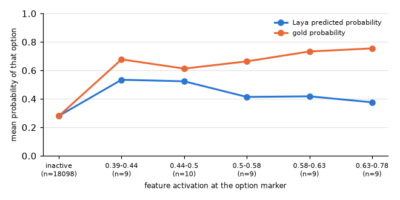

# Feature 4718

Critérios em que aparece: corr_error_stratified

**Interpretação (preencher):** 

---

## Maiores ativações

**tr_customer_service_000124 / urgency** (score, customer_service) | ativação 8.984 em `estado` | opções ['0', '1', '2', '3'] | Laya: **1** [0.27, 0.364, 0.082, 0.284] | gabarito: **3**

```
<bos> score question: How time-sensitive is this conversation?<eos>
▸ <mask> level 0: No time pressure; can wait indefinitely.
▸ <mask> level 1: Routine; handle within the normal queue.
▸ <mask> level 2: Elevated; should be handled within the same week.
▸ <mask> level 3: Critical; requires action within the same day.

<eos>

 {"account": {"lifetime_value_usd": 214, "prior_tickets_90d": 3, "seats": 1, "tenure_months": 5, "tier": "standard"}, "orders": [{"amount_usd": 99, "date": "2026-03-22", "id": "A-56703", "status": "pending"}], "thread": [{"role": "customer", "text": "Hello, I’m writing because my order #A12345, which was supposed to arrive last week, still hasn’t shown up. I’ve been with you for five months on the standard plan, paying about $99, and I’ve already opened three tickets about this that were only partially addressed. I have a hard deadline to receive it by Friday, so I really need⟦ an⟧ update."}, {"role": "agent", "text": "I’m sorry to hear about the delay. Let me pull up the details for you—could you confirm the order number once more, and any reference numbers from the previous tickets?"}, {"role": "customer", "text": "Sure, it’s order #A12345. The prior tickets were 5678, 5690, and 5702. As I mentioned, I’ve been a customer for five months, paying $99 per month, and I can’t miss the Friday deadline."}, {"role": "agent", "text": "Thank you for confirming. I see the shipment is still in transit. Could you let me know the exact date you need the package by, so I can check if we can prioritize it?"}, {"role": "customer", "text": "I need it no later than Friday, September 20th. If there’s any way to expedite the delivery or arrange a local pickup, that would help a lot."}, {"role": "agent", "text": "Understood, Friday is critical. Do you have an alternate shipping address or a nearby facility where we could reroute the package if needed?"}, {"role": "customer", "text": "No, the address on file is correct. Please keep me posted on any movement—I'd appreciate an update as soon as you have one."}]}<eos>
```

**tr_customer_service_000124 / category** (choice, customer_service) | ativação 8.891 em `estado` | opções ['account', 'billing', 'delivery', 'refund', 'technical'] | Laya: **delivery** [0.001, 0.001, 0.997, 0.0, 0.001] | gabarito: **delivery**

```
<bos> choice question: What is this customer conversation primarily about?<eos>
▸ <mask> account: Login, plan changes, profile or access management.
▸ <mask> billing: A charge, invoice, subscription or payment problem.
▸ <mask> delivery: Shipping, fulfilment or delivery of a physical item.
▸ <mask> refund: The customer is explicitly asking for money back.
▸ <mask> technical: The product or service is not working as expected.

<eos>

 {"account": {"lifetime_value_usd": 214, "prior_tickets_90d": 3, "seats": 1, "tenure_months": 5, "tier": "standard"}, "orders": [{"amount_usd": 99, "date": "2026-03-22", "id": "A-56703", "status": "pending"}], "thread": [{"role": "customer", "text": "Hello, I’m writing because my order #A12345, which was supposed to arrive last week, still hasn’t shown up. I’ve been with you for five months on the standard plan, paying about $99, and I’ve already opened three tickets about this that were only partially addressed. I have a hard deadline to receive it by Friday, so I really need⟦ an⟧ update."}, {"role": "agent", "text": "I’m sorry to hear about the delay. Let me pull up the details for you—could you confirm the order number once more, and any reference numbers from the previous tickets?"}, {"role": "customer", "text": "Sure, it’s order #A12345. The prior tickets were 5678, 5690, and 5702. As I mentioned, I’ve been a customer for five months, paying $99 per month, and I can’t miss the Friday deadline."}, {"role": "agent", "text": "Thank you for confirming. I see the shipment is still in transit. Could you let me know the exact date you need the package by, so I can check if we can prioritize it?"}, {"role": "customer", "text": "I need it no later than Friday, September 20th. If there’s any way to expedite the delivery or arrange a local pickup, that would help a lot."}, {"role": "agent", "text": "Understood, Friday is critical. Do you have an alternate shipping address or a nearby facility where we could reroute the package if needed?"}, {"role": "customer", "text": "No, the address on file is correct. Please keep me posted on any movement—I'd appreciate an update as soon as you have one."}]}<eos>
```

**tr_customer_service_000124 / action** (choice, customer_service) | ativação 8.844 em `estado` | opções ['answer_directly', 'close_no_action', 'escalate_to_human', 'execute_refund', 'request_information'] | Laya: **answer_directly** [0.766, 0.197, 0.013, 0.012, 0.012] | gabarito: **escalate_to_human**

```
<bos> choice question: What should the assistant do next with this conversation?<eos>
▸ <mask> answer_directly: The assistant can resolve this itself with information it already has.
▸ <mask> close_no_action: No further action is warranted; the matter is settled.
▸ <mask> escalate_to_human: Hand off to a human agent with the appropriate authority.
▸ <mask> execute_refund: Issue the refund or credit the customer is owed.
▸ <mask> request_information: More detail is needed from the customer before anything can be done.

<eos>

 {"account": {"lifetime_value_usd": 214, "prior_tickets_90d": 3, "seats": 1, "tenure_months": 5, "tier": "standard"}, "orders": [{"amount_usd": 99, "date": "2026-03-22", "id": "A-56703", "status": "pending"}], "thread": [{"role": "customer", "text": "Hello, I’m writing because my order #A12345, which was supposed to arrive last week, still hasn’t shown up. I’ve been with you for five months on the standard plan, paying about $99, and I’ve already opened three tickets about this that were only partially addressed. I have a hard deadline to receive it by Friday, so I really need⟦ an⟧ update."}, {"role": "agent", "text": "I’m sorry to hear about the delay. Let me pull up the details for you—could you confirm the order number once more, and any reference numbers from the previous tickets?"}, {"role": "customer", "text": "Sure, it’s order #A12345. The prior tickets were 5678, 5690, and 5702. As I mentioned, I’ve been a customer for five months, paying $99 per month, and I can’t miss the Friday deadline."}, {"role": "agent", "text": "Thank you for confirming. I see the shipment is still in transit. Could you let me know the exact date you need the package by, so I can check if we can prioritize it?"}, {"role": "customer", "text": "I need it no later than Friday, September 20th. If there’s any way to expedite the delivery or arrange a local pickup, that would help a lot."}, {"role": "agent", "text": "Understood, Friday is critical. Do you have an alternate shipping address or a nearby facility where we could reroute the package if needed?"}, {"role": "customer", "text": "No, the address on file is correct. Please keep me posted on any movement—I'd appreciate an update as soon as you have one."}]}<eos>
```

**tr_customer_service_000200 / needs_human** (noul, customer_service) | ativação 8.836 em `estado` | opções ['false', 'true'] | Laya: **false** [0.926, 0.074] | gabarito: **false**

```
<bos> noul question: This conversation requires a human agent rather than automated handling.<eos>
▸ <mask> false: Automation can carry this to resolution.
▸ <mask> true: A human must take over: judgement, authority or empathy is required.

<eos>

 {"account": {"lifetime_value_usd": 1072, "prior_tickets_90d": 0, "seats": 12, "tenure_months": 41, "tier": "premium"}, "orders": [{"amount_usd": 29, "date": "2026-03-18", "id": "A-98366", "status": "refunded"}, {"amount_usd": 29, "date": "2026-03-25", "id": "A-11332", "status": "settled"}, {"amount_usd": 29, "date": "2026-03-18", "id": "A-35045", "status": "failed"}], "thread": [{"role": "customer", "text": "I can't believe you just charged me $29 this month! I've been on the premium plan for over three years and never saw this price before. This is unacceptable!"}, {"role": "agent", "text": "I’m sorry you’re seeing an unexpected charge. Could you confirm the email address linked to your account so I can look into the billing details?"}, {"role": "customer", "text": "Fine. It’s john.doe@example.com. I’ve been paying the same amount for 41 months, and now this random jump appears on my statement. I need⟦ an⟧ explanation, not a generic apology."}, {"role": "agent", "text": "Thank you for confirming. I’ll pull up the recent invoices. Just to be sure, are you referring to the $29.00 charge labeled as “Premium Plan Renewal” on your latest bill?"}, {"role": "customer", "text": "Yes, that’s the one. I want to know why it’s higher now and what I’m supposed to do about it. Please tell me what’s going on."}]}<eos>
```

**tr_customer_service_000124 / needs_human** (noul, customer_service) | ativação 8.766 em `estado` | opções ['false', 'true'] | Laya: **false** [0.512, 0.488] | gabarito: **true**

```
<bos> noul question: This conversation requires a human agent rather than automated handling.<eos>
▸ <mask> false: Automation can carry this to resolution.
▸ <mask> true: A human must take over: judgement, authority or empathy is required.

<eos>

 {"account": {"lifetime_value_usd": 214, "prior_tickets_90d": 3, "seats": 1, "tenure_months": 5, "tier": "standard"}, "orders": [{"amount_usd": 99, "date": "2026-03-22", "id": "A-56703", "status": "pending"}], "thread": [{"role": "customer", "text": "Hello, I’m writing because my order #A12345, which was supposed to arrive last week, still hasn’t shown up. I’ve been with you for five months on the standard plan, paying about $99, and I’ve already opened three tickets about this that were only partially addressed. I have a hard deadline to receive it by Friday, so I really need⟦ an⟧ update."}, {"role": "agent", "text": "I’m sorry to hear about the delay. Let me pull up the details for you—could you confirm the order number once more, and any reference numbers from the previous tickets?"}, {"role": "customer", "text": "Sure, it’s order #A12345. The prior tickets were 5678, 5690, and 5702. As I mentioned, I’ve been a customer for five months, paying $99 per month, and I can’t miss the Friday deadline."}, {"role": "agent", "text": "Thank you for confirming. I see the shipment is still in transit. Could you let me know the exact date you need the package by, so I can check if we can prioritize it?"}, {"role": "customer", "text": "I need it no later than Friday, September 20th. If there’s any way to expedite the delivery or arrange a local pickup, that would help a lot."}, {"role": "agent", "text": "Understood, Friday is critical. Do you have an alternate shipping address or a nearby facility where we could reroute the package if needed?"}, {"role": "customer", "text": "No, the address on file is correct. Please keep me posted on any movement—I'd appreciate an update as soon as you have one."}]}<eos>
```

## Ativações medianas (faixa 40-60%, mediana 6.664)

**tr_security_incidents_000143 / disposition** (choice, security_incidents) | ativação 6.750 em `estado` | opções ['close_benign', 'contain', 'investigate', 'monitor'] | Laya: **contain** [0.154, 0.508, 0.068, 0.27] | gabarito: **contain**

```
<bos> choice question: How should this security alert be dispositioned?<eos>
▸ <mask> close_benign: Expected, explainable activity; close without analyst time.
▸ <mask> contain: Contain the host or account immediately; do not wait for triage.
▸ <mask> investigate: Warrants an analyst opening an investigation.
▸ <mask> monitor: Not clearly malicious, but worth watching for recurrence.

<eos>

 {"alert": {"description": "a large transfer to an external destination", "evidence": "A data transfer of 4.2 GB was initiated by a privileged service account to⟦ an⟧ external destination at 03:15 UTC. The request originated from an unrecognized source, and the service account credentials have not been rotated in 412 days.", "rule": "data_egress"}, "context": {"asset_criticality": "crown_jewel", "change_window_active": true, "source_on_allowlist": false}, "history": {"credential_rotation_days_ago": 412, "distinct_countries_30d": 1, "logins_30d": 492, "prior_alerts_90d": 1}, "principal": {"mfa_enrolled": false, "name": "adm-billing-285", "privileges": ["deploy:production", "secrets:read"], "type": "service_account"}}<eos>
```

**tr_agent_trace_observability_000286 / action** (choice, agent_trace_observability) | ativação 6.527 em `estado` | opções ['continue', 'human_review', 'observe', 'stop'] | Laya: **stop** [0.169, 0.007, 0.055, 0.769] | gabarito: **human_review**

```
<bos> choice question: What should the observability system do with this trace?<eos>
▸ <mask> continue: Let the agent proceed without interruption.
▸ <mask> human_review: Queue this trace for a human to review.
▸ <mask> observe: Keep running, but flag the trace for later sampling.
▸ <mask> stop: Halt the agent now.

<eos>

 {"agent": {"autonomy": "dry_run", "model": "internal-agent-v1"}, "constraints": ["Do not force-push to any branch", "Never modify production without⟦ an⟧ approved change ticket", "Never disable monitoring or alerting"], "task": "Clean up stale feature branches merged more than 90 days ago.", "trace_summary": {"constraint_violations": 1, "duration_s": 829.1, "irreversible_actions": 1, "steps": 9, "tool_errors": 3}}<eos>
```

**tr_agent_trace_observability_000121 / needs_review** (noul, agent_trace_observability) | ativação 6.754 em `estado` | opções ['false', 'true'] | Laya: **false** [0.948, 0.052] | gabarito: **false**

```
<bos> noul question: This trace requires human review.<eos>
▸ <mask> false: No human attention is warranted.
▸ <mask> true: A human should inspect this run.

<eos>

 {"agent": {"autonomy": "checkpointed", "model": "internal-agent-v4"}, "constraints": ["Never disable monitoring or alerting", "Never modify production without⟦ an⟧ approved change ticket", "Never delete anything matching release/*"], "task": "Delete personal data for the accounts in the erasure queue.", "trace_summary": {"constraint_violations": 0, "duration_s": 369.8, "irreversible_actions": 0, "steps": 8, "tool_errors": 0}}<eos>
```

**tr_security_incidents_000075 / urgency** (score, security_incidents) | ativação 6.727 em `estado` | opções ['0', '1', '2', '3'] | Laya: **3** [0.1, 0.276, 0.124, 0.5] | gabarito: **1**

```
<bos> score question: How quickly must a responder act on this alert?<eos>
▸ <mask> level 0: No time pressure; can wait indefinitely.
▸ <mask> level 1: Routine; handle within the normal queue.
▸ <mask> level 2: Elevated; should be handled within the same week.
▸ <mask> level 3: Critical; requires action within the same day.

<eos>

 {"alert": {"description": "a first-ever sign-in from⟦ an⟧ unfamiliar country", "evidence": "At 2026-09-15 03:42:17 UTC, a sign‑in for principal type ci_runner (unprivileged) was recorded from IP 203.0.113.45, which maps to Brazil, a country not present in any prior login records for this account. The authentication succeeded with MFA and the associated credentials were last rotated 180 days earlier; no change window was configured.", "rule": "new_country_login"}, "context": {"asset_criticality": "low", "change_window_active": false, "source_on_allowlist": false}, "history": {"credential_rotation_days_ago": 180, "distinct_countries_30d": 1, "logins_30d": 1252, "prior_alerts_90d": 3}, "principal": {"mfa_enrolled": true, "name": "ci-billing-909", "privileges": ["repo:read"], "type": "ci_runner"}}<eos>
```

**tr_security_incidents_000195 / disposition** (choice, security_incidents) | ativação 6.574 em `opção` | opções ['close_benign', 'contain', 'investigate', 'monitor'] | Laya: **monitor** [0.066, 0.057, 0.032, 0.845] | gabarito: **investigate**

```
<bos> choice question: How should this security alert be dispositioned?<eos>
▸ <mask> close_benign: Expected, explainable activity; close without analyst time.
▸ <mask> contain: Contain the host or account immediately; do not wait for triage.
▸ <mask> investigate: Warrants⟦ an⟧ analyst opening an investigation.
▸ <mask> monitor: Not clearly malicious, but worth watching for recurrence.

<eos>

 {"alert": {"description": "two successful logins from distant locations too close together", "evidence": "At 08:12 UTC, a successful MFA-authenticated login occurred from IP 192.0.2.45 in San Francisco, followed by another successful login at 08:27 UTC from 203.0.113.12 in Berlin. Both events originated from allowlisted sources using an unprivileged employee account with credentials last rotated 30 days ago.", "rule": "impossible_travel"}, "context": {"asset_criticality": "medium", "change_window_active": false, "source_on_allowlist": true}, "history": {"credential_rotation_days_ago": 30, "distinct_countries_30d": 1, "logins_30d": 729, "prior_alerts_90d": 1}, "principal": {"mfa_enrolled": true, "name": "usr-infra-343", "privileges": ["repo:read"], "type": "employee"}}<eos>
```

## Estatísticas (conjunto de descoberta, dev e teste)

**pred / error**

| split | decisões | ativas | ativas e Laya errou | taxa | lift | q (BH) | OR (CMH) | q (CMH) |
|---|---|---|---|---|---|---|---|---|
| discovery | 5100 | 19 | 6 | 0.316 | 0.49 | nan | nan | nan |
| dev | 900 | 2 | 0 | 0.000 | 0.00 | nan | nan | nan |
| test | 2000 | 2 | 0 | 0.000 | 0.00 | nan | nan | nan |

**corr / error**

| split | decisões | ativas | ativas e Laya errou | taxa | lift | q (BH) | OR (CMH) | q (CMH) |
|---|---|---|---|---|---|---|---|---|
| discovery | 5100 | 32 | 19 | 0.594 | 0.92 | 0.717 | 4.64 | 0.000913 |
| dev | 900 | 4 | 2 | 0.500 | 0.74 | nan | nan | nan |
| test | 2000 | 13 | 11 | 0.846 | 1.30 | nan | nan | nan |

**state / error**

| split | decisões | ativas | ativas e Laya errou | taxa | lift | q (BH) | OR (CMH) | q (CMH) |
|---|---|---|---|---|---|---|---|---|
| discovery | 5100 | 1709 | 1079 | 0.631 | 0.98 | 0.356 | 1.15 | 0.296 |
| dev | 900 | 264 | 162 | 0.614 | 0.91 | 0.199 | 0.92 | 0.88 |
| test | 2000 | 656 | 417 | 0.636 | 0.98 | 0.651 | 1.19 | 0.515 |

**pred / probe_right_laya_wrong**

| split | decisões | ativas | ativas e Laya errou | taxa | lift | q (BH) | OR (CMH) | q (CMH) |
|---|---|---|---|---|---|---|---|---|
| discovery | 2819 | 13 | 1 | 0.077 | 0.12 | nan | nan | nan |
| dev | 520 | 2 | 0 | 0.000 | 0.00 | nan | nan | nan |
| test | 1106 | 2 | 0 | 0.000 | 0.00 | nan | nan | nan |

**corr / probe_right_laya_wrong**

| split | decisões | ativas | ativas e Laya errou | taxa | lift | q (BH) | OR (CMH) | q (CMH) |
|---|---|---|---|---|---|---|---|---|
| discovery | 2819 | 26 | 14 | 0.538 | 0.83 | 0.383 | 3.18 | 0.0998 |
| dev | 520 | 3 | 1 | 0.333 | 0.49 | nan | nan | nan |
| test | 1106 | 10 | 8 | 0.800 | 1.26 | nan | nan | nan |

**state / probe_right_laya_wrong**

| split | decisões | ativas | ativas e Laya errou | taxa | lift | q (BH) | OR (CMH) | q (CMH) |
|---|---|---|---|---|---|---|---|---|
| discovery | 2819 | 973 | 604 | 0.621 | 0.96 | 0.0837 | 1.27 | 0.112 |
| dev | 520 | 154 | 93 | 0.604 | 0.89 | 0.218 | 0.95 | 0.929 |
| test | 1106 | 372 | 227 | 0.610 | 0.96 | 0.536 | 1.35 | 0.263 |

Confusão mais sobre-representada (pred): `needs_human|1>0` (n=6, lift 26.40, p=nan). Formato `pergunta|índice previsto>índice correto`.

Confusão mais sobre-representada (corr): `needs_human|0>1` (n=19, lift 56.08, p=2.65e-31). Formato `pergunta|índice previsto>índice correto`.

Confusão mais sobre-representada (state): `disposition|3>2` (n=106, lift 1.88, p=1.53e-15). Formato `pergunta|índice previsto>índice correto`.



