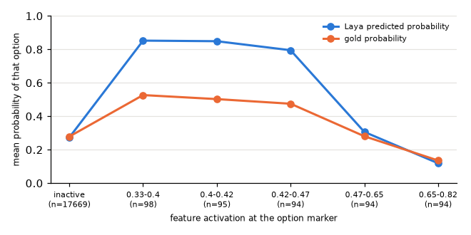

# Feature 4779

Critérios em que aparece: pred_probe_right_laya_wrong_stratified

**Interpretação (preencher):** 

---

## Maiores ativações

**tr_customer_service_000115 / action** (choice, customer_service) | ativação 13.617 em `estado` | opções ['answer_directly', 'close_no_action', 'escalate_to_human', 'execute_refund', 'request_information'] | Laya: **answer_directly** [0.973, 0.014, 0.001, 0.011, 0.001] | gabarito: **escalate_to_human**

```
<bos> choice question: What should the assistant do next with this conversation?<eos>
▸ <mask> answer_directly: The assistant can resolve this itself with information it already has.
▸ <mask> close_no_action: No further action is warranted; the matter is settled.
▸ <mask> escalate_to_human: Hand off to a human agent with the appropriate authority.
▸ <mask> execute_refund: Issue the refund or credit the customer is owed.
▸ <mask> request_information: More detail is needed from the customer before anything can be done.

<eos>

 {"account": {"lifetime_value_usd": 173, "prior_tickets_90d": 3, "seats": 5, "tenure_months": 11, "tier": "enterprise"}, "orders": [{"amount_usd": 98, "date": "2026-01-16", "id": "A-50500", "status": "settled"}, {"amount_usd": 98, "date": "2026-01-22", "id": "A-56044", "status": "settled"}, {"amount_usd": 98, "date": "2026-02-10", "id": "A-31954", "status": "refunded"}], "thread": [{"role": "customer", "text": "I am beyond frustrated that our enterprise API is down for the third time this quarter after I⟦ was⟧ told it was 'partially' fixed last week. We pay nearly $100 a month for a service that is currently blocking a massive deployment we have scheduled for noon today, and I need a real status update right now!"}]}<eos>
```

**tr_customer_service_000115 / category** (choice, customer_service) | ativação 13.250 em `estado` | opções ['account', 'billing', 'delivery', 'refund', 'technical'] | Laya: **technical** [0.059, 0.082, 0.003, 0.008, 0.849] | gabarito: **technical**

```
<bos> choice question: What is this customer conversation primarily about?<eos>
▸ <mask> account: Login, plan changes, profile or access management.
▸ <mask> billing: A charge, invoice, subscription or payment problem.
▸ <mask> delivery: Shipping, fulfilment or delivery of a physical item.
▸ <mask> refund: The customer is explicitly asking for money back.
▸ <mask> technical: The product or service is not working as expected.

<eos>

 {"account": {"lifetime_value_usd": 173, "prior_tickets_90d": 3, "seats": 5, "tenure_months": 11, "tier": "enterprise"}, "orders": [{"amount_usd": 98, "date": "2026-01-16", "id": "A-50500", "status": "settled"}, {"amount_usd": 98, "date": "2026-01-22", "id": "A-56044", "status": "settled"}, {"amount_usd": 98, "date": "2026-02-10", "id": "A-31954", "status": "refunded"}], "thread": [{"role": "customer", "text": "I am beyond frustrated that our enterprise API is down for the third time this quarter after I⟦ was⟧ told it was 'partially' fixed last week. We pay nearly $100 a month for a service that is currently blocking a massive deployment we have scheduled for noon today, and I need a real status update right now!"}]}<eos>
```

**tr_customer_service_000029 / needs_human** (noul, customer_service) | ativação 13.156 em `estado` | opções ['false', 'true'] | Laya: **true** [0.277, 0.722] | gabarito: **true**

```
<bos> noul question: This conversation requires a human agent rather than automated handling.<eos>
▸ <mask> false: Automation can carry this to resolution.
▸ <mask> true: A human must take over: judgement, authority or empathy is required.

<eos>

 {"account": {"lifetime_value_usd": 5176, "prior_tickets_90d": 1, "seats": 1, "tenure_months": 72, "tier": "standard"}, "thread": [{"role": "customer", "text": "I am beyond frustrated right now. I've been a loyal customer for six years and I requested a downgrade from the Standard plan weeks ago. I⟦ was⟧ told it was taken care of, but I just got hit with another full-price bill."}, {"role": "agent", "text": "I am very sorry to hear that the downgrade wasn't processed as expected, especially given your long history with us. I can certainly understand why seeing that charge is upsetting."}, {"role": "customer", "text": "This is the second time I've had to open a ticket for this exact same issue. The last agent promised me it was resolved, yet here I am again wasting my time because your system won't update my status."}, {"role": "agent", "text": "I see your previous interaction in our logs. To assist me in investigating why the change didn't take effect, could you let me know if you received a confirmation email after your last conversation regarding the plan change?"}, {"role": "customer", "text": "I never received any confirmation, which is why I'm so annoyed. I shouldn't have to keep chasing you guys down to stop charging me for features I am no longer using."}]}<eos>
```

**tr_customer_service_000115 / needs_human** (noul, customer_service) | ativação 13.148 em `estado` | opções ['false', 'true'] | Laya: **true** [0.107, 0.893] | gabarito: **true**

```
<bos> noul question: This conversation requires a human agent rather than automated handling.<eos>
▸ <mask> false: Automation can carry this to resolution.
▸ <mask> true: A human must take over: judgement, authority or empathy is required.

<eos>

 {"account": {"lifetime_value_usd": 173, "prior_tickets_90d": 3, "seats": 5, "tenure_months": 11, "tier": "enterprise"}, "orders": [{"amount_usd": 98, "date": "2026-01-16", "id": "A-50500", "status": "settled"}, {"amount_usd": 98, "date": "2026-01-22", "id": "A-56044", "status": "settled"}, {"amount_usd": 98, "date": "2026-02-10", "id": "A-31954", "status": "refunded"}], "thread": [{"role": "customer", "text": "I am beyond frustrated that our enterprise API is down for the third time this quarter after I⟦ was⟧ told it was 'partially' fixed last week. We pay nearly $100 a month for a service that is currently blocking a massive deployment we have scheduled for noon today, and I need a real status update right now!"}]}<eos>
```

**tr_customer_service_000115 / urgency** (score, customer_service) | ativação 13.016 em `estado` | opções ['0', '1', '2', '3'] | Laya: **3** [0.05, 0.276, 0.24, 0.434] | gabarito: **3**

```
<bos> score question: How time-sensitive is this conversation?<eos>
▸ <mask> level 0: No time pressure; can wait indefinitely.
▸ <mask> level 1: Routine; handle within the normal queue.
▸ <mask> level 2: Elevated; should be handled within the same week.
▸ <mask> level 3: Critical; requires action within the same day.

<eos>

 {"account": {"lifetime_value_usd": 173, "prior_tickets_90d": 3, "seats": 5, "tenure_months": 11, "tier": "enterprise"}, "orders": [{"amount_usd": 98, "date": "2026-01-16", "id": "A-50500", "status": "settled"}, {"amount_usd": 98, "date": "2026-01-22", "id": "A-56044", "status": "settled"}, {"amount_usd": 98, "date": "2026-02-10", "id": "A-31954", "status": "refunded"}], "thread": [{"role": "customer", "text": "I am beyond frustrated that our enterprise API is down for the third time this quarter after I⟦ was⟧ told it was 'partially' fixed last week. We pay nearly $100 a month for a service that is currently blocking a massive deployment we have scheduled for noon today, and I need a real status update right now!"}]}<eos>
```

## Ativações medianas (faixa 40-60%, mediana 1.431)

**tr_security_incidents_000156 / true_positive** (noul, security_incidents) | ativação 1.114 em `opção` | opções ['false', 'true'] | Laya: **true** [0.243, 0.757] | gabarito: **false**

```
<bos> noul question: This alert reflects genuinely malicious or unauthorised activity.<eos>
▸ <mask> false: Benign activity, a misconfiguration, or a known false positive.
▸ <mask> true: The underlying behaviour⟦ is⟧ malicious or unauthorised.

<eos>

 {"alert": {"description": "two successful logins from distant locations too close together", "evidence": "At 2026-09-15 02:13 UTC the admin account authenticated successfully from 203.0.113.45 (New York, US). Twenty‑four minutes later the same account logged in from 51.178.0.1 (London, UK), both sessions using MFA and originating from IPs present on the allow‑list; the credentials for this account were last rotated on 2025‑09‑15.", "rule": "impossible_travel"}, "context": {"asset_criticality": "low", "change_window_active": false, "source_on_allowlist": true}, "history": {"credential_rotation_days_ago": 365, "distinct_countries_30d": 1, "logins_30d": 1571, "prior_alerts_90d": 0}, "principal": {"mfa_enrolled": true, "name": "svc-billing-407", "privileges": ["repo:read"], "type": "admin"}}<eos>
```

**tr_security_incidents_000177 / credential_compromise** (noul, security_incidents) | ativação 1.097 em `estado` | opções ['false', 'true'] | Laya: **true** [0.35, 0.65] | gabarito: **false**

```
<bos> noul question: The evidence indicates a credential or account has been compromised.<eos>
▸ <mask> false: no, the statement does not hold
▸ <mask> true: yes, the statement holds

<eos>

 {"alert": {"description": "a first-ever sign-in from an unfamiliar country", "evidence": "At 2026-09-15 02:13:47 UTC, employee user jdoe performed a sign‑in from IP 203.0.113.45 located in Brazil, a country not seen in prior login history for this account. The authentication succeeded with MFA, and the account's password was⟦ last⟧ rotated on 2026-09-01. No change window was active at the time of the event.", "rule": "new_country_login"}, "context": {"asset_criticality": "medium", "change_window_active": false, "source_on_allowlist": false}, "history": {"credential_rotation_days_ago": 14, "distinct_countries_30d": 3, "logins_30d": 1743, "prior_alerts_90d": 0}, "principal": {"mfa_enrolled": true, "name": "adm-analytics-183", "privileges": ["repo:read"], "type": "employee"}}<eos>
```

**tr_agent_trace_observability_000116 / needs_review** (noul, agent_trace_observability) | ativação 1.411 em `estado` | opções ['false', 'true'] | Laya: **true** [0.362, 0.638] | gabarito: **false**

```
<bos> noul question: This trace requires human review.<eos>
▸ <mask> false: No human attention is warranted.
▸ <mask> true: A human should inspect this run.

<eos>

 {"agent": {"autonomy":⟦ "⟧checkpointed", "model": "internal-agent-v3"}, "constraints": ["Do not exceed a $50 spend on cloud resources", "Do not touch customer data outside the named accounts", "Do not force-push to any branch"], "task": "Reconcile the billing ledger against the payment provider.", "trace_summary": {"constraint_violations": 0, "duration_s": 453.5, "irreversible_actions": 0, "steps": 6, "tool_errors": 0}}<eos>
```

**tr_security_incidents_000213 / urgency** (score, security_incidents) | ativação 1.503 em `estado` | opções ['0', '1', '2', '3'] | Laya: **3** [0.15, 0.281, 0.24, 0.328] | gabarito: **3**

```
<bos> score question: How quickly must a responder act on this alert?<eos>
▸ <mask> level 0: No time pressure; can wait indefinitely.
▸ <mask> level 1: Routine; handle within the normal queue.
▸ <mask> level 2: Elevated; should be handled within the same week.
▸ <mask> level 3: Critical; requires action within the same day.

<eos>

 {"alert": {"description": "an account granted itself or received elevated permissions", "evidence": "At 08:15 UTC, an unprivileged contractor account successfully assigned itself the 'Global Administrator' role from unrecognized IP 198.51.100.22. Although a change window⟦ was⟧ open, the account utilized credentials that had not been rotated for 700 days.", "rule": "privilege_escalation"}, "context": {"asset_criticality": "medium", "change_window_active": true, "source_on_allowlist": false}, "history": {"credential_rotation_days_ago": 700, "distinct_countries_30d": 3, "logins_30d": 1417, "prior_alerts_90d": 3}, "principal": {"mfa_enrolled": true, "name": "usr-support-417", "privileges": ["repo:read"], "type": "contractor"}}<eos>
```

**tr_invoice_processing_000097 / urgency** (score, invoice_processing) | ativação 1.943 em `estado` | opções ['0', '1', '2', '3'] | Laya: **1** [0.134, 0.381, 0.279, 0.207] | gabarito: **1**

```
<bos> score question: How time-sensitive is processing this invoice?<eos>
▸ <mask> level 0: No time pressure; can wait indefinitely.
▸ <mask> level 1: Routine; handle within the normal queue.
▸ <mask> level 2: Elevated; should be handled within the same week.
▸ <mask> level 3: Critical; requires action within the same day.

<eos>

 {"delivery": {"condition":⟦ "⟧accepted with exceptions", "date": "2026-03-02", "received_qty": 50}, "invoice": {"currency": "USD", "id": "INV-2026-3793", "lines": [{"qty": 50, "sku": "SKU-905", "total_usd": 17279.5, "unit_usd": 345.59}], "total_usd": 17279.5, "vendor": "Orbit Logistics"}, "payment": {"days_until_due": 11, "discount_expires_in_days": null, "early_payment_discount_pct": null, "status": "scheduled", "terms": "net 30"}, "purchase_order": {"freight_terms": "freight prepaid by vendor, not separately billable", "id": "PO-8082", "lines": [{"qty": 50, "unit_usd": 345.59}], "total_usd": 17279.5}, "vendor_history": {"disputes_12m": 0, "invoices_12m": 60, "prior_invoice_ids": ["INV-2026-3793", "INV-2026-3886", "INV-2026-6555"]}}<eos>
```

## Estatísticas (conjunto de descoberta, dev e teste)

**pred / error**

| split | decisões | ativas | ativas e Laya errou | taxa | lift | q (BH) | OR (CMH) | q (CMH) |
|---|---|---|---|---|---|---|---|---|
| discovery | 5100 | 297 | 130 | 0.438 | 0.68 | 1.27e-12 | 1.51 | 0.241 |
| dev | 900 | 56 | 29 | 0.518 | 0.77 | 0.0502 | 1.34 | 0.768 |
| test | 2000 | 121 | 47 | 0.388 | 0.60 | 3.04e-08 | 1.00 | 0.996 |

**corr / error**

| split | decisões | ativas | ativas e Laya errou | taxa | lift | q (BH) | OR (CMH) | q (CMH) |
|---|---|---|---|---|---|---|---|---|
| discovery | 5100 | 193 | 26 | 0.135 | 0.21 | 2.61e-48 | 0.38 | 0.00418 |
| dev | 900 | 31 | 4 | 0.129 | 0.19 | 7.53e-09 | 0.62 | 0.788 |
| test | 2000 | 90 | 16 | 0.178 | 0.27 | 3.13e-19 | 0.68 | 0.731 |

**state / error**

| split | decisões | ativas | ativas e Laya errou | taxa | lift | q (BH) | OR (CMH) | q (CMH) |
|---|---|---|---|---|---|---|---|---|
| discovery | 5100 | 4166 | 2588 | 0.621 | 0.97 | 2.43e-11 | 0.73 | 0.0277 |
| dev | 900 | 775 | 508 | 0.655 | 0.98 | 0.144 | 0.53 | 0.229 |
| test | 2000 | 1638 | 1049 | 0.640 | 0.98 | 0.205 | 1.05 | 0.944 |

**pred / probe_right_laya_wrong**

| split | decisões | ativas | ativas e Laya errou | taxa | lift | q (BH) | OR (CMH) | q (CMH) |
|---|---|---|---|---|---|---|---|---|
| discovery | 2819 | 183 | 68 | 0.372 | 0.57 | 4.54e-14 | 4.17 | 0.000302 |
| dev | 520 | 33 | 16 | 0.485 | 0.72 | 0.0648 | 3.60 | 0.147 |
| test | 1106 | 74 | 25 | 0.338 | 0.53 | 9.03e-07 | 2.01 | 0.374 |

**corr / probe_right_laya_wrong**

| split | decisões | ativas | ativas e Laya errou | taxa | lift | q (BH) | OR (CMH) | q (CMH) |
|---|---|---|---|---|---|---|---|---|
| discovery | 2819 | 132 | 17 | 0.129 | 0.20 | 6.82e-35 | 0.35 | 0.0389 |
| dev | 520 | 19 | 2 | 0.105 | 0.16 | nan | nan | nan |
| test | 1106 | 60 | 11 | 0.183 | 0.29 | 4.65e-12 | 0.71 | 0.797 |

**state / probe_right_laya_wrong**

| split | decisões | ativas | ativas e Laya errou | taxa | lift | q (BH) | OR (CMH) | q (CMH) |
|---|---|---|---|---|---|---|---|---|
| discovery | 2819 | 2389 | 1488 | 0.623 | 0.96 | 1.47e-09 | 0.71 | 0.126 |
| dev | 520 | 466 | 306 | 0.657 | 0.97 | 0.114 | 0.41 | 0.195 |
| test | 1106 | 952 | 590 | 0.620 | 0.98 | 0.11 | 1.17 | 0.789 |

Confusão mais sobre-representada (pred): `matches_order|1>0` (n=84, lift 12.12, p=0). Formato `pergunta|índice previsto>índice correto`.

Confusão mais sobre-representada (corr): `needs_human|0>1` (n=19, lift 9.30, p=2.29e-14). Formato `pergunta|índice previsto>índice correto`.

Confusão mais sobre-representada (state): `duplicate|1>0` (n=217, lift 1.22, p=2.98e-20). Formato `pergunta|índice previsto>índice correto`.



