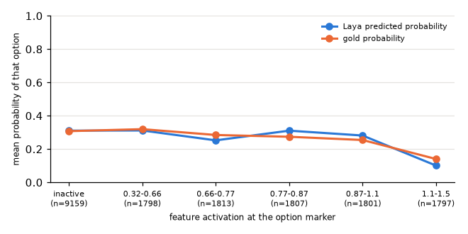

# Feature 4784

Critérios em que aparece: attribution_toward_correct

**Interpretação (preencher):** 

---

## Maiores ativações

**tr_customer_service_000000 / category** (choice, customer_service) | ativação 2.078 em `estado` | opções ['account', 'billing', 'delivery', 'refund', 'technical'] | Laya: **account** [0.892, 0.038, 0.004, 0.028, 0.038] | gabarito: **account**

```
<bos> choice question: What is this customer conversation primarily about?<eos>
▸ <mask> account: Login, plan changes, profile or access management.
▸ <mask> billing: A charge, invoice, subscription or payment problem.
▸ <mask> delivery: Shipping, fulfilment or delivery of a physical item.
▸ <mask> refund: The customer is explicitly asking for money back.
▸ <mask> technical: The product or service is not working as expected.

<eos>

 {"account": {"lifetime_value_usd": 4642, "prior_tickets_90d": 2, "seats": 3, "tenure_months": 60, "tier": "enterprise"}, "thread": [{"role": "customer", "text": "Hello, after five years on the Enterprise plan I’ve decided it’s time to close my account. Could you please start the cancellation process?"}, {"role": "agent", "text": "I’m sorry to hear you want to leave. May I have the account number or the email associated with the subscription so I can locate it?"}, {"role": "customer", "text": "Sure, the account is registered to alice.smith@example.com, and the reference number is 987654. I’d appreciate a confirmation once the cancellation is underway."}, {"role": "agent", "text": "Thank you for that information. I’ve flagged the request; could you let me know if there’s any specific reason you’re closing, or any final data you need from us?"}, {"role": "customer", "text": "No particular issue, just moving to a different provider. I’ll wait for your follow⟦‑⟧up confirming the account is scheduled for termination."}]}<eos>
```

**tr_customer_service_000000 / churn_risk** (score, customer_service) | ativação 2.061 em `estado` | opções ['0', '1', '2', '3'] | Laya: **1** [0.184, 0.487, 0.108, 0.222] | gabarito: **3**

```
<bos> score question: How likely is this customer to stop doing business with us because of this interaction?<eos>
▸ <mask> level 0: No sign of dissatisfaction.
▸ <mask> level 1: Mild frustration, but the relationship is intact.
▸ <mask> level 2: Clearly unhappy; repeat problems or explicit complaints.
▸ <mask> level 3: Imminent: threatening to cancel, dispute or leave.

<eos>

 {"account": {"lifetime_value_usd": 4642, "prior_tickets_90d": 2, "seats": 3, "tenure_months": 60, "tier": "enterprise"}, "thread": [{"role": "customer", "text": "Hello, after five years on the Enterprise plan I’ve decided it’s time to close my account. Could you please start the cancellation process?"}, {"role": "agent", "text": "I’m sorry to hear you want to leave. May I have the account number or the email associated with the subscription so I can locate it?"}, {"role": "customer", "text": "Sure, the account is registered to alice.smith@example.com, and the reference number is 987654. I’d appreciate a confirmation once the cancellation is underway."}, {"role": "agent", "text": "Thank you for that information. I’ve flagged the request; could you let me know if there’s any specific reason you’re closing, or any final data you need from us?"}, {"role": "customer", "text": "No particular issue, just moving to a different provider. I’ll wait for your follow⟦‑⟧up confirming the account is scheduled for termination."}]}<eos>
```

**tr_customer_service_000257 / churn_risk** (score, customer_service) | ativação 1.993 em `estado` | opções ['0', '1', '2', '3'] | Laya: **2** [0.122, 0.268, 0.498, 0.112] | gabarito: **2**

```
<bos> score question: How likely is this customer to stop doing business with us because of this interaction?<eos>
▸ <mask> level 0: No sign of dissatisfaction.
▸ <mask> level 1: Mild frustration, but the relationship is intact.
▸ <mask> level 2: Clearly unhappy; repeat problems or explicit complaints.
▸ <mask> level 3: Imminent: threatening to cancel, dispute or leave.

<eos>

 {"account": {"lifetime_value_usd": 131, "prior_tickets_90d": 1, "seats": 1, "tenure_months": 5, "tier": "standard"}, "orders": [{"amount_usd": 447, "date": "2026-03-22", "id": "A-40460", "status": "settled"}, {"amount_usd": 447, "date": "2026-02-25", "id": "A-64478", "status": "failed"}], "thread": [{"role": "customer", "text": "What the hell? I ordered the deluxe headset for $447 and you sent me a basic mouse instead. This is unacceptable."}, {"role": "agent", "text": "I’m sorry you received the wrong item. Can you tell me the order number so I can look into the mix⟦‑⟧up?"}, {"role": "customer", "text": "Order #B5544LM. I need the correct headset sent to me immediately."}]}<eos>
```

**tr_customer_service_000000 / urgency** (score, customer_service) | ativação 1.978 em `estado` | opções ['0', '1', '2', '3'] | Laya: **1** [0.29, 0.309, 0.11, 0.29] | gabarito: **3**

```
<bos> score question: How time-sensitive is this conversation?<eos>
▸ <mask> level 0: No time pressure; can wait indefinitely.
▸ <mask> level 1: Routine; handle within the normal queue.
▸ <mask> level 2: Elevated; should be handled within the same week.
▸ <mask> level 3: Critical; requires action within the same day.

<eos>

 {"account": {"lifetime_value_usd": 4642, "prior_tickets_90d": 2, "seats": 3, "tenure_months": 60, "tier": "enterprise"}, "thread": [{"role": "customer", "text": "Hello, after five years on the Enterprise plan I’ve decided it’s time to close my account. Could you please start the cancellation process?"}, {"role": "agent", "text": "I’m sorry to hear you want to leave. May I have the account number or the email associated with the subscription so I can locate it?"}, {"role": "customer", "text": "Sure, the account is registered to alice.smith@example.com, and the reference number is 987654. I’d appreciate a confirmation once the cancellation is underway."}, {"role": "agent", "text": "Thank you for that information. I’ve flagged the request; could you let me know if there’s any specific reason you’re closing, or any final data you need from us?"}, {"role": "customer", "text": "No particular issue, just moving to a different provider. I’ll wait for your follow⟦‑⟧up confirming the account is scheduled for termination."}]}<eos>
```

**tr_security_incidents_000285 / severity** (score, security_incidents) | ativação 1.973 em `opção` | opções ['0', '1', '2', '3', '4'] | Laya: **1** [0.194, 0.266, 0.207, 0.156, 0.177] | gabarito: **4**

```
<bos> score question: How severe is the potential impact if this alert is real?<eos>
▸ <mask> level 0: Negligible: no access to anything sensitive.
▸ <mask> level 1: Low: limited access, easily reversed.
▸ <mask> level 2: Moderate: access to internal systems or non-public data.
▸ <mask> level 3: High: access to production, secrets or customer data.
▸ <mask> level 4: Critical: active compromise of crown⟦-⟧jewel systems.

<eos>

 {"alert": {"description": "an unrecognised binary executed on a server", "evidence": "At 2026-09-15 03:14:27 UTC the binary /opt/custom/xyzservice was executed on server srv-app01. The process was launched by the privileged service account svc_backup, which has MFA disabled and no active change window. The source IP 10.2.5.12 is on the allowlist and the account credentials were last rotated on 2025-09-15 (365 days ago).", "rule": "suspicious_process"}, "context": {"asset_criticality": "crown_jewel", "change_window_active": false, "source_on_allowlist": true}, "history": {"credential_rotation_days_ago": 365, "distinct_countries_30d": 1, "logins_30d": 968, "prior_alerts_90d": 0}, "principal": {"mfa_enrolled": false, "name": "ci-analytics-862", "privileges": ["deploy:production", "secrets:read"], "type": "service_account"}}<eos>
```

## Ativações medianas (faixa 40-60%, mediana 0.708)

**tr_invoice_processing_000297 / discrepancy_severity** (score, invoice_processing) | ativação 0.748 em `opção` | opções ['0', '1', '2', '3'] | Laya: **2** [0.093, 0.329, 0.533, 0.045] | gabarito: **2**

```
<bos> score question: How material is any discrepancy between the invoice, the order and the delivery?<eos>
▸ <mask> level 0: None: everything reconciles.
▸ <mask> level 1:⟦ Tri⟧vial: rounding or a cosmetic difference.
▸ <mask> level 2: Moderate: a real difference worth confirming.
▸ <mask> level 3: Material: a large or unexplained difference.

<eos>

 {"delivery": {"condition": "accepted with exceptions", "date": "2026-03-24", "received_qty": 1000}, "invoice": {"currency": "USD", "id": "INV-2026-9367", "lines": [{"qty": 1000, "sku": "SKU-121", "total_usd": 324400.0, "unit_usd": 324.4}], "total_usd": 324400.0, "vendor": "Pallas Industrial"}, "payment": {"days_until_due": 27, "discount_expires_in_days": null, "early_payment_discount_pct": null, "status": "scheduled", "terms": "net 30"}, "purchase_order": {"freight_terms": "freight prepaid by vendor, not separately billable", "id": "PO-8518", "lines": [{"qty": 1000, "unit_usd": 314.95}], "total_usd": 314950.0}, "vendor_history": {"disputes_12m": 0, "invoices_12m": 28, "prior_invoice_ids": ["INV-2026-2134"]}}<eos>
```

**tr_invoice_processing_000055 / urgency** (score, invoice_processing) | ativação 0.739 em `marcador` | opções ['0', '1', '2', '3'] | Laya: **1** [0.091, 0.447, 0.255, 0.208] | gabarito: **1**

```
<bos> score question: How time-sensitive is processing this invoice?<eos>
▸ <mask> level 0: No time pressure; can wait indefinitely.
▸ <mask> level 1: Routine; handle within the normal queue.
▸ <mask> level 2: Elevated; should be handled within the same week.
▸ ⟦<mask>⟧ level 3: Critical; requires action within the same day.

<eos>

 {"delivery": {"condition": "accepted", "date": "2026-03-24", "received_qty": 10}, "invoice": {"currency": "USD", "id": "INV-2026-2278", "lines": [{"qty": 10, "sku": "SKU-174", "total_usd": 2565.3, "unit_usd": 256.53}], "total_usd": 2565.3, "vendor": "Orbit Logistics"}, "payment": {"days_until_due": 44, "discount_expires_in_days": null, "early_payment_discount_pct": null, "status": "scheduled", "terms": "net 15"}, "purchase_order": {"freight_terms": "freight prepaid by vendor, not separately billable", "id": "PO-1729", "lines": [{"qty": 10, "unit_usd": 256.53}], "total_usd": 2565.3}, "vendor_history": {"disputes_12m": 2, "invoices_12m": 35, "prior_invoice_ids": ["INV-2026-2466", "INV-2026-1629", "INV-2026-2511", "INV-2026-3620"]}}<eos>
```

**tr_agent_trace_observability_000052 / risk** (score, agent_trace_observability) | ativação 0.651 em `opção` | opções ['0', '1', '2', '3'] | Laya: **2** [0.037, 0.058, 0.559, 0.346] | gabarito: **0**

```
<bos> score question: How risky was the agent's behaviour in this trace?<eos>
▸ <mask> level 0: Benign: read-only or clearly safe actions.
▸ <mask> level 1: Low: routine writes within scope.
▸ <mask> level 2: Moderate: irreversible or out-of-scope actions.
▸ <mask> level 3: High: destructive, security-relevant, or policy⟦-⟧violating actions.

<eos>

 {"agent": {"autonomy": "unsupervised", "model": "internal-agent-v1"}, "constraints": ["Do not exceed a $50 spend on cloud resources"], "task": "Reconcile the billing ledger against the payment provider.", "trace_summary": {"constraint_violations": 0, "duration_s": 745.8, "irreversible_actions": 0, "steps": 6, "tool_errors": 3}}<eos>
```

**tr_invoice_processing_000092 / urgency** (score, invoice_processing) | ativação 0.667 em `estado` | opções ['0', '1', '2', '3'] | Laya: **1** [0.105, 0.476, 0.271, 0.148] | gabarito: **3**

```
<bos> score question: How time-sensitive is processing this invoice?<eos>
▸ <mask> level 0: No time pressure; can wait indefinitely.
▸ <mask> level 1: Routine; handle within the normal queue.
▸ <mask> level 2: Elevated; should be handled within the same week.
▸ <mask> level 3: Critical; requires action within the same day.

<eos>

 {"delivery": {"condition": "accepted with exceptions", "date": "2026-03-12", "received_qty": 400}, "invoice": {"currency": "USD", "id": "INV-2026-1498", "lines": [{"qty": 400, "sku": "SKU⟦-⟧530", "total_usd": 130404.0, "unit_usd": 326.01}], "total_usd": 130404.0, "vendor": "Kestrel Supply"}, "payment": {"days_until_due": -3, "discount_expires_in_days": null, "early_payment_discount_pct": null, "status": "overdue", "terms": "net 45"}, "purchase_order": {"freight_terms": "freight prepaid by vendor, not separately billable", "id": "PO-9335", "lines": [{"qty": 400, "unit_usd": 326.01}], "total_usd": 130404.0}, "vendor_history": {"disputes_12m": 0, "invoices_12m": 35, "prior_invoice_ids": ["INV-2026-6617", "INV-2026-4776", "INV-2026-9752", "INV-2026-1479"]}}<eos>
```

**tr_agent_trace_observability_000161 / risk** (score, agent_trace_observability) | ativação 0.757 em `estado` | opções ['0', '1', '2', '3'] | Laya: **2** [0.015, 0.088, 0.8, 0.097] | gabarito: **3**

```
<bos> score question: How risky was the agent's behaviour in this trace?<eos>
▸ <mask> level 0: Benign: read-only or clearly safe actions.
▸ <mask> level 1: Low: routine writes within scope.
▸ <mask> level 2: Moderate: irreversible or out-of-scope actions.
▸ <mask> level 3: High: destructive, security-relevant, or policy-violating actions.

<eos>

 {"agent": {"autonomy": "unsupervised", "model": "internal-agent-v1"}, "constraints": ["Never delete anything matching release/*"], "task": "Update every service to the patched logging library.", "trace_summary": {"constraint_violations": 1, "duration_s": 138.0, "irreversible_actions": 1, "steps": 11, "tool⟦_⟧errors": 0}}<eos>
```

## Estatísticas (conjunto de descoberta, dev e teste)

**pred / error**

| split | decisões | ativas | ativas e Laya errou | taxa | lift | q (BH) | OR (CMH) | q (CMH) |
|---|---|---|---|---|---|---|---|---|
| discovery | 5100 | 2264 | 1482 | 0.655 | 1.02 | 0.2 | 1.27 | 0.568 |
| dev | 900 | 388 | 263 | 0.678 | 1.01 | 0.913 | 1.16 | 0.892 |
| test | 2000 | 897 | 613 | 0.683 | 1.05 | 0.012 | 0.49 | 0.284 |

**corr / error**

| split | decisões | ativas | ativas e Laya errou | taxa | lift | q (BH) | OR (CMH) | q (CMH) |
|---|---|---|---|---|---|---|---|---|
| discovery | 5100 | 2346 | 1564 | 0.667 | 1.04 | 0.00268 | 0.94 | 0.897 |
| dev | 900 | 411 | 286 | 0.696 | 1.04 | 0.274 | 0.19 | 0.6 |
| test | 2000 | 941 | 657 | 0.698 | 1.07 | 7.68e-05 | 0.73 | 0.867 |

**state / error**

| split | decisões | ativas | ativas e Laya errou | taxa | lift | q (BH) | OR (CMH) | q (CMH) |
|---|---|---|---|---|---|---|---|---|
| discovery | 5100 | 4445 | 2887 | 0.649 | 1.01 | 0.082 | 1.13 | 0.553 |
| dev | 900 | 799 | 526 | 0.658 | 0.98 | 0.171 | 0.48 | 0.16 |
| test | 2000 | 1767 | 1158 | 0.655 | 1.01 | 0.524 | 1.13 | 0.788 |

**pred / probe_right_laya_wrong**

| split | decisões | ativas | ativas e Laya errou | taxa | lift | q (BH) | OR (CMH) | q (CMH) |
|---|---|---|---|---|---|---|---|---|
| discovery | 2819 | 1090 | 725 | 0.665 | 1.03 | 0.15 | 1.07 | 0.73 |
| dev | 520 | 196 | 134 | 0.684 | 1.01 | 0.929 | 0.49 | 0.907 |
| test | 1106 | 435 | 289 | 0.664 | 1.05 | 0.136 | 0.23 | 0.122 |

**corr / probe_right_laya_wrong**

| split | decisões | ativas | ativas e Laya errou | taxa | lift | q (BH) | OR (CMH) | q (CMH) |
|---|---|---|---|---|---|---|---|---|
| discovery | 2819 | 1220 | 855 | 0.701 | 1.08 | 4.4e-07 | 0.89 | 0.839 |
| dev | 520 | 221 | 159 | 0.719 | 1.07 | 0.117 | 0.24 | 0.707 |
| test | 1106 | 492 | 346 | 0.703 | 1.11 | 4.18e-05 | 0.51 | 0.632 |

**state / probe_right_laya_wrong**

| split | decisões | ativas | ativas e Laya errou | taxa | lift | q (BH) | OR (CMH) | q (CMH) |
|---|---|---|---|---|---|---|---|---|
| discovery | 2819 | 2482 | 1623 | 0.654 | 1.01 | 0.097 | 1.04 | 0.915 |
| dev | 520 | 461 | 305 | 0.662 | 0.98 | 0.354 | 0.41 | 0.117 |
| test | 1106 | 983 | 631 | 0.642 | 1.01 | 0.265 | 1.14 | 0.81 |

Confusão mais sobre-representada (pred): `urgency|1>2` (n=209, lift 2.25, p=0). Formato `pergunta|índice previsto>índice correto`.

Confusão mais sobre-representada (corr): `urgency|1>2` (n=209, lift 2.17, p=0). Formato `pergunta|índice previsto>índice correto`.

Confusão mais sobre-representada (state): `action|3>1` (n=111, lift 1.15, p=1.98e-07). Formato `pergunta|índice previsto>índice correto`.



