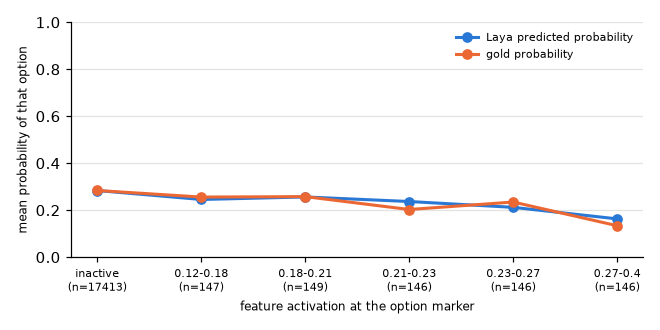

# Feature 4798

Critérios em que aparece: corr_probe_right_laya_wrong_stratified

**Interpretação (preencher):** 

---

## Maiores ativações

**tr_customer_service_000207 / urgency** (score, customer_service) | ativação 3.740 em `estado` | opções ['0', '1', '2', '3'] | Laya: **3** [0.082, 0.322, 0.197, 0.398] | gabarito: **3**

```
<bos> score question: How time-sensitive is this conversation?<eos>
▸ <mask> level 0: No time pressure; can wait indefinitely.
▸ <mask> level 1: Routine; handle within the normal queue.
▸ <mask> level 2: Elevated; should be handled within the same week.
▸ <mask> level 3: Critical; requires action within the same day.

<eos>

 {"account": {"lifetime_value_usd": 17, "prior_tickets_90d": 0, "seats": 1, "tenure_months": 1, "tier": "premium"}, "orders": [{"amount_usd": 149, "date":⟦ "⟧2026-01-08", "id": "A-46380", "status": "settled"}], "thread": [{"role": "customer", "text": "I thought I could switch to the Basic plan, but my account still shows I'm on Premium and I'm being charged $149. I'm not sure what's happening."}, {"role": "agent", "text": "I’m sorry for the mix‑up. Just to double‑check, could you tell me the email address linked to your account and when you tried to make the change?"}, {"role": "customer", "text": "The email is jane.doe@example.com. I clicked the downgrade button in the dashboard yesterday evening, after being on Premium for a month."}, {"role": "agent", "text": "Got it, thank you. I see the downgrade request in the system, but it looks like the change didn’t finish processing. Have you received any confirmation email about the downgrade?"}, {"role": "customer", "text": "No, I didn’t get any email. The dashboard still says Premium, and my next payment of $149 is scheduled for tomorrow."}, {"role": "agent", "text": "Understood. I’ll look into why the request got stuck. Could you let me know if you made the change from a mobile app or the web portal?"}, {"role": "customer", "text": "I used the web portal on Chrome. I’m just hoping this can be sorted before the next charge hits."}]}<eos>
```

**tr_customer_service_000207 / churn_risk** (score, customer_service) | ativação 3.729 em `estado` | opções ['0', '1', '2', '3'] | Laya: **1** [0.145, 0.553, 0.174, 0.127] | gabarito: **2**

```
<bos> score question: How likely is this customer to stop doing business with us because of this interaction?<eos>
▸ <mask> level 0: No sign of dissatisfaction.
▸ <mask> level 1: Mild frustration, but the relationship is intact.
▸ <mask> level 2: Clearly unhappy; repeat problems or explicit complaints.
▸ <mask> level 3: Imminent: threatening to cancel, dispute or leave.

<eos>

 {"account": {"lifetime_value_usd": 17, "prior_tickets_90d": 0, "seats": 1, "tenure_months": 1, "tier": "premium"}, "orders": [{"amount_usd": 149, "date":⟦ "⟧2026-01-08", "id": "A-46380", "status": "settled"}], "thread": [{"role": "customer", "text": "I thought I could switch to the Basic plan, but my account still shows I'm on Premium and I'm being charged $149. I'm not sure what's happening."}, {"role": "agent", "text": "I’m sorry for the mix‑up. Just to double‑check, could you tell me the email address linked to your account and when you tried to make the change?"}, {"role": "customer", "text": "The email is jane.doe@example.com. I clicked the downgrade button in the dashboard yesterday evening, after being on Premium for a month."}, {"role": "agent", "text": "Got it, thank you. I see the downgrade request in the system, but it looks like the change didn’t finish processing. Have you received any confirmation email about the downgrade?"}, {"role": "customer", "text": "No, I didn’t get any email. The dashboard still says Premium, and my next payment of $149 is scheduled for tomorrow."}, {"role": "agent", "text": "Understood. I’ll look into why the request got stuck. Could you let me know if you made the change from a mobile app or the web portal?"}, {"role": "customer", "text": "I used the web portal on Chrome. I’m just hoping this can be sorted before the next charge hits."}]}<eos>
```

**tr_customer_service_000207 / action** (choice, customer_service) | ativação 3.701 em `estado` | opções ['answer_directly', 'close_no_action', 'escalate_to_human', 'execute_refund', 'request_information'] | Laya: **close_no_action** [0.256, 0.671, 0.015, 0.055, 0.003] | gabarito: **escalate_to_human**

```
<bos> choice question: What should the assistant do next with this conversation?<eos>
▸ <mask> answer_directly: The assistant can resolve this itself with information it already has.
▸ <mask> close_no_action: No further action is warranted; the matter is settled.
▸ <mask> escalate_to_human: Hand off to a human agent with the appropriate authority.
▸ <mask> execute_refund: Issue the refund or credit the customer is owed.
▸ <mask> request_information: More detail is needed from the customer before anything can be done.

<eos>

 {"account": {"lifetime_value_usd": 17, "prior_tickets_90d": 0, "seats": 1, "tenure_months": 1, "tier": "premium"}, "orders": [{"amount_usd": 149, "date":⟦ "⟧2026-01-08", "id": "A-46380", "status": "settled"}], "thread": [{"role": "customer", "text": "I thought I could switch to the Basic plan, but my account still shows I'm on Premium and I'm being charged $149. I'm not sure what's happening."}, {"role": "agent", "text": "I’m sorry for the mix‑up. Just to double‑check, could you tell me the email address linked to your account and when you tried to make the change?"}, {"role": "customer", "text": "The email is jane.doe@example.com. I clicked the downgrade button in the dashboard yesterday evening, after being on Premium for a month."}, {"role": "agent", "text": "Got it, thank you. I see the downgrade request in the system, but it looks like the change didn’t finish processing. Have you received any confirmation email about the downgrade?"}, {"role": "customer", "text": "No, I didn’t get any email. The dashboard still says Premium, and my next payment of $149 is scheduled for tomorrow."}, {"role": "agent", "text": "Understood. I’ll look into why the request got stuck. Could you let me know if you made the change from a mobile app or the web portal?"}, {"role": "customer", "text": "I used the web portal on Chrome. I’m just hoping this can be sorted before the next charge hits."}]}<eos>
```

**tr_customer_service_000207 / needs_human** (noul, customer_service) | ativação 3.699 em `estado` | opções ['false', 'true'] | Laya: **false** [0.654, 0.346] | gabarito: **true**

```
<bos> noul question: This conversation requires a human agent rather than automated handling.<eos>
▸ <mask> false: Automation can carry this to resolution.
▸ <mask> true: A human must take over: judgement, authority or empathy is required.

<eos>

 {"account": {"lifetime_value_usd": 17, "prior_tickets_90d": 0, "seats": 1, "tenure_months": 1, "tier": "premium"}, "orders": [{"amount_usd": 149, "date":⟦ "⟧2026-01-08", "id": "A-46380", "status": "settled"}], "thread": [{"role": "customer", "text": "I thought I could switch to the Basic plan, but my account still shows I'm on Premium and I'm being charged $149. I'm not sure what's happening."}, {"role": "agent", "text": "I’m sorry for the mix‑up. Just to double‑check, could you tell me the email address linked to your account and when you tried to make the change?"}, {"role": "customer", "text": "The email is jane.doe@example.com. I clicked the downgrade button in the dashboard yesterday evening, after being on Premium for a month."}, {"role": "agent", "text": "Got it, thank you. I see the downgrade request in the system, but it looks like the change didn’t finish processing. Have you received any confirmation email about the downgrade?"}, {"role": "customer", "text": "No, I didn’t get any email. The dashboard still says Premium, and my next payment of $149 is scheduled for tomorrow."}, {"role": "agent", "text": "Understood. I’ll look into why the request got stuck. Could you let me know if you made the change from a mobile app or the web portal?"}, {"role": "customer", "text": "I used the web portal on Chrome. I’m just hoping this can be sorted before the next charge hits."}]}<eos>
```

**tr_customer_service_000141 / churn_risk** (score, customer_service) | ativação 3.678 em `estado` | opções ['0', '1', '2', '3'] | Laya: **2** [0.056, 0.178, 0.688, 0.078] | gabarito: **2**

```
<bos> score question: How likely is this customer to stop doing business with us because of this interaction?<eos>
▸ <mask> level 0: No sign of dissatisfaction.
▸ <mask> level 1: Mild frustration, but the relationship is intact.
▸ <mask> level 2: Clearly unhappy; repeat problems or explicit complaints.
▸ <mask> level 3: Imminent: threatening to cancel, dispute or leave.

<eos>

 {"account": {"lifetime_value_usd": 225, "prior_tickets_90d": 5, "seats": 1, "tenure_months": 3, "tier": "standard"}, "orders": [{"amount_usd": 297, "date":⟦ "⟧2026-01-07", "id": "A-98625", "status": "pending"}], "thread": [{"role": "customer", "text": "My service has been running significantly slower than usual over the last week, even though I'm paying $297 monthly."}, {"role": "agent", "text": "I am sorry to hear you are experiencing latency issues. Could you please run a speed test and share the results with me so I can review your connection logs?"}, {"role": "customer", "text": "I've already run three tests and they show speeds are at 10% of what I'm promised. I've logged five tickets about this already with no progress."}]}<eos>
```

## Ativações medianas (faixa 40-60%, mediana 0.643)

**tr_customer_service_000113 / action** (choice, customer_service) | ativação 0.621 em `estado` | opções ['answer_directly', 'close_no_action', 'escalate_to_human', 'execute_refund', 'request_information'] | Laya: **answer_directly** [0.419, 0.196, 0.091, 0.264, 0.029] | gabarito: **answer_directly**

```
<bos> choice question: What should the assistant do next with this conversation?<eos>
▸ <mask> answer_directly: The assistant can resolve this itself with information it already has.
▸ <mask> close_no_action: No further action is warranted; the matter is settled.
▸ <mask> escalate_to_human: Hand off to a human agent with the appropriate authority.
▸ <mask> execute_refund: Issue the refund or credit the customer is owed.
▸ <mask> request_information: More detail is needed from the customer before anything can be done.

<eos>

 {"account": {"lifetime_value_usd": 47⟦,⟧ "prior_tickets_90d": 0, "seats": 1, "tenure_months": 1, "tier": "standard"}, "orders": [{"amount_usd": 87, "date": "2026-01-11", "id": "A-32698", "status": "settled"}, {"amount_usd": 87, "date": "2026-03-25", "id": "A-92735", "status": "refunded"}], "thread": [{"role": "customer", "text": "Hi there! I've been using the standard plan for about a month now and I really enjoy the interface, but I've noticed the page load times are getting quite slow today. Is there anything I should check on my end?"}, {"role": "agent", "text": "Welcome to the platform! I'd be happy to help you look into those load times. Are you experiencing this slowness on all pages, or is it specifically when you try to generate reports?"}, {"role": "customer", "text": "It seems to be happening everywhere, especially when I try to save my work. I paid $87 for this month and I have a very important hard deadline this evening, so I'm a bit worried about getting everything finished in time."}, {"role": "agent", "text": "I understand the importance of meeting your deadline. Could you tell me which web browser you are currently using and if you have tried clearing your cache recently?"}, {"role": "customer", "text": "I'm using the latest version of Chrome and I did try clearing the cache, but the lag persists. I really need to have this project submitted by 5:00 PM today, so any guidance on how to speed things up would be greatly appreciated."}]}<eos>
```

**tr_invoice_processing_000294 / duplicate** (noul, invoice_processing) | ativação 0.603 em `estado` | opções ['false', 'true'] | Laya: **true** [0.076, 0.924] | gabarito: **false**

```
<bos> noul question: This invoice appears to duplicate an invoice already submitted.<eos>
▸ <mask> false: no, the statement does not hold
▸ <mask> true: yes, the statement holds

<eos>

 {"delivery": {"condition": "accepted with exceptions",⟦ "⟧date": "2026-03-02", "received_qty": 100}, "invoice": {"currency": "USD", "id": "INV-2026-3359", "lines": [{"qty": 120, "sku": "SKU-891", "total_usd": 49472.4, "unit_usd": 412.27}], "total_usd": 49472.4, "vendor": "Northwind Components"}, "payment": {"days_until_due": -9, "discount_expires_in_days": null, "early_payment_discount_pct": null, "status": "overdue", "terms": "net 30"}, "purchase_order": {"freight_terms": "freight prepaid by vendor, not separately billable", "id": "PO-3955", "lines": [{"qty": 100, "unit_usd": 412.27}], "total_usd": 41227.0}, "vendor_history": {"disputes_12m": 0, "invoices_12m": 13, "prior_invoice_ids": ["INV-2026-2480", "INV-2026-4309"]}}<eos>
```

**tr_security_incidents_000260 / disposition** (choice, security_incidents) | ativação 0.701 em `estado` | opções ['close_benign', 'contain', 'investigate', 'monitor'] | Laya: **monitor** [0.123, 0.172, 0.041, 0.664] | gabarito: **monitor**

```
<bos> choice question: How should this security alert be dispositioned?<eos>
▸ <mask> close_benign: Expected, explainable activity; close without analyst time.
▸ <mask> contain: Contain the host or account immediately; do not wait for triage.
▸ <mask> investigate: Warrants an analyst opening an investigation.
▸ <mask> monitor: Not clearly malicious, but worth watching for recurrence.

<eos>

 {"alert": {"description": "a long-unused account became active", "evidence": "A privileged admin account admin_backup logged in from IP 203.0.113.45⟦ to⟧ server 10.0.0.12 at 2026-09-15T08:45:12Z, marking its first activity since the last successful login on 2024-01-01. The account has MFA enabled, its credentials were last rotated 412 days ago, and the authentication request originated from an allowlisted source.", "rule": "dormant_account_use"}, "context": {"asset_criticality": "low", "change_window_active": false, "source_on_allowlist": true}, "history": {"credential_rotation_days_ago": 412, "distinct_countries_30d": 2, "logins_30d": 1352, "prior_alerts_90d": 0}, "principal": {"mfa_enrolled": true, "name": "svc-support-134", "privileges": ["deploy:production", "secrets:read"], "type": "admin"}}<eos>
```

**tr_invoice_processing_000239 / matches_order** (noul, invoice_processing) | ativação 0.697 em `estado` | opções ['false', 'true'] | Laya: **true** [0.038, 0.962] | gabarito: **true**

```
<bos> noul question: The invoice reconciles with the purchase order and the recorded delivery.<eos>
▸ <mask> false: There is a discrepancy against the order or the delivery.
▸ <mask> true: Line items, quantities and amounts reconcile.

<eos>

 {"delivery": {"condition": "accepted with exceptions",⟦ "⟧date": "2026-03-09", "received_qty": 25}, "invoice": {"currency": "USD", "id": "INV-2026-6058", "lines": [{"qty": 25, "sku": "SKU-229", "total_usd": 10799.0, "unit_usd": 431.96}], "total_usd": 10799.0, "vendor": "Kestrel Supply"}, "payment": {"days_until_due": -3, "discount_expires_in_days": null, "early_payment_discount_pct": null, "status": "overdue", "terms": "net 15"}, "purchase_order": {"freight_terms": "freight prepaid by vendor, not separately billable", "id": "PO-3159", "lines": [{"qty": 25, "unit_usd": 431.96}], "total_usd": 10799.0}, "vendor_history": {"disputes_12m": 2, "invoices_12m": 2, "prior_invoice_ids": ["INV-2026-6719", "INV-2026-4543", "INV-2026-1306"]}}<eos>
```

**tr_invoice_processing_000051 / disposition** (choice, invoice_processing) | ativação 0.683 em `estado` | opções ['approve', 'hold', 'manual_review', 'reject'] | Laya: **reject** [0.39, 0.045, 0.017, 0.548] | gabarito: **manual_review**

```
<bos> choice question: How should this vendor invoice be dispositioned?<eos>
▸ <mask> approve: Matches the order and delivery; approve for payment.
▸ <mask> hold: Something needs confirming before payment; hold pending clarification.
▸ <mask> manual_review: A human in finance must review the discrepancy.
▸ <mask> reject: Should not be paid: duplicate, unauthorised or materially wrong.

<eos>

 {"delivery": {"condition": "accepted⟦",⟧ "date": "2026-03-21", "received_qty": 50}, "invoice": {"currency": "USD", "id": "INV-2026-9184", "lines": [{"qty": 50, "sku": "SKU-942", "total_usd": 13431.0, "unit_usd": 268.62}, {"qty": 1, "sku": "FREIGHT", "total_usd": 826.36, "unit_usd": 826.36}], "total_usd": 14257.36, "vendor": "Vantage Materials"}, "payment": {"days_until_due": 2, "discount_expires_in_days": 5, "early_payment_discount_pct": 2.0, "status": "scheduled", "terms": "net 45"}, "purchase_order": {"freight_terms": "freight prepaid by vendor, not separately billable", "id": "PO-3229", "lines": [{"qty": 50, "unit_usd": 268.62}], "total_usd": 13431.0}, "vendor_history": {"disputes_12m": 1, "invoices_12m": 20, "prior_invoice_ids": ["INV-2026-5102", "INV-2026-3057"]}}<eos>
```

## Estatísticas (conjunto de descoberta, dev e teste)

**pred / error**

| split | decisões | ativas | ativas e Laya errou | taxa | lift | q (BH) | OR (CMH) | q (CMH) |
|---|---|---|---|---|---|---|---|---|
| discovery | 5100 | 167 | 118 | 0.707 | 1.10 | 0.136 | 1.25 | 0.561 |
| dev | 900 | 23 | 14 | 0.609 | 0.91 | 0.781 | 0.57 | 0.729 |
| test | 2000 | 51 | 30 | 0.588 | 0.90 | 0.502 | 0.60 | 0.423 |

**corr / error**

| split | decisões | ativas | ativas e Laya errou | taxa | lift | q (BH) | OR (CMH) | q (CMH) |
|---|---|---|---|---|---|---|---|---|
| discovery | 5100 | 161 | 112 | 0.696 | 1.08 | 0.223 | 1.84 | 0.0198 |
| dev | 900 | 21 | 12 | 0.571 | 0.85 | 0.579 | 0.52 | 0.704 |
| test | 2000 | 53 | 32 | 0.604 | 0.93 | 0.608 | 0.99 | 0.976 |

**state / error**

| split | decisões | ativas | ativas e Laya errou | taxa | lift | q (BH) | OR (CMH) | q (CMH) |
|---|---|---|---|---|---|---|---|---|
| discovery | 5100 | 4415 | 2758 | 0.625 | 0.97 | 7.45e-12 | 0.78 | 0.268 |
| dev | 900 | 786 | 521 | 0.663 | 0.99 | 0.432 | 1.03 | 0.978 |
| test | 2000 | 1739 | 1107 | 0.637 | 0.98 | 0.0166 | 0.76 | 0.526 |

**pred / probe_right_laya_wrong**

| split | decisões | ativas | ativas e Laya errou | taxa | lift | q (BH) | OR (CMH) | q (CMH) |
|---|---|---|---|---|---|---|---|---|
| discovery | 2819 | 67 | 48 | 0.716 | 1.11 | 0.321 | 1.38 | 0.522 |
| dev | 520 | 10 | 7 | 0.700 | 1.04 | nan | nan | nan |
| test | 1106 | 19 | 11 | 0.579 | 0.91 | nan | nan | nan |

**corr / probe_right_laya_wrong**

| split | decisões | ativas | ativas e Laya errou | taxa | lift | q (BH) | OR (CMH) | q (CMH) |
|---|---|---|---|---|---|---|---|---|
| discovery | 2819 | 80 | 61 | 0.762 | 1.18 | 0.0438 | 2.60 | 0.0497 |
| dev | 520 | 10 | 7 | 0.700 | 1.04 | nan | nan | nan |
| test | 1106 | 28 | 20 | 0.714 | 1.13 | 0.543 | 1.46 | 0.775 |

**state / probe_right_laya_wrong**

| split | decisões | ativas | ativas e Laya errou | taxa | lift | q (BH) | OR (CMH) | q (CMH) |
|---|---|---|---|---|---|---|---|---|
| discovery | 2819 | 2490 | 1563 | 0.628 | 0.97 | 1.74e-08 | 0.97 | 0.95 |
| dev | 520 | 464 | 305 | 0.657 | 0.97 | 0.149 | 0.68 | 0.671 |
| test | 1106 | 995 | 614 | 0.617 | 0.97 | 0.0117 | 0.82 | 0.769 |

Confusão mais sobre-representada (pred): `urgency|3>2` (n=17, lift 9.80, p=2.95e-13). Formato `pergunta|índice previsto>índice correto`.

Confusão mais sobre-representada (corr): `urgency|1>3` (n=43, lift 9.02, p=6.33e-31). Formato `pergunta|índice previsto>índice correto`.

Confusão mais sobre-representada (state): `duplicate|1>0` (n=217, lift 1.16, p=1.22e-14). Formato `pergunta|índice previsto>índice correto`.



