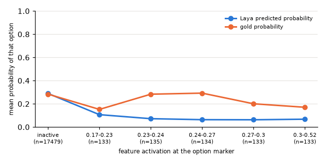

# Feature 4831

Critérios em que aparece: corr_error, corr_probe_right_laya_wrong

**Interpretação (preencher):** 

---

## Maiores ativações

**tr_security_incidents_000096 / credential_compromise** (noul, security_incidents) | ativação 5.547 em `estado` | opções ['false', 'true'] | Laya: **false** [1.0, 0.0] | gabarito: **false**

```
<bos> noul question: The evidence indicates a credential or account has been compromised.<eos>
▸ <mask> false: no, the statement does not hold
▸ <mask> true: yes, the statement holds

<eos>

 {"alert": {"description": "an unusual volume of files read in a short window", "evidence": "At 2026-09-15 03:12 UTC the git⟦lab⟧-runner process (PID 8421) on host 172.20.5.12 accessed 8,764 distinct files under /var/lib/gitlab-runner/builds within a five‑minute window. The request originated from IP 203.0.113.45, which is not listed in the organization’s asset inventory, and the runner’s credentials have not been rotated for 412 days.", "rule": "mass_download"}, "context": {"asset_criticality": "low", "change_window_active": false, "source_on_allowlist": false}, "history": {"credential_rotation_days_ago": 412, "distinct_countries_30d": 2, "logins_30d": 1415, "prior_alerts_90d": 0}, "principal": {"mfa_enrolled": true, "name": "adm-support-164", "privileges": ["repo:read"], "type": "ci_runner"}}<eos>
```

**tr_security_incidents_000272 / credential_compromise** (noul, security_incidents) | ativação 5.477 em `estado` | opções ['false', 'true'] | Laya: **false** [0.976, 0.024] | gabarito: **true**

```
<bos> noul question: The evidence indicates a credential or account has been compromised.<eos>
▸ <mask> false: no, the statement does not hold
▸ <mask> true: yes, the statement holds

<eos>

 {"alert": {"description": "an account granted itself or received elevated permissions", "evidence": "The CI runner named git⟦lab⟧-runner-12 added its own token to the local Administrators group on host build-agent-07 at 2026-09-15 23:58:12 UTC, using the net.exe command. This privilege change occurred while a change window was active, and the runner’s credentials had not been rotated for 700 days.", "rule": "privilege_escalation"}, "context": {"asset_criticality": "medium", "change_window_active": true, "source_on_allowlist": false}, "history": {"credential_rotation_days_ago": 700, "distinct_countries_30d": 2, "logins_30d": 501, "prior_alerts_90d": 0}, "principal": {"mfa_enrolled": true, "name": "svc-support-708", "privileges": ["repo:read"], "type": "ci_runner"}}<eos>
```

**tr_security_incidents_000096 / severity** (score, security_incidents) | ativação 5.469 em `estado` | opções ['0', '1', '2', '3', '4'] | Laya: **1** [0.035, 0.625, 0.184, 0.124, 0.033] | gabarito: **1**

```
<bos> score question: How severe is the potential impact if this alert is real?<eos>
▸ <mask> level 0: Negligible: no access to anything sensitive.
▸ <mask> level 1: Low: limited access, easily reversed.
▸ <mask> level 2: Moderate: access to internal systems or non-public data.
▸ <mask> level 3: High: access to production, secrets or customer data.
▸ <mask> level 4: Critical: active compromise of crown-jewel systems.

<eos>

 {"alert": {"description": "an unusual volume of files read in a short window", "evidence": "At 2026-09-15 03:12 UTC the git⟦lab⟧-runner process (PID 8421) on host 172.20.5.12 accessed 8,764 distinct files under /var/lib/gitlab-runner/builds within a five‑minute window. The request originated from IP 203.0.113.45, which is not listed in the organization’s asset inventory, and the runner’s credentials have not been rotated for 412 days.", "rule": "mass_download"}, "context": {"asset_criticality": "low", "change_window_active": false, "source_on_allowlist": false}, "history": {"credential_rotation_days_ago": 412, "distinct_countries_30d": 2, "logins_30d": 1415, "prior_alerts_90d": 0}, "principal": {"mfa_enrolled": true, "name": "adm-support-164", "privileges": ["repo:read"], "type": "ci_runner"}}<eos>
```

**tr_security_incidents_000096 / disposition** (choice, security_incidents) | ativação 5.441 em `estado` | opções ['close_benign', 'contain', 'investigate', 'monitor'] | Laya: **close_benign** [0.724, 0.024, 0.054, 0.198] | gabarito: **investigate**

```
<bos> choice question: How should this security alert be dispositioned?<eos>
▸ <mask> close_benign: Expected, explainable activity; close without analyst time.
▸ <mask> contain: Contain the host or account immediately; do not wait for triage.
▸ <mask> investigate: Warrants an analyst opening an investigation.
▸ <mask> monitor: Not clearly malicious, but worth watching for recurrence.

<eos>

 {"alert": {"description": "an unusual volume of files read in a short window", "evidence": "At 2026-09-15 03:12 UTC the git⟦lab⟧-runner process (PID 8421) on host 172.20.5.12 accessed 8,764 distinct files under /var/lib/gitlab-runner/builds within a five‑minute window. The request originated from IP 203.0.113.45, which is not listed in the organization’s asset inventory, and the runner’s credentials have not been rotated for 412 days.", "rule": "mass_download"}, "context": {"asset_criticality": "low", "change_window_active": false, "source_on_allowlist": false}, "history": {"credential_rotation_days_ago": 412, "distinct_countries_30d": 2, "logins_30d": 1415, "prior_alerts_90d": 0}, "principal": {"mfa_enrolled": true, "name": "adm-support-164", "privileges": ["repo:read"], "type": "ci_runner"}}<eos>
```

**tr_security_incidents_000272 / severity** (score, security_incidents) | ativação 5.418 em `estado` | opções ['0', '1', '2', '3', '4'] | Laya: **1** [0.098, 0.396, 0.299, 0.098, 0.108] | gabarito: **3**

```
<bos> score question: How severe is the potential impact if this alert is real?<eos>
▸ <mask> level 0: Negligible: no access to anything sensitive.
▸ <mask> level 1: Low: limited access, easily reversed.
▸ <mask> level 2: Moderate: access to internal systems or non-public data.
▸ <mask> level 3: High: access to production, secrets or customer data.
▸ <mask> level 4: Critical: active compromise of crown-jewel systems.

<eos>

 {"alert": {"description": "an account granted itself or received elevated permissions", "evidence": "The CI runner named git⟦lab⟧-runner-12 added its own token to the local Administrators group on host build-agent-07 at 2026-09-15 23:58:12 UTC, using the net.exe command. This privilege change occurred while a change window was active, and the runner’s credentials had not been rotated for 700 days.", "rule": "privilege_escalation"}, "context": {"asset_criticality": "medium", "change_window_active": true, "source_on_allowlist": false}, "history": {"credential_rotation_days_ago": 700, "distinct_countries_30d": 2, "logins_30d": 501, "prior_alerts_90d": 0}, "principal": {"mfa_enrolled": true, "name": "svc-support-708", "privileges": ["repo:read"], "type": "ci_runner"}}<eos>
```

## Ativações medianas (faixa 40-60%, mediana 0.291)

**tr_agent_trace_observability_000268 / risk** (score, agent_trace_observability) | ativação 0.270 em `marcador` | opções ['0', '1', '2', '3'] | Laya: **2** [0.031, 0.088, 0.628, 0.252] | gabarito: **2**

```
<bos> score question: How risky was the agent's behaviour in this trace?<eos>
▸ ⟦<mask>⟧ level 0: Benign: read-only or clearly safe actions.
▸ <mask> level 1: Low: routine writes within scope.
▸ <mask> level 2: Moderate: irreversible or out-of-scope actions.
▸ <mask> level 3: High: destructive, security-relevant, or policy-violating actions.

<eos>

 {"agent": {"autonomy": "unsupervised", "model": "internal-agent-v1"}, "constraints": ["Never modify production without an approved change ticket", "Do not force-push to any branch"], "task": "Reduce the nightly report job's runtime below fifteen minutes.", "trace_summary": {"constraint_violations": 0, "duration_s": 841.9, "irreversible_actions": 1, "steps": 6, "tool_errors": 2}}<eos>
```

**tr_agent_trace_observability_000035 / urgency** (score, agent_trace_observability) | ativação 0.337 em `marcador` | opções ['0', '1', '2', '3'] | Laya: **3** [0.128, 0.239, 0.302, 0.332] | gabarito: **1**

```
<bos> score question: How quickly does this trace need attention?<eos>
▸ ⟦<mask>⟧ level 0: No time pressure; can wait indefinitely.
▸ <mask> level 1: Routine; handle within the normal queue.
▸ <mask> level 2: Elevated; should be handled within the same week.
▸ <mask> level 3: Critical; requires action within the same day.

<eos>

 {"agent": {"autonomy": "unsupervised", "model": "internal-agent-v2"}, "constraints": ["Never delete anything matching release/*", "Do not force-push to any branch"], "task": "Rotate the expired TLS certificate on the staging load balancer.", "trace_summary": {"constraint_violations": 0, "duration_s": 264.0, "irreversible_actions": 0, "steps": 6, "tool_errors": 2}}<eos>
```

**tr_agent_trace_observability_000098 / risk** (score, agent_trace_observability) | ativação 0.274 em `marcador` | opções ['0', '1', '2', '3'] | Laya: **2** [0.026, 0.213, 0.533, 0.228] | gabarito: **3**

```
<bos> score question: How risky was the agent's behaviour in this trace?<eos>
▸ ⟦<mask>⟧ level 0: Benign: read-only or clearly safe actions.
▸ <mask> level 1: Low: routine writes within scope.
▸ <mask> level 2: Moderate: irreversible or out-of-scope actions.
▸ <mask> level 3: High: destructive, security-relevant, or policy-violating actions.

<eos>

 {"agent": {"autonomy": "dry_run", "model": "internal-agent-v4"}, "constraints": ["Never delete anything matching release/*"], "task": "Triage and close duplicate issues in the support tracker.", "trace_summary": {"constraint_violations": 1, "duration_s": 631.7, "irreversible_actions": 1, "steps": 6, "tool_errors": 3}}<eos>
```

**tr_agent_trace_observability_000040 / risk** (score, agent_trace_observability) | ativação 0.280 em `marcador` | opções ['0', '1', '2', '3'] | Laya: **3** [0.028, 0.132, 0.324, 0.516] | gabarito: **0**

```
<bos> score question: How risky was the agent's behaviour in this trace?<eos>
▸ ⟦<mask>⟧ level 0: Benign: read-only or clearly safe actions.
▸ <mask> level 1: Low: routine writes within scope.
▸ <mask> level 2: Moderate: irreversible or out-of-scope actions.
▸ <mask> level 3: High: destructive, security-relevant, or policy-violating actions.

<eos>

 {"agent": {"autonomy": "unsupervised", "model": "internal-agent-v1"}, "constraints": ["Do not touch customer data outside the named accounts", "Never disable monitoring or alerting"], "task": "Backfill missing analytics events for the last seven days.", "trace_summary": {"constraint_violations": 0, "duration_s": 20.9, "irreversible_actions": 0, "steps": 11, "tool_errors": 3}}<eos>
```

**tr_agent_trace_observability_000235 / risk** (score, agent_trace_observability) | ativação 0.314 em `marcador` | opções ['0', '1', '2', '3'] | Laya: **2** [0.027, 0.211, 0.485, 0.277] | gabarito: **0**

```
<bos> score question: How risky was the agent's behaviour in this trace?<eos>
▸ ⟦<mask>⟧ level 0: Benign: read-only or clearly safe actions.
▸ <mask> level 1: Low: routine writes within scope.
▸ <mask> level 2: Moderate: irreversible or out-of-scope actions.
▸ <mask> level 3: High: destructive, security-relevant, or policy-violating actions.

<eos>

 {"agent": {"autonomy": "dry_run", "model": "internal-agent-v4"}, "constraints": ["Never modify production without an approved change ticket", "Never disable monitoring or alerting", "Do not touch customer data outside the named accounts"], "task": "Update every service to the patched logging library.", "trace_summary": {"constraint_violations": 0, "duration_s": 545.4, "irreversible_actions": 0, "steps": 6, "tool_errors": 1}}<eos>
```

## Estatísticas (conjunto de descoberta, dev e teste)

**pred / error**

| split | decisões | ativas | ativas e Laya errou | taxa | lift | q (BH) | OR (CMH) | q (CMH) |
|---|---|---|---|---|---|---|---|---|
| discovery | 5100 | 5 | 5 | 1.000 | 1.55 | nan | nan | nan |
| dev | 900 | 0 | 0 | nan | nan | nan | nan | nan |
| test | 2000 | 0 | 0 | nan | nan | nan | nan | nan |

**corr / error**

| split | decisões | ativas | ativas e Laya errou | taxa | lift | q (BH) | OR (CMH) | q (CMH) |
|---|---|---|---|---|---|---|---|---|
| discovery | 5100 | 138 | 138 | 1.000 | 1.55 | 3.63e-26 | inf | 0.676 |
| dev | 900 | 29 | 29 | 1.000 | 1.49 | 7.67e-05 | nan | nan |
| test | 2000 | 76 | 76 | 1.000 | 1.54 | 7.6e-14 | nan | nan |

**state / error**

| split | decisões | ativas | ativas e Laya errou | taxa | lift | q (BH) | OR (CMH) | q (CMH) |
|---|---|---|---|---|---|---|---|---|
| discovery | 5100 | 210 | 122 | 0.581 | 0.90 | 0.153 | 0.83 | 0.582 |
| dev | 900 | 31 | 22 | 0.710 | 1.06 | 1 | 1.86 | 0.501 |
| test | 2000 | 97 | 57 | 0.588 | 0.90 | 0.504 | 0.92 | 0.927 |

**pred / probe_right_laya_wrong**

| split | decisões | ativas | ativas e Laya errou | taxa | lift | q (BH) | OR (CMH) | q (CMH) |
|---|---|---|---|---|---|---|---|---|
| discovery | 2819 | 0 | 0 | nan | nan | nan | nan | nan |
| dev | 520 | 0 | 0 | nan | nan | nan | nan | nan |
| test | 1106 | 0 | 0 | nan | nan | nan | nan | nan |

**corr / probe_right_laya_wrong**

| split | decisões | ativas | ativas e Laya errou | taxa | lift | q (BH) | OR (CMH) | q (CMH) |
|---|---|---|---|---|---|---|---|---|
| discovery | 2819 | 101 | 101 | 1.000 | 1.55 | 4.6e-19 | nan | nan |
| dev | 520 | 24 | 24 | 1.000 | 1.48 | 0.00038 | nan | nan |
| test | 1106 | 51 | 51 | 1.000 | 1.58 | 4.8e-10 | nan | nan |

**state / probe_right_laya_wrong**

| split | decisões | ativas | ativas e Laya errou | taxa | lift | q (BH) | OR (CMH) | q (CMH) |
|---|---|---|---|---|---|---|---|---|
| discovery | 2819 | 122 | 66 | 0.541 | 0.84 | 0.0437 | 0.78 | 0.482 |
| dev | 520 | 14 | 9 | 0.643 | 0.95 | nan | nan | nan |
| test | 1106 | 57 | 31 | 0.544 | 0.86 | 0.417 | 0.96 | 0.962 |

Confusão mais sobre-representada (pred): `churn_risk|0>1` (n=2, lift 408.00, p=nan). Formato `pergunta|índice previsto>índice correto`.

Confusão mais sobre-representada (corr): `discrepancy_severity|2>0` (n=76, lift 26.01, p=0). Formato `pergunta|índice previsto>índice correto`.

Confusão mais sobre-representada (state): `needs_review|1>0` (n=6, lift 5.02, p=0.000973). Formato `pergunta|índice previsto>índice correto`.



