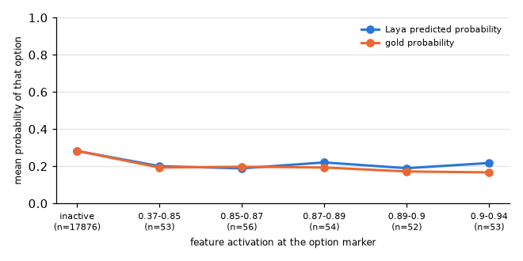

# Feature 4867

Critérios em que aparece: corr_error_stratified

**Interpretação (preencher):** 

---

## Maiores ativações

**tr_customer_service_000076 / needs_human** (noul, customer_service) | ativação 2.943 em `estado` | opções ['false', 'true'] | Laya: **true** [0.067, 0.933] | gabarito: **true**

```
<bos> noul question: This conversation requires a human agent rather than automated handling.<eos>
▸ <mask> false: Automation can carry this to resolution.
▸ <mask> true: A human must take over: judgement, authority or empathy is required.

<eos>

 {"account": {"lifetime_value_usd": 2408, "prior_tickets_90d": 1, "seats": 1, "tenure_months": 72, "tier": "standard"}, "orders": [{"amount_usd": 298, "date": "2026-02-13", "id": "A-26883", "status": "refunded"}, {"amount_usd": 298, "date": "2026-02-21", "id": "A-47417", "status": "failed"}], "thread": [{"role": "customer", "text": "I’ve been paying for the standard plan for six years now, yet my $298 order is nowhere⟦ to⟧ be found. This delivery is late again, just like the last issue I had to open a ticket for."}, {"role": "agent", "text": "I see your history with us and I'm sorry to hear that this delivery is experiencing a delay. Could you please provide your order number so I can take a look at the current status?"}, {"role": "customer", "text": "It’s #99284. I don't care what you see in the system, I just want to know where my stuff is since it clearly didn't arrive when it was supposed to."}]}<eos>
```

**tr_customer_service_000076 / churn_risk** (score, customer_service) | ativação 2.924 em `estado` | opções ['0', '1', '2', '3'] | Laya: **2** [0.115, 0.371, 0.428, 0.086] | gabarito: **2**

```
<bos> score question: How likely is this customer to stop doing business with us because of this interaction?<eos>
▸ <mask> level 0: No sign of dissatisfaction.
▸ <mask> level 1: Mild frustration, but the relationship is intact.
▸ <mask> level 2: Clearly unhappy; repeat problems or explicit complaints.
▸ <mask> level 3: Imminent: threatening to cancel, dispute or leave.

<eos>

 {"account": {"lifetime_value_usd": 2408, "prior_tickets_90d": 1, "seats": 1, "tenure_months": 72, "tier": "standard"}, "orders": [{"amount_usd": 298, "date": "2026-02-13", "id": "A-26883", "status": "refunded"}, {"amount_usd": 298, "date": "2026-02-21", "id": "A-47417", "status": "failed"}], "thread": [{"role": "customer", "text": "I’ve been paying for the standard plan for six years now, yet my $298 order is nowhere⟦ to⟧ be found. This delivery is late again, just like the last issue I had to open a ticket for."}, {"role": "agent", "text": "I see your history with us and I'm sorry to hear that this delivery is experiencing a delay. Could you please provide your order number so I can take a look at the current status?"}, {"role": "customer", "text": "It’s #99284. I don't care what you see in the system, I just want to know where my stuff is since it clearly didn't arrive when it was supposed to."}]}<eos>
```

**tr_customer_service_000180 / action** (choice, customer_service) | ativação 2.838 em `estado` | opções ['answer_directly', 'close_no_action', 'escalate_to_human', 'execute_refund', 'request_information'] | Laya: **close_no_action** [0.028, 0.962, 0.002, 0.004, 0.004] | gabarito: **escalate_to_human**

```
<bos> choice question: What should the assistant do next with this conversation?<eos>
▸ <mask> answer_directly: The assistant can resolve this itself with information it already has.
▸ <mask> close_no_action: No further action is warranted; the matter is settled.
▸ <mask> escalate_to_human: Hand off to a human agent with the appropriate authority.
▸ <mask> execute_refund: Issue the refund or credit the customer is owed.
▸ <mask> request_information: More detail is needed from the customer before anything can be done.

<eos>

 {"account": {"lifetime_value_usd": 1386, "prior_tickets_90d": 0, "seats": 5, "tenure_months": 33, "tier": "premium"}, "orders": [{"amount_usd": 29, "date": "2026-01-04", "id": "A-58867", "status": "settled"}], "thread": [{"role": "customer", "text": "I need you to fix our seat management right now – we can't add any new users and the dashboard keeps throwing a 500 error. If this isn’t sorted out immediately I’m pulling us off the platform."}, {"role": "agent", "text": "I’m sorry you’re seeing that, and I understand the urgency. Could you tell me which team or project you’re trying to add seats to?"}, {"role": "customer", "text": "It’s the Sales Ops group – the “Add Seats” button just spins forever after I enter the email addresses, and none⟦ of⟧ the new accounts appear."}, {"role": "agent", "text": "Thanks for the detail. Are you getting any specific error message besides the spinner, maybe in the console or an email notification?"}, {"role": "customer", "text": "No email, just the endless loading. I’ve tried clearing cache, different browsers, everything. I need this resolved today or we’re out."}]}<eos>
```

**tr_customer_service_000180 / category** (choice, customer_service) | ativação 2.822 em `estado` | opções ['account', 'billing', 'delivery', 'refund', 'technical'] | Laya: **technical** [0.342, 0.259, 0.003, 0.005, 0.392] | gabarito: **technical**

```
<bos> choice question: What is this customer conversation primarily about?<eos>
▸ <mask> account: Login, plan changes, profile or access management.
▸ <mask> billing: A charge, invoice, subscription or payment problem.
▸ <mask> delivery: Shipping, fulfilment or delivery of a physical item.
▸ <mask> refund: The customer is explicitly asking for money back.
▸ <mask> technical: The product or service is not working as expected.

<eos>

 {"account": {"lifetime_value_usd": 1386, "prior_tickets_90d": 0, "seats": 5, "tenure_months": 33, "tier": "premium"}, "orders": [{"amount_usd": 29, "date": "2026-01-04", "id": "A-58867", "status": "settled"}], "thread": [{"role": "customer", "text": "I need you to fix our seat management right now – we can't add any new users and the dashboard keeps throwing a 500 error. If this isn’t sorted out immediately I’m pulling us off the platform."}, {"role": "agent", "text": "I’m sorry you’re seeing that, and I understand the urgency. Could you tell me which team or project you’re trying to add seats to?"}, {"role": "customer", "text": "It’s the Sales Ops group – the “Add Seats” button just spins forever after I enter the email addresses, and none⟦ of⟧ the new accounts appear."}, {"role": "agent", "text": "Thanks for the detail. Are you getting any specific error message besides the spinner, maybe in the console or an email notification?"}, {"role": "customer", "text": "No email, just the endless loading. I’ve tried clearing cache, different browsers, everything. I need this resolved today or we’re out."}]}<eos>
```

**tr_customer_service_000180 / needs_human** (noul, customer_service) | ativação 2.764 em `estado` | opções ['false', 'true'] | Laya: **true** [0.145, 0.855] | gabarito: **true**

```
<bos> noul question: This conversation requires a human agent rather than automated handling.<eos>
▸ <mask> false: Automation can carry this to resolution.
▸ <mask> true: A human must take over: judgement, authority or empathy is required.

<eos>

 {"account": {"lifetime_value_usd": 1386, "prior_tickets_90d": 0, "seats": 5, "tenure_months": 33, "tier": "premium"}, "orders": [{"amount_usd": 29, "date": "2026-01-04", "id": "A-58867", "status": "settled"}], "thread": [{"role": "customer", "text": "I need you to fix our seat management right now – we can't add any new users and the dashboard keeps throwing a 500 error. If this isn’t sorted out immediately I’m pulling us off the platform."}, {"role": "agent", "text": "I’m sorry you’re seeing that, and I understand the urgency. Could you tell me which team or project you’re trying to add seats to?"}, {"role": "customer", "text": "It’s the Sales Ops group – the “Add Seats” button just spins forever after I enter the email addresses, and none⟦ of⟧ the new accounts appear."}, {"role": "agent", "text": "Thanks for the detail. Are you getting any specific error message besides the spinner, maybe in the console or an email notification?"}, {"role": "customer", "text": "No email, just the endless loading. I’ve tried clearing cache, different browsers, everything. I need this resolved today or we’re out."}]}<eos>
```

## Ativações medianas (faixa 40-60%, mediana 0.608)

**tr_customer_service_000264 / category** (choice, customer_service) | ativação 0.615 em `estado` | opções ['account', 'billing', 'delivery', 'refund', 'technical'] | Laya: **billing** [0.0, 0.999, 0.0, 0.0, 0.001] | gabarito: **billing**

```
<bos> choice question: What is this customer conversation primarily about?<eos>
▸ <mask> account: Login, plan changes, profile or access management.
▸ <mask> billing: A charge, invoice, subscription or payment problem.
▸ <mask> delivery: Shipping, fulfilment or delivery of a physical item.
▸ <mask> refund: The customer is explicitly asking for money back.
▸ <mask> technical: The product or service is not working as expected.

<eos>

 {"account": {"lifetime_value_usd": 166, "prior_tickets_90d": 2, "seats": 1, "tenure_months": 3, "tier": "standard"}, "thread": [{"role": "customer", "text": "I’m looking at my statement and see I’ve been hit with another duplicate charge⟦ for⟧ my standard plan. This is the third time now, and those last two tickets I opened resulted in absolutely nothing but empty promises from your team."}, {"role": "agent", "text": "I understand how frustrating it is to see recurring billing issues like this, and I apologize that your previous experience hasn't met expectations. Could you please provide the dates of those specific charges so I can pull up the transaction history?"}, {"role": "customer", "text": "It’s happened on the 15th of each of the last three months. I've already sent these dates in twice before, so I’m really not sure why you need them again."}, {"role": "agent", "text": "Thank you for clarifying that timeline. I am currently cross-referencing your billing records with the account activity; could you confirm if you have received any automated notification emails regarding these specific transaction dates?"}, {"role": "customer", "text": "I haven't seen a single email about these charges, which is exactly why this is so confusing. I’m just trying to get this sorted out once and for all."}]}<eos>
```

**tr_invoice_processing_000021 / disposition** (choice, invoice_processing) | ativação 0.551 em `opção` | opções ['approve', 'hold', 'manual_review', 'reject'] | Laya: **approve** [0.492, 0.154, 0.027, 0.328] | gabarito: **approve**

```
<bos> choice question: How should this vendor invoice be dispositioned?<eos>
▸ <mask> approve: Matches the order and delivery; approve for payment.
▸ <mask> hold: Something needs confirming before payment; hold pending clarification.
▸ <mask> manual⟦_⟧review: A human in finance must review the discrepancy.
▸ <mask> reject: Should not be paid: duplicate, unauthorised or materially wrong.

<eos>

 {"delivery": {"condition": "accepted", "date": "2026-03-07", "received_qty": 100}, "invoice": {"currency": "USD", "id": "INV-2026-1810", "lines": [{"qty": 100, "sku": "SKU-868", "total_usd": 40841.0, "unit_usd": 408.41}], "total_usd": 40841.0, "vendor": "Vantage Materials"}, "payment": {"days_until_due": 0, "discount_expires_in_days": null, "early_payment_discount_pct": null, "status": "scheduled", "terms": "net 45"}, "purchase_order": {"freight_terms": "freight prepaid by vendor, not separately billable", "id": "PO-3491", "lines": [{"qty": 100, "unit_usd": 408.41}], "total_usd": 40841.0}, "vendor_history": {"disputes_12m": 0, "invoices_12m": 57, "prior_invoice_ids": ["INV-2026-1810", "INV-2026-7846", "INV-2026-5769", "INV-2026-7710"]}}<eos>
```

**tr_customer_service_000172 / needs_human** (noul, customer_service) | ativação 0.626 em `estado` | opções ['false', 'true'] | Laya: **false** [0.681, 0.319] | gabarito: **true**

```
<bos> noul question: This conversation requires a human agent rather than automated handling.<eos>
▸ <mask> false: Automation can carry this to resolution.
▸ <mask> true: A human must take over: judgement, authority or empathy is required.

<eos>

 {"account": {"lifetime_value_usd": 131, "prior_tickets_90d": 0, "seats": 5, "tenure_months": 5, "tier": "premium"}, "thread": [{"role": "customer", "text": "Hi, I'm really scratching my head here. My package says it was delivered yesterday, but I've been checking my porch all morning and there's absolutely nothing. I've been with you for five months on the premium plan and this has never happened."}, {"role": "agent", "text": "I’m sorry to hear that you haven't received your package yet. Could you please confirm the tracking number you are referring to so I can take a look?"}, {"role": "customer", "text": "The tracking number is 94001000. I'm just so confused because the status hasn't updated since yesterday morning. I really need this by tomorrow afternoon for a presentation."}, {"role": "agent", "text": "Thank you for providing that number. I am pulling up your account details now. Could you tell me if you have checked with any neighbors or a building manager in the meantime?"}, {"role": "customer", "text": "I did check with my neighbor, but they didn't see anything. I'm worried because I'm on a tight timeline here. Is there any way to see exactly where the driver left it?"}, {"role": "agent", "text": "I understand your concern given your upcoming deadline. I need to reach out to our logistics partner to get more information on the delivery scan; could you confirm⟦ the⟧ exact address on file?"}, {"role": "customer", "text": "It's 442 Maple Drive. I just hope this gets sorted out quickly because I really can't miss this deadline."}]}<eos>
```

**tr_customer_service_000243 / needs_human** (noul, customer_service) | ativação 0.686 em `estado` | opções ['false', 'true'] | Laya: **true** [0.383, 0.617] | gabarito: **true**

```
<bos> noul question: This conversation requires a human agent rather than automated handling.<eos>
▸ <mask> false: Automation can carry this to resolution.
▸ <mask> true: A human must take over: judgement, authority or empathy is required.

<eos>

 {"account": {"lifetime_value_usd": 2942, "prior_tickets_90d": 0, "seats": 1, "tenure_months": 49, "tier": "standard"}, "orders": [{"amount_usd": 299, "date": "2026-01-20", "id": "A-16271", "status": "pending"}], "thread": [{"role": "customer", "text": "Look, I've been using this service for over four years now and I have never seen it this slow. Every time I try to load a report, the screen just hangs for nearly a minute. It’s making it impossible to get through my daily tasks."}, {"role": "agent", "text": "I understand how frustrating it is when the system⟦ isn⟧'t responsive. To better assist you, are you noticing this lag on all pages of the dashboard or just when running specific reports?"}, {"role": "customer", "text": "It’s pretty much everywhere, but the billing section is particularly painful. I spent almost $300 this month and I can't even view my own data without a massive delay. I've already tried restarting my router and it didn't help one bit."}, {"role": "agent", "text": "Thank you for that information. Could you please let me know if you are using a VPN or any specific browser extensions that might be active while you're accessing the site?"}, {"role": "customer", "text": "No VPN, just standard Chrome. I've even tried incognito mode and the performance is still abysmal. What are the next steps to get this actually looked at?"}]}<eos>
```

**tr_security_incidents_000058 / disposition** (choice, security_incidents) | ativação 0.559 em `opção` | opções ['close_benign', 'contain', 'investigate', 'monitor'] | Laya: **monitor** [0.187, 0.119, 0.124, 0.57] | gabarito: **investigate**

```
<bos> choice question: How should this security alert be dispositioned?<eos>
▸ <mask> close_benign: Expected, explainable activity; close without analyst time.
▸ <mask> contain: Contain the host or account immediately; do not wait for triage.
▸ <mask> investigate: Warrants an analyst opening an investigation.
▸ <mask> monitor: Not clearly malicious⟦,⟧ but worth watching for recurrence.

<eos>

 {"alert": {"description": "an unusual volume of files read in a short window", "evidence": "From 09:41 to 09:46 UTC on 2026-05-18, process explorer.exe on FIN-ADMIN-112 opened 1,204 files under D:\\Shared\\Finance\\Q1, including q1-ledger.xlsx and payroll-2026-04.csv, after a successful MFA logon for admin account fin_admin from 203.0.113.47. A change window for FIN-ADMIN-112 was open from 09:00 to 12:00 UTC, and the account's credentials were last rotated 14 days ago. The source IP was outside the registered corporate address ranges.", "rule": "mass_download"}, "context": {"asset_criticality": "low", "change_window_active": true, "source_on_allowlist": false}, "history": {"credential_rotation_days_ago": 14, "distinct_countries_30d": 4, "logins_30d": 1055, "prior_alerts_90d": 0}, "principal": {"mfa_enrolled": true, "name": "usr-infra-171", "privileges": ["deploy:production", "secrets:read"], "type": "admin"}}<eos>
```

## Estatísticas (conjunto de descoberta, dev e teste)

**pred / error**

| split | decisões | ativas | ativas e Laya errou | taxa | lift | q (BH) | OR (CMH) | q (CMH) |
|---|---|---|---|---|---|---|---|---|
| discovery | 5100 | 16 | 12 | 0.750 | 1.17 | nan | nan | nan |
| dev | 900 | 2 | 2 | 1.000 | 1.49 | nan | nan | nan |
| test | 2000 | 12 | 7 | 0.583 | 0.90 | nan | nan | nan |

**corr / error**

| split | decisões | ativas | ativas e Laya errou | taxa | lift | q (BH) | OR (CMH) | q (CMH) |
|---|---|---|---|---|---|---|---|---|
| discovery | 5100 | 31 | 27 | 0.871 | 1.35 | 0.0125 | 12.08 | 0.000103 |
| dev | 900 | 9 | 9 | 1.000 | 1.49 | nan | nan | nan |
| test | 2000 | 33 | 28 | 0.848 | 1.30 | 0.029 | 3.98 | 0.247 |

**state / error**

| split | decisões | ativas | ativas e Laya errou | taxa | lift | q (BH) | OR (CMH) | q (CMH) |
|---|---|---|---|---|---|---|---|---|
| discovery | 5100 | 3390 | 2137 | 0.630 | 0.98 | 0.021 | 1.02 | 0.922 |
| dev | 900 | 595 | 383 | 0.644 | 0.96 | 0.162 | 0.80 | 0.601 |
| test | 2000 | 1304 | 832 | 0.638 | 0.98 | 0.35 | 0.91 | 0.753 |

**pred / probe_right_laya_wrong**

| split | decisões | ativas | ativas e Laya errou | taxa | lift | q (BH) | OR (CMH) | q (CMH) |
|---|---|---|---|---|---|---|---|---|
| discovery | 2819 | 7 | 7 | 1.000 | 1.55 | nan | nan | nan |
| dev | 520 | 2 | 2 | 1.000 | 1.48 | nan | nan | nan |
| test | 1106 | 4 | 2 | 0.500 | 0.79 | nan | nan | nan |

**corr / probe_right_laya_wrong**

| split | decisões | ativas | ativas e Laya errou | taxa | lift | q (BH) | OR (CMH) | q (CMH) |
|---|---|---|---|---|---|---|---|---|
| discovery | 2819 | 0 | 0 | nan | nan | nan | nan | nan |
| dev | 520 | 0 | 0 | nan | nan | nan | nan | nan |
| test | 1106 | 2 | 0 | 0.000 | 0.00 | nan | nan | nan |

**state / probe_right_laya_wrong**

| split | decisões | ativas | ativas e Laya errou | taxa | lift | q (BH) | OR (CMH) | q (CMH) |
|---|---|---|---|---|---|---|---|---|
| discovery | 2819 | 1920 | 1205 | 0.628 | 0.97 | 0.00639 | 1.00 | 0.994 |
| dev | 520 | 346 | 221 | 0.639 | 0.95 | 0.149 | 0.81 | 0.651 |
| test | 1106 | 714 | 440 | 0.616 | 0.97 | 0.326 | 1.01 | 0.981 |

Confusão mais sobre-representada (pred): `action|0>1` (n=6, lift 318.75, p=nan). Formato `pergunta|índice previsto>índice correto`.

Confusão mais sobre-representada (corr): `action|3>0` (n=27, lift 138.81, p=0). Formato `pergunta|índice previsto>índice correto`.

Confusão mais sobre-representada (state): `action|1>2` (n=71, lift 1.50, p=1.99e-13). Formato `pergunta|índice previsto>índice correto`.



