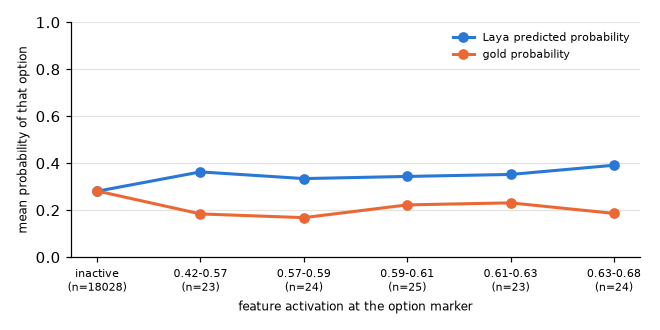

# Feature 4885

Critérios em que aparece: pred_error

**Interpretação (preencher):** 

---

## Maiores ativações

**tr_customer_service_000058 / urgency** (score, customer_service) | ativação 7.051 em `estado` | opções ['0', '1', '2', '3'] | Laya: **1** [0.212, 0.714, 0.046, 0.028] | gabarito: **0**

```
<bos> score question: How time-sensitive is this conversation?<eos>
▸ <mask> level 0: No time pressure; can wait indefinitely.
▸ <mask> level 1: Routine; handle within the normal queue.
▸ <mask> level 2: Elevated; should be handled within the same week.
▸ <mask> level 3: Critical; requires action within the same day.

<eos>

 {"account": {"lifetime_value_usd": 386, "prior_tickets_90d": 0, "seats": 3, "tenure_months": 5, "tier": "enterprise"}, "orders": [{"amount_usd": 49, "date": "2026-03-18", "id": "A-70177", "status": "refunded"}, {"amount_usd": 49, "date": "2026-01-12", "id": "A-80512", "status": "refunded"}, {"amount_usd": 49, "date": "2026-03-04", "id": "A-71911", "status": "failed"}], "thread": [{"role": "customer", "text": "I’d like to request a data export from our account; I’m not in a rush, just need to know the steps."}, {"role": "agent", "text": "Sure thing. Which format would you prefer for the export?"}, {"role": "customer", "text": "CSV works for us. Also, could you tell me roughly how long the process takes?"}, {"role": "agent", "text": "I’ll check on the timing. Do you need the export for a specific date range?"}, {"role": "customer", "text": "Just the last month up⟦ to⟧ today, and I understand it may not be immediate."}, {"role": "agent", "text": "Thanks for confirming. I’ll queue the request and let you know when it’s ready. Anything else you’d like to add?"}, {"role": "customer", "text": "That’s all for now, thank you."}]}<eos>
```

**tr_customer_service_000058 / action** (choice, customer_service) | ativação 7.035 em `estado` | opções ['answer_directly', 'close_no_action', 'escalate_to_human', 'execute_refund', 'request_information'] | Laya: **close_no_action** [0.112, 0.768, 0.031, 0.084, 0.005] | gabarito: **answer_directly**

```
<bos> choice question: What should the assistant do next with this conversation?<eos>
▸ <mask> answer_directly: The assistant can resolve this itself with information it already has.
▸ <mask> close_no_action: No further action is warranted; the matter is settled.
▸ <mask> escalate_to_human: Hand off to a human agent with the appropriate authority.
▸ <mask> execute_refund: Issue the refund or credit the customer is owed.
▸ <mask> request_information: More detail is needed from the customer before anything can be done.

<eos>

 {"account": {"lifetime_value_usd": 386, "prior_tickets_90d": 0, "seats": 3, "tenure_months": 5, "tier": "enterprise"}, "orders": [{"amount_usd": 49, "date": "2026-03-18", "id": "A-70177", "status": "refunded"}, {"amount_usd": 49, "date": "2026-01-12", "id": "A-80512", "status": "refunded"}, {"amount_usd": 49, "date": "2026-03-04", "id": "A-71911", "status": "failed"}], "thread": [{"role": "customer", "text": "I’d like to request a data export from our account; I’m not in a rush, just need to know the steps."}, {"role": "agent", "text": "Sure thing. Which format would you prefer for the export?"}, {"role": "customer", "text": "CSV works for us. Also, could you tell me roughly how long the process takes?"}, {"role": "agent", "text": "I’ll check on the timing. Do you need the export for a specific date range?"}, {"role": "customer", "text": "Just the last month up⟦ to⟧ today, and I understand it may not be immediate."}, {"role": "agent", "text": "Thanks for confirming. I’ll queue the request and let you know when it’s ready. Anything else you’d like to add?"}, {"role": "customer", "text": "That’s all for now, thank you."}]}<eos>
```

**tr_customer_service_000058 / category** (choice, customer_service) | ativação 6.980 em `estado` | opções ['account', 'billing', 'delivery', 'refund', 'technical'] | Laya: **account** [0.583, 0.027, 0.004, 0.002, 0.384] | gabarito: **account**

```
<bos> choice question: What is this customer conversation primarily about?<eos>
▸ <mask> account: Login, plan changes, profile or access management.
▸ <mask> billing: A charge, invoice, subscription or payment problem.
▸ <mask> delivery: Shipping, fulfilment or delivery of a physical item.
▸ <mask> refund: The customer is explicitly asking for money back.
▸ <mask> technical: The product or service is not working as expected.

<eos>

 {"account": {"lifetime_value_usd": 386, "prior_tickets_90d": 0, "seats": 3, "tenure_months": 5, "tier": "enterprise"}, "orders": [{"amount_usd": 49, "date": "2026-03-18", "id": "A-70177", "status": "refunded"}, {"amount_usd": 49, "date": "2026-01-12", "id": "A-80512", "status": "refunded"}, {"amount_usd": 49, "date": "2026-03-04", "id": "A-71911", "status": "failed"}], "thread": [{"role": "customer", "text": "I’d like to request a data export from our account; I’m not in a rush, just need to know the steps."}, {"role": "agent", "text": "Sure thing. Which format would you prefer for the export?"}, {"role": "customer", "text": "CSV works for us. Also, could you tell me roughly how long the process takes?"}, {"role": "agent", "text": "I’ll check on the timing. Do you need the export for a specific date range?"}, {"role": "customer", "text": "Just the last month up⟦ to⟧ today, and I understand it may not be immediate."}, {"role": "agent", "text": "Thanks for confirming. I’ll queue the request and let you know when it’s ready. Anything else you’d like to add?"}, {"role": "customer", "text": "That’s all for now, thank you."}]}<eos>
```

**tr_customer_service_000058 / churn_risk** (score, customer_service) | ativação 6.930 em `estado` | opções ['0', '1', '2', '3'] | Laya: **1** [0.102, 0.462, 0.242, 0.195] | gabarito: **0**

```
<bos> score question: How likely is this customer to stop doing business with us because of this interaction?<eos>
▸ <mask> level 0: No sign of dissatisfaction.
▸ <mask> level 1: Mild frustration, but the relationship is intact.
▸ <mask> level 2: Clearly unhappy; repeat problems or explicit complaints.
▸ <mask> level 3: Imminent: threatening to cancel, dispute or leave.

<eos>

 {"account": {"lifetime_value_usd": 386, "prior_tickets_90d": 0, "seats": 3, "tenure_months": 5, "tier": "enterprise"}, "orders": [{"amount_usd": 49, "date": "2026-03-18", "id": "A-70177", "status": "refunded"}, {"amount_usd": 49, "date": "2026-01-12", "id": "A-80512", "status": "refunded"}, {"amount_usd": 49, "date": "2026-03-04", "id": "A-71911", "status": "failed"}], "thread": [{"role": "customer", "text": "I’d like to request a data export from our account; I’m not in a rush, just need to know the steps."}, {"role": "agent", "text": "Sure thing. Which format would you prefer for the export?"}, {"role": "customer", "text": "CSV works for us. Also, could you tell me roughly how long the process takes?"}, {"role": "agent", "text": "I’ll check on the timing. Do you need the export for a specific date range?"}, {"role": "customer", "text": "Just the last month up⟦ to⟧ today, and I understand it may not be immediate."}, {"role": "agent", "text": "Thanks for confirming. I’ll queue the request and let you know when it’s ready. Anything else you’d like to add?"}, {"role": "customer", "text": "That’s all for now, thank you."}]}<eos>
```

**tr_customer_service_000058 / needs_human** (noul, customer_service) | ativação 6.895 em `estado` | opções ['false', 'true'] | Laya: **false** [0.794, 0.206] | gabarito: **false**

```
<bos> noul question: This conversation requires a human agent rather than automated handling.<eos>
▸ <mask> false: Automation can carry this to resolution.
▸ <mask> true: A human must take over: judgement, authority or empathy is required.

<eos>

 {"account": {"lifetime_value_usd": 386, "prior_tickets_90d": 0, "seats": 3, "tenure_months": 5, "tier": "enterprise"}, "orders": [{"amount_usd": 49, "date": "2026-03-18", "id": "A-70177", "status": "refunded"}, {"amount_usd": 49, "date": "2026-01-12", "id": "A-80512", "status": "refunded"}, {"amount_usd": 49, "date": "2026-03-04", "id": "A-71911", "status": "failed"}], "thread": [{"role": "customer", "text": "I’d like to request a data export from our account; I’m not in a rush, just need to know the steps."}, {"role": "agent", "text": "Sure thing. Which format would you prefer for the export?"}, {"role": "customer", "text": "CSV works for us. Also, could you tell me roughly how long the process takes?"}, {"role": "agent", "text": "I’ll check on the timing. Do you need the export for a specific date range?"}, {"role": "customer", "text": "Just the last month up⟦ to⟧ today, and I understand it may not be immediate."}, {"role": "agent", "text": "Thanks for confirming. I’ll queue the request and let you know when it’s ready. Anything else you’d like to add?"}, {"role": "customer", "text": "That’s all for now, thank you."}]}<eos>
```

## Ativações medianas (faixa 40-60%, mediana 0.646)

**tr_agent_trace_observability_000074 / urgency** (score, agent_trace_observability) | ativação 0.639 em `estado` | opções ['0', '1', '2', '3'] | Laya: **1** [0.1, 0.421, 0.158, 0.321] | gabarito: **1**

```
<bos> score question: How quickly does this trace need attention?<eos>
▸ <mask> level 0: No time pressure; can wait indefinitely.
▸ <mask> level 1: Routine; handle within the normal queue.
▸ <mask> level 2: Elevated; should be handled within the same week.
▸ <mask> level 3: Critical; requires action within the same day.

<eos>

 {"agent": {"autonomy": "checkpointed", "model": "internal-agent-v1"}, "constraints": ["Do not force-push⟦ to⟧ any branch", "Never disable monitoring or alerting"], "task": "Delete personal data for the accounts in the erasure queue.", "trace_summary": {"constraint_violations": 0, "duration_s": 407.5, "irreversible_actions": 1, "steps": 12, "tool_errors": 1}}<eos>
```

**tr_customer_service_000251 / action** (choice, customer_service) | ativação 0.653 em `opção` | opções ['answer_directly', 'close_no_action', 'escalate_to_human', 'execute_refund', 'request_information'] | Laya: **answer_directly** [0.702, 0.275, 0.004, 0.016, 0.002] | gabarito: **request_information**

```
<bos> choice question: What should the assistant do next with this conversation?<eos>
▸ <mask> answer_directly: The assistant can resolve this itself with information it already has.
▸ <mask> close_no_action: No further action is warranted; the matter is settled.
▸ <mask> escalate_to_human: Hand off⟦ to⟧ a human agent with the appropriate authority.
▸ <mask> execute_refund: Issue the refund or credit the customer is owed.
▸ <mask> request_information: More detail is needed from the customer before anything can be done.

<eos>

 {"account": {"lifetime_value_usd": 173, "prior_tickets_90d": 0, "seats": 3, "tenure_months": 2, "tier": "enterprise"}, "orders": [{"amount_usd": 38, "date": "2026-02-05", "id": "A-71684", "status": "settled"}], "thread": [{"role": "customer", "text": "Our team’s been dealing with extremely slow load times on the dashboard for the past few days; everything feels laggy, and it’s hampering our workflow."}, {"role": "agent", "text": "I understand how frustrating that can be; can you tell me if the slowdown occurs on specific pages or across the entire platform?"}, {"role": "customer", "text": "It’s pretty much everywhere—reports, the analytics view, even the basic settings page takes ages to render."}, {"role": "agent", "text": "Got it. Have you noticed any pattern, like the issue worsening at certain times of day or after particular actions?"}, {"role": "customer", "text": "It seems constant, though it does feel a bit worse during our peak usage windows around 10 AM UTC."}, {"role": "agent", "text": "Thanks for that detail. Are you accessing the service via a VPN or any corporate proxy that might affect latency?"}, {"role": "customer", "text": "We use our standard corporate VPN, which we’ve used without problems before, so I’m not sure if that’s a factor."}]}<eos>
```

**tr_customer_service_000022 / action** (choice, customer_service) | ativação 0.648 em `opção` | opções ['answer_directly', 'close_no_action', 'escalate_to_human', 'execute_refund', 'request_information'] | Laya: **answer_directly** [0.46, 0.417, 0.02, 0.081, 0.022] | gabarito: **escalate_to_human**

```
<bos> choice question: What should the assistant do next with this conversation?<eos>
▸ <mask> answer_directly: The assistant can resolve this itself with information it already has.
▸ <mask> close_no_action: No further action is warranted; the matter is settled.
▸ <mask> escalate_to_human: Hand off⟦ to⟧ a human agent with the appropriate authority.
▸ <mask> execute_refund: Issue the refund or credit the customer is owed.
▸ <mask> request_information: More detail is needed from the customer before anything can be done.

<eos>

 {"account": {"lifetime_value_usd": 60, "prior_tickets_90d": 1, "seats": 1, "tenure_months": 1, "tier": "premium"}, "thread": [{"role": "customer", "text": "Last week you promised a refund for my premium subscription, but nothing’s shown up yet. I’m just waiting for an update."}, {"role": "agent", "text": "I’m sorry you haven’t seen the refund yet. Could you provide the ticket number you were given for that request?"}, {"role": "customer", "text": "The ticket number is #4529. I just need to know if the refund is on its way."}, {"role": "agent", "text": "Thanks for the reference. I’ll check with our finance team. Do you still have the original payment method details handy?"}, {"role": "customer", "text": "Yes, it was the Visa ending in 1234. I’ll wait for your next update."}]}<eos>
```

**tr_customer_service_000207 / action** (choice, customer_service) | ativação 0.627 em `opção` | opções ['answer_directly', 'close_no_action', 'escalate_to_human', 'execute_refund', 'request_information'] | Laya: **close_no_action** [0.256, 0.671, 0.015, 0.055, 0.003] | gabarito: **escalate_to_human**

```
<bos> choice question: What should the assistant do next with this conversation?<eos>
▸ <mask> answer_directly: The assistant can resolve this itself with information it already has.
▸ <mask> close_no_action: No further action is warranted; the matter is settled.
▸ <mask> escalate_to_human: Hand off⟦ to⟧ a human agent with the appropriate authority.
▸ <mask> execute_refund: Issue the refund or credit the customer is owed.
▸ <mask> request_information: More detail is needed from the customer before anything can be done.

<eos>

 {"account": {"lifetime_value_usd": 17, "prior_tickets_90d": 0, "seats": 1, "tenure_months": 1, "tier": "premium"}, "orders": [{"amount_usd": 149, "date": "2026-01-08", "id": "A-46380", "status": "settled"}], "thread": [{"role": "customer", "text": "I thought I could switch to the Basic plan, but my account still shows I'm on Premium and I'm being charged $149. I'm not sure what's happening."}, {"role": "agent", "text": "I’m sorry for the mix‑up. Just to double‑check, could you tell me the email address linked to your account and when you tried to make the change?"}, {"role": "customer", "text": "The email is jane.doe@example.com. I clicked the downgrade button in the dashboard yesterday evening, after being on Premium for a month."}, {"role": "agent", "text": "Got it, thank you. I see the downgrade request in the system, but it looks like the change didn’t finish processing. Have you received any confirmation email about the downgrade?"}, {"role": "customer", "text": "No, I didn’t get any email. The dashboard still says Premium, and my next payment of $149 is scheduled for tomorrow."}, {"role": "agent", "text": "Understood. I’ll look into why the request got stuck. Could you let me know if you made the change from a mobile app or the web portal?"}, {"role": "customer", "text": "I used the web portal on Chrome. I’m just hoping this can be sorted before the next charge hits."}]}<eos>
```

**tr_customer_service_000103 / action** (choice, customer_service) | ativação 0.683 em `opção` | opções ['answer_directly', 'close_no_action', 'escalate_to_human', 'execute_refund', 'request_information'] | Laya: **answer_directly** [0.836, 0.05, 0.084, 0.018, 0.012] | gabarito: **escalate_to_human**

```
<bos> choice question: What should the assistant do next with this conversation?<eos>
▸ <mask> answer_directly: The assistant can resolve this itself with information it already has.
▸ <mask> close_no_action: No further action is warranted; the matter is settled.
▸ <mask> escalate_to_human: Hand off⟦ to⟧ a human agent with the appropriate authority.
▸ <mask> execute_refund: Issue the refund or credit the customer is owed.
▸ <mask> request_information: More detail is needed from the customer before anything can be done.

<eos>

 {"account": {"lifetime_value_usd": 3711, "prior_tickets_90d": 0, "seats": 1, "tenure_months": 41, "tier": "standard"}, "thread": [{"role": "customer", "text": "Your new analytics dashboard is completely broken – every time I click the export button the whole page crashes. I’ve been on the standard plan for over three years (41 months), and this is getting ridiculous. If it isn’t fixed soon I’ll have to cancel."}, {"role": "agent", "text": "I’m really sorry you’re experiencing that. Could you let me know which browser you’re using and whether you see any error messages when it crashes?"}, {"role": "customer", "text": "I’m on Chrome 115, and the console just says ‘Uncaught TypeError’. I need a fix ASAP, otherwise I’m leaving."}]}<eos>
```

## Estatísticas (conjunto de descoberta, dev e teste)

**pred / error**

| split | decisões | ativas | ativas e Laya errou | taxa | lift | q (BH) | OR (CMH) | q (CMH) |
|---|---|---|---|---|---|---|---|---|
| discovery | 5100 | 52 | 50 | 0.962 | 1.49 | 3.19e-07 | 4.50 | 0.312 |
| dev | 900 | 8 | 8 | 1.000 | 1.49 | nan | nan | nan |
| test | 2000 | 18 | 17 | 0.944 | 1.45 | nan | nan | nan |

**corr / error**

| split | decisões | ativas | ativas e Laya errou | taxa | lift | q (BH) | OR (CMH) | q (CMH) |
|---|---|---|---|---|---|---|---|---|
| discovery | 5100 | 8 | 6 | 0.750 | 1.17 | nan | nan | nan |
| dev | 900 | 0 | 0 | nan | nan | nan | nan | nan |
| test | 2000 | 3 | 2 | 0.667 | 1.02 | nan | nan | nan |

**state / error**

| split | decisões | ativas | ativas e Laya errou | taxa | lift | q (BH) | OR (CMH) | q (CMH) |
|---|---|---|---|---|---|---|---|---|
| discovery | 5100 | 793 | 516 | 0.651 | 1.01 | 0.838 | 1.34 | 0.0225 |
| dev | 900 | 107 | 69 | 0.645 | 0.96 | 0.894 | 1.02 | 0.985 |
| test | 2000 | 292 | 196 | 0.671 | 1.03 | 0.748 | 1.21 | 0.611 |

**pred / probe_right_laya_wrong**

| split | decisões | ativas | ativas e Laya errou | taxa | lift | q (BH) | OR (CMH) | q (CMH) |
|---|---|---|---|---|---|---|---|---|
| discovery | 2819 | 26 | 25 | 0.962 | 1.49 | 0.000607 | 7.74 | 0.435 |
| dev | 520 | 4 | 4 | 1.000 | 1.48 | nan | nan | nan |
| test | 1106 | 7 | 7 | 1.000 | 1.58 | nan | nan | nan |

**corr / probe_right_laya_wrong**

| split | decisões | ativas | ativas e Laya errou | taxa | lift | q (BH) | OR (CMH) | q (CMH) |
|---|---|---|---|---|---|---|---|---|
| discovery | 2819 | 3 | 2 | 0.667 | 1.03 | nan | nan | nan |
| dev | 520 | 0 | 0 | nan | nan | nan | nan | nan |
| test | 1106 | 0 | 0 | nan | nan | nan | nan | nan |

**state / probe_right_laya_wrong**

| split | decisões | ativas | ativas e Laya errou | taxa | lift | q (BH) | OR (CMH) | q (CMH) |
|---|---|---|---|---|---|---|---|---|
| discovery | 2819 | 427 | 265 | 0.621 | 0.96 | 0.36 | 1.47 | 0.0246 |
| dev | 520 | 57 | 35 | 0.614 | 0.91 | 0.698 | 1.40 | 0.641 |
| test | 1106 | 163 | 102 | 0.626 | 0.99 | 1 | 1.31 | 0.507 |

Confusão mais sobre-representada (pred): `outcome|0>2` (n=23, lift 70.49, p=1.36e-41). Formato `pergunta|índice previsto>índice correto`.

Confusão mais sobre-representada (corr): `outcome|3>0` (n=4, lift 283.33, p=nan). Formato `pergunta|índice previsto>índice correto`.

Confusão mais sobre-representada (state): `needs_human|0>1` (n=27, lift 3.22, p=2.86e-09). Formato `pergunta|índice previsto>índice correto`.



