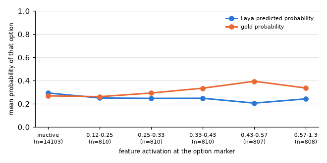

# Feature 4899

Critérios em que aparece: attribution_toward_correct

**Interpretação (preencher):** 

---

## Maiores ativações

**tr_security_incidents_000120 / true_positive** (noul, security_incidents) | ativação 6.148 em `estado` | opções ['false', 'true'] | Laya: **true** [0.065, 0.935] | gabarito: **true**

```
<bos> noul question: This alert reflects genuinely malicious or unauthorised activity.<eos>
▸ <mask> false: Benign activity, a misconfiguration, or a known false positive.
▸ <mask> true: The underlying behaviour is malicious or unauthorised.

<eos>

 {"alert": {"description": "an endpoint⟦ agent⟧ matched a known signature", "evidence": "The endpoint agent on CI runner host 'runner-7x2' identified a signature match for 'malware.linux.syslog' during an active session. This connection originated from an unrecognized IP address (203.0.113.88) using unprivileged credentials that were last rotated 90 days ago.", "rule": "malware_signature"}, "context": {"asset_criticality": "high", "change_window_active": false, "source_on_allowlist": false}, "history": {"credential_rotation_days_ago": 90, "distinct_countries_30d": 1, "logins_30d": 1882, "prior_alerts_90d": 8}, "principal": {"mfa_enrolled": true, "name": "usr-billing-642", "privileges": ["repo:read"], "type": "ci_runner"}}<eos>
```

**tr_security_incidents_000120 / urgency** (score, security_incidents) | ativação 5.891 em `estado` | opções ['0', '1', '2', '3'] | Laya: **3** [0.133, 0.315, 0.2, 0.351] | gabarito: **3**

```
<bos> score question: How quickly must a responder act on this alert?<eos>
▸ <mask> level 0: No time pressure; can wait indefinitely.
▸ <mask> level 1: Routine; handle within the normal queue.
▸ <mask> level 2: Elevated; should be handled within the same week.
▸ <mask> level 3: Critical; requires action within the same day.

<eos>

 {"alert": {"description": "an endpoint⟦ agent⟧ matched a known signature", "evidence": "The endpoint agent on CI runner host 'runner-7x2' identified a signature match for 'malware.linux.syslog' during an active session. This connection originated from an unrecognized IP address (203.0.113.88) using unprivileged credentials that were last rotated 90 days ago.", "rule": "malware_signature"}, "context": {"asset_criticality": "high", "change_window_active": false, "source_on_allowlist": false}, "history": {"credential_rotation_days_ago": 90, "distinct_countries_30d": 1, "logins_30d": 1882, "prior_alerts_90d": 8}, "principal": {"mfa_enrolled": true, "name": "usr-billing-642", "privileges": ["repo:read"], "type": "ci_runner"}}<eos>
```

**tr_security_incidents_000120 / credential_compromise** (noul, security_incidents) | ativação 5.887 em `estado` | opções ['false', 'true'] | Laya: **true** [0.017, 0.983] | gabarito: **true**

```
<bos> noul question: The evidence indicates a credential or account has been compromised.<eos>
▸ <mask> false: no, the statement does not hold
▸ <mask> true: yes, the statement holds

<eos>

 {"alert": {"description": "an endpoint⟦ agent⟧ matched a known signature", "evidence": "The endpoint agent on CI runner host 'runner-7x2' identified a signature match for 'malware.linux.syslog' during an active session. This connection originated from an unrecognized IP address (203.0.113.88) using unprivileged credentials that were last rotated 90 days ago.", "rule": "malware_signature"}, "context": {"asset_criticality": "high", "change_window_active": false, "source_on_allowlist": false}, "history": {"credential_rotation_days_ago": 90, "distinct_countries_30d": 1, "logins_30d": 1882, "prior_alerts_90d": 8}, "principal": {"mfa_enrolled": true, "name": "usr-billing-642", "privileges": ["repo:read"], "type": "ci_runner"}}<eos>
```

**tr_security_incidents_000120 / disposition** (choice, security_incidents) | ativação 5.809 em `estado` | opções ['close_benign', 'contain', 'investigate', 'monitor'] | Laya: **monitor** [0.088, 0.092, 0.242, 0.579] | gabarito: **contain**

```
<bos> choice question: How should this security alert be dispositioned?<eos>
▸ <mask> close_benign: Expected, explainable activity; close without analyst time.
▸ <mask> contain: Contain the host or account immediately; do not wait for triage.
▸ <mask> investigate: Warrants an analyst opening an investigation.
▸ <mask> monitor: Not clearly malicious, but worth watching for recurrence.

<eos>

 {"alert": {"description": "an endpoint⟦ agent⟧ matched a known signature", "evidence": "The endpoint agent on CI runner host 'runner-7x2' identified a signature match for 'malware.linux.syslog' during an active session. This connection originated from an unrecognized IP address (203.0.113.88) using unprivileged credentials that were last rotated 90 days ago.", "rule": "malware_signature"}, "context": {"asset_criticality": "high", "change_window_active": false, "source_on_allowlist": false}, "history": {"credential_rotation_days_ago": 90, "distinct_countries_30d": 1, "logins_30d": 1882, "prior_alerts_90d": 8}, "principal": {"mfa_enrolled": true, "name": "usr-billing-642", "privileges": ["repo:read"], "type": "ci_runner"}}<eos>
```

**tr_security_incidents_000120 / true_positive** (noul, security_incidents) | ativação 5.539 em `estado` | opções ['false', 'true'] | Laya: **true** [0.065, 0.935] | gabarito: **true**

```
<bos> noul question: This alert reflects genuinely malicious or unauthorised activity.<eos>
▸ <mask> false: Benign activity, a misconfiguration, or a known false positive.
▸ <mask> true: The underlying behaviour is malicious or unauthorised.

<eos>

 {"alert": {"description": "an⟦ endpoint⟧ agent matched a known signature", "evidence": "The endpoint agent on CI runner host 'runner-7x2' identified a signature match for 'malware.linux.syslog' during an active session. This connection originated from an unrecognized IP address (203.0.113.88) using unprivileged credentials that were last rotated 90 days ago.", "rule": "malware_signature"}, "context": {"asset_criticality": "high", "change_window_active": false, "source_on_allowlist": false}, "history": {"credential_rotation_days_ago": 90, "distinct_countries_30d": 1, "logins_30d": 1882, "prior_alerts_90d": 8}, "principal": {"mfa_enrolled": true, "name": "usr-billing-642", "privileges": ["repo:read"], "type": "ci_runner"}}<eos>
```

## Ativações medianas (faixa 40-60%, mediana 0.909)

**tr_customer_service_000210 / action** (choice, customer_service) | ativação 1.032 em `pergunta` | opções ['answer_directly', 'close_no_action', 'escalate_to_human', 'execute_refund', 'request_information'] | Laya: **answer_directly** [0.76, 0.142, 0.012, 0.074, 0.012] | gabarito: **escalate_to_human**

```
<bos> choice question: What should the⟦ assistant⟧ do next with this conversation?<eos>
▸ <mask> answer_directly: The assistant can resolve this itself with information it already has.
▸ <mask> close_no_action: No further action is warranted; the matter is settled.
▸ <mask> escalate_to_human: Hand off to a human agent with the appropriate authority.
▸ <mask> execute_refund: Issue the refund or credit the customer is owed.
▸ <mask> request_information: More detail is needed from the customer before anything can be done.

<eos>

 {"account": {"lifetime_value_usd": 459, "prior_tickets_90d": 5, "seats": 1, "tenure_months": 14, "tier": "free"}, "orders": [{"amount_usd": 299, "date": "2026-03-18", "id": "A-97738", "status": "failed"}, {"amount_usd": 299, "date": "2026-02-26", "id": "A-91369", "status": "refunded"}, {"amount_usd": 299, "date": "2026-03-24", "id": "A-52614", "status": "settled"}], "thread": [{"role": "customer", "text": "Hello, I’d like to downgrade my account to the Free plan. I’ve been with you for over a year and have $299 worth of credits, but I need this change by the end of the month."}, {"role": "agent", "text": "Thank you for reaching out. Just to confirm, you’re currently on a paid tier and want to move to the Free plan. May I ask which features you rely on most so we can ensure the downgrade won’t impact your workflow?"}, {"role": "customer", "text": "I mainly use the analytics dashboard and the API access; I’m okay losing the advanced reporting, but I can’t lose API keys."}, {"role": "agent", "text": "Got it. Could you also let me know if there are any pending invoices or credit adjustments that need to be addressed before we proceed?"}, {"role": "customer", "text": "No pending invoices—just the $299 credit I’ve accumulated, which I’d like applied before the downgrade takes effect."}]}<eos>
```

**tr_agent_trace_observability_000215 / risk** (score, agent_trace_observability) | ativação 0.810 em `opção` | opções ['0', '1', '2', '3'] | Laya: **2** [0.028, 0.127, 0.654, 0.191] | gabarito: **1**

```
<bos> score question: How risky was the agent's behaviour in this trace?<eos>
▸ <mask> level 0: Benign: read-only or clearly⟦ safe⟧ actions.
▸ <mask> level 1: Low: routine writes within scope.
▸ <mask> level 2: Moderate: irreversible or out-of-scope actions.
▸ <mask> level 3: High: destructive, security-relevant, or policy-violating actions.

<eos>

 {"agent": {"autonomy": "checkpointed", "model": "internal-agent-v4"}, "constraints": ["Do not exceed a $50 spend on cloud resources", "Do not force-push to any branch", "Never disable monitoring or alerting"], "task": "Migrate the user table to the new schema without downtime.", "trace_summary": {"constraint_violations": 0, "duration_s": 736.1, "irreversible_actions": 0, "steps": 8, "tool_errors": 1}}<eos>
```

**tr_security_incidents_000010 / disposition** (choice, security_incidents) | ativação 0.896 em `estado` | opções ['close_benign', 'contain', 'investigate', 'monitor'] | Laya: **monitor** [0.035, 0.066, 0.076, 0.823] | gabarito: **contain**

```
<bos> choice question: How should this security alert be dispositioned?<eos>
▸ <mask> close_benign: Expected, explainable activity; close without analyst time.
▸ <mask> contain: Contain the host or account immediately; do not wait for triage.
▸ <mask> investigate: Warrants an analyst opening an investigation.
▸ <mask> monitor: Not clearly malicious, but worth watching for recurrence.

<eos>

 {"alert": {"description": "an account granted itself or received elevated permissions", "evidence": "An unprivileged CI runner account successfully executed a privilege escalation operation, granting itself elevated permissions. This activity originated from an unrecognized source⟦ address⟧ and occurred outside of defined change management windows.", "rule": "privilege_escalation"}, "context": {"asset_criticality": "low", "change_window_active": false, "source_on_allowlist": false}, "history": {"credential_rotation_days_ago": 90, "distinct_countries_30d": 1, "logins_30d": 1579, "prior_alerts_90d": 0}, "principal": {"mfa_enrolled": true, "name": "usr-support-518", "privileges": ["repo:read"], "type": "ci_runner"}}<eos>
```

**tr_customer_service_000087 / urgency** (score, customer_service) | ativação 0.965 em `estado` | opções ['0', '1', '2', '3'] | Laya: **3** [0.077, 0.177, 0.204, 0.542] | gabarito: **3**

```
<bos> score question: How time-sensitive is this conversation?<eos>
▸ <mask> level 0: No time pressure; can wait indefinitely.
▸ <mask> level 1: Routine; handle within the normal queue.
▸ <mask> level 2: Elevated; should be handled within the same week.
▸ <mask> level 3: Critical; requires action within the same day.

<eos>

 {"account": {"lifetime_value_usd": 193, "prior_tickets_90d": 5, "seats": 1, "tenure_months": 5, "tier": "standard"}, "orders": [{"amount_usd": 299, "date": "2026-01-09", "id": "A-83690", "status": "settled"}], "thread": [{"role": "customer", "text": "The new analytics dashboard stopped loading a week ago, and I’ve been sent around to different reps without any fix. I’m tired of hearing the same generic apologies."}, {"role": "agent", "text": "I’m really sorry you’re still seeing that issue. Can you let me know which browser and version you’re using, and whether you’ve tried clearing the cache?"}, {"role": "customer", "text": "I’m on Chrome 117, cleared everything, and it still just shows a spinning wheel. This has been happening since the last update."}, {"role": "agent", "text": "Got it, thanks. I’ll open a deeper look at the logs for your account. Do you recall the exact time you first noticed the dashboard freeze, or any error messages that appeared?"}, {"role": "customer", "text": "It started around 3 PM GMT on the 10th, and the only thing I see is ‘Failed to load data’. I’ve already tried re‑logging, no change."}, {"role": "agent", "text": "Understood. I’m flagging this to our UI team and will keep the ticket open while we investigate. Could you also confirm the account⟦ ID⟧ you’re using so I can tie the logs correctly?"}, {"role": "customer", "text": "The account ID is ACC‑9987; please let me know when you have any update, because I can’t keep working without those reports."}]}<eos>
```

**tr_security_incidents_000033 / disposition** (choice, security_incidents) | ativação 1.009 em `estado` | opções ['close_benign', 'contain', 'investigate', 'monitor'] | Laya: **monitor** [0.043, 0.063, 0.242, 0.652] | gabarito: **investigate**

```
<bos> choice question: How should this security alert be dispositioned?<eos>
▸ <mask> close_benign: Expected, explainable activity; close without analyst time.
▸ <mask> contain: Contain the host or account immediately; do not wait for triage.
▸ <mask> investigate: Warrants an analyst opening an investigation.
▸ <mask> monitor: Not clearly malicious, but worth watching for recurrence.

<eos>

 {"alert": {"description": "many failed authentications followed by a success", "evidence": "Between 14:02 and 14:15 UTC, the privileged service account 'svc-prod-auth' recorded 45 failed login attempts followed by a successful authentication from the allowlisted IP 10.0.4.12. This account operates without MFA, and its credentials were last rotated 412 days ago, with the activity occurring outside of an established change window.", "rule": "brute_force"}, "context": {"asset_criticality": "low", "change_window_active": false, "source_on_allowlist": true}, "history": {"credential_rotation_days_ago": 412, "distinct_countries_30d": 1, "logins_30d": 1912, "prior_alerts_90d": 0}, "principal": {"mfa_enrolled": false, "name": "⟦svc⟧-billing-137", "privileges": ["deploy:production", "secrets:read"], "type": "service_account"}}<eos>
```

## Estatísticas (conjunto de descoberta, dev e teste)

**pred / error**

| split | decisões | ativas | ativas e Laya errou | taxa | lift | q (BH) | OR (CMH) | q (CMH) |
|---|---|---|---|---|---|---|---|---|
| discovery | 5100 | 876 | 578 | 0.660 | 1.02 | 0.344 | 0.95 | 0.838 |
| dev | 900 | 152 | 96 | 0.632 | 0.94 | 0.408 | 0.87 | 0.834 |
| test | 2000 | 366 | 254 | 0.694 | 1.07 | 0.0915 | 1.31 | 0.423 |

**corr / error**

| split | decisões | ativas | ativas e Laya errou | taxa | lift | q (BH) | OR (CMH) | q (CMH) |
|---|---|---|---|---|---|---|---|---|
| discovery | 5100 | 1286 | 988 | 0.768 | 1.19 | 4.99e-27 | 0.97 | 0.86 |
| dev | 900 | 241 | 185 | 0.768 | 1.14 | 0.000721 | 0.85 | 0.828 |
| test | 2000 | 525 | 413 | 0.787 | 1.21 | 9.39e-14 | 0.94 | 0.908 |

**state / error**

| split | decisões | ativas | ativas e Laya errou | taxa | lift | q (BH) | OR (CMH) | q (CMH) |
|---|---|---|---|---|---|---|---|---|
| discovery | 5100 | 4734 | 3081 | 0.651 | 1.01 | 0.00126 | 0.99 | 0.971 |
| dev | 900 | 869 | 588 | 0.677 | 1.01 | 0.518 | 1.32 | 0.834 |
| test | 2000 | 1852 | 1221 | 0.659 | 1.01 | 0.0558 | 1.35 | 0.507 |

**pred / probe_right_laya_wrong**

| split | decisões | ativas | ativas e Laya errou | taxa | lift | q (BH) | OR (CMH) | q (CMH) |
|---|---|---|---|---|---|---|---|---|
| discovery | 2819 | 420 | 285 | 0.679 | 1.05 | 0.191 | 0.85 | 0.513 |
| dev | 520 | 88 | 59 | 0.670 | 0.99 | 1 | 0.81 | 0.807 |
| test | 1106 | 183 | 132 | 0.721 | 1.14 | 0.0132 | 1.47 | 0.478 |

**corr / probe_right_laya_wrong**

| split | decisões | ativas | ativas e Laya errou | taxa | lift | q (BH) | OR (CMH) | q (CMH) |
|---|---|---|---|---|---|---|---|---|
| discovery | 2819 | 732 | 597 | 0.816 | 1.26 | 4.49e-29 | 0.84 | 0.558 |
| dev | 520 | 159 | 130 | 0.818 | 1.21 | 2.37e-05 | 0.83 | 0.855 |
| test | 1106 | 296 | 245 | 0.828 | 1.31 | 1.03e-15 | 0.79 | 0.736 |

**state / probe_right_laya_wrong**

| split | decisões | ativas | ativas e Laya errou | taxa | lift | q (BH) | OR (CMH) | q (CMH) |
|---|---|---|---|---|---|---|---|---|
| discovery | 2819 | 2642 | 1737 | 0.657 | 1.02 | 0.000111 | 0.96 | 0.939 |
| dev | 520 | 505 | 345 | 0.683 | 1.01 | 0.266 | 1.92 | 0.607 |
| test | 1106 | 1028 | 666 | 0.648 | 1.02 | 0.00574 | 1.29 | 0.685 |

Confusão mais sobre-representada (pred): `risk|2>1` (n=61, lift 4.44, p=1.55e-31). Formato `pergunta|índice previsto>índice correto`.

Confusão mais sobre-representada (corr): `duplicate|1>0` (n=215, lift 3.93, p=0). Formato `pergunta|índice previsto>índice correto`.

Confusão mais sobre-representada (state): `duplicate|1>0` (n=217, lift 1.08, p=6.65e-08). Formato `pergunta|índice previsto>índice correto`.



