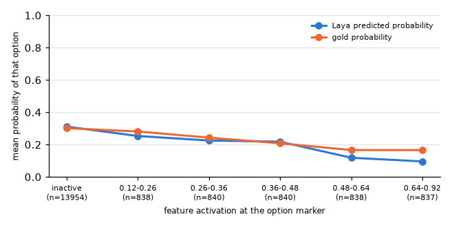

# Feature 4917

Critérios em que aparece: pred_probe_right_laya_wrong_stratified

**Interpretação (preencher):** 

---

## Maiores ativações

**tr_customer_service_000225 / action** (choice, customer_service) | ativação 2.074 em `estado` | opções ['answer_directly', 'close_no_action', 'escalate_to_human', 'execute_refund', 'request_information'] | Laya: **close_no_action** [0.095, 0.85, 0.008, 0.02, 0.028] | gabarito: **request_information**

```
<bos> choice question: What should the assistant do next with this conversation?<eos>
▸ <mask> answer_directly: The assistant can resolve this itself with information it already has.
▸ <mask> close_no_action: No further action is warranted; the matter is settled.
▸ <mask> escalate_to_human: Hand off to a human agent with the appropriate authority.
▸ <mask> execute_refund: Issue the refund or credit the customer is owed.
▸ <mask> request_information: More detail is needed from the customer before anything can be done.

<eos>

 {"account": {"lifetime_value_usd": 419, "prior_tickets_90d": 1, "seats": 1, "tenure_months": 5, "tier": "standard"}, "orders": [{"amount_usd": 99, "date": "2026-01-07", "id": "A-67520", "status": "settled"}, {"amount_usd": 99, "date": "2026-03-11", "id": "A-78780", "status": "settled"}, {"amount_usd": 99, "date": "2026-02-08", "id": "A-39325", "status": "settled"}], "thread": [{"role": "customer", "text": "Hello, I’m writing because I accidentally dropped the $99 device I bought five months ago, and the screen is now completely cracked."}, {"role": "agent", "text": "I’m sorry to hear that your device was damaged. Could you please provide your order number and a brief description of the current display functionality?"}, {"role": "customer", "text": "The order number is #88291, and while the touch screen is unresponsive, the device still powers⟦ on⟧."}, {"role": "agent", "text": "Thank you for providing those details. Just to ensure I have the full picture, could you tell me if there is any visible damage to the charging port or the frame?"}, {"role": "customer", "text": "No, the frame and charging port look perfectly fine, it is just the screen."}]}<eos>
```

**tr_customer_service_000225 / churn_risk** (score, customer_service) | ativação 1.935 em `estado` | opções ['0', '1', '2', '3'] | Laya: **2** [0.271, 0.298, 0.335, 0.095] | gabarito: **1**

```
<bos> score question: How likely is this customer to stop doing business with us because of this interaction?<eos>
▸ <mask> level 0: No sign of dissatisfaction.
▸ <mask> level 1: Mild frustration, but the relationship is intact.
▸ <mask> level 2: Clearly unhappy; repeat problems or explicit complaints.
▸ <mask> level 3: Imminent: threatening to cancel, dispute or leave.

<eos>

 {"account": {"lifetime_value_usd": 419, "prior_tickets_90d": 1, "seats": 1, "tenure_months": 5, "tier": "standard"}, "orders": [{"amount_usd": 99, "date": "2026-01-07", "id": "A-67520", "status": "settled"}, {"amount_usd": 99, "date": "2026-03-11", "id": "A-78780", "status": "settled"}, {"amount_usd": 99, "date": "2026-02-08", "id": "A-39325", "status": "settled"}], "thread": [{"role": "customer", "text": "Hello, I’m writing because I accidentally dropped the $99 device I bought five months ago, and the screen is now completely cracked."}, {"role": "agent", "text": "I’m sorry to hear that your device was damaged. Could you please provide your order number and a brief description of the current display functionality?"}, {"role": "customer", "text": "The order number is #88291, and while the touch screen is unresponsive, the device still powers⟦ on⟧."}, {"role": "agent", "text": "Thank you for providing those details. Just to ensure I have the full picture, could you tell me if there is any visible damage to the charging port or the frame?"}, {"role": "customer", "text": "No, the frame and charging port look perfectly fine, it is just the screen."}]}<eos>
```

**tr_customer_service_000225 / category** (choice, customer_service) | ativação 1.894 em `estado` | opções ['account', 'billing', 'delivery', 'refund', 'technical'] | Laya: **technical** [0.392, 0.086, 0.004, 0.032, 0.486] | gabarito: **technical**

```
<bos> choice question: What is this customer conversation primarily about?<eos>
▸ <mask> account: Login, plan changes, profile or access management.
▸ <mask> billing: A charge, invoice, subscription or payment problem.
▸ <mask> delivery: Shipping, fulfilment or delivery of a physical item.
▸ <mask> refund: The customer is explicitly asking for money back.
▸ <mask> technical: The product or service is not working as expected.

<eos>

 {"account": {"lifetime_value_usd": 419, "prior_tickets_90d": 1, "seats": 1, "tenure_months": 5, "tier": "standard"}, "orders": [{"amount_usd": 99, "date": "2026-01-07", "id": "A-67520", "status": "settled"}, {"amount_usd": 99, "date": "2026-03-11", "id": "A-78780", "status": "settled"}, {"amount_usd": 99, "date": "2026-02-08", "id": "A-39325", "status": "settled"}], "thread": [{"role": "customer", "text": "Hello, I’m writing because I accidentally dropped the $99 device I bought five months ago, and the screen is now completely cracked."}, {"role": "agent", "text": "I’m sorry to hear that your device was damaged. Could you please provide your order number and a brief description of the current display functionality?"}, {"role": "customer", "text": "The order number is #88291, and while the touch screen is unresponsive, the device still powers⟦ on⟧."}, {"role": "agent", "text": "Thank you for providing those details. Just to ensure I have the full picture, could you tell me if there is any visible damage to the charging port or the frame?"}, {"role": "customer", "text": "No, the frame and charging port look perfectly fine, it is just the screen."}]}<eos>
```

**tr_customer_service_000214 / churn_risk** (score, customer_service) | ativação 1.879 em `estado` | opções ['0', '1', '2', '3'] | Laya: **2** [0.076, 0.359, 0.446, 0.119] | gabarito: **2**

```
<bos> score question: How likely is this customer to stop doing business with us because of this interaction?<eos>
▸ <mask> level 0: No sign of dissatisfaction.
▸ <mask> level 1: Mild frustration, but the relationship is intact.
▸ <mask> level 2: Clearly unhappy; repeat problems or explicit complaints.
▸ <mask> level 3: Imminent: threatening to cancel, dispute or leave.

<eos>

 {"account": {"lifetime_value_usd": 820, "prior_tickets_90d": 2, "seats": 1, "tenure_months": 19, "tier": "standard"}, "thread": [{"role": "customer", "text": "The platform has been crawling at a snail'⟦s⟧ pace all day—queries that used to return in seconds now take minutes, and I need this fixed before my deadline tomorrow."}, {"role": "agent", "text": "I understand how critical that is. Can you tell me which specific actions are lagging and if this slowdown is happening across all browsers?"}, {"role": "customer", "text": "Both the search bar and the analytics tab are sluggish, and it’s the same on Chrome and Firefox. I’ve been on the standard plan for 19 months and this is the first time I’ve seen anything this bad."}]}<eos>
```

**tr_customer_service_000214 / urgency** (score, customer_service) | ativação 1.859 em `estado` | opções ['0', '1', '2', '3'] | Laya: **3** [0.052, 0.152, 0.162, 0.634] | gabarito: **3**

```
<bos> score question: How time-sensitive is this conversation?<eos>
▸ <mask> level 0: No time pressure; can wait indefinitely.
▸ <mask> level 1: Routine; handle within the normal queue.
▸ <mask> level 2: Elevated; should be handled within the same week.
▸ <mask> level 3: Critical; requires action within the same day.

<eos>

 {"account": {"lifetime_value_usd": 820, "prior_tickets_90d": 2, "seats": 1, "tenure_months": 19, "tier": "standard"}, "thread": [{"role": "customer", "text": "The platform has been crawling at a snail'⟦s⟧ pace all day—queries that used to return in seconds now take minutes, and I need this fixed before my deadline tomorrow."}, {"role": "agent", "text": "I understand how critical that is. Can you tell me which specific actions are lagging and if this slowdown is happening across all browsers?"}, {"role": "customer", "text": "Both the search bar and the analytics tab are sluggish, and it’s the same on Chrome and Firefox. I’ve been on the standard plan for 19 months and this is the first time I’ve seen anything this bad."}]}<eos>
```

## Ativações medianas (faixa 40-60%, mediana 0.459)

**tr_customer_service_000165 / urgency** (score, customer_service) | ativação 0.438 em `marcador` | opções ['0', '1', '2', '3'] | Laya: **1** [0.133, 0.373, 0.314, 0.179] | gabarito: **2**

```
<bos> score question: How time-sensitive is this conversation?<eos>
▸ ⟦<mask>⟧ level 0: No time pressure; can wait indefinitely.
▸ <mask> level 1: Routine; handle within the normal queue.
▸ <mask> level 2: Elevated; should be handled within the same week.
▸ <mask> level 3: Critical; requires action within the same day.

<eos>

 {"account": {"lifetime_value_usd": 4890, "prior_tickets_90d": 3, "seats": 1, "tenure_months": 60, "tier": "premium"}, "orders": [{"amount_usd": 19, "date": "2026-01-24", "id": "A-27992", "status": "settled"}, {"amount_usd": 19, "date": "2026-02-04", "id": "A-63170", "status": "settled"}, {"amount_usd": 19, "date": "2026-02-15", "id": "A-75660", "status": "settled"}], "thread": [{"role": "customer", "text": "Hi, I was checking my bank statement and noticed two charges from you guys for the same $19 amount. I'm really confused—am I getting billed twice for the same premium subscription?"}, {"role": "agent", "text": "Hello, thank you for reaching out to us. I would be happy to look into these charges for you. Could you please confirm the dates of the transactions you are seeing?"}, {"role": "customer", "text": "They both hit on the 12th. I've been with you for five years now and I've had three previous tickets where things were promised but never actually followed through on, so I'm hoping this one is different."}, {"role": "agent", "text": "I appreciate your long-term membership and I sincerely apologize for any previous lapses in service. I am checking your billing ledger now; could you verify the email address associated with the account?"}, {"role": "customer", "text": "It’s under j.doe@email.com. I really just want to understand why my account would show two charges when I’ve only ever had one plan."}, {"role": "agent", "text": "Thank you for that information. I am currently reviewing your billing cycle. To ensure I'm looking at the right data, could you clarify if you recently made any changes to your payment method?"}, {"role": "customer", "text": "No, I haven't touched my settings in years. I’m just trying to make sense of why my balance is off."}]}<eos>
```

**tr_customer_service_000234 / churn_risk** (score, customer_service) | ativação 0.505 em `marcador` | opções ['0', '1', '2', '3'] | Laya: **1** [0.049, 0.638, 0.265, 0.049] | gabarito: **2**

```
<bos> score question: How likely is this customer to stop doing business with us because of this interaction?<eos>
▸ ⟦<mask>⟧ level 0: No sign of dissatisfaction.
▸ <mask> level 1: Mild frustration, but the relationship is intact.
▸ <mask> level 2: Clearly unhappy; repeat problems or explicit complaints.
▸ <mask> level 3: Imminent: threatening to cancel, dispute or leave.

<eos>

 {"account": {"lifetime_value_usd": 1458, "prior_tickets_90d": 0, "seats": 3, "tenure_months": 33, "tier": "premium"}, "thread": [{"role": "customer", "text": "I’ve been paying for this premium plan for 33 months without a single hitch, but now I’m completely locked out and I have a hard deadline in two hours. Why is the login screen just spinning?"}, {"role": "agent", "text": "I’m sorry to hear you're experiencing this frustration right now. Could you please confirm the exact error message or code you are seeing when the page hangs?"}, {"role": "customer", "text": "There is no code! It’s just a blank page after I enter my credentials. I have a massive report due for my firm by noon and I can’t get in to export the data. This is ridiculous."}, {"role": "agent", "text": "I understand the urgency of this report. To help me narrow down the cause, are you accessing the portal through a browser or our desktop application?"}, {"role": "customer", "text": "I’m using Chrome on my desktop. I’ve already cleared my cache and tried an incognito window, so don't even suggest that. Fix this now."}]}<eos>
```

**tr_customer_service_000141 / churn_risk** (score, customer_service) | ativação 0.427 em `estado` | opções ['0', '1', '2', '3'] | Laya: **2** [0.056, 0.178, 0.688, 0.078] | gabarito: **2**

```
<bos> score question: How likely is this customer to stop doing business with us because of this interaction?<eos>
▸ <mask> level 0: No sign of dissatisfaction.
▸ <mask> level 1: Mild frustration, but the relationship is intact.
▸ <mask> level 2: Clearly unhappy; repeat problems or explicit complaints.
▸ <mask> level 3: Imminent: threatening to cancel, dispute or leave.

<eos>

 {"account": {"lifetime_value_usd": 225, "prior_tickets_90d": 5, "seats": 1, "tenure_months": 3, "tier": "standard"}, "orders": [{"amount_usd": 297, "date": "2026-01-07", "id": "A-98625", "status": "pending"}], "thread": [{"role": "customer", "text": "My service has been running significantly slower than usual over the last week, even though I'm paying $297 monthly."}, {"role": "agent", "text": "I am sorry to hear you are experiencing latency issues. Could you please run a speed test and share the results with me so I can review your connection logs?"}, {"role": "customer", "text": "I've already run three tests and they show speeds are at 10% of what I'm promised⟦.⟧ I've logged five tickets about this already with no progress."}]}<eos>
```

**tr_security_incidents_000149 / credential_compromise** (noul, security_incidents) | ativação 0.480 em `estado` | opções ['false', 'true'] | Laya: **false** [0.709, 0.291] | gabarito: **true**

```
<bos> noul question: The evidence indicates a credential or account has been compromised.<eos>
▸ <mask> false: no, the statement does not hold
▸ <mask> true: yes, the statement holds

<eos>

 {"alert": {"description": "an account granted itself or received elevated permissions", "evidence": "A privilege change was recorded at 2026-09-16 08:09:12 UTC where user \"ADMIN_JONES\" was added to the \"Domain Admins\" group⟦ on⟧ the domain controller. The account already has privileged status, MFA is enabled, but the source of the request originates from an unrecognized endpoint; the credentials for this account were last rotated 14 days prior and the activity fell outside any scheduled change window.", "rule": "privilege_escalation"}, "context": {"asset_criticality": "low", "change_window_active": false, "source_on_allowlist": false}, "history": {"credential_rotation_days_ago": 14, "distinct_countries_30d": 4, "logins_30d": 1034, "prior_alerts_90d": 0}, "principal": {"mfa_enrolled": true, "name": "ci-analytics-841", "privileges": ["deploy:production", "secrets:read"], "type": "admin"}}<eos>
```

**tr_customer_service_000206 / urgency** (score, customer_service) | ativação 0.489 em `estado` | opções ['0', '1', '2', '3'] | Laya: **1** [0.106, 0.512, 0.28, 0.102] | gabarito: **2**

```
<bos> score question: How time-sensitive is this conversation?<eos>
▸ <mask> level 0: No time pressure; can wait indefinitely.
▸ <mask> level 1: Routine; handle within the normal queue.
▸ <mask> level 2: Elevated; should be handled within the same week.
▸ <mask> level 3: Critical; requires action within the same day.

<eos>

 {"account": {"lifetime_value_usd": 152, "prior_tickets_90d": 3, "seats": 1, "tenure_months": 5, "tier": "standard"}, "orders": [{"amount_usd": 297, "date": "2026-03-11", "id": "A-35334", "status": "settled"}], "thread": [{"role": "customer", "text": "I just got an email saying my $297 payment failed, but I don't understand why because I haven't changed any of my bank settings."}, {"role": "agent", "text": "I can certainly look into that billing notification for you. Have you recently updated any of the security features on your credit card, such as a new expiration date or CVV?"}, {"role": "customer", "text": "No, everything is exactly the same as it was when it worked two months ago. This same thing happened back in June and then it just started working again for no reason."}, {"role": "agent", "text": "I see that we've had a few intermittent issues with this account in the past. Are you getting a specific error message when you try to manually process the payment through the 'Pay Now' button?"}, {"role": "customer", "text": "It just gives me a red box that says 'Transaction Denied' and tells me to contact my administrator, but I am the administrator."}, {"role": "agent", "text": "That is definitely confusing. Could you tell me if you are trying to process this through a VPN or a restricted corporate network⟦,⟧ as that can sometimes trigger a decline?"}, {"role": "customer", "text": "I'm just using my home Wi-Fi like I always do, so I don't think it's a network problem on my end."}]}<eos>
```

## Estatísticas (conjunto de descoberta, dev e teste)

**pred / error**

| split | decisões | ativas | ativas e Laya errou | taxa | lift | q (BH) | OR (CMH) | q (CMH) |
|---|---|---|---|---|---|---|---|---|
| discovery | 5100 | 545 | 357 | 0.655 | 1.02 | 0.648 | 1.50 | 0.101 |
| dev | 900 | 91 | 63 | 0.692 | 1.03 | 0.865 | 1.51 | 0.729 |
| test | 2000 | 199 | 133 | 0.668 | 1.03 | 0.689 | 2.15 | 0.166 |

**corr / error**

| split | decisões | ativas | ativas e Laya errou | taxa | lift | q (BH) | OR (CMH) | q (CMH) |
|---|---|---|---|---|---|---|---|---|
| discovery | 5100 | 814 | 626 | 0.769 | 1.19 | 4.05e-16 | 0.84 | 0.516 |
| dev | 900 | 155 | 127 | 0.819 | 1.22 | 6.8e-05 | 0.51 | 0.698 |
| test | 2000 | 356 | 290 | 0.815 | 1.25 | 1.37e-12 | 1.34 | 0.557 |

**state / error**

| split | decisões | ativas | ativas e Laya errou | taxa | lift | q (BH) | OR (CMH) | q (CMH) |
|---|---|---|---|---|---|---|---|---|
| discovery | 5100 | 3020 | 1873 | 0.620 | 0.96 | 0.000202 | 0.90 | 0.456 |
| dev | 900 | 530 | 347 | 0.655 | 0.97 | 0.531 | 0.86 | 0.719 |
| test | 2000 | 1257 | 795 | 0.632 | 0.97 | 0.16 | 0.86 | 0.546 |

**pred / probe_right_laya_wrong**

| split | decisões | ativas | ativas e Laya errou | taxa | lift | q (BH) | OR (CMH) | q (CMH) |
|---|---|---|---|---|---|---|---|---|
| discovery | 2819 | 266 | 169 | 0.635 | 0.98 | 0.753 | 2.39 | 0.00124 |
| dev | 520 | 42 | 28 | 0.667 | 0.99 | 1 | 0.79 | 0.839 |
| test | 1106 | 86 | 51 | 0.593 | 0.94 | 0.599 | 1.71 | 0.423 |

**corr / probe_right_laya_wrong**

| split | decisões | ativas | ativas e Laya errou | taxa | lift | q (BH) | OR (CMH) | q (CMH) |
|---|---|---|---|---|---|---|---|---|
| discovery | 2819 | 401 | 304 | 0.758 | 1.17 | 7.45e-07 | 0.62 | 0.306 |
| dev | 520 | 79 | 65 | 0.823 | 1.22 | 0.00526 | 0.12 | 0.226 |
| test | 1106 | 170 | 135 | 0.794 | 1.25 | 4.2e-06 | 0.68 | 0.721 |

**state / probe_right_laya_wrong**

| split | decisões | ativas | ativas e Laya errou | taxa | lift | q (BH) | OR (CMH) | q (CMH) |
|---|---|---|---|---|---|---|---|---|
| discovery | 2819 | 1674 | 1019 | 0.609 | 0.94 | 2.67e-06 | 0.80 | 0.118 |
| dev | 520 | 296 | 190 | 0.642 | 0.95 | 0.337 | 0.82 | 0.638 |
| test | 1106 | 708 | 430 | 0.607 | 0.96 | 0.0898 | 0.85 | 0.588 |

Confusão mais sobre-representada (pred): `urgency|3>1` (n=76, lift 8.67, p=0). Formato `pergunta|índice previsto>índice correto`.

Confusão mais sobre-representada (corr): `discrepancy_severity|2>0` (n=108, lift 6.27, p=0). Formato `pergunta|índice previsto>índice correto`.

Confusão mais sobre-representada (state): `urgency|1>2` (n=169, lift 1.37, p=8.4e-12). Formato `pergunta|índice previsto>índice correto`.



