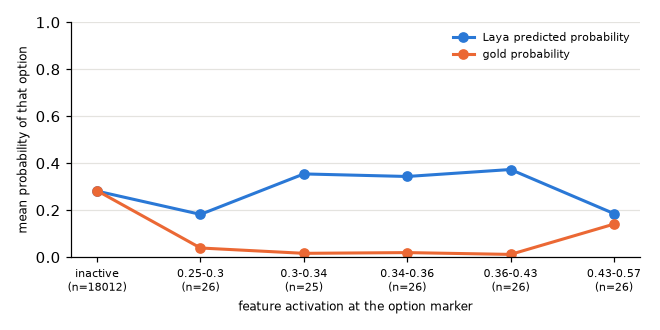

# Feature 5016

Critérios em que aparece: pred_error

**Interpretação (preencher):** 

---

## Maiores ativações

**tr_security_incidents_000205 / disposition** (choice, security_incidents) | ativação 2.812 em `estado` | opções ['close_benign', 'contain', 'investigate', 'monitor'] | Laya: **monitor** [0.117, 0.1, 0.141, 0.642] | gabarito: **investigate**

```
<bos> choice question: How should this security alert be dispositioned?<eos>
▸ <mask> close_benign: Expected, explainable activity; close without analyst time.
▸ <mask> contain: Contain the host or account immediately; do not wait for triage.
▸ <mask> investigate: Warrants an analyst opening an investigation.
▸ <mask> monitor: Not clearly malicious, but worth watching for recurrence.

<eos>

 {"alert": {"description": "audit logging was turned off on a host", "evidence": "On 2026-09-14 22:07:53 UTC audit logging was disabled on host WIN‑SRV-12 (hostname: win-⟦srv⟧-12.corp.example.com) by an employee account with unprivileged rights. The action originated from an unrecognised source IP 198.51.100.22, MFA was confirmed, and the user’s credentials were last updated on 2026-06-16. No maintenance window was associated with this change.", "rule": "disabled_logging"}, "context": {"asset_criticality": "medium", "change_window_active": false, "source_on_allowlist": false}, "history": {"credential_rotation_days_ago": 90, "distinct_countries_30d": 4, "logins_30d": 1587, "prior_alerts_90d": 0}, "principal": {"mfa_enrolled": true, "name": "ci-infra-804", "privileges": ["repo:read"], "type": "employee"}}<eos>
```

**tr_security_incidents_000205 / severity** (score, security_incidents) | ativação 2.803 em `estado` | opções ['0', '1', '2', '3', '4'] | Laya: **1** [0.151, 0.341, 0.249, 0.129, 0.129] | gabarito: **2**

```
<bos> score question: How severe is the potential impact if this alert is real?<eos>
▸ <mask> level 0: Negligible: no access to anything sensitive.
▸ <mask> level 1: Low: limited access, easily reversed.
▸ <mask> level 2: Moderate: access to internal systems or non-public data.
▸ <mask> level 3: High: access to production, secrets or customer data.
▸ <mask> level 4: Critical: active compromise of crown-jewel systems.

<eos>

 {"alert": {"description": "audit logging was turned off on a host", "evidence": "On 2026-09-14 22:07:53 UTC audit logging was disabled on host WIN‑SRV-12 (hostname: win-⟦srv⟧-12.corp.example.com) by an employee account with unprivileged rights. The action originated from an unrecognised source IP 198.51.100.22, MFA was confirmed, and the user’s credentials were last updated on 2026-06-16. No maintenance window was associated with this change.", "rule": "disabled_logging"}, "context": {"asset_criticality": "medium", "change_window_active": false, "source_on_allowlist": false}, "history": {"credential_rotation_days_ago": 90, "distinct_countries_30d": 4, "logins_30d": 1587, "prior_alerts_90d": 0}, "principal": {"mfa_enrolled": true, "name": "ci-infra-804", "privileges": ["repo:read"], "type": "employee"}}<eos>
```

**tr_security_incidents_000072 / credential_compromise** (noul, security_incidents) | ativação 2.787 em `estado` | opções ['false', 'true'] | Laya: **true** [0.007, 0.993] | gabarito: **true**

```
<bos> noul question: The evidence indicates a credential or account has been compromised.<eos>
▸ <mask> false: no, the statement does not hold
▸ <mask> true: yes, the statement holds

<eos>

 {"alert": {"description": "an unrecognised binary executed on a server", "evidence": "The unrecognised binary `svc_init.bin` was executed by an unprivileged admin principal on server `⟦srv⟧-prod-09` at 14:22 UTC. This execution originated from the unrecognised IP 198.51.100.12 outside of a change window using credentials last rotated 90 days ago.", "rule": "suspicious_process"}, "context": {"asset_criticality": "medium", "change_window_active": false, "source_on_allowlist": false}, "history": {"credential_rotation_days_ago": 90, "distinct_countries_30d": 1, "logins_30d": 1141, "prior_alerts_90d": 1}, "principal": {"mfa_enrolled": true, "name": "ci-infra-555", "privileges": ["repo:read"], "type": "admin"}}<eos>
```

**tr_security_incidents_000205 / true_positive** (noul, security_incidents) | ativação 2.785 em `estado` | opções ['false', 'true'] | Laya: **true** [0.161, 0.839] | gabarito: **true**

```
<bos> noul question: This alert reflects genuinely malicious or unauthorised activity.<eos>
▸ <mask> false: Benign activity, a misconfiguration, or a known false positive.
▸ <mask> true: The underlying behaviour is malicious or unauthorised.

<eos>

 {"alert": {"description": "audit logging was turned off on a host", "evidence": "On 2026-09-14 22:07:53 UTC audit logging was disabled on host WIN‑SRV-12 (hostname: win-⟦srv⟧-12.corp.example.com) by an employee account with unprivileged rights. The action originated from an unrecognised source IP 198.51.100.22, MFA was confirmed, and the user’s credentials were last updated on 2026-06-16. No maintenance window was associated with this change.", "rule": "disabled_logging"}, "context": {"asset_criticality": "medium", "change_window_active": false, "source_on_allowlist": false}, "history": {"credential_rotation_days_ago": 90, "distinct_countries_30d": 4, "logins_30d": 1587, "prior_alerts_90d": 0}, "principal": {"mfa_enrolled": true, "name": "ci-infra-804", "privileges": ["repo:read"], "type": "employee"}}<eos>
```

**tr_security_incidents_000205 / credential_compromise** (noul, security_incidents) | ativação 2.766 em `estado` | opções ['false', 'true'] | Laya: **true** [0.026, 0.974] | gabarito: **true**

```
<bos> noul question: The evidence indicates a credential or account has been compromised.<eos>
▸ <mask> false: no, the statement does not hold
▸ <mask> true: yes, the statement holds

<eos>

 {"alert": {"description": "audit logging was turned off on a host", "evidence": "On 2026-09-14 22:07:53 UTC audit logging was disabled on host WIN‑SRV-12 (hostname: win-⟦srv⟧-12.corp.example.com) by an employee account with unprivileged rights. The action originated from an unrecognised source IP 198.51.100.22, MFA was confirmed, and the user’s credentials were last updated on 2026-06-16. No maintenance window was associated with this change.", "rule": "disabled_logging"}, "context": {"asset_criticality": "medium", "change_window_active": false, "source_on_allowlist": false}, "history": {"credential_rotation_days_ago": 90, "distinct_countries_30d": 4, "logins_30d": 1587, "prior_alerts_90d": 0}, "principal": {"mfa_enrolled": true, "name": "ci-infra-804", "privileges": ["repo:read"], "type": "employee"}}<eos>
```

## Ativações medianas (faixa 40-60%, mediana 0.514)

**tr_agent_trace_observability_000146 / urgency** (score, agent_trace_observability) | ativação 0.549 em `estado` | opções ['0', '1', '2', '3'] | Laya: **3** [0.13, 0.238, 0.285, 0.347] | gabarito: **1**

```
<bos> score question: How quickly does this trace need attention?<eos>
▸ <mask> level 0: No time pressure; can wait indefinitely.
▸ <mask> level 1: Routine; handle within the normal queue.
▸ <mask> level 2: Elevated; should be handled within the same week.
▸ <mask> level 3: Critical; requires action within the same day.

<eos>

 {"agent": {"autonomy": "unsupervised", "model": "internal-agent-v2"}, "constraints": ["Never modify production without an approved change ticket"], "task": "Delete personal data for the accounts in the erasure queue.", "trace_summary": {"constraint_violations": 0, "⟦duration⟧_s": 219.8, "irreversible_actions": 0, "steps": 10, "tool_errors": 2}}<eos>
```

**tr_agent_trace_observability_000008 / needs_review** (noul, agent_trace_observability) | ativação 0.487 em `estado` | opções ['false', 'true'] | Laya: **false** [0.972, 0.028] | gabarito: **true**

```
<bos> noul question: This trace requires human review.<eos>
▸ <mask> false: No human attention is warranted.
▸ <mask> true: A human should inspect this run.

<eos>

 {"agent": {"autonomy": "checkpointed", "model": "internal-agent-v4"}, "constraints": ["Never modify production without an approved change ticket"], "task": "Delete personal data for the accounts in the erasure queue.", "trace_summary": {"constraint_violations": 0, "⟦duration⟧_s": 358.1, "irreversible_actions": 1, "steps": 6, "tool_errors": 2}}<eos>
```

**tr_agent_trace_observability_000242 / outcome** (choice, agent_trace_observability) | ativação 0.520 em `marcador` | opções ['failure', 'harmful', 'partial', 'success'] | Laya: **success** [0.164, 0.074, 0.117, 0.645] | gabarito: **partial**

```
<bos> choice question: How did this agent run turn out?<eos>
▸ <mask> failure: The agent did not accomplish the task.
▸ ⟦<mask>⟧ harmful: The agent took an action that caused damage or violated a constraint.
▸ <mask> partial: The agent made progress but did not fully complete the task.
▸ <mask> success: The agent completed the task correctly.

<eos>

 {"agent": {"autonomy": "unsupervised", "model": "internal-agent-v3"}, "constraints": ["Never delete anything matching release/*"], "task": "Migrate the user table to the new schema without downtime.", "trace_summary": {"constraint_violations": 0, "duration_s": 783.5, "irreversible_actions": 1, "steps": 8, "tool_errors": 3}}<eos>
```

**tr_customer_service_000050 / category** (choice, customer_service) | ativação 0.524 em `opção` | opções ['account', 'billing', 'delivery', 'refund', 'technical'] | Laya: **account** [0.477, 0.067, 0.001, 0.006, 0.448] | gabarito: **billing**

```
<bos> choice question: What is this customer conversation primarily about?<eos>
▸ <mask> account: Login, plan changes, profile or access management.
▸ <mask> billing: A charge, invoice, subscription or payment problem.
▸ <mask> delivery: Shipping, fulfilment or delivery of a physical item.
▸ <mask>⟦ refund⟧: The customer is explicitly asking for money back.
▸ <mask> technical: The product or service is not working as expected.

<eos>

 {"account": {"lifetime_value_usd": 577, "prior_tickets_90d": 0, "seats": 1, "tenure_months": 8, "tier": "free"}, "orders": [{"amount_usd": 298, "date": "2026-03-23", "id": "A-38807", "status": "failed"}, {"amount_usd": 298, "date": "2026-03-27", "id": "A-98913", "status": "failed"}], "thread": [{"role": "customer", "text": "My payment for $298 failed even though the funds are definitely in my account. This is incredibly annoying, especially since I've been using this free plan for 8 months now."}, {"role": "agent", "text": "I am sorry to hear about the trouble with your transaction. Could you please provide the last four digits of the card you attempted to use so I can look into the status?"}, {"role": "customer", "text": "I’m not comfortable typing my card details here. Why can't you just see why the transaction was blocked on your end?"}]}<eos>
```

**tr_customer_service_000197 / category** (choice, customer_service) | ativação 0.538 em `opção` | opções ['account', 'billing', 'delivery', 'refund', 'technical'] | Laya: **account** [0.753, 0.001, 0.21, 0.003, 0.033] | gabarito: **delivery**

```
<bos> choice question: What is this customer conversation primarily about?<eos>
▸ <mask> account: Login, plan changes, profile or access management.
▸ <mask> billing: A charge, invoice, subscription or payment problem.
▸ <mask> delivery: Shipping, fulfilment or delivery of a physical item.
▸ <mask>⟦ refund⟧: The customer is explicitly asking for money back.
▸ <mask> technical: The product or service is not working as expected.

<eos>

 {"account": {"lifetime_value_usd": 1409, "prior_tickets_90d": 2, "seats": 1, "tenure_months": 49, "tier": "free"}, "thread": [{"role": "customer", "text": "I’ve been with you for over four years now, but I’m really lost as to why my delivery hasn't arrived yet. I've reached out twice before and was told it was on the way, but nothing ever shows up. It’s making it very hard to justify staying if this keeps happening."}]}<eos>
```

## Estatísticas (conjunto de descoberta, dev e teste)

**pred / error**

| split | decisões | ativas | ativas e Laya errou | taxa | lift | q (BH) | OR (CMH) | q (CMH) |
|---|---|---|---|---|---|---|---|---|
| discovery | 5100 | 40 | 40 | 1.000 | 1.55 | 1.52e-07 | inf | 0.795 |
| dev | 900 | 8 | 8 | 1.000 | 1.49 | nan | nan | nan |
| test | 2000 | 11 | 11 | 1.000 | 1.54 | nan | nan | nan |

**corr / error**

| split | decisões | ativas | ativas e Laya errou | taxa | lift | q (BH) | OR (CMH) | q (CMH) |
|---|---|---|---|---|---|---|---|---|
| discovery | 5100 | 5 | 5 | 1.000 | 1.55 | nan | nan | nan |
| dev | 900 | 0 | 0 | nan | nan | nan | nan | nan |
| test | 2000 | 0 | 0 | nan | nan | nan | nan | nan |

**state / error**

| split | decisões | ativas | ativas e Laya errou | taxa | lift | q (BH) | OR (CMH) | q (CMH) |
|---|---|---|---|---|---|---|---|---|
| discovery | 5100 | 1658 | 1109 | 0.669 | 1.04 | 0.0343 | 1.00 | 0.997 |
| dev | 900 | 275 | 181 | 0.658 | 0.98 | 0.905 | 0.77 | 0.455 |
| test | 2000 | 601 | 395 | 0.657 | 1.01 | 0.929 | 0.94 | 0.855 |

**pred / probe_right_laya_wrong**

| split | decisões | ativas | ativas e Laya errou | taxa | lift | q (BH) | OR (CMH) | q (CMH) |
|---|---|---|---|---|---|---|---|---|
| discovery | 2819 | 25 | 25 | 1.000 | 1.55 | 7.05e-05 | nan | nan |
| dev | 520 | 5 | 5 | 1.000 | 1.48 | nan | nan | nan |
| test | 1106 | 7 | 7 | 1.000 | 1.58 | nan | nan | nan |

**corr / probe_right_laya_wrong**

| split | decisões | ativas | ativas e Laya errou | taxa | lift | q (BH) | OR (CMH) | q (CMH) |
|---|---|---|---|---|---|---|---|---|
| discovery | 2819 | 0 | 0 | nan | nan | nan | nan | nan |
| dev | 520 | 0 | 0 | nan | nan | nan | nan | nan |
| test | 1106 | 0 | 0 | nan | nan | nan | nan | nan |

**state / probe_right_laya_wrong**

| split | decisões | ativas | ativas e Laya errou | taxa | lift | q (BH) | OR (CMH) | q (CMH) |
|---|---|---|---|---|---|---|---|---|
| discovery | 2819 | 893 | 605 | 0.677 | 1.05 | 0.0556 | 0.89 | 0.484 |
| dev | 520 | 153 | 101 | 0.660 | 0.98 | 0.966 | 0.69 | 0.325 |
| test | 1106 | 322 | 206 | 0.640 | 1.01 | 0.981 | 0.78 | 0.37 |

Confusão mais sobre-representada (pred): `action|1>2` (n=23, lift 41.30, p=2.91e-34). Formato `pergunta|índice previsto>índice correto`.

Confusão mais sobre-representada (corr): `outcome|0>1` (n=2, lift 120.00, p=nan). Formato `pergunta|índice previsto>índice correto`.

Confusão mais sobre-representada (state): `outcome|3>2` (n=63, lift 2.25, p=7.01e-15). Formato `pergunta|índice previsto>índice correto`.



