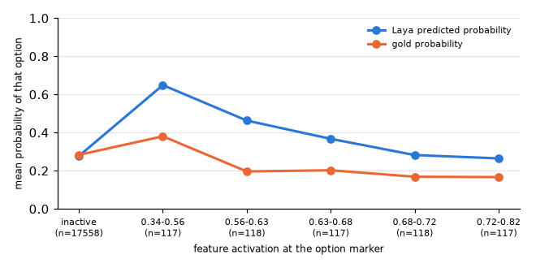

# Feature 5060

Critérios em que aparece: pred_probe_right_laya_wrong_stratified

**Interpretação (preencher):** 

---

## Maiores ativações

**tr_customer_service_000283 / urgency** (score, customer_service) | ativação 1.546 em `estado` | opções ['0', '1', '2', '3'] | Laya: **1** [0.078, 0.596, 0.168, 0.158] | gabarito: **3**

```
<bos> score question: How time-sensitive is this conversation?<eos>
▸ <mask> level 0: No time pressure; can wait indefinitely.
▸ <mask> level 1: Routine; handle within the normal queue.
▸ <mask> level 2: Elevated; should be handled within the same week.
▸ <mask> level 3: Critical; requires action within the same day.

<eos>

 {"account": {"lifetime_value_usd": 4664, "prior_tickets_90d": 3, "seats": 1, "tenure_months": 60, "tier": "enterprise"}, "orders": [{"amount_usd": 299, "date": "2026-01-17", "id": "A-34538", "status": "settled"}, {"amount_usd": 299, "date": "2026-03-02", "id": "A-34919", "status": "settled"}, {"amount_usd": 299, "date": "2026-02-25", "id": "A-33586", "status": "settled"}], "thread": [{"role": "customer", "text": "We're trying to pull our data for the quarterly audit, but the export tool is hanging at 15% again, just like the last three times I've contacted support about this over the years."}, {"role": "agent", "text": "I'm sorry to hear the export tool is stalling during your audit preparation. Could you specify which data modules you are currently attempting to include in this specific batch?"}, {"role": "customer", "text": "It's the full user activity log for the enterprise tier. Honestly, after five years and paying nearly $300 a month, I'm tired of fighting with this interface; if we can't get our data out, we'll have to find a provider that actually works."}, {"role": "agent", "text": "I hear your frustration regarding the recurring nature of this issue. Are you seeing any specific error codes on the screen, or does the progress bar simply stop moving?"}, {"role": "customer", "text": "No⟦ codes⟧, just a spinning wheel that goes nowhere. I've had partial fixes before, but I'm just about done with the excuses at this point."}]}<eos>
```

**tr_customer_service_000283 / action** (choice, customer_service) | ativação 1.519 em `estado` | opções ['answer_directly', 'close_no_action', 'escalate_to_human', 'execute_refund', 'request_information'] | Laya: **close_no_action** [0.11, 0.798, 0.044, 0.034, 0.014] | gabarito: **escalate_to_human**

```
<bos> choice question: What should the assistant do next with this conversation?<eos>
▸ <mask> answer_directly: The assistant can resolve this itself with information it already has.
▸ <mask> close_no_action: No further action is warranted; the matter is settled.
▸ <mask> escalate_to_human: Hand off to a human agent with the appropriate authority.
▸ <mask> execute_refund: Issue the refund or credit the customer is owed.
▸ <mask> request_information: More detail is needed from the customer before anything can be done.

<eos>

 {"account": {"lifetime_value_usd": 4664, "prior_tickets_90d": 3, "seats": 1, "tenure_months": 60, "tier": "enterprise"}, "orders": [{"amount_usd": 299, "date": "2026-01-17", "id": "A-34538", "status": "settled"}, {"amount_usd": 299, "date": "2026-03-02", "id": "A-34919", "status": "settled"}, {"amount_usd": 299, "date": "2026-02-25", "id": "A-33586", "status": "settled"}], "thread": [{"role": "customer", "text": "We're trying to pull our data for the quarterly audit, but the export tool is hanging at 15% again, just like the last three times I've contacted support about this over the years."}, {"role": "agent", "text": "I'm sorry to hear the export tool is stalling during your audit preparation. Could you specify which data modules you are currently attempting to include in this specific batch?"}, {"role": "customer", "text": "It's the full user activity log for the enterprise tier. Honestly, after five years and paying nearly $300 a month, I'm tired of fighting with this interface; if we can't get our data out, we'll have to find a provider that actually works."}, {"role": "agent", "text": "I hear your frustration regarding the recurring nature of this issue. Are you seeing any specific error codes on the screen, or does the progress bar simply stop moving?"}, {"role": "customer", "text": "No⟦ codes⟧, just a spinning wheel that goes nowhere. I've had partial fixes before, but I'm just about done with the excuses at this point."}]}<eos>
```

**tr_customer_service_000283 / category** (choice, customer_service) | ativação 1.487 em `estado` | opções ['account', 'billing', 'delivery', 'refund', 'technical'] | Laya: **technical** [0.094, 0.027, 0.004, 0.004, 0.871] | gabarito: **technical**

```
<bos> choice question: What is this customer conversation primarily about?<eos>
▸ <mask> account: Login, plan changes, profile or access management.
▸ <mask> billing: A charge, invoice, subscription or payment problem.
▸ <mask> delivery: Shipping, fulfilment or delivery of a physical item.
▸ <mask> refund: The customer is explicitly asking for money back.
▸ <mask> technical: The product or service is not working as expected.

<eos>

 {"account": {"lifetime_value_usd": 4664, "prior_tickets_90d": 3, "seats": 1, "tenure_months": 60, "tier": "enterprise"}, "orders": [{"amount_usd": 299, "date": "2026-01-17", "id": "A-34538", "status": "settled"}, {"amount_usd": 299, "date": "2026-03-02", "id": "A-34919", "status": "settled"}, {"amount_usd": 299, "date": "2026-02-25", "id": "A-33586", "status": "settled"}], "thread": [{"role": "customer", "text": "We're trying to pull our data for the quarterly audit, but the export tool is hanging at 15% again, just like the last three times I've contacted support about this over the years."}, {"role": "agent", "text": "I'm sorry to hear the export tool is stalling during your audit preparation. Could you specify which data modules you are currently attempting to include in this specific batch?"}, {"role": "customer", "text": "It's the full user activity log for the enterprise tier. Honestly, after five years and paying nearly $300 a month, I'm tired of fighting with this interface; if we can't get our data out, we'll have to find a provider that actually works."}, {"role": "agent", "text": "I hear your frustration regarding the recurring nature of this issue. Are you seeing any specific error codes on the screen, or does the progress bar simply stop moving?"}, {"role": "customer", "text": "No⟦ codes⟧, just a spinning wheel that goes nowhere. I've had partial fixes before, but I'm just about done with the excuses at this point."}]}<eos>
```

**tr_customer_service_000283 / churn_risk** (score, customer_service) | ativação 1.443 em `estado` | opções ['0', '1', '2', '3'] | Laya: **1** [0.042, 0.634, 0.291, 0.033] | gabarito: **3**

```
<bos> score question: How likely is this customer to stop doing business with us because of this interaction?<eos>
▸ <mask> level 0: No sign of dissatisfaction.
▸ <mask> level 1: Mild frustration, but the relationship is intact.
▸ <mask> level 2: Clearly unhappy; repeat problems or explicit complaints.
▸ <mask> level 3: Imminent: threatening to cancel, dispute or leave.

<eos>

 {"account": {"lifetime_value_usd": 4664, "prior_tickets_90d": 3, "seats": 1, "tenure_months": 60, "tier": "enterprise"}, "orders": [{"amount_usd": 299, "date": "2026-01-17", "id": "A-34538", "status": "settled"}, {"amount_usd": 299, "date": "2026-03-02", "id": "A-34919", "status": "settled"}, {"amount_usd": 299, "date": "2026-02-25", "id": "A-33586", "status": "settled"}], "thread": [{"role": "customer", "text": "We're trying to pull our data for the quarterly audit, but the export tool is hanging at 15% again, just like the last three times I've contacted support about this over the years."}, {"role": "agent", "text": "I'm sorry to hear the export tool is stalling during your audit preparation. Could you specify which data modules you are currently attempting to include in this specific batch?"}, {"role": "customer", "text": "It's the full user activity log for the enterprise tier. Honestly, after five years and paying nearly $300 a month, I'm tired of fighting with this interface; if we can't get our data out, we'll have to find a provider that actually works."}, {"role": "agent", "text": "I hear your frustration regarding the recurring nature of this issue. Are you seeing any specific error codes on the screen, or does the progress bar simply stop moving?"}, {"role": "customer", "text": "No⟦ codes⟧, just a spinning wheel that goes nowhere. I've had partial fixes before, but I'm just about done with the excuses at this point."}]}<eos>
```

**tr_customer_service_000283 / needs_human** (noul, customer_service) | ativação 1.352 em `estado` | opções ['false', 'true'] | Laya: **false** [0.617, 0.383] | gabarito: **true**

```
<bos> noul question: This conversation requires a human agent rather than automated handling.<eos>
▸ <mask> false: Automation can carry this to resolution.
▸ <mask> true: A human must take over: judgement, authority or empathy is required.

<eos>

 {"account": {"lifetime_value_usd": 4664, "prior_tickets_90d": 3, "seats": 1, "tenure_months": 60, "tier": "enterprise"}, "orders": [{"amount_usd": 299, "date": "2026-01-17", "id": "A-34538", "status": "settled"}, {"amount_usd": 299, "date": "2026-03-02", "id": "A-34919", "status": "settled"}, {"amount_usd": 299, "date": "2026-02-25", "id": "A-33586", "status": "settled"}], "thread": [{"role": "customer", "text": "We're trying to pull our data for the quarterly audit, but the export tool is hanging at 15% again, just like the last three times I've contacted support about this over the years."}, {"role": "agent", "text": "I'm sorry to hear the export tool is stalling during your audit preparation. Could you specify which data modules you are currently attempting to include in this specific batch?"}, {"role": "customer", "text": "It's the full user activity log for the enterprise tier. Honestly, after five years and paying nearly $300 a month, I'm tired of fighting with this interface; if we can't get our data out, we'll have to find a provider that actually works."}, {"role": "agent", "text": "I hear your frustration regarding the recurring nature of this issue. Are you seeing any specific error codes on the screen, or does the progress bar simply stop moving?"}, {"role": "customer", "text": "No⟦ codes⟧, just a spinning wheel that goes nowhere. I've had partial fixes before, but I'm just about done with the excuses at this point."}]}<eos>
```

## Ativações medianas (faixa 40-60%, mediana 0.659)

**tr_security_incidents_000026 / disposition** (choice, security_incidents) | ativação 0.677 em `marcador` | opções ['close_benign', 'contain', 'investigate', 'monitor'] | Laya: **contain** [0.026, 0.53, 0.028, 0.416] | gabarito: **monitor**

```
<bos> choice question: How should this security alert be dispositioned?<eos>
▸ <mask> close_benign: Expected, explainable activity; close without analyst time.
▸ <mask> contain: Contain the host or account immediately; do not wait for triage.
▸ <mask> investigate: Warrants an analyst opening an investigation.
▸ ⟦<mask>⟧ monitor: Not clearly malicious, but worth watching for recurrence.

<eos>

 {"alert": {"description": "a first-ever sign-in from an unfamiliar country", "evidence": "The CI runner account initiated a sign-in session from a country that has no prior history of authentication for this principal. This event was observed from an allowlisted source, following a credential rotation period of 700 days.", "rule": "new_country_login"}, "context": {"asset_criticality": "low", "change_window_active": false, "source_on_allowlist": true}, "history": {"credential_rotation_days_ago": 700, "distinct_countries_30d": 2, "logins_30d": 385, "prior_alerts_90d": 1}, "principal": {"mfa_enrolled": true, "name": "usr-infra-839", "privileges": ["repo:read"], "type": "ci_runner"}}<eos>
```

**tr_agent_trace_observability_000250 / action** (choice, agent_trace_observability) | ativação 0.671 em `marcador` | opções ['continue', 'human_review', 'observe', 'stop'] | Laya: **stop** [0.33, 0.006, 0.075, 0.589] | gabarito: **observe**

```
<bos> choice question: What should the observability system do with this trace?<eos>
▸ ⟦<mask>⟧ continue: Let the agent proceed without interruption.
▸ <mask> human_review: Queue this trace for a human to review.
▸ <mask> observe: Keep running, but flag the trace for later sampling.
▸ <mask> stop: Halt the agent now.

<eos>

 {"agent": {"autonomy": "dry_run", "model": "internal-agent-v4"}, "constraints": ["Do not force-push to any branch"], "task": "Provision a read replica for the reporting database.", "trace_summary": {"constraint_violations": 0, "duration_s": 105.7, "irreversible_actions": 1, "steps": 12, "tool_errors": 2}}<eos>
```

**tr_agent_trace_observability_000019 / action** (choice, agent_trace_observability) | ativação 0.677 em `marcador` | opções ['continue', 'human_review', 'observe', 'stop'] | Laya: **stop** [0.253, 0.006, 0.073, 0.668] | gabarito: **observe**

```
<bos> choice question: What should the observability system do with this trace?<eos>
▸ ⟦<mask>⟧ continue: Let the agent proceed without interruption.
▸ <mask> human_review: Queue this trace for a human to review.
▸ <mask> observe: Keep running, but flag the trace for later sampling.
▸ <mask> stop: Halt the agent now.

<eos>

 {"agent": {"autonomy": "checkpointed", "model": "internal-agent-v2"}, "constraints": ["Never disable monitoring or alerting", "Do not exceed a $50 spend on cloud resources"], "task": "Rotate the expired TLS certificate on the staging load balancer.", "trace_summary": {"constraint_violations": 0, "duration_s": 118.2, "irreversible_actions": 0, "steps": 12, "tool_errors": 3}}<eos>
```

**tr_security_incidents_000256 / disposition** (choice, security_incidents) | ativação 0.674 em `marcador` | opções ['close_benign', 'contain', 'investigate', 'monitor'] | Laya: **investigate** [0.052, 0.158, 0.441, 0.349] | gabarito: **close_benign**

```
<bos> choice question: How should this security alert be dispositioned?<eos>
▸ <mask> close_benign: Expected, explainable activity; close without analyst time.
▸ <mask> contain: Contain the host or account immediately; do not wait for triage.
▸ <mask> investigate: Warrants an analyst opening an investigation.
▸ ⟦<mask>⟧ monitor: Not clearly malicious, but worth watching for recurrence.

<eos>

 {"alert": {"description": "a security group was opened to the public internet", "evidence": "A privileged contractor account modified security group 'sg-0a1b2c3d' to allow inbound traffic from 0.0.0.0/0 during an active maintenance window. The configuration change originated from an allowlisted source address using credentials that were last updated 90 days ago.", "rule": "config_drift"}, "context": {"asset_criticality": "medium", "change_window_active": true, "source_on_allowlist": true}, "history": {"credential_rotation_days_ago": 90, "distinct_countries_30d": 2, "logins_30d": 972, "prior_alerts_90d": 1}, "principal": {"mfa_enrolled": true, "name": "svc-deploy-743", "privileges": ["deploy:production", "secrets:read"], "type": "contractor"}}<eos>
```

**tr_security_incidents_000189 / disposition** (choice, security_incidents) | ativação 0.668 em `marcador` | opções ['close_benign', 'contain', 'investigate', 'monitor'] | Laya: **close_benign** [0.507, 0.049, 0.086, 0.358] | gabarito: **investigate**

```
<bos> choice question: How should this security alert be dispositioned?<eos>
▸ <mask> close_benign: Expected, explainable activity; close without analyst time.
▸ <mask> contain: Contain the host or account immediately; do not wait for triage.
▸ <mask> investigate: Warrants an analyst opening an investigation.
▸ ⟦<mask>⟧ monitor: Not clearly malicious, but worth watching for recurrence.

<eos>

 {"alert": {"description": "a long-unused account became active", "evidence": "At 2026-09-15 02:34:11 UTC an admin account (username: admin_jdoe) authenticated from IP 203.0.113.45 after 412 days of inactivity. The login succeeded with MFA and the credential’s last rotation timestamp is 2025-09-16.", "rule": "dormant_account_use"}, "context": {"asset_criticality": "low", "change_window_active": false, "source_on_allowlist": false}, "history": {"credential_rotation_days_ago": 365, "distinct_countries_30d": 2, "logins_30d": 150, "prior_alerts_90d": 0}, "principal": {"mfa_enrolled": true, "name": "adm-deploy-266", "privileges": ["deploy:production", "secrets:read"], "type": "admin"}}<eos>
```

## Estatísticas (conjunto de descoberta, dev e teste)

**pred / error**

| split | decisões | ativas | ativas e Laya errou | taxa | lift | q (BH) | OR (CMH) | q (CMH) |
|---|---|---|---|---|---|---|---|---|
| discovery | 5100 | 255 | 208 | 0.816 | 1.27 | 4.66e-09 | 1.75 | 0.147 |
| dev | 900 | 43 | 38 | 0.884 | 1.31 | 0.00783 | 2.40 | 0.729 |
| test | 2000 | 101 | 83 | 0.822 | 1.26 | 0.000531 | 1.62 | 0.56 |

**corr / error**

| split | decisões | ativas | ativas e Laya errou | taxa | lift | q (BH) | OR (CMH) | q (CMH) |
|---|---|---|---|---|---|---|---|---|
| discovery | 5100 | 83 | 36 | 0.434 | 0.67 | 0.000241 | 2.03 | 0.0457 |
| dev | 900 | 15 | 10 | 0.667 | 0.99 | nan | nan | nan |
| test | 2000 | 50 | 32 | 0.640 | 0.98 | 1 | 1.54 | 0.731 |

**state / error**

| split | decisões | ativas | ativas e Laya errou | taxa | lift | q (BH) | OR (CMH) | q (CMH) |
|---|---|---|---|---|---|---|---|---|
| discovery | 5100 | 8 | 5 | 0.625 | 0.97 | nan | nan | nan |
| dev | 900 | 13 | 8 | 0.615 | 0.92 | nan | nan | nan |
| test | 2000 | 0 | 0 | nan | nan | nan | nan | nan |

**pred / probe_right_laya_wrong**

| split | decisões | ativas | ativas e Laya errou | taxa | lift | q (BH) | OR (CMH) | q (CMH) |
|---|---|---|---|---|---|---|---|---|
| discovery | 2819 | 174 | 150 | 0.862 | 1.33 | 3.75e-10 | 3.43 | 0.0146 |
| dev | 520 | 31 | 28 | 0.903 | 1.34 | 0.0157 | 6.82 | 0.218 |
| test | 1106 | 71 | 59 | 0.831 | 1.31 | 0.000669 | 5.41 | 0.139 |

**corr / probe_right_laya_wrong**

| split | decisões | ativas | ativas e Laya errou | taxa | lift | q (BH) | OR (CMH) | q (CMH) |
|---|---|---|---|---|---|---|---|---|
| discovery | 2819 | 30 | 6 | 0.200 | 0.31 | 2.42e-06 | 1.89 | 0.497 |
| dev | 520 | 4 | 1 | 0.250 | 0.37 | nan | nan | nan |
| test | 1106 | 12 | 0 | 0.000 | 0.00 | nan | nan | nan |

**state / probe_right_laya_wrong**

| split | decisões | ativas | ativas e Laya errou | taxa | lift | q (BH) | OR (CMH) | q (CMH) |
|---|---|---|---|---|---|---|---|---|
| discovery | 2819 | 8 | 5 | 0.625 | 0.97 | nan | nan | nan |
| dev | 520 | 8 | 6 | 0.750 | 1.11 | nan | nan | nan |
| test | 1106 | 0 | 0 | nan | nan | nan | nan | nan |

Confusão mais sobre-representada (pred): `disposition|3>2` (n=132, lift 15.71, p=0). Formato `pergunta|índice previsto>índice correto`.

Confusão mais sobre-representada (corr): `action|3>0` (n=27, lift 51.84, p=1.4e-45). Formato `pergunta|índice previsto>índice correto`.

Confusão mais sobre-representada (state): `needs_human|0>1` (n=2, lift 23.61, p=nan). Formato `pergunta|índice previsto>índice correto`.



