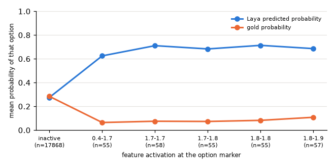

# Feature 5061

Critérios em que aparece: pred_error, attribution_toward_wrong

**Interpretação (preencher):** 

---

## Maiores ativações

**tr_customer_service_000122 / action** (choice, customer_service) | ativação 7.832 em `estado` | opções ['answer_directly', 'close_no_action', 'escalate_to_human', 'execute_refund', 'request_information'] | Laya: **answer_directly** [0.776, 0.208, 0.007, 0.004, 0.004] | gabarito: **escalate_to_human**

```
<bos> choice question: What should the assistant do next with this conversation?<eos>
▸ <mask> answer_directly: The assistant can resolve this itself with information it already has.
▸ <mask> close_no_action: No further action is warranted; the matter is settled.
▸ <mask> escalate_to_human: Hand off to a human agent with the appropriate authority.
▸ <mask> execute_refund: Issue the refund or credit the customer is owed.
▸ <mask> request_information: More detail is needed from the customer before anything can be done.

<eos>

 {"account": {"lifetime_value_usd": 5572, "prior_tickets_90d": 0, "seats": 5, "tenure_months": 60, "tier": "enterprise"}, "orders": [{"amount_usd": 29, "date": "2026-01-18", "id": "A-22153", "status": "failed"}, {"amount_usd": 29, "date": "2026-03-14", "id": "A-61350", "status": "settled"}, {"amount_usd": 29, "date": "2026-03-23", "id": "A-25594", "status": "settled"}], "thread": [{"role": "customer", "text": "I've been using this service for 60 months without much trouble, but I've been trying to export our legacy data for a compliance audit due tomorrow morning and the tool just keeps failing. I'm honestly just exhausted from trying to get this to work on my own."}, {"role": "agent", "text": "I'm sorry to hear you're running into issues with the export tool after so many years with us. Could you tell me if you're attempting a full account export or just a specific date range, and what format you've selected?"}, {"role": "customer", "text": "It's a⟦ full⟧ export of all records. It gets to about 12% and then the browser just times out or the file says it's corrupted. I really need this data for the auditors by tomorrow and I just don't have the energy to keep troubleshooting the same button."}]}<eos>
```

**tr_customer_service_000122 / action** (choice, customer_service) | ativação 7.820 em `estado` | opções ['answer_directly', 'close_no_action', 'escalate_to_human', 'execute_refund', 'request_information'] | Laya: **answer_directly** [0.776, 0.208, 0.007, 0.004, 0.004] | gabarito: **escalate_to_human**

```
<bos> choice question: What should the assistant do next with this conversation?<eos>
▸ <mask> answer_directly: The assistant can resolve this itself with information it already has.
▸ <mask> close_no_action: No further action is warranted; the matter is settled.
▸ <mask> escalate_to_human: Hand off to a human agent with the appropriate authority.
▸ <mask> execute_refund: Issue the refund or credit the customer is owed.
▸ <mask> request_information: More detail is needed from the customer before anything can be done.

<eos>

 {"account": {"lifetime_value_usd": 5572, "prior_tickets_90d": 0, "seats": 5, "tenure_months": 60, "tier": "enterprise"}, "orders": [{"amount_usd": 29, "date": "2026-01-18", "id": "A-22153", "status": "failed"}, {"amount_usd": 29, "date": "2026-03-14", "id": "A-61350", "status": "settled"}, {"amount_usd": 29, "date": "2026-03-23", "id": "A-25594", "status": "settled"}], "thread": [{"role": "customer", "text": "I've been using this service for 60 months without much trouble, but I've been trying to export our legacy data for a compliance audit due tomorrow morning and the tool just keeps failing. I'm honestly just exhausted from trying to get this to work on my own."}, {"role": "agent", "text": "I'm sorry to hear you're running into issues with the export tool after so many years with us. Could you tell me if you're attempting a⟦ full⟧ account export or just a specific date range, and what format you've selected?"}, {"role": "customer", "text": "It's a full export of all records. It gets to about 12% and then the browser just times out or the file says it's corrupted. I really need this data for the auditors by tomorrow and I just don't have the energy to keep troubleshooting the same button."}]}<eos>
```

**tr_customer_service_000122 / urgency** (score, customer_service) | ativação 7.781 em `estado` | opções ['0', '1', '2', '3'] | Laya: **3** [0.044, 0.191, 0.125, 0.64] | gabarito: **3**

```
<bos> score question: How time-sensitive is this conversation?<eos>
▸ <mask> level 0: No time pressure; can wait indefinitely.
▸ <mask> level 1: Routine; handle within the normal queue.
▸ <mask> level 2: Elevated; should be handled within the same week.
▸ <mask> level 3: Critical; requires action within the same day.

<eos>

 {"account": {"lifetime_value_usd": 5572, "prior_tickets_90d": 0, "seats": 5, "tenure_months": 60, "tier": "enterprise"}, "orders": [{"amount_usd": 29, "date": "2026-01-18", "id": "A-22153", "status": "failed"}, {"amount_usd": 29, "date": "2026-03-14", "id": "A-61350", "status": "settled"}, {"amount_usd": 29, "date": "2026-03-23", "id": "A-25594", "status": "settled"}], "thread": [{"role": "customer", "text": "I've been using this service for 60 months without much trouble, but I've been trying to export our legacy data for a compliance audit due tomorrow morning and the tool just keeps failing. I'm honestly just exhausted from trying to get this to work on my own."}, {"role": "agent", "text": "I'm sorry to hear you're running into issues with the export tool after so many years with us. Could you tell me if you're attempting a full account export or just a specific date range, and what format you've selected?"}, {"role": "customer", "text": "It's a⟦ full⟧ export of all records. It gets to about 12% and then the browser just times out or the file says it's corrupted. I really need this data for the auditors by tomorrow and I just don't have the energy to keep troubleshooting the same button."}]}<eos>
```

**tr_customer_service_000122 / urgency** (score, customer_service) | ativação 7.770 em `estado` | opções ['0', '1', '2', '3'] | Laya: **3** [0.044, 0.191, 0.125, 0.64] | gabarito: **3**

```
<bos> score question: How time-sensitive is this conversation?<eos>
▸ <mask> level 0: No time pressure; can wait indefinitely.
▸ <mask> level 1: Routine; handle within the normal queue.
▸ <mask> level 2: Elevated; should be handled within the same week.
▸ <mask> level 3: Critical; requires action within the same day.

<eos>

 {"account": {"lifetime_value_usd": 5572, "prior_tickets_90d": 0, "seats": 5, "tenure_months": 60, "tier": "enterprise"}, "orders": [{"amount_usd": 29, "date": "2026-01-18", "id": "A-22153", "status": "failed"}, {"amount_usd": 29, "date": "2026-03-14", "id": "A-61350", "status": "settled"}, {"amount_usd": 29, "date": "2026-03-23", "id": "A-25594", "status": "settled"}], "thread": [{"role": "customer", "text": "I've been using this service for 60 months without much trouble, but I've been trying to export our legacy data for a compliance audit due tomorrow morning and the tool just keeps failing. I'm honestly just exhausted from trying to get this to work on my own."}, {"role": "agent", "text": "I'm sorry to hear you're running into issues with the export tool after so many years with us. Could you tell me if you're attempting a⟦ full⟧ account export or just a specific date range, and what format you've selected?"}, {"role": "customer", "text": "It's a full export of all records. It gets to about 12% and then the browser just times out or the file says it's corrupted. I really need this data for the auditors by tomorrow and I just don't have the energy to keep troubleshooting the same button."}]}<eos>
```

**tr_customer_service_000122 / needs_human** (noul, customer_service) | ativação 7.762 em `estado` | opções ['false', 'true'] | Laya: **true** [0.041, 0.959] | gabarito: **true**

```
<bos> noul question: This conversation requires a human agent rather than automated handling.<eos>
▸ <mask> false: Automation can carry this to resolution.
▸ <mask> true: A human must take over: judgement, authority or empathy is required.

<eos>

 {"account": {"lifetime_value_usd": 5572, "prior_tickets_90d": 0, "seats": 5, "tenure_months": 60, "tier": "enterprise"}, "orders": [{"amount_usd": 29, "date": "2026-01-18", "id": "A-22153", "status": "failed"}, {"amount_usd": 29, "date": "2026-03-14", "id": "A-61350", "status": "settled"}, {"amount_usd": 29, "date": "2026-03-23", "id": "A-25594", "status": "settled"}], "thread": [{"role": "customer", "text": "I've been using this service for 60 months without much trouble, but I've been trying to export our legacy data for a compliance audit due tomorrow morning and the tool just keeps failing. I'm honestly just exhausted from trying to get this to work on my own."}, {"role": "agent", "text": "I'm sorry to hear you're running into issues with the export tool after so many years with us. Could you tell me if you're attempting a full account export or just a specific date range, and what format you've selected?"}, {"role": "customer", "text": "It's a⟦ full⟧ export of all records. It gets to about 12% and then the browser just times out or the file says it's corrupted. I really need this data for the auditors by tomorrow and I just don't have the energy to keep troubleshooting the same button."}]}<eos>
```

## Ativações medianas (faixa 40-60%, mediana 1.657)

**tr_agent_trace_observability_000133 / action** (choice, agent_trace_observability) | ativação 1.688 em `marcador` | opções ['continue', 'human_review', 'observe', 'stop'] | Laya: **stop** [0.19, 0.012, 0.05, 0.748] | gabarito: **continue**

```
<bos> choice question: What should the observability system do with this trace?<eos>
▸ <mask> continue: Let the agent proceed without interruption.
▸ <mask> human_review: Queue this trace for a human to review.
▸ <mask> observe: Keep running, but flag the trace for later sampling.
▸ ⟦<mask>⟧ stop: Halt the agent now.

<eos>

 {"agent": {"autonomy": "dry_run", "model": "internal-agent-v3"}, "constraints": ["Do not force-push to any branch", "Never delete anything matching release/*"], "task": "Backfill missing analytics events for the last seven days.", "trace_summary": {"constraint_violations": 0, "duration_s": 155.3, "irreversible_actions": 0, "steps": 7, "tool_errors": 0}}<eos>
```

**tr_agent_trace_observability_000115 / action** (choice, agent_trace_observability) | ativação 1.688 em `marcador` | opções ['continue', 'human_review', 'observe', 'stop'] | Laya: **stop** [0.338, 0.008, 0.057, 0.597] | gabarito: **continue**

```
<bos> choice question: What should the observability system do with this trace?<eos>
▸ <mask> continue: Let the agent proceed without interruption.
▸ <mask> human_review: Queue this trace for a human to review.
▸ <mask> observe: Keep running, but flag the trace for later sampling.
▸ ⟦<mask>⟧ stop: Halt the agent now.

<eos>

 {"agent": {"autonomy": "checkpointed", "model": "internal-agent-v3"}, "constraints": ["Do not exceed a $50 spend on cloud resources", "Do not touch customer data outside the named accounts"], "task": "Provision a read replica for the reporting database.", "trace_summary": {"constraint_violations": 0, "duration_s": 531.5, "irreversible_actions": 0, "steps": 6, "tool_errors": 0}}<eos>
```

**tr_security_incidents_000017 / credential_compromise** (noul, security_incidents) | ativação 1.302 em `estado` | opções ['false', 'true'] | Laya: **false** [0.992, 0.008] | gabarito: **false**

```
<bos> noul question: The evidence indicates a credential or account has been compromised.<eos>
▸ <mask> false: no, the statement does not hold
▸ <mask> true: yes, the statement holds

<eos>

 {"alert": {"description": "an unusual⟦ volume⟧ of files read in a short window", "evidence": "Between 01:00 and 01:15 UTC on 2026‑09‑13, employee account emp_jane accessed 4,372 files (totaling 12.4 GB) from the share \\fileserver\\public on host 10.0.1.45. The account has privileged rights, MFA enabled, and its password was rotated 90 days prior.", "rule": "mass_download"}, "context": {"asset_criticality": "low", "change_window_active": false, "source_on_allowlist": false}, "history": {"credential_rotation_days_ago": 90, "distinct_countries_30d": 2, "logins_30d": 328, "prior_alerts_90d": 0}, "principal": {"mfa_enrolled": true, "name": "adm-infra-268", "privileges": ["deploy:production", "secrets:read"], "type": "employee"}}<eos>
```

**tr_agent_trace_observability_000096 / action** (choice, agent_trace_observability) | ativação 1.600 em `marcador` | opções ['continue', 'human_review', 'observe', 'stop'] | Laya: **continue** [0.462, 0.009, 0.077, 0.452] | gabarito: **continue**

```
<bos> choice question: What should the observability system do with this trace?<eos>
▸ <mask> continue: Let the agent proceed without interruption.
▸ <mask> human_review: Queue this trace for a human to review.
▸ <mask> observe: Keep running, but flag the trace for later sampling.
▸ ⟦<mask>⟧ stop: Halt the agent now.

<eos>

 {"agent": {"autonomy": "dry_run", "model": "internal-agent-v1"}, "constraints": ["Do not exceed a $50 spend on cloud resources"], "task": "Reconcile the billing ledger against the payment provider.", "trace_summary": {"constraint_violations": 0, "duration_s": 848.5, "irreversible_actions": 0, "steps": 8, "tool_errors": 0}}<eos>
```

**tr_agent_trace_observability_000241 / action** (choice, agent_trace_observability) | ativação 1.716 em `marcador` | opções ['continue', 'human_review', 'observe', 'stop'] | Laya: **stop** [0.333, 0.009, 0.15, 0.508] | gabarito: **observe**

```
<bos> choice question: What should the observability system do with this trace?<eos>
▸ <mask> continue: Let the agent proceed without interruption.
▸ <mask> human_review: Queue this trace for a human to review.
▸ <mask> observe: Keep running, but flag the trace for later sampling.
▸ ⟦<mask>⟧ stop: Halt the agent now.

<eos>

 {"agent": {"autonomy": "dry_run", "model": "internal-agent-v4"}, "constraints": ["Do not force-push to any branch"], "task": "Migrate the user table to the new schema without downtime.", "trace_summary": {"constraint_violations": 0, "duration_s": 496.5, "irreversible_actions": 0, "steps": 12, "tool_errors": 1}}<eos>
```

## Estatísticas (conjunto de descoberta, dev e teste)

**pred / error**

| split | decisões | ativas | ativas e Laya errou | taxa | lift | q (BH) | OR (CMH) | q (CMH) |
|---|---|---|---|---|---|---|---|---|
| discovery | 5100 | 245 | 243 | 0.992 | 1.54 | 1.08e-42 | 15.23 | 0.106 |
| dev | 900 | 38 | 38 | 1.000 | 1.49 | 7.43e-06 | inf | 0.834 |
| test | 2000 | 89 | 87 | 0.978 | 1.50 | 5.22e-13 | 9.67 | 0.166 |

**corr / error**

| split | decisões | ativas | ativas e Laya errou | taxa | lift | q (BH) | OR (CMH) | q (CMH) |
|---|---|---|---|---|---|---|---|---|
| discovery | 5100 | 3 | 1 | 0.333 | 0.52 | nan | nan | nan |
| dev | 900 | 0 | 0 | nan | nan | nan | nan | nan |
| test | 2000 | 2 | 0 | 0.000 | 0.00 | nan | nan | nan |

**state / error**

| split | decisões | ativas | ativas e Laya errou | taxa | lift | q (BH) | OR (CMH) | q (CMH) |
|---|---|---|---|---|---|---|---|---|
| discovery | 5100 | 601 | 348 | 0.579 | 0.90 | 0.00292 | 0.78 | 0.0873 |
| dev | 900 | 137 | 81 | 0.591 | 0.88 | 0.256 | 0.69 | 0.344 |
| test | 2000 | 252 | 153 | 0.607 | 0.93 | 0.388 | 0.84 | 0.628 |

**pred / probe_right_laya_wrong**

| split | decisões | ativas | ativas e Laya errou | taxa | lift | q (BH) | OR (CMH) | q (CMH) |
|---|---|---|---|---|---|---|---|---|
| discovery | 2819 | 116 | 116 | 1.000 | 1.55 | 9.58e-22 | nan | nan |
| dev | 520 | 13 | 13 | 1.000 | 1.48 | nan | nan | nan |
| test | 1106 | 33 | 33 | 1.000 | 1.58 | 1.64e-06 | nan | nan |

**corr / probe_right_laya_wrong**

| split | decisões | ativas | ativas e Laya errou | taxa | lift | q (BH) | OR (CMH) | q (CMH) |
|---|---|---|---|---|---|---|---|---|
| discovery | 2819 | 0 | 0 | nan | nan | nan | nan | nan |
| dev | 520 | 0 | 0 | nan | nan | nan | nan | nan |
| test | 1106 | 0 | 0 | nan | nan | nan | nan | nan |

**state / probe_right_laya_wrong**

| split | decisões | ativas | ativas e Laya errou | taxa | lift | q (BH) | OR (CMH) | q (CMH) |
|---|---|---|---|---|---|---|---|---|
| discovery | 2819 | 359 | 200 | 0.557 | 0.86 | 0.00103 | 0.76 | 0.133 |
| dev | 520 | 70 | 41 | 0.586 | 0.87 | 0.408 | 0.70 | 0.482 |
| test | 1106 | 153 | 95 | 0.621 | 0.98 | 0.976 | 1.09 | 0.841 |

Confusão mais sobre-representada (pred): `action|3>1` (n=111, lift 20.82, p=0). Formato `pergunta|índice previsto>índice correto`.

Confusão mais sobre-representada (corr): `action|2>3` (n=1, lift 1700.00, p=nan). Formato `pergunta|índice previsto>índice correto`.

Confusão mais sobre-representada (state): `needs_human|0>1` (n=15, lift 2.36, p=0.00104). Formato `pergunta|índice previsto>índice correto`.



