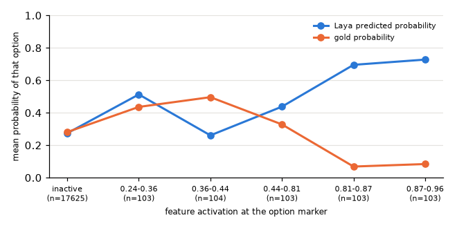

# Feature 5066

Critérios em que aparece: corr_error_stratified, attribution_toward_wrong

**Interpretação (preencher):** 

---

## Maiores ativações

**tr_security_incidents_000239 / credential_compromise** (noul, security_incidents) | ativação 2.031 em `estado` | opções ['false', 'true'] | Laya: **true** [0.027, 0.973] | gabarito: **false**

```
<bos> noul question: The evidence indicates a credential or account has been compromised.<eos>
▸ <mask> false: no, the statement does not hold
▸ <mask> true: yes, the statement holds

<eos>

 {"alert": {"description": "a first-ever sign-in from an unfamiliar country", "evidence": "An admin account performed a login from allowlisted IP 192.0.2.55 (Tokyo) at 2026-09-14T14:02:33Z, with MFA⟦ succeeding⟧. This marks the first sign‑in from Japan for this admin identity, and the password was last changed on 2024-09-14 (700 days ago).", "rule": "new_country_login"}, "context": {"asset_criticality": "crown_jewel", "change_window_active": false, "source_on_allowlist": true}, "history": {"credential_rotation_days_ago": 700, "distinct_countries_30d": 2, "logins_30d": 1033, "prior_alerts_90d": 1}, "principal": {"mfa_enrolled": true, "name": "svc-support-154", "privileges": ["repo:read"], "type": "admin"}}<eos>
```

**tr_security_incidents_000239 / severity** (score, security_incidents) | ativação 1.982 em `estado` | opções ['0', '1', '2', '3', '4'] | Laya: **2** [0.082, 0.324, 0.43, 0.08, 0.085] | gabarito: **3**

```
<bos> score question: How severe is the potential impact if this alert is real?<eos>
▸ <mask> level 0: Negligible: no access to anything sensitive.
▸ <mask> level 1: Low: limited access, easily reversed.
▸ <mask> level 2: Moderate: access to internal systems or non-public data.
▸ <mask> level 3: High: access to production, secrets or customer data.
▸ <mask> level 4: Critical: active compromise of crown-jewel systems.

<eos>

 {"alert": {"description": "a first-ever sign-in from an unfamiliar country", "evidence": "An admin account performed a login from allowlisted IP 192.0.2.55 (Tokyo) at 2026-09-14T14:02:33Z, with MFA⟦ succeeding⟧. This marks the first sign‑in from Japan for this admin identity, and the password was last changed on 2024-09-14 (700 days ago).", "rule": "new_country_login"}, "context": {"asset_criticality": "crown_jewel", "change_window_active": false, "source_on_allowlist": true}, "history": {"credential_rotation_days_ago": 700, "distinct_countries_30d": 2, "logins_30d": 1033, "prior_alerts_90d": 1}, "principal": {"mfa_enrolled": true, "name": "svc-support-154", "privileges": ["repo:read"], "type": "admin"}}<eos>
```

**tr_customer_service_000073 / churn_risk** (score, customer_service) | ativação 1.976 em `estado` | opções ['0', '1', '2', '3'] | Laya: **2** [0.043, 0.303, 0.402, 0.252] | gabarito: **3**

```
<bos> score question: How likely is this customer to stop doing business with us because of this interaction?<eos>
▸ <mask> level 0: No sign of dissatisfaction.
▸ <mask> level 1: Mild frustration, but the relationship is intact.
▸ <mask> level 2: Clearly unhappy; repeat problems or explicit complaints.
▸ <mask> level 3: Imminent: threatening to cancel, dispute or leave.

<eos>

 {"account": {"lifetime_value_usd": 54, "prior_tickets_90d": 1, "seats": 1, "tenure_months": 1, "tier": "premium"}, "orders": [{"amount_usd": 29, "date": "2026-01-23", "id": "A-91950", "status": "failed"}], "thread": [{"role": "customer", "text": "I am absolutely livid that my payment failed again after I was told this was fixed last week, this is ridiculous!"}, {"role": "agent", "text": "I'm very sorry for the ongoing trouble with your premium subscription payment; I see your previous ticket regarding this same issue."}, {"role": "customer", "text": "Seeing it doesn't help me! I've only been a member for a month and you've already messed up the $29 charge twice now."}, {"role": "agent", "text": "I understand how frustrating that is. To help me investigate, are you receiving a specific error message from your bank or within our portal?"}, {"role": "customer", "text": "It just says 'transaction failed' with no explanation, which is exactly what happened the first time I complained."}, {"role": "agent", "text": "Thank you for that detail. I'm going to pull up the logs from our payment⟦ processor⟧ to see if there's a more descriptive rejection code on the backend."}, {"role": "customer", "text": "You do that, but if this isn't sorted out once and for all, I'm canceling this plan and moving to a competitor who actually wants my money."}]}<eos>
```

**tr_customer_service_000073 / category** (choice, customer_service) | ativação 1.911 em `estado` | opções ['account', 'billing', 'delivery', 'refund', 'technical'] | Laya: **billing** [0.001, 0.977, 0.0, 0.0, 0.022] | gabarito: **billing**

```
<bos> choice question: What is this customer conversation primarily about?<eos>
▸ <mask> account: Login, plan changes, profile or access management.
▸ <mask> billing: A charge, invoice, subscription or payment problem.
▸ <mask> delivery: Shipping, fulfilment or delivery of a physical item.
▸ <mask> refund: The customer is explicitly asking for money back.
▸ <mask> technical: The product or service is not working as expected.

<eos>

 {"account": {"lifetime_value_usd": 54, "prior_tickets_90d": 1, "seats": 1, "tenure_months": 1, "tier": "premium"}, "orders": [{"amount_usd": 29, "date": "2026-01-23", "id": "A-91950", "status": "failed"}], "thread": [{"role": "customer", "text": "I am absolutely livid that my payment failed again after I was told this was fixed last week, this is ridiculous!"}, {"role": "agent", "text": "I'm very sorry for the ongoing trouble with your premium subscription payment; I see your previous ticket regarding this same issue."}, {"role": "customer", "text": "Seeing it doesn't help me! I've only been a member for a month and you've already messed up the $29 charge twice now."}, {"role": "agent", "text": "I understand how frustrating that is. To help me investigate, are you receiving a specific error message from your bank or within our portal?"}, {"role": "customer", "text": "It just says 'transaction failed' with no explanation, which is exactly what happened the first time I complained."}, {"role": "agent", "text": "Thank you for that detail. I'm going to pull up the logs from our payment⟦ processor⟧ to see if there's a more descriptive rejection code on the backend."}, {"role": "customer", "text": "You do that, but if this isn't sorted out once and for all, I'm canceling this plan and moving to a competitor who actually wants my money."}]}<eos>
```

**tr_security_incidents_000239 / urgency** (score, security_incidents) | ativação 1.906 em `estado` | opções ['0', '1', '2', '3'] | Laya: **1** [0.085, 0.52, 0.191, 0.204] | gabarito: **1**

```
<bos> score question: How quickly must a responder act on this alert?<eos>
▸ <mask> level 0: No time pressure; can wait indefinitely.
▸ <mask> level 1: Routine; handle within the normal queue.
▸ <mask> level 2: Elevated; should be handled within the same week.
▸ <mask> level 3: Critical; requires action within the same day.

<eos>

 {"alert": {"description": "a first-ever sign-in from an unfamiliar country", "evidence": "An admin account performed a login from allowlisted IP 192.0.2.55 (Tokyo) at 2026-09-14T14:02:33Z, with MFA⟦ succeeding⟧. This marks the first sign‑in from Japan for this admin identity, and the password was last changed on 2024-09-14 (700 days ago).", "rule": "new_country_login"}, "context": {"asset_criticality": "crown_jewel", "change_window_active": false, "source_on_allowlist": true}, "history": {"credential_rotation_days_ago": 700, "distinct_countries_30d": 2, "logins_30d": 1033, "prior_alerts_90d": 1}, "principal": {"mfa_enrolled": true, "name": "svc-support-154", "privileges": ["repo:read"], "type": "admin"}}<eos>
```

## Ativações medianas (faixa 40-60%, mediana 0.518)

**tr_security_incidents_000048 / severity** (score, security_incidents) | ativação 0.557 em `opção` | opções ['0', '1', '2', '3', '4'] | Laya: **1** [0.089, 0.37, 0.312, 0.061, 0.167] | gabarito: **4**

```
<bos> score question: How severe is the potential impact if this alert is real?<eos>
▸ <mask> level 0: Negligible: no access to anything sensitive.
▸ <mask> level 1: Low: limited access, easily reversed.
▸ <mask> level 2: Moderate: access to internal systems or non-public data.
▸ <mask> level 3: High: access⟦ to⟧ production, secrets or customer data.
▸ <mask> level 4: Critical: active compromise of crown-jewel systems.

<eos>

 {"alert": {"description": "a long-unused account became active", "evidence": "Administrative principal access was detected from an unrecognized source after 700 days of account inactivity. The privileged session was established using MFA during an active change window.", "rule": "dormant_account_use"}, "context": {"asset_criticality": "crown_jewel", "change_window_active": true, "source_on_allowlist": false}, "history": {"credential_rotation_days_ago": 700, "distinct_countries_30d": 3, "logins_30d": 503, "prior_alerts_90d": 8}, "principal": {"mfa_enrolled": true, "name": "svc-analytics-977", "privileges": ["deploy:production", "secrets:read"], "type": "admin"}}<eos>
```

**tr_invoice_processing_000000 / discrepancy_severity** (score, invoice_processing) | ativação 0.524 em `opção` | opções ['0', '1', '2', '3'] | Laya: **2** [0.041, 0.287, 0.616, 0.056] | gabarito: **3**

```
<bos> score question: How material is any discrepancy between the invoice, the order and the delivery?<eos>
▸ <mask> level 0: None: everything reconciles.
▸ <mask> level 1: Trivial: rounding or a cosmetic difference.
▸ <mask> level 2⟦:⟧ Moderate: a real difference worth confirming.
▸ <mask> level 3: Material: a large or unexplained difference.

<eos>

 {"delivery": {"condition": "accepted with exceptions", "date": "2026-03-18", "received_qty": 1000}, "invoice": {"currency": "USD", "id": "INV-2026-7551", "lines": [{"qty": 1000, "sku": "SKU-940", "total_usd": 300020.0, "unit_usd": 300.02}], "total_usd": 300020.0, "vendor": "Acme Fabrication"}, "payment": {"days_until_due": -3, "discount_expires_in_days": null, "early_payment_discount_pct": null, "status": "overdue", "terms": "net 45"}, "purchase_order": {"freight_terms": "freight prepaid by vendor, not separately billable", "id": "PO-3392", "lines": [{"qty": 1000, "unit_usd": 214.3}], "total_usd": 214300.0}, "vendor_history": {"disputes_12m": 0, "invoices_12m": 40, "prior_invoice_ids": ["INV-2026-6633", "INV-2026-9563", "INV-2026-7939"]}}<eos>
```

**tr_invoice_processing_000212 / discrepancy_severity** (score, invoice_processing) | ativação 0.491 em `opção` | opções ['0', '1', '2', '3'] | Laya: **2** [0.042, 0.357, 0.556, 0.044] | gabarito: **3**

```
<bos> score question: How material is any discrepancy between the invoice, the order and the delivery?<eos>
▸ <mask> level 0: None: everything reconciles.
▸ <mask> level 1: Trivial: rounding or a cosmetic difference.
▸ <mask> level 2⟦:⟧ Moderate: a real difference worth confirming.
▸ <mask> level 3: Material: a large or unexplained difference.

<eos>

 {"delivery": {"condition": "accepted", "date": "2026-03-15", "received_qty": 50}, "invoice": {"currency": "USD", "id": "INV-2026-9746", "lines": [{"qty": 50, "sku": "SKU-109", "total_usd": 1888.0, "unit_usd": 37.76}], "total_usd": 1888.0, "vendor": "Kestrel Supply"}, "payment": {"days_until_due": 27, "discount_expires_in_days": null, "early_payment_discount_pct": null, "status": "scheduled", "terms": "net 60"}, "purchase_order": {"freight_terms": "freight prepaid by vendor, not separately billable", "id": "PO-9528", "lines": [{"qty": 50, "unit_usd": 26.97}], "total_usd": 1348.5}, "vendor_history": {"disputes_12m": 0, "invoices_12m": 31, "prior_invoice_ids": ["INV-2026-4023", "INV-2026-4752", "INV-2026-8633", "INV-2026-3220"]}}<eos>
```

**tr_invoice_processing_000124 / discrepancy_severity** (score, invoice_processing) | ativação 0.513 em `opção` | opções ['0', '1', '2', '3'] | Laya: **2** [0.072, 0.4, 0.488, 0.04] | gabarito: **2**

```
<bos> score question: How material is any discrepancy between the invoice, the order and the delivery?<eos>
▸ <mask> level 0: None: everything reconciles.
▸ <mask> level 1: Trivial: rounding or a cosmetic difference.
▸ <mask> level 2⟦:⟧ Moderate: a real difference worth confirming.
▸ <mask> level 3: Material: a large or unexplained difference.

<eos>

 {"delivery": {"condition": "accepted", "date": "2026-03-17", "received_qty": 10}, "invoice": {"currency": "USD", "id": "INV-2026-6789", "lines": [{"qty": 10, "sku": "SKU-692", "total_usd": 2272.9, "unit_usd": 227.29}], "total_usd": 2272.9, "vendor": "Orbit Logistics"}, "payment": {"days_until_due": 5, "discount_expires_in_days": null, "early_payment_discount_pct": null, "status": "scheduled", "terms": "net 30"}, "purchase_order": {"freight_terms": "freight prepaid by vendor, not separately billable", "id": "PO-2113", "lines": [{"qty": 10, "unit_usd": 220.67}], "total_usd": 2206.7}, "vendor_history": {"disputes_12m": 0, "invoices_12m": 1, "prior_invoice_ids": ["INV-2026-5780", "INV-2026-1144"]}}<eos>
```

**tr_customer_service_000099 / churn_risk** (score, customer_service) | ativação 0.535 em `opção` | opções ['0', '1', '2', '3'] | Laya: **3** [0.116, 0.302, 0.266, 0.316] | gabarito: **2**

```
<bos> score question: How likely is this customer to stop doing business with us because of this interaction?<eos>
▸ <mask> level 0⟦:⟧ No sign of dissatisfaction.
▸ <mask> level 1: Mild frustration, but the relationship is intact.
▸ <mask> level 2: Clearly unhappy; repeat problems or explicit complaints.
▸ <mask> level 3: Imminent: threatening to cancel, dispute or leave.

<eos>

 {"account": {"lifetime_value_usd": 210, "prior_tickets_90d": 0, "seats": 1, "tenure_months": 5, "tier": "standard"}, "thread": [{"role": "customer", "text": "I need to downgrade my account immediately. My budget is finalized at the end of the day today, so this needs to be handled right now."}, {"role": "agent", "text": "I understand that you have a time-sensitive deadline. To ensure I'm looking at the correct account, could you please verify the full name on the billing profile?"}, {"role": "customer", "text": "The name is Marcus Thorne. Please, I really don't have time to go back and forth on this today."}, {"role": "agent", "text": "Thank you, Marcus. I have your account pulled up. Could you please clarify if you are looking to move to the base tier or if you'd like to remove specific add-ons?"}, {"role": "customer", "text": "I just want the base tier, and I need this confirmed before the business day closes. Can you tell me if that's going to happen?"}]}<eos>
```

## Estatísticas (conjunto de descoberta, dev e teste)

**pred / error**

| split | decisões | ativas | ativas e Laya errou | taxa | lift | q (BH) | OR (CMH) | q (CMH) |
|---|---|---|---|---|---|---|---|---|
| discovery | 5100 | 328 | 289 | 0.881 | 1.37 | 3.85e-22 | 1.62 | 0.313 |
| dev | 900 | 55 | 45 | 0.818 | 1.22 | 0.0522 | 0.99 | 0.993 |
| test | 2000 | 115 | 103 | 0.896 | 1.38 | 1.69e-08 | 2.32 | 0.284 |

**corr / error**

| split | decisões | ativas | ativas e Laya errou | taxa | lift | q (BH) | OR (CMH) | q (CMH) |
|---|---|---|---|---|---|---|---|---|
| discovery | 5100 | 115 | 76 | 0.661 | 1.03 | 0.816 | 2.64 | 0.00334 |
| dev | 900 | 24 | 14 | 0.583 | 0.87 | 0.601 | 2.46 | 0.605 |
| test | 2000 | 42 | 30 | 0.714 | 1.10 | 0.538 | 3.22 | 0.0954 |

**state / error**

| split | decisões | ativas | ativas e Laya errou | taxa | lift | q (BH) | OR (CMH) | q (CMH) |
|---|---|---|---|---|---|---|---|---|
| discovery | 5100 | 3474 | 2225 | 0.640 | 0.99 | 0.676 | 1.05 | 0.798 |
| dev | 900 | 605 | 403 | 0.666 | 0.99 | 0.922 | 1.23 | 0.598 |
| test | 2000 | 1349 | 857 | 0.635 | 0.98 | 0.193 | 0.94 | 0.836 |

**pred / probe_right_laya_wrong**

| split | decisões | ativas | ativas e Laya errou | taxa | lift | q (BH) | OR (CMH) | q (CMH) |
|---|---|---|---|---|---|---|---|---|
| discovery | 2819 | 166 | 146 | 0.880 | 1.36 | 2.39e-11 | 1.07 | 0.919 |
| dev | 520 | 25 | 19 | 0.760 | 1.13 | 0.621 | 1.30 | 0.873 |
| test | 1106 | 47 | 41 | 0.872 | 1.38 | 0.000863 | 0.78 | 0.811 |

**corr / probe_right_laya_wrong**

| split | decisões | ativas | ativas e Laya errou | taxa | lift | q (BH) | OR (CMH) | q (CMH) |
|---|---|---|---|---|---|---|---|---|
| discovery | 2819 | 69 | 49 | 0.710 | 1.10 | 0.372 | 2.44 | 0.153 |
| dev | 520 | 15 | 9 | 0.600 | 0.89 | nan | nan | nan |
| test | 1106 | 28 | 22 | 0.786 | 1.24 | 0.159 | 7.72 | 0.184 |

**state / probe_right_laya_wrong**

| split | decisões | ativas | ativas e Laya errou | taxa | lift | q (BH) | OR (CMH) | q (CMH) |
|---|---|---|---|---|---|---|---|---|
| discovery | 2819 | 1941 | 1253 | 0.646 | 1.00 | 0.931 | 1.17 | 0.304 |
| dev | 520 | 351 | 237 | 0.675 | 1.00 | 1 | 1.43 | 0.354 |
| test | 1106 | 744 | 460 | 0.618 | 0.98 | 0.373 | 0.95 | 0.887 |

Confusão mais sobre-representada (pred): `action|3>1` (n=111, lift 15.55, p=0). Formato `pergunta|índice previsto>índice correto`.

Confusão mais sobre-representada (corr): `credential_compromise|1>0` (n=54, lift 29.20, p=0). Formato `pergunta|índice previsto>índice correto`.

Confusão mais sobre-representada (state): `action|1>2` (n=70, lift 1.45, p=4.02e-11). Formato `pergunta|índice previsto>índice correto`.



