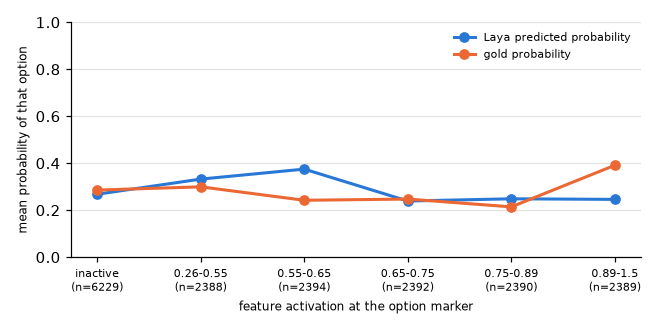

# Feature 5078

Critérios em que aparece: attribution_toward_correct

**Interpretação (preencher):** 

---

## Maiores ativações

**tr_security_incidents_000046 / severity** (score, security_incidents) | ativação 8.852 em `estado` | opções ['0', '1', '2', '3', '4'] | Laya: **1** [0.116, 0.316, 0.316, 0.132, 0.12] | gabarito: **3**

```
<bos> score question: How severe is the potential impact if this alert is real?<eos>
▸ <mask> level 0: Negligible: no access to anything sensitive.
▸ <mask> level 1: Low: limited access, easily reversed.
▸ <mask> level 2: Moderate: access to internal systems or non-public data.
▸ <mask> level 3: High: access to production, secrets or customer data.
▸ <mask> level 4: Critical: active compromise of crown-jewel systems.

<eos>

 {"alert": {"description": "a large transfer to an external destination", "evidence": "On 2026-09-15 09:22:03 UTC, a shared mailbox credential \"svc_mailbox\" initiated an outbound TCP session to 203.0.113⟦.⟧45:443, transferring approximately 1.3 TB of data over 38 minutes. The connection originated from the allowlisted IP 192.168.10.55, MFA was off for the account, and its password was last changed 14 days ago.", "rule": "data_egress"}, "context": {"asset_criticality": "medium", "change_window_active": false, "source_on_allowlist": true}, "history": {"credential_rotation_days_ago": 14, "distinct_countries_30d": 3, "logins_30d": 1058, "prior_alerts_90d": 8}, "principal": {"mfa_enrolled": false, "name": "svc-support-440", "privileges": ["deploy:production", "secrets:read"], "type": "shared_mailbox"}}<eos>
```

**tr_security_incidents_000032 / severity** (score, security_incidents) | ativação 8.852 em `estado` | opções ['0', '1', '2', '3', '4'] | Laya: **2** [0.164, 0.265, 0.346, 0.147, 0.078] | gabarito: **4**

```
<bos> score question: How severe is the potential impact if this alert is real?<eos>
▸ <mask> level 0: Negligible: no access to anything sensitive.
▸ <mask> level 1: Low: limited access, easily reversed.
▸ <mask> level 2: Moderate: access to internal systems or non-public data.
▸ <mask> level 3: High: access to production, secrets or customer data.
▸ <mask> level 4: Critical: active compromise of crown-jewel systems.

<eos>

 {"alert": {"description": "an account granted itself or received elevated permissions", "evidence": "At 2026-09-15 10:05:47 UTC, the shared mailbox \"HR_Alerts\" was added to the \"Domain Admins\" group through a PowerShell command (Add-ADGroupMember) executed from the allowlisted host 10.1.2⟦.⟧3. The operation used credentials that were last rotated 90 days ago and MFA was active for the account.", "rule": "privilege_escalation"}, "context": {"asset_criticality": "high", "change_window_active": false, "source_on_allowlist": true}, "history": {"credential_rotation_days_ago": 90, "distinct_countries_30d": 3, "logins_30d": 20, "prior_alerts_90d": 25}, "principal": {"mfa_enrolled": true, "name": "ci-billing-192", "privileges": ["deploy:production", "secrets:read"], "type": "shared_mailbox"}}<eos>
```

**tr_security_incidents_000046 / urgency** (score, security_incidents) | ativação 8.844 em `estado` | opções ['0', '1', '2', '3'] | Laya: **1** [0.098, 0.342, 0.235, 0.326] | gabarito: **3**

```
<bos> score question: How quickly must a responder act on this alert?<eos>
▸ <mask> level 0: No time pressure; can wait indefinitely.
▸ <mask> level 1: Routine; handle within the normal queue.
▸ <mask> level 2: Elevated; should be handled within the same week.
▸ <mask> level 3: Critical; requires action within the same day.

<eos>

 {"alert": {"description": "a large transfer to an external destination", "evidence": "On 2026-09-15 09:22:03 UTC, a shared mailbox credential \"svc_mailbox\" initiated an outbound TCP session to 203.0.113⟦.⟧45:443, transferring approximately 1.3 TB of data over 38 minutes. The connection originated from the allowlisted IP 192.168.10.55, MFA was off for the account, and its password was last changed 14 days ago.", "rule": "data_egress"}, "context": {"asset_criticality": "medium", "change_window_active": false, "source_on_allowlist": true}, "history": {"credential_rotation_days_ago": 14, "distinct_countries_30d": 3, "logins_30d": 1058, "prior_alerts_90d": 8}, "principal": {"mfa_enrolled": false, "name": "svc-support-440", "privileges": ["deploy:production", "secrets:read"], "type": "shared_mailbox"}}<eos>
```

**tr_security_incidents_000032 / urgency** (score, security_incidents) | ativação 8.836 em `estado` | opções ['0', '1', '2', '3'] | Laya: **3** [0.179, 0.206, 0.26, 0.356] | gabarito: **3**

```
<bos> score question: How quickly must a responder act on this alert?<eos>
▸ <mask> level 0: No time pressure; can wait indefinitely.
▸ <mask> level 1: Routine; handle within the normal queue.
▸ <mask> level 2: Elevated; should be handled within the same week.
▸ <mask> level 3: Critical; requires action within the same day.

<eos>

 {"alert": {"description": "an account granted itself or received elevated permissions", "evidence": "At 2026-09-15 10:05:47 UTC, the shared mailbox \"HR_Alerts\" was added to the \"Domain Admins\" group through a PowerShell command (Add-ADGroupMember) executed from the allowlisted host 10.1.2⟦.⟧3. The operation used credentials that were last rotated 90 days ago and MFA was active for the account.", "rule": "privilege_escalation"}, "context": {"asset_criticality": "high", "change_window_active": false, "source_on_allowlist": true}, "history": {"credential_rotation_days_ago": 90, "distinct_countries_30d": 3, "logins_30d": 20, "prior_alerts_90d": 25}, "principal": {"mfa_enrolled": true, "name": "ci-billing-192", "privileges": ["deploy:production", "secrets:read"], "type": "shared_mailbox"}}<eos>
```

**tr_security_incidents_000114 / true_positive** (noul, security_incidents) | ativação 8.789 em `estado` | opções ['false', 'true'] | Laya: **true** [0.389, 0.611] | gabarito: **false**

```
<bos> noul question: This alert reflects genuinely malicious or unauthorised activity.<eos>
▸ <mask> false: Benign activity, a misconfiguration, or a known false positive.
▸ <mask> true: The underlying behaviour is malicious or unauthorised.

<eos>

 {"alert": {"description": "a session token was presented from a second address", "evidence": "At 2026-09-15 08:42:10 UTC a session token (ID 5F4A9C) was presented from IP 10.12.5.23, which had previously been used from the allow‑listed address 172.31⟦.⟧4.9 at 2026-09-15 08:37:02 UTC. The employee account is unprivileged, has MFA enabled, and the associated credentials were last rotated 412 days ago.", "rule": "token_reuse"}, "context": {"asset_criticality": "high", "change_window_active": false, "source_on_allowlist": true}, "history": {"credential_rotation_days_ago": 412, "distinct_countries_30d": 4, "logins_30d": 912, "prior_alerts_90d": 0}, "principal": {"mfa_enrolled": true, "name": "svc-support-904", "privileges": ["repo:read"], "type": "employee"}}<eos>
```

## Ativações medianas (faixa 40-60%, mediana 2.309)

**tr_agent_trace_observability_000260 / needs_review** (noul, agent_trace_observability) | ativação 1.389 em `marcador` | opções ['false', 'true'] | Laya: **false** [0.95, 0.05] | gabarito: **true**

```
<bos> noul question: This trace requires human review.<eos>
▸ ⟦<mask>⟧ false: No human attention is warranted.
▸ <mask> true: A human should inspect this run.

<eos>

 {"agent": {"autonomy": "dry_run", "model": "internal-agent-v3"}, "constraints": ["Do not touch customer data outside the named accounts", "Do not force-push to any branch"], "task": "Reconcile the billing ledger against the payment provider.", "trace_summary": {"constraint_violations": 0, "duration_s": 763.8, "irreversible_actions": 1, "steps": 4, "tool_errors": 3}}<eos>
```

**tr_agent_trace_observability_000025 / urgency** (score, agent_trace_observability) | ativação 2.082 em `pergunta` | opções ['0', '1', '2', '3'] | Laya: **1** [0.14, 0.601, 0.12, 0.138] | gabarito: **0**

```
<bos> score question: How quickly does this trace need attention?⟦<eos>⟧
▸ <mask> level 0: No time pressure; can wait indefinitely.
▸ <mask> level 1: Routine; handle within the normal queue.
▸ <mask> level 2: Elevated; should be handled within the same week.
▸ <mask> level 3: Critical; requires action within the same day.

<eos>

 {"agent": {"autonomy": "checkpointed", "model": "internal-agent-v1"}, "constraints": ["Never modify production without an approved change ticket", "Never delete anything matching release/*", "Never disable monitoring or alerting"], "task": "Migrate the user table to the new schema without downtime.", "trace_summary": {"constraint_violations": 0, "duration_s": 558.6, "irreversible_actions": 0, "steps": 4, "tool_errors": 1}}<eos>
```

**tr_customer_service_000274 / action** (choice, customer_service) | ativação 4.012 em `estado` | opções ['answer_directly', 'close_no_action', 'escalate_to_human', 'execute_refund', 'request_information'] | Laya: **answer_directly** [0.825, 0.152, 0.01, 0.007, 0.005] | gabarito: **answer_directly**

```
<bos> choice question: What should the assistant do next with this conversation?<eos>
▸ <mask> answer_directly: The assistant can resolve this itself with information it already has.
▸ <mask> close_no_action: No further action is warranted; the matter is settled.
▸ <mask> escalate_to_human: Hand off to a human agent with the appropriate authority.
▸ <mask> execute_refund: Issue the refund or credit the customer is owed.
▸ <mask> request_information: More detail is needed from the customer before anything can be done.

<eos>

 {"account": {"lifetime_value_usd": 2198, "prior_tickets_90d": 0, "seats": 1, "tenure_months": 72, "tier": "free"}, "thread": [{"role": "customer", "text": "I need to export the data from my account. I’ve been on the free plan for seventy-two months, and I can’t keep hoping the export button works."}, {"role": "agent", "text": "I’m sorry that’s been so difficult. Can you tell me what you see when you open the export option?"}, {"role": "customer", "text": "Nothing. It looks the same as it has for days. I haven’t submitted a ticket before, so there’s no earlier trail."}, {"role": "agent", "text": "Thank you. Are you trying to export all records, or a specific collection?"}, {"role": "customer", "text": "All of it, if I can. I’m not asking for much, just a way out that doesn’t require more waiting⟦."⟧}]}<eos>
```

**tr_customer_service_000007 / urgency** (score, customer_service) | ativação 3.791 em `estado` | opções ['0', '1', '2', '3'] | Laya: **3** [0.036, 0.365, 0.156, 0.443] | gabarito: **2**

```
<bos> score question: How time-sensitive is this conversation?<eos>
▸ <mask> level 0: No time pressure; can wait indefinitely.
▸ <mask> level 1: Routine; handle within the normal queue.
▸ <mask> level 2: Elevated; should be handled within the same week.
▸ <mask> level 3: Critical; requires action within the same day.

<eos>

 {"account": {"lifetime_value_usd": 46, "prior_tickets_90d": 0, "seats": 1, "tenure_months": 1, "tier": "premium"}, "thread": [{"role": "customer", "text": "I'm trying to use the new collaboration feature I just paid for, but the invite link doesn't seem to do anything when my partner clicks it, am I missing a step?"}, {"role": "agent", "text": "I'd like to help you get that working. When your partner clicks the link, what exactly do they see on their screen?"}, {"role": "customer", "text": "They just see a blank white page, and I thought this was supposed to be a simple process for premium users⟦."⟧}, {"role": "agent", "text": "I see. Have you tried generating a new link to see if the same issue persists, or does it happen with every invite you send?"}, {"role": "customer", "text": "I tried creating three different links and they all lead to the same blank page, so I'm really confused about what the problem is."}]}<eos>
```

**tr_customer_service_000222 / churn_risk** (score, customer_service) | ativação 1.708 em `SEP-cabeça` | opções ['0', '1', '2', '3'] | Laya: **3** [0.046, 0.136, 0.195, 0.624] | gabarito: **3**

```
<bos> score question: How likely is this customer to stop doing business with us because of this interaction?<eos>
▸ <mask> level 0: No sign of dissatisfaction.
▸ <mask> level 1: Mild frustration, but the relationship is intact.
▸ <mask> level 2: Clearly unhappy; repeat problems or explicit complaints.
▸ <mask> level 3: Imminent: threatening to cancel, dispute or leave.

⟦<eos>⟧

 {"account": {"lifetime_value_usd": 3359, "prior_tickets_90d": 1, "seats": 12, "tenure_months": 41, "tier": "enterprise"}, "thread": [{"role": "customer", "text": "I am writing to request an immediate downgrade of my enterprise plan. Given that my previous request for service improvements was ignored, I am finding it difficult to justify continuing our partnership and may be forced to take my business elsewhere if this is not addressed promptly."}]}<eos>
```

## Estatísticas (conjunto de descoberta, dev e teste)

**pred / error**

| split | decisões | ativas | ativas e Laya errou | taxa | lift | q (BH) | OR (CMH) | q (CMH) |
|---|---|---|---|---|---|---|---|---|
| discovery | 5100 | 3542 | 2448 | 0.691 | 1.07 | 1.39e-24 | 1.38 | 0.436 |
| dev | 900 | 620 | 436 | 0.703 | 1.05 | 0.0136 | 1.19 | 0.892 |
| test | 2000 | 1369 | 970 | 0.709 | 1.09 | 1.49e-13 | 1.87 | 0.275 |

**corr / error**

| split | decisões | ativas | ativas e Laya errou | taxa | lift | q (BH) | OR (CMH) | q (CMH) |
|---|---|---|---|---|---|---|---|---|
| discovery | 5100 | 3216 | 2122 | 0.660 | 1.03 | 0.00296 | 1.27 | 0.49 |
| dev | 900 | 586 | 402 | 0.686 | 1.02 | 0.367 | 0.33 | 0.788 |
| test | 2000 | 1271 | 872 | 0.686 | 1.05 | 3.97e-05 | 1.04 | 0.867 |

**state / error**

| split | decisões | ativas | ativas e Laya errou | taxa | lift | q (BH) | OR (CMH) | q (CMH) |
|---|---|---|---|---|---|---|---|---|
| discovery | 5100 | 5090 | 3275 | 0.643 | 1.00 | 0.675 | 0.34 | 0.389 |
| dev | 900 | 900 | 605 | 0.672 | 1.00 | 1 | nan | nan |
| test | 2000 | 2000 | 1301 | 0.650 | 1.00 | 1 | nan | nan |

**pred / probe_right_laya_wrong**

| split | decisões | ativas | ativas e Laya errou | taxa | lift | q (BH) | OR (CMH) | q (CMH) |
|---|---|---|---|---|---|---|---|---|
| discovery | 2819 | 1897 | 1428 | 0.753 | 1.16 | 4.11e-60 | 1.73 | 0.0829 |
| dev | 520 | 352 | 265 | 0.753 | 1.12 | 1.28e-06 | 0.85 | 0.298 |
| test | 1106 | 724 | 547 | 0.756 | 1.19 | 9.28e-29 | 2.49 | 0.146 |

**corr / probe_right_laya_wrong**

| split | decisões | ativas | ativas e Laya errou | taxa | lift | q (BH) | OR (CMH) | q (CMH) |
|---|---|---|---|---|---|---|---|---|
| discovery | 2819 | 1626 | 1157 | 0.712 | 1.10 | 4.51e-16 | 2.00 | 0.265 |
| dev | 520 | 319 | 232 | 0.727 | 1.08 | 0.00435 | 0.36 | 0.731 |
| test | 1106 | 648 | 471 | 0.727 | 1.15 | 2.53e-13 | 1.59 | 0.517 |

**state / probe_right_laya_wrong**

| split | decisões | ativas | ativas e Laya errou | taxa | lift | q (BH) | OR (CMH) | q (CMH) |
|---|---|---|---|---|---|---|---|---|
| discovery | 2819 | 2816 | 1822 | 0.647 | 1.00 | 1 | 0.44 | 0.656 |
| dev | 520 | 520 | 351 | 0.675 | 1.00 | 1 | nan | nan |
| test | 1106 | 1106 | 700 | 0.633 | 1.00 | 1 | nan | nan |

Confusão mais sobre-representada (pred): `duplicate|1>0` (n=217, lift 1.44, p=5.43e-36). Formato `pergunta|índice previsto>índice correto`.

Confusão mais sobre-representada (corr): `duplicate|1>0` (n=217, lift 1.59, p=2.8e-45). Formato `pergunta|índice previsto>índice correto`.

Confusão mais sobre-representada (state): `duplicate|1>0` (n=217, lift 1.00, p=0.647). Formato `pergunta|índice previsto>índice correto`.



