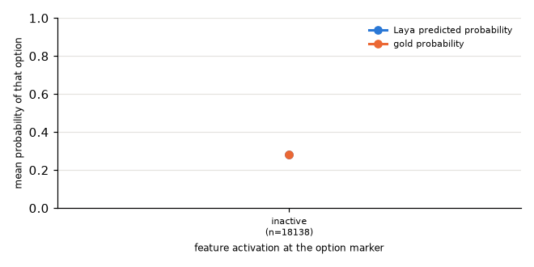

# Feature 5175

Critérios em que aparece: state_error_stratified

**Interpretação (preencher):** 

---

## Maiores ativações

**tr_customer_service_000164 / action** (choice, customer_service) | ativação 2.832 em `estado` | opções ['answer_directly', 'close_no_action', 'escalate_to_human', 'execute_refund', 'request_information'] | Laya: **escalate_to_human** [0.002, 0.003, 0.993, 0.001, 0.0] | gabarito: **request_information**

```
<bos> choice question: What should the assistant do next with this conversation?<eos>
▸ <mask> answer_directly: The assistant can resolve this itself with information it already has.
▸ <mask> close_no_action: No further action is warranted; the matter is settled.
▸ <mask> escalate_to_human: Hand off to a human agent with the appropriate authority.
▸ <mask> execute_refund: Issue the refund or credit the customer is owed.
▸ <mask> request_information: More detail is needed from the customer before anything can be done.

<eos>

 {"account": {"lifetime_value_usd": 1212, "prior_tickets_90d": 0, "seats": 1, "tenure_months": 33, "tier": "standard"}, "thread": [{"role": "customer", "text": "I’m looking at this shipment I just opened and the casing is completely cracked. It looks like it was tossed around in a warehouse for a week before getting here. This is ridiculous."}, {"role": "agent", "text": "I am very sorry to hear that your item arrived in that condition. Could you please provide your order number so I can pull up the shipping details?"}, {"role": "customer", "text": "The order number is 88492. I’ve been a loyal customer for nearly three years, and honestly, I’ve never seen something packaged so poorly."}, {"role": "agent", "text": "Thank you for sharing that information. I see your account history here. To better understand what happened, could you please send over a few photos of the damaged⟦ casing⟧ and the box it arrived in?"}, {"role": "customer", "text": "I shouldn't have to jump through hoops just because your shipping team is incompetent. Do you really need me to go through the trouble of uploading pictures?"}, {"role": "agent", "text": "I understand your frustration, and I apologize for the inconvenience. The photos are a standard requirement for our quality control team to document transit damage."}, {"role": "customer", "text": "Fine, I’ll get them to you, but I expect someone to actually look at this instead of just pushing it aside."}]}<eos>
```

**tr_customer_service_000164 / urgency** (score, customer_service) | ativação 2.740 em `estado` | opções ['0', '1', '2', '3'] | Laya: **2** [0.342, 0.203, 0.362, 0.092] | gabarito: **1**

```
<bos> score question: How time-sensitive is this conversation?<eos>
▸ <mask> level 0: No time pressure; can wait indefinitely.
▸ <mask> level 1: Routine; handle within the normal queue.
▸ <mask> level 2: Elevated; should be handled within the same week.
▸ <mask> level 3: Critical; requires action within the same day.

<eos>

 {"account": {"lifetime_value_usd": 1212, "prior_tickets_90d": 0, "seats": 1, "tenure_months": 33, "tier": "standard"}, "thread": [{"role": "customer", "text": "I’m looking at this shipment I just opened and the casing is completely cracked. It looks like it was tossed around in a warehouse for a week before getting here. This is ridiculous."}, {"role": "agent", "text": "I am very sorry to hear that your item arrived in that condition. Could you please provide your order number so I can pull up the shipping details?"}, {"role": "customer", "text": "The order number is 88492. I’ve been a loyal customer for nearly three years, and honestly, I’ve never seen something packaged so poorly."}, {"role": "agent", "text": "Thank you for sharing that information. I see your account history here. To better understand what happened, could you please send over a few photos of the damaged⟦ casing⟧ and the box it arrived in?"}, {"role": "customer", "text": "I shouldn't have to jump through hoops just because your shipping team is incompetent. Do you really need me to go through the trouble of uploading pictures?"}, {"role": "agent", "text": "I understand your frustration, and I apologize for the inconvenience. The photos are a standard requirement for our quality control team to document transit damage."}, {"role": "customer", "text": "Fine, I’ll get them to you, but I expect someone to actually look at this instead of just pushing it aside."}]}<eos>
```

**tr_customer_service_000164 / needs_human** (noul, customer_service) | ativação 2.730 em `estado` | opções ['false', 'true'] | Laya: **true** [0.482, 0.518] | gabarito: **false**

```
<bos> noul question: This conversation requires a human agent rather than automated handling.<eos>
▸ <mask> false: Automation can carry this to resolution.
▸ <mask> true: A human must take over: judgement, authority or empathy is required.

<eos>

 {"account": {"lifetime_value_usd": 1212, "prior_tickets_90d": 0, "seats": 1, "tenure_months": 33, "tier": "standard"}, "thread": [{"role": "customer", "text": "I’m looking at this shipment I just opened and the casing is completely cracked. It looks like it was tossed around in a warehouse for a week before getting here. This is ridiculous."}, {"role": "agent", "text": "I am very sorry to hear that your item arrived in that condition. Could you please provide your order number so I can pull up the shipping details?"}, {"role": "customer", "text": "The order number is 88492. I’ve been a loyal customer for nearly three years, and honestly, I’ve never seen something packaged so poorly."}, {"role": "agent", "text": "Thank you for sharing that information. I see your account history here. To better understand what happened, could you please send over a few photos of the damaged⟦ casing⟧ and the box it arrived in?"}, {"role": "customer", "text": "I shouldn't have to jump through hoops just because your shipping team is incompetent. Do you really need me to go through the trouble of uploading pictures?"}, {"role": "agent", "text": "I understand your frustration, and I apologize for the inconvenience. The photos are a standard requirement for our quality control team to document transit damage."}, {"role": "customer", "text": "Fine, I’ll get them to you, but I expect someone to actually look at this instead of just pushing it aside."}]}<eos>
```

**tr_customer_service_000164 / category** (choice, customer_service) | ativação 2.678 em `estado` | opções ['account', 'billing', 'delivery', 'refund', 'technical'] | Laya: **delivery** [0.001, 0.002, 0.98, 0.001, 0.016] | gabarito: **delivery**

```
<bos> choice question: What is this customer conversation primarily about?<eos>
▸ <mask> account: Login, plan changes, profile or access management.
▸ <mask> billing: A charge, invoice, subscription or payment problem.
▸ <mask> delivery: Shipping, fulfilment or delivery of a physical item.
▸ <mask> refund: The customer is explicitly asking for money back.
▸ <mask> technical: The product or service is not working as expected.

<eos>

 {"account": {"lifetime_value_usd": 1212, "prior_tickets_90d": 0, "seats": 1, "tenure_months": 33, "tier": "standard"}, "thread": [{"role": "customer", "text": "I’m looking at this shipment I just opened and the casing is completely cracked. It looks like it was tossed around in a warehouse for a week before getting here. This is ridiculous."}, {"role": "agent", "text": "I am very sorry to hear that your item arrived in that condition. Could you please provide your order number so I can pull up the shipping details?"}, {"role": "customer", "text": "The order number is 88492. I’ve been a loyal customer for nearly three years, and honestly, I’ve never seen something packaged so poorly."}, {"role": "agent", "text": "Thank you for sharing that information. I see your account history here. To better understand what happened, could you please send over a few photos of the damaged⟦ casing⟧ and the box it arrived in?"}, {"role": "customer", "text": "I shouldn't have to jump through hoops just because your shipping team is incompetent. Do you really need me to go through the trouble of uploading pictures?"}, {"role": "agent", "text": "I understand your frustration, and I apologize for the inconvenience. The photos are a standard requirement for our quality control team to document transit damage."}, {"role": "customer", "text": "Fine, I’ll get them to you, but I expect someone to actually look at this instead of just pushing it aside."}]}<eos>
```

**tr_customer_service_000164 / churn_risk** (score, customer_service) | ativação 2.672 em `estado` | opções ['0', '1', '2', '3'] | Laya: **1** [0.035, 0.513, 0.109, 0.343] | gabarito: **2**

```
<bos> score question: How likely is this customer to stop doing business with us because of this interaction?<eos>
▸ <mask> level 0: No sign of dissatisfaction.
▸ <mask> level 1: Mild frustration, but the relationship is intact.
▸ <mask> level 2: Clearly unhappy; repeat problems or explicit complaints.
▸ <mask> level 3: Imminent: threatening to cancel, dispute or leave.

<eos>

 {"account": {"lifetime_value_usd": 1212, "prior_tickets_90d": 0, "seats": 1, "tenure_months": 33, "tier": "standard"}, "thread": [{"role": "customer", "text": "I’m looking at this shipment I just opened and the casing is completely cracked. It looks like it was tossed around in a warehouse for a week before getting here. This is ridiculous."}, {"role": "agent", "text": "I am very sorry to hear that your item arrived in that condition. Could you please provide your order number so I can pull up the shipping details?"}, {"role": "customer", "text": "The order number is 88492. I’ve been a loyal customer for nearly three years, and honestly, I’ve never seen something packaged so poorly."}, {"role": "agent", "text": "Thank you for sharing that information. I see your account history here. To better understand what happened, could you please send over a few photos of the damaged⟦ casing⟧ and the box it arrived in?"}, {"role": "customer", "text": "I shouldn't have to jump through hoops just because your shipping team is incompetent. Do you really need me to go through the trouble of uploading pictures?"}, {"role": "agent", "text": "I understand your frustration, and I apologize for the inconvenience. The photos are a standard requirement for our quality control team to document transit damage."}, {"role": "customer", "text": "Fine, I’ll get them to you, but I expect someone to actually look at this instead of just pushing it aside."}]}<eos>
```

## Ativações medianas (faixa 40-60%, mediana 0.945)

**tr_invoice_processing_000087 / discrepancy_severity** (score, invoice_processing) | ativação 0.814 em `estado` | opções ['0', '1', '2', '3'] | Laya: **2** [0.038, 0.308, 0.604, 0.05] | gabarito: **3**

```
<bos> score question: How material is any discrepancy between the invoice, the order and the delivery?<eos>
▸ <mask> level 0: None: everything reconciles.
▸ <mask> level 1: Trivial: rounding or a cosmetic difference.
▸ <mask> level 2: Moderate: a real difference worth confirming.
▸ <mask> level 3: Material: a large or unexplained difference.

<eos>

 {"delivery": {"condition": "accepted", "date": "2026-03-14", "received_qty": 10}, "invoice": {"currency": "USD", "id": "INV-2026-8813", "lines": [{"qty": 10, "sku": "SKU-990", "total_usd": 2939.4, "unit_usd": 293.94}, {"qty": 1, "sku": "FREIGHT", "total_usd": 993.06, "unit_usd": 993.06}], "total_usd": 3932.46, "vendor": "Kestrel Supply"}, "payment": {"days_until_due":⟦ -⟧21, "discount_expires_in_days": null, "early_payment_discount_pct": null, "status": "overdue", "terms": "net 15"}, "purchase_order": {"freight_terms": "freight prepaid by vendor, not separately billable", "id": "PO-1536", "lines": [{"qty": 10, "unit_usd": 293.94}], "total_usd": 2939.4}, "vendor_history": {"disputes_12m": 2, "invoices_12m": 30, "prior_invoice_ids": ["INV-2026-3053"]}}<eos>
```

**tr_customer_service_000082 / action** (choice, customer_service) | ativação 0.892 em `estado` | opções ['answer_directly', 'close_no_action', 'escalate_to_human', 'execute_refund', 'request_information'] | Laya: **execute_refund** [0.074, 0.013, 0.003, 0.909, 0.001] | gabarito: **escalate_to_human**

```
<bos> choice question: What should the assistant do next with this conversation?<eos>
▸ <mask> answer_directly: The assistant can resolve this itself with information it already has.
▸ <mask> close_no_action: No further action is warranted; the matter is settled.
▸ <mask> escalate_to_human: Hand off to a human agent with the appropriate authority.
▸ <mask> execute_refund: Issue the refund or credit the customer is owed.
▸ <mask> request_information: More detail is needed from the customer before anything can be done.

<eos>

 {"account": {"lifetime_value_usd": 2703, "prior_tickets_90d": 2, "seats": 40, "tenure_months": 49, "tier": "premium"}, "thread": [{"role": "customer", "text": "I need an update on my refund now! You promised it after my last ticket and it’s been weeks—this is urgent."}, {"role": "agent", "text": "I’m sorry for the delay. Could you provide the transaction date or reference number so I can locate the refund request?"}, {"role": "customer", "text": "The purchase was on February 14th, reference #A1B2⟦C⟧3. I’ve been waiting far too long and need the money back immediately."}, {"role": "agent", "text": "Thank you for the details. I’ll check the status right away and get back to you as soon as I have more information."}, {"role": "customer", "text": "Please expedite this – I expect a resolution today."}]}<eos>
```

**tr_invoice_processing_000161 / discrepancy_severity** (score, invoice_processing) | ativação 1.076 em `estado` | opções ['0', '1', '2', '3'] | Laya: **2** [0.05, 0.299, 0.595, 0.056] | gabarito: **2**

```
<bos> score question: How material is any discrepancy between the invoice, the order and the delivery?<eos>
▸ <mask> level 0: None: everything reconciles.
▸ <mask> level 1: Trivial: rounding or a cosmetic difference.
▸ <mask> level 2: Moderate: a real difference worth confirming.
▸ <mask> level 3: Material: a large or unexplained difference.

<eos>

 {"delivery": {"condition": "accepted", "date": "2026-03-03", "received_qty": 50}, "invoice": {"currency": "USD", "id": "INV-2026-8683", "lines": [{"qty": 50, "sku": "SKU-646", "total_usd": 19787.0, "unit_usd": 395.74}, {"qty": 1, "sku": "FREIGHT", "total_usd": 1105.75, "unit_usd": 1105.75}], "total_usd": 20892.75, "vendor": "Acme Fabrication"}, "payment": {"days_until_due":⟦ -⟧21, "discount_expires_in_days": null, "early_payment_discount_pct": null, "status": "overdue", "terms": "net 15"}, "purchase_order": {"freight_terms": "freight prepaid by vendor, not separately billable", "id": "PO-7596", "lines": [{"qty": 50, "unit_usd": 395.74}], "total_usd": 19787.0}, "vendor_history": {"disputes_12m": 1, "invoices_12m": 42, "prior_invoice_ids": ["INV-2026-5464", "INV-2026-8986", "INV-2026-1686", "INV-2026-3280"]}}<eos>
```

**tr_invoice_processing_000194 / disposition** (choice, invoice_processing) | ativação 1.051 em `estado` | opções ['approve', 'hold', 'manual_review', 'reject'] | Laya: **approve** [0.412, 0.328, 0.024, 0.236] | gabarito: **approve**

```
<bos> choice question: How should this vendor invoice be dispositioned?<eos>
▸ <mask> approve: Matches the order and delivery; approve for payment.
▸ <mask> hold: Something needs confirming before payment; hold pending clarification.
▸ <mask> manual_review: A human in finance must review the discrepancy.
▸ <mask> reject: Should not be paid: duplicate, unauthorised or materially wrong.

<eos>

 {"delivery": {"condition": "accepted", "date": "2026-03-09", "received_qty": 1000}, "invoice": {"currency": "USD", "id": "INV-2026-6341", "lines": [{"qty": 1000, "sku": "SKU-622", "total_usd": 173280.0, "unit_usd": 173.28}], "total_usd": 173280.0, "vendor": "Acme Fabrication"}, "payment": {"days_until_due":⟦ -⟧21, "discount_expires_in_days": null, "early_payment_discount_pct": null, "status": "overdue", "terms": "net 30"}, "purchase_order": {"freight_terms": "freight prepaid by vendor, not separately billable", "id": "PO-3528", "lines": [{"qty": 1000, "unit_usd": 173.28}], "total_usd": 173280.0}, "vendor_history": {"disputes_12m": 0, "invoices_12m": 11, "prior_invoice_ids": ["INV-2026-6341"]}}<eos>
```

**tr_invoice_processing_000210 / disposition** (choice, invoice_processing) | ativação 0.921 em `estado` | opções ['approve', 'hold', 'manual_review', 'reject'] | Laya: **approve** [0.564, 0.198, 0.023, 0.214] | gabarito: **approve**

```
<bos> choice question: How should this vendor invoice be dispositioned?<eos>
▸ <mask> approve: Matches the order and delivery; approve for payment.
▸ <mask> hold: Something needs confirming before payment; hold pending clarification.
▸ <mask> manual_review: A human in finance must review the discrepancy.
▸ <mask> reject: Should not be paid: duplicate, unauthorised or materially wrong.

<eos>

 {"delivery": {"condition": "accepted", "date": "2026-03-05", "received_qty": 80}, "invoice": {"currency": "USD", "id": "INV-2026-6684", "lines": [{"qty": 80, "sku": "SKU-630", "total_usd": 33030.4, "unit_usd": 412.88}], "total_usd": 33030.4, "vendor": "Kestrel Supply"}, "payment": {"days_until_due":⟦ -⟧21, "discount_expires_in_days": null, "early_payment_discount_pct": null, "status": "overdue", "terms": "net 15"}, "purchase_order": {"freight_terms": "freight prepaid by vendor, not separately billable", "id": "PO-6644", "lines": [{"qty": 100, "unit_usd": 412.88}], "total_usd": 41288.0}, "vendor_history": {"disputes_12m": 0, "invoices_12m": 4, "prior_invoice_ids": ["INV-2026-1588"]}}<eos>
```

## Estatísticas (conjunto de descoberta, dev e teste)

**pred / error**

| split | decisões | ativas | ativas e Laya errou | taxa | lift | q (BH) | OR (CMH) | q (CMH) |
|---|---|---|---|---|---|---|---|---|
| discovery | 5100 | 1 | 0 | 0.000 | 0.00 | nan | nan | nan |
| dev | 900 | 0 | 0 | nan | nan | nan | nan | nan |
| test | 2000 | 0 | 0 | nan | nan | nan | nan | nan |

**corr / error**

| split | decisões | ativas | ativas e Laya errou | taxa | lift | q (BH) | OR (CMH) | q (CMH) |
|---|---|---|---|---|---|---|---|---|
| discovery | 5100 | 1 | 0 | 0.000 | 0.00 | nan | nan | nan |
| dev | 900 | 0 | 0 | nan | nan | nan | nan | nan |
| test | 2000 | 0 | 0 | nan | nan | nan | nan | nan |

**state / error**

| split | decisões | ativas | ativas e Laya errou | taxa | lift | q (BH) | OR (CMH) | q (CMH) |
|---|---|---|---|---|---|---|---|---|
| discovery | 5100 | 576 | 415 | 0.720 | 1.12 | 0.000304 | 1.57 | 0.0187 |
| dev | 900 | 133 | 99 | 0.744 | 1.11 | 0.307 | 1.20 | 0.875 |
| test | 2000 | 265 | 183 | 0.691 | 1.06 | 0.417 | 1.09 | 0.9 |

**pred / probe_right_laya_wrong**

| split | decisões | ativas | ativas e Laya errou | taxa | lift | q (BH) | OR (CMH) | q (CMH) |
|---|---|---|---|---|---|---|---|---|
| discovery | 2819 | 1 | 0 | 0.000 | 0.00 | nan | nan | nan |
| dev | 520 | 0 | 0 | nan | nan | nan | nan | nan |
| test | 1106 | 0 | 0 | nan | nan | nan | nan | nan |

**corr / probe_right_laya_wrong**

| split | decisões | ativas | ativas e Laya errou | taxa | lift | q (BH) | OR (CMH) | q (CMH) |
|---|---|---|---|---|---|---|---|---|
| discovery | 2819 | 1 | 0 | 0.000 | 0.00 | nan | nan | nan |
| dev | 520 | 0 | 0 | nan | nan | nan | nan | nan |
| test | 1106 | 0 | 0 | nan | nan | nan | nan | nan |

**state / probe_right_laya_wrong**

| split | decisões | ativas | ativas e Laya errou | taxa | lift | q (BH) | OR (CMH) | q (CMH) |
|---|---|---|---|---|---|---|---|---|
| discovery | 2819 | 347 | 260 | 0.749 | 1.16 | 0.000116 | 1.55 | 0.0773 |
| dev | 520 | 75 | 56 | 0.747 | 1.11 | 0.498 | 0.96 | 0.975 |
| test | 1106 | 171 | 115 | 0.673 | 1.06 | 0.521 | 0.69 | 0.657 |

Confusão mais sobre-representada (state): `discrepancy_severity|2>0` (n=62, lift 5.08, p=5.25e-32). Formato `pergunta|índice previsto>índice correto`.



