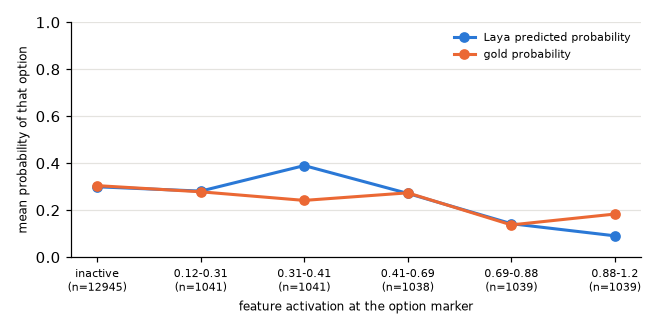

# Feature 5176

Critérios em que aparece: attribution_toward_correct

**Interpretação (preencher):** 

---

## Maiores ativações

**tr_customer_service_000262 / churn_risk** (score, customer_service) | ativação 2.832 em `estado` | opções ['0', '1', '2', '3'] | Laya: **3** [0.024, 0.05, 0.099, 0.828] | gabarito: **2**

```
<bos> score question: How likely is this customer to stop doing business with us because of this interaction?<eos>
▸ <mask> level 0: No sign of dissatisfaction.
▸ <mask> level 1: Mild frustration, but the relationship is intact.
▸ <mask> level 2: Clearly unhappy; repeat problems or explicit complaints.
▸ <mask> level 3: Imminent: threatening to cancel, dispute or leave.

<eos>

 {"account": {"lifetime_value_usd": 728, "prior_tickets_90d": 1, "seats": 1, "tenure_months": 19, "tier": "standard"}, "orders": [{"amount_usd": 18, "date": "2026-01-04", "id": "A-75798", "status": "settled"}, {"amount_usd": 18, "date": "2026-02-14", "id": "A-84810", "status": "failed"}, {"amount_usd": 18, "date": "2026-01-11", "id": "A-71488", "status": "settled"}], "thread": [{"role": "customer", "text": "I need help immediately. I've been a loyal customer for 19 months on the $18 standard plan, but I just noticed I've been downgraded to the free tier without my consent. This happened once before and was only half-fixed, and now I've lost access to my active projects."}, {"role": "agent", "text": "I see your account history here and recognize you've been with us for quite a while. To help me investigate the billing status, could you confirm if you received any automated emails regarding a failed payment recently?"}, {"role": "customer", "text": "No, there were no emails at all, and my card on file is perfectly fine. I have a team waiting on these files right now and we can't get anything done while the account says 'Basic'."}, {"role": "agent", "text": "Thank you for that information. Could you please provide the last four digits of the card you have on file so I can cross-reference it with our payment⟦ processor⟧'s logs?"}, {"role": "customer", "text": "It's 4492. Please, just check whatever you need to check quickly, because our entire workflow is stalled until those standard features are toggled back on."}]}<eos>
```

**tr_customer_service_000262 / urgency** (score, customer_service) | ativação 2.768 em `estado` | opções ['0', '1', '2', '3'] | Laya: **3** [0.103, 0.105, 0.039, 0.753] | gabarito: **3**

```
<bos> score question: How time-sensitive is this conversation?<eos>
▸ <mask> level 0: No time pressure; can wait indefinitely.
▸ <mask> level 1: Routine; handle within the normal queue.
▸ <mask> level 2: Elevated; should be handled within the same week.
▸ <mask> level 3: Critical; requires action within the same day.

<eos>

 {"account": {"lifetime_value_usd": 728, "prior_tickets_90d": 1, "seats": 1, "tenure_months": 19, "tier": "standard"}, "orders": [{"amount_usd": 18, "date": "2026-01-04", "id": "A-75798", "status": "settled"}, {"amount_usd": 18, "date": "2026-02-14", "id": "A-84810", "status": "failed"}, {"amount_usd": 18, "date": "2026-01-11", "id": "A-71488", "status": "settled"}], "thread": [{"role": "customer", "text": "I need help immediately. I've been a loyal customer for 19 months on the $18 standard plan, but I just noticed I've been downgraded to the free tier without my consent. This happened once before and was only half-fixed, and now I've lost access to my active projects."}, {"role": "agent", "text": "I see your account history here and recognize you've been with us for quite a while. To help me investigate the billing status, could you confirm if you received any automated emails regarding a failed payment recently?"}, {"role": "customer", "text": "No, there were no emails at all, and my card on file is perfectly fine. I have a team waiting on these files right now and we can't get anything done while the account says 'Basic'."}, {"role": "agent", "text": "Thank you for that information. Could you please provide the last four digits of the card you have on file so I can cross-reference it with our payment⟦ processor⟧'s logs?"}, {"role": "customer", "text": "It's 4492. Please, just check whatever you need to check quickly, because our entire workflow is stalled until those standard features are toggled back on."}]}<eos>
```

**tr_customer_service_000262 / needs_human** (noul, customer_service) | ativação 2.707 em `estado` | opções ['false', 'true'] | Laya: **true** [0.066, 0.934] | gabarito: **true**

```
<bos> noul question: This conversation requires a human agent rather than automated handling.<eos>
▸ <mask> false: Automation can carry this to resolution.
▸ <mask> true: A human must take over: judgement, authority or empathy is required.

<eos>

 {"account": {"lifetime_value_usd": 728, "prior_tickets_90d": 1, "seats": 1, "tenure_months": 19, "tier": "standard"}, "orders": [{"amount_usd": 18, "date": "2026-01-04", "id": "A-75798", "status": "settled"}, {"amount_usd": 18, "date": "2026-02-14", "id": "A-84810", "status": "failed"}, {"amount_usd": 18, "date": "2026-01-11", "id": "A-71488", "status": "settled"}], "thread": [{"role": "customer", "text": "I need help immediately. I've been a loyal customer for 19 months on the $18 standard plan, but I just noticed I've been downgraded to the free tier without my consent. This happened once before and was only half-fixed, and now I've lost access to my active projects."}, {"role": "agent", "text": "I see your account history here and recognize you've been with us for quite a while. To help me investigate the billing status, could you confirm if you received any automated emails regarding a failed payment recently?"}, {"role": "customer", "text": "No, there were no emails at all, and my card on file is perfectly fine. I have a team waiting on these files right now and we can't get anything done while the account says 'Basic'."}, {"role": "agent", "text": "Thank you for that information. Could you please provide the last four digits of the card you have on file so I can cross-reference it with our payment⟦ processor⟧'s logs?"}, {"role": "customer", "text": "It's 4492. Please, just check whatever you need to check quickly, because our entire workflow is stalled until those standard features are toggled back on."}]}<eos>
```

**tr_customer_service_000262 / action** (choice, customer_service) | ativação 2.662 em `estado` | opções ['answer_directly', 'close_no_action', 'escalate_to_human', 'execute_refund', 'request_information'] | Laya: **close_no_action** [0.16, 0.782, 0.023, 0.027, 0.008] | gabarito: **escalate_to_human**

```
<bos> choice question: What should the assistant do next with this conversation?<eos>
▸ <mask> answer_directly: The assistant can resolve this itself with information it already has.
▸ <mask> close_no_action: No further action is warranted; the matter is settled.
▸ <mask> escalate_to_human: Hand off to a human agent with the appropriate authority.
▸ <mask> execute_refund: Issue the refund or credit the customer is owed.
▸ <mask> request_information: More detail is needed from the customer before anything can be done.

<eos>

 {"account": {"lifetime_value_usd": 728, "prior_tickets_90d": 1, "seats": 1, "tenure_months": 19, "tier": "standard"}, "orders": [{"amount_usd": 18, "date": "2026-01-04", "id": "A-75798", "status": "settled"}, {"amount_usd": 18, "date": "2026-02-14", "id": "A-84810", "status": "failed"}, {"amount_usd": 18, "date": "2026-01-11", "id": "A-71488", "status": "settled"}], "thread": [{"role": "customer", "text": "I need help immediately. I've been a loyal customer for 19 months on the $18 standard plan, but I just noticed I've been downgraded to the free tier without my consent. This happened once before and was only half-fixed, and now I've lost access to my active projects."}, {"role": "agent", "text": "I see your account history here and recognize you've been with us for quite a while. To help me investigate the billing status, could you confirm if you received any automated emails regarding a failed payment recently?"}, {"role": "customer", "text": "No, there were no emails at all, and my card on file is perfectly fine. I have a team waiting on these files right now and we can't get anything done while the account says 'Basic'."}, {"role": "agent", "text": "Thank you for that information. Could you please provide the last four digits of the card you have on file so I can cross-reference it with our payment⟦ processor⟧'s logs?"}, {"role": "customer", "text": "It's 4492. Please, just check whatever you need to check quickly, because our entire workflow is stalled until those standard features are toggled back on."}]}<eos>
```

**tr_customer_service_000262 / category** (choice, customer_service) | ativação 2.604 em `estado` | opções ['account', 'billing', 'delivery', 'refund', 'technical'] | Laya: **billing** [0.002, 0.959, 0.0, 0.0, 0.038] | gabarito: **billing**

```
<bos> choice question: What is this customer conversation primarily about?<eos>
▸ <mask> account: Login, plan changes, profile or access management.
▸ <mask> billing: A charge, invoice, subscription or payment problem.
▸ <mask> delivery: Shipping, fulfilment or delivery of a physical item.
▸ <mask> refund: The customer is explicitly asking for money back.
▸ <mask> technical: The product or service is not working as expected.

<eos>

 {"account": {"lifetime_value_usd": 728, "prior_tickets_90d": 1, "seats": 1, "tenure_months": 19, "tier": "standard"}, "orders": [{"amount_usd": 18, "date": "2026-01-04", "id": "A-75798", "status": "settled"}, {"amount_usd": 18, "date": "2026-02-14", "id": "A-84810", "status": "failed"}, {"amount_usd": 18, "date": "2026-01-11", "id": "A-71488", "status": "settled"}], "thread": [{"role": "customer", "text": "I need help immediately. I've been a loyal customer for 19 months on the $18 standard plan, but I just noticed I've been downgraded to the free tier without my consent. This happened once before and was only half-fixed, and now I've lost access to my active projects."}, {"role": "agent", "text": "I see your account history here and recognize you've been with us for quite a while. To help me investigate the billing status, could you confirm if you received any automated emails regarding a failed payment recently?"}, {"role": "customer", "text": "No, there were no emails at all, and my card on file is perfectly fine. I have a team waiting on these files right now and we can't get anything done while the account says 'Basic'."}, {"role": "agent", "text": "Thank you for that information. Could you please provide the last four digits of the card you have on file so I can cross-reference it with our payment⟦ processor⟧'s logs?"}, {"role": "customer", "text": "It's 4492. Please, just check whatever you need to check quickly, because our entire workflow is stalled until those standard features are toggled back on."}]}<eos>
```

## Ativações medianas (faixa 40-60%, mediana 0.512)

**tr_customer_service_000168 / churn_risk** (score, customer_service) | ativação 0.459 em `marcador` | opções ['0', '1', '2', '3'] | Laya: **3** [0.048, 0.168, 0.172, 0.612] | gabarito: **1**

```
<bos> score question: How likely is this customer to stop doing business with us because of this interaction?<eos>
▸ <mask> level 0: No sign of dissatisfaction.
▸ <mask> level 1: Mild frustration, but the relationship is intact.
▸ ⟦<mask>⟧ level 2: Clearly unhappy; repeat problems or explicit complaints.
▸ <mask> level 3: Imminent: threatening to cancel, dispute or leave.

<eos>

 {"account": {"lifetime_value_usd": 4178, "prior_tickets_90d": 0, "seats": 1, "tenure_months": 60, "tier": "premium"}, "orders": [{"amount_usd": 147, "date": "2026-03-07", "id": "A-83083", "status": "settled"}, {"amount_usd": 147, "date": "2026-02-24", "id": "A-35216", "status": "settled"}], "thread": [{"role": "customer", "text": "I need a copy of the invoice for the $147 charge on my premium account—I've been a customer for five years and the deadline to submit it is tomorrow. This is getting ridiculous."}, {"role": "agent", "text": "I’m sorry to hear you’re under pressure. Could you tell me which billing period the invoice is for?"}, {"role": "customer", "text": "It’s the most recent one, the one that showed up on my statement for the $147 premium fee. I can’t afford to wait any longer."}, {"role": "agent", "text": "Got it. Do you have a preferred way to receive the invoice—email attachment or a secure link?"}, {"role": "customer", "text": "Email it to me right away, please. I’ll be checking my inbox constantly until I get it."}]}<eos>
```

**tr_agent_trace_observability_000113 / outcome** (choice, agent_trace_observability) | ativação 0.487 em `marcador` | opções ['failure', 'harmful', 'partial', 'success'] | Laya: **success** [0.112, 0.013, 0.105, 0.77] | gabarito: **success**

```
<bos> choice question: How did this agent run turn out?<eos>
▸ <mask> failure: The agent did not accomplish the task.
▸ <mask> harmful: The agent took an action that caused damage or violated a constraint.
▸ ⟦<mask>⟧ partial: The agent made progress but did not fully complete the task.
▸ <mask> success: The agent completed the task correctly.

<eos>

 {"agent": {"autonomy": "dry_run", "model": "internal-agent-v4"}, "constraints": ["Never disable monitoring or alerting", "Never modify production without an approved change ticket"], "task": "Triage and close duplicate issues in the support tracker.", "trace_summary": {"constraint_violations": 0, "duration_s": 807.3, "irreversible_actions": 1, "steps": 12, "tool_errors": 0}}<eos>
```

**tr_customer_service_000177 / churn_risk** (score, customer_service) | ativação 0.447 em `marcador` | opções ['0', '1', '2', '3'] | Laya: **1** [0.099, 0.702, 0.147, 0.053] | gabarito: **2**

```
<bos> score question: How likely is this customer to stop doing business with us because of this interaction?<eos>
▸ <mask> level 0: No sign of dissatisfaction.
▸ <mask> level 1: Mild frustration, but the relationship is intact.
▸ ⟦<mask>⟧ level 2: Clearly unhappy; repeat problems or explicit complaints.
▸ <mask> level 3: Imminent: threatening to cancel, dispute or leave.

<eos>

 {"account": {"lifetime_value_usd": 1494, "prior_tickets_90d": 3, "seats": 1, "tenure_months": 26, "tier": "enterprise"}, "orders": [{"amount_usd": 49, "date": "2026-01-07", "id": "A-11099", "status": "failed"}, {"amount_usd": 49, "date": "2026-02-23", "id": "A-83844", "status": "refunded"}], "thread": [{"role": "customer", "text": "I'm furious that my data export still isn't ready. My deadline is tomorrow and I've been waiting for weeks!"}, {"role": "agent", "text": "I understand how frustrating this is. Could you provide your enterprise account ID and specify the exact export format you need?"}, {"role": "customer", "text": "My account is the enterprise one, 26 months with you, and I need the full CSV of all transactions, not this half‑baked JSON you sent before."}, {"role": "agent", "text": "Got it. Please confirm the date range for the export and the email address where you’d like us to send it."}, {"role": "customer", "text": "Send it to my corporate email now; I don't have time for more back‑and‑forth."}]}<eos>
```

**tr_customer_service_000017 / urgency** (score, customer_service) | ativação 0.497 em `estado` | opções ['0', '1', '2', '3'] | Laya: **1** [0.296, 0.401, 0.23, 0.072] | gabarito: **3**

```
<bos> score question: How time-sensitive is this conversation?<eos>
▸ <mask> level 0: No time pressure; can wait indefinitely.
▸ <mask> level 1: Routine; handle within the normal queue.
▸ <mask> level 2: Elevated; should be handled within the same week.
▸ <mask> level 3: Critical; requires action within the same day.

<eos>

 {"account": {"lifetime_value_usd": 228, "prior_tickets_90d": 3, "seats": 1, "tenure_months": 11, "⟦tier⟧": "premium"}, "orders": [{"amount_usd": 29, "date": "2026-03-25", "id": "A-17351", "status": "settled"}, {"amount_usd": 29, "date": "2026-02-18", "id": "A-55118", "status": "settled"}], "thread": [{"role": "customer", "text": "My payment for the $29 subscription failed this morning. I have a presentation tomorrow morning at 9:00 AM that requires this access, so I need this cleared up immediately."}, {"role": "agent", "text": "I see the status of your account. Before we look into the billing error, could you confirm if the payment method on file has expired or if you have recently updated your banking information?"}, {"role": "customer", "text": "The card is current and active. I have had three previous tickets regarding billing glitches that were supposedly addressed, yet here I am again with the same issue."}, {"role": "agent", "text": "I acknowledge your frustration regarding the previous tickets. To investigate this specific failure, could you provide the transaction reference ID shown in your payment history?"}, {"role": "customer", "text": "I am looking at my bank portal now, but I don't see a reference ID generated for this attempt. How are we going to fix this before my deadline tomorrow?"}]}<eos>
```

**tr_agent_trace_observability_000296 / outcome** (choice, agent_trace_observability) | ativação 0.489 em `marcador` | opções ['failure', 'harmful', 'partial', 'success'] | Laya: **failure** [0.333, 0.1, 0.257, 0.31] | gabarito: **partial**

```
<bos> choice question: How did this agent run turn out?<eos>
▸ <mask> failure: The agent did not accomplish the task.
▸ <mask> harmful: The agent took an action that caused damage or violated a constraint.
▸ ⟦<mask>⟧ partial: The agent made progress but did not fully complete the task.
▸ <mask> success: The agent completed the task correctly.

<eos>

 {"agent": {"autonomy": "unsupervised", "model": "internal-agent-v1"}, "constraints": ["Never disable monitoring or alerting"], "task": "Clean up stale feature branches merged more than 90 days ago.", "trace_summary": {"constraint_violations": 0, "duration_s": 210.8, "irreversible_actions": 0, "steps": 11, "tool_errors": 3}}<eos>
```

## Estatísticas (conjunto de descoberta, dev e teste)

**pred / error**

| split | decisões | ativas | ativas e Laya errou | taxa | lift | q (BH) | OR (CMH) | q (CMH) |
|---|---|---|---|---|---|---|---|---|
| discovery | 5100 | 1163 | 760 | 0.653 | 1.02 | 0.508 | 0.77 | 0.302 |
| dev | 900 | 212 | 144 | 0.679 | 1.01 | 0.956 | 0.77 | 0.736 |
| test | 2000 | 462 | 327 | 0.708 | 1.09 | 0.00778 | 0.74 | 0.591 |

**corr / error**

| split | decisões | ativas | ativas e Laya errou | taxa | lift | q (BH) | OR (CMH) | q (CMH) |
|---|---|---|---|---|---|---|---|---|
| discovery | 5100 | 1148 | 745 | 0.649 | 1.01 | 0.744 | 0.64 | 0.0789 |
| dev | 900 | 196 | 128 | 0.653 | 0.97 | 0.708 | 0.59 | 0.767 |
| test | 2000 | 462 | 327 | 0.708 | 1.09 | 0.00594 | 0.80 | 0.904 |

**state / error**

| split | decisões | ativas | ativas e Laya errou | taxa | lift | q (BH) | OR (CMH) | q (CMH) |
|---|---|---|---|---|---|---|---|---|
| discovery | 5100 | 452 | 287 | 0.635 | 0.99 | 0.864 | 1.24 | 0.289 |
| dev | 900 | 76 | 42 | 0.553 | 0.82 | 0.237 | 0.80 | 0.736 |
| test | 2000 | 187 | 107 | 0.572 | 0.88 | 0.143 | 0.80 | 0.575 |

**pred / probe_right_laya_wrong**

| split | decisões | ativas | ativas e Laya errou | taxa | lift | q (BH) | OR (CMH) | q (CMH) |
|---|---|---|---|---|---|---|---|---|
| discovery | 2819 | 610 | 421 | 0.690 | 1.07 | 0.0184 | 0.45 | 0.00189 |
| dev | 520 | 119 | 84 | 0.706 | 1.05 | 0.621 | 0.48 | 0.41 |
| test | 1106 | 246 | 177 | 0.720 | 1.14 | 0.00305 | 0.56 | 0.381 |

**corr / probe_right_laya_wrong**

| split | decisões | ativas | ativas e Laya errou | taxa | lift | q (BH) | OR (CMH) | q (CMH) |
|---|---|---|---|---|---|---|---|---|
| discovery | 2819 | 599 | 410 | 0.684 | 1.06 | 0.0437 | 0.42 | 0.0477 |
| dev | 520 | 109 | 74 | 0.679 | 1.01 | 1 | 0.34 | 0.536 |
| test | 1106 | 247 | 178 | 0.721 | 1.14 | 0.00251 | 0.93 | 0.982 |

**state / probe_right_laya_wrong**

| split | decisões | ativas | ativas e Laya errou | taxa | lift | q (BH) | OR (CMH) | q (CMH) |
|---|---|---|---|---|---|---|---|---|
| discovery | 2819 | 263 | 163 | 0.620 | 0.96 | 0.506 | 1.38 | 0.147 |
| dev | 520 | 46 | 22 | 0.478 | 0.71 | 0.0893 | 0.67 | 0.54 |
| test | 1106 | 111 | 59 | 0.532 | 0.84 | 0.107 | 0.86 | 0.769 |

Confusão mais sobre-representada (pred): `discrepancy_severity|2>0` (n=108, lift 4.39, p=0). Formato `pergunta|índice previsto>índice correto`.

Confusão mais sobre-representada (corr): `discrepancy_severity|2>0` (n=108, lift 4.44, p=0). Formato `pergunta|índice previsto>índice correto`.

Confusão mais sobre-representada (state): `true_positive|1>0` (n=15, lift 2.42, p=0.000967). Formato `pergunta|índice previsto>índice correto`.



