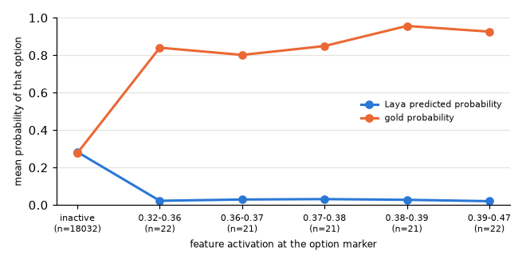

# Feature 5231

Critérios em que aparece: corr_error

**Interpretação (preencher):** 

---

## Maiores ativações

**tr_security_incidents_000191 / severity** (score, security_incidents) | ativação 1.976 em `estado` | opções ['0', '1', '2', '3', '4'] | Laya: **2** [0.094, 0.39, 0.402, 0.051, 0.064] | gabarito: **1**

```
<bos> score question: How severe is the potential impact if this alert is real?<eos>
▸ <mask> level 0: Negligible: no access to anything sensitive.
▸ <mask> level 1: Low: limited access, easily reversed.
▸ <mask> level 2: Moderate: access to internal systems or non-public data.
▸ <mask> level 3: High: access to production, secrets or customer data.
▸ <mask> level 4: Critical: active compromise of crown-jewel systems.

<eos>

 {"alert": {"description": "an unrecognised binary executed on a server", "evidence": "A binary named⟦ \⟧"/tmp/xdg-setup\" was launched on host \"mail-srv-03\" at 2026-09-15 05:48:03 UTC under the shared_mailbox user, which has MFA enabled. The file’s SHA256 hash is a1b2c3d4e5f6… and it was fetched from source IP 192.0.2.55.", "rule": "suspicious_process"}, "context": {"asset_criticality": "low", "change_window_active": false, "source_on_allowlist": false}, "history": {"credential_rotation_days_ago": 3, "distinct_countries_30d": 2, "logins_30d": 1521, "prior_alerts_90d": 1}, "principal": {"mfa_enrolled": true, "name": "adm-analytics-202", "privileges": ["repo:read"], "type": "shared_mailbox"}}<eos>
```

**tr_security_incidents_000191 / credential_compromise** (noul, security_incidents) | ativação 1.966 em `estado` | opções ['false', 'true'] | Laya: **true** [0.014, 0.986] | gabarito: **true**

```
<bos> noul question: The evidence indicates a credential or account has been compromised.<eos>
▸ <mask> false: no, the statement does not hold
▸ <mask> true: yes, the statement holds

<eos>

 {"alert": {"description": "an unrecognised binary executed on a server", "evidence": "A binary named⟦ \⟧"/tmp/xdg-setup\" was launched on host \"mail-srv-03\" at 2026-09-15 05:48:03 UTC under the shared_mailbox user, which has MFA enabled. The file’s SHA256 hash is a1b2c3d4e5f6… and it was fetched from source IP 192.0.2.55.", "rule": "suspicious_process"}, "context": {"asset_criticality": "low", "change_window_active": false, "source_on_allowlist": false}, "history": {"credential_rotation_days_ago": 3, "distinct_countries_30d": 2, "logins_30d": 1521, "prior_alerts_90d": 1}, "principal": {"mfa_enrolled": true, "name": "adm-analytics-202", "privileges": ["repo:read"], "type": "shared_mailbox"}}<eos>
```

**tr_security_incidents_000191 / urgency** (score, security_incidents) | ativação 1.911 em `estado` | opções ['0', '1', '2', '3'] | Laya: **1** [0.142, 0.423, 0.171, 0.265] | gabarito: **2**

```
<bos> score question: How quickly must a responder act on this alert?<eos>
▸ <mask> level 0: No time pressure; can wait indefinitely.
▸ <mask> level 1: Routine; handle within the normal queue.
▸ <mask> level 2: Elevated; should be handled within the same week.
▸ <mask> level 3: Critical; requires action within the same day.

<eos>

 {"alert": {"description": "an unrecognised binary executed on a server", "evidence": "A binary named⟦ \⟧"/tmp/xdg-setup\" was launched on host \"mail-srv-03\" at 2026-09-15 05:48:03 UTC under the shared_mailbox user, which has MFA enabled. The file’s SHA256 hash is a1b2c3d4e5f6… and it was fetched from source IP 192.0.2.55.", "rule": "suspicious_process"}, "context": {"asset_criticality": "low", "change_window_active": false, "source_on_allowlist": false}, "history": {"credential_rotation_days_ago": 3, "distinct_countries_30d": 2, "logins_30d": 1521, "prior_alerts_90d": 1}, "principal": {"mfa_enrolled": true, "name": "adm-analytics-202", "privileges": ["repo:read"], "type": "shared_mailbox"}}<eos>
```

**tr_security_incidents_000044 / credential_compromise** (noul, security_incidents) | ativação 1.897 em `estado` | opções ['false', 'true'] | Laya: **true** [0.017, 0.983] | gabarito: **false**

```
<bos> noul question: The evidence indicates a credential or account has been compromised.<eos>
▸ <mask> false: no, the statement does not hold
▸ <mask> true: yes, the statement holds

<eos>

 {"alert": {"description": "an unrecognised binary executed on a server", "evidence": "On 2026‑09‑16 at 08:22:33 UTC, the binary file⟦ \⟧"/opt/app/tmp/unknown_processor.bin\" (SHA‑256: a1b2c3d4e5f6…) was executed on host srv‑mail‑02 under the shared_mailbox account \"svc_alerts\" (process ID 4567). The binary is not present in the approved software inventory, the account has MFA disabled, its credentials were last changed on 2025‑03‑20 (180 days ago), and a change window was open during the execution.", "rule": "suspicious_process"}, "context": {"asset_criticality": "high", "change_window_active": true, "source_on_allowlist": true}, "history": {"credential_rotation_days_ago": 180, "distinct_countries_30d": 2, "logins_30d": 1101, "prior_alerts_90d": 0}, "principal": {"mfa_enrolled": false, "name": "ci-billing-491", "privileges": ["repo:read"], "type": "shared_mailbox"}}<eos>
```

**tr_security_incidents_000191 / disposition** (choice, security_incidents) | ativação 1.849 em `estado` | opções ['close_benign', 'contain', 'investigate', 'monitor'] | Laya: **monitor** [0.176, 0.323, 0.168, 0.333] | gabarito: **investigate**

```
<bos> choice question: How should this security alert be dispositioned?<eos>
▸ <mask> close_benign: Expected, explainable activity; close without analyst time.
▸ <mask> contain: Contain the host or account immediately; do not wait for triage.
▸ <mask> investigate: Warrants an analyst opening an investigation.
▸ <mask> monitor: Not clearly malicious, but worth watching for recurrence.

<eos>

 {"alert": {"description": "an unrecognised binary executed on a server", "evidence": "A binary named⟦ \⟧"/tmp/xdg-setup\" was launched on host \"mail-srv-03\" at 2026-09-15 05:48:03 UTC under the shared_mailbox user, which has MFA enabled. The file’s SHA256 hash is a1b2c3d4e5f6… and it was fetched from source IP 192.0.2.55.", "rule": "suspicious_process"}, "context": {"asset_criticality": "low", "change_window_active": false, "source_on_allowlist": false}, "history": {"credential_rotation_days_ago": 3, "distinct_countries_30d": 2, "logins_30d": 1521, "prior_alerts_90d": 1}, "principal": {"mfa_enrolled": true, "name": "adm-analytics-202", "privileges": ["repo:read"], "type": "shared_mailbox"}}<eos>
```

## Ativações medianas (faixa 40-60%, mediana 0.391)

**tr_invoice_processing_000105 / duplicate** (noul, invoice_processing) | ativação 0.406 em `marcador` | opções ['false', 'true'] | Laya: **true** [0.033, 0.967] | gabarito: **true**

```
<bos> noul question: This invoice appears to duplicate an invoice already submitted.<eos>
▸ ⟦<mask>⟧ false: no, the statement does not hold
▸ <mask> true: yes, the statement holds

<eos>

 {"delivery": {"condition": "accepted", "date": "2026-03-10", "received_qty": 250}, "invoice": {"currency": "USD", "id": "INV-2026-2481", "lines": [{"qty": 250, "sku": "SKU-290", "total_usd": 68527.5, "unit_usd": 274.11}], "total_usd": 68527.5, "vendor": "Northwind Components"}, "payment": {"days_until_due": 11, "discount_expires_in_days": null, "early_payment_discount_pct": null, "status": "scheduled", "terms": "net 15"}, "purchase_order": {"freight_terms": "freight prepaid by vendor, not separately billable", "id": "PO-9344", "lines": [{"qty": 250, "unit_usd": 274.11}], "total_usd": 68527.5}, "vendor_history": {"disputes_12m": 5, "invoices_12m": 22, "prior_invoice_ids": ["INV-2026-2481"]}}<eos>
```

**tr_customer_service_000114 / churn_risk** (score, customer_service) | ativação 0.416 em `estado` | opções ['0', '1', '2', '3'] | Laya: **1** [0.058, 0.622, 0.241, 0.079] | gabarito: **2**

```
<bos> score question: How likely is this customer to stop doing business with us because of this interaction?<eos>
▸ <mask> level 0: No sign of dissatisfaction.
▸ <mask> level 1: Mild frustration, but the relationship is intact.
▸ <mask> level 2: Clearly unhappy; repeat problems or explicit complaints.
▸ <mask> level 3: Imminent: threatening to cancel, dispute or leave.

<eos>

 {"account": {"lifetime_value_usd": 483, "prior_tickets_90d": 2, "seats": 1, "tenure_months": 11, "tier":⟦ "⟧standard"}, "orders": [{"amount_usd": 18, "date": "2026-02-08", "id": "A-56150", "status": "settled"}, {"amount_usd": 18, "date": "2026-03-21", "id": "A-45857", "status": "settled"}], "thread": [{"role": "customer", "text": "The PDF export tool is failing to generate files again. I've been on the standard plan for 11 months now and this is the third time this specific feature has stopped working for me."}, {"role": "agent", "text": "I see that you've encountered issues with the PDF export previously. To help me triage this, could you let me know if you are seeing a specific error code when the generation fails?"}, {"role": "customer", "text": "There isn't an error code; the loading bar just hangs at 15% and then the browser times out. I'm paying about $18 a month for this and it's frustrating that a feature that was previously fixed has broken again."}, {"role": "agent", "text": "That sounds like a persistent hang in the rendering process. Does this happen with all of your documents, or is it only occurring with files that contain large images?"}, {"role": "customer", "text": "It's happening even with simple text-only documents. This is exactly what happened the last two times I reported this, so it seems like the old bug has returned."}]}<eos>
```

**tr_invoice_processing_000076 / duplicate** (noul, invoice_processing) | ativação 0.387 em `marcador` | opções ['false', 'true'] | Laya: **true** [0.031, 0.969] | gabarito: **false**

```
<bos> noul question: This invoice appears to duplicate an invoice already submitted.<eos>
▸ ⟦<mask>⟧ false: no, the statement does not hold
▸ <mask> true: yes, the statement holds

<eos>

 {"delivery": {"condition": "accepted", "date": "2026-03-03", "received_qty": 50}, "invoice": {"currency": "USD", "id": "INV-2026-7325", "lines": [{"qty": 50, "sku": "SKU-282", "total_usd": 24438.5, "unit_usd": 488.77}], "total_usd": 24438.5, "vendor": "Pallas Industrial"}, "payment": {"days_until_due": 11, "discount_expires_in_days": null, "early_payment_discount_pct": null, "status": "scheduled", "terms": "net 30"}, "purchase_order": {"freight_terms": "freight prepaid by vendor, not separately billable", "id": "PO-3572", "lines": [{"qty": 50, "unit_usd": 436.4}], "total_usd": 21820.0}, "vendor_history": {"disputes_12m": 0, "invoices_12m": 20, "prior_invoice_ids": ["INV-2026-6186", "INV-2026-6194", "INV-2026-8302"]}}<eos>
```

**tr_security_incidents_000051 / true_positive** (noul, security_incidents) | ativação 0.399 em `estado` | opções ['false', 'true'] | Laya: **true** [0.008, 0.992] | gabarito: **true**

```
<bos> noul question: This alert reflects genuinely malicious or unauthorised activity.<eos>
▸ <mask> false: Benign activity, a misconfiguration, or a known false positive.
▸ <mask> true: The underlying behaviour is malicious or unauthorised.

<eos>

 {"alert": {"description": "many failed authentications followed by a success", "evidence": "A sequence of failed authentication attempts from an unrecognized source was followed by a successful login to a privileged shared mailbox. The account, which does not have multi-factor authentication enabled, utilized credentials that were last rotated 700 days ago.", "rule": "brute_force⟦"},⟧ "context": {"asset_criticality": "medium", "change_window_active": false, "source_on_allowlist": false}, "history": {"credential_rotation_days_ago": 700, "distinct_countries_30d": 3, "logins_30d": 1791, "prior_alerts_90d": 0}, "principal": {"mfa_enrolled": false, "name": "svc-analytics-259", "privileges": ["deploy:production", "secrets:read"], "type": "shared_mailbox"}}<eos>
```

**tr_invoice_processing_000043 / duplicate** (noul, invoice_processing) | ativação 0.400 em `marcador` | opções ['false', 'true'] | Laya: **true** [0.017, 0.983] | gabarito: **false**

```
<bos> noul question: This invoice appears to duplicate an invoice already submitted.<eos>
▸ ⟦<mask>⟧ false: no, the statement does not hold
▸ <mask> true: yes, the statement holds

<eos>

 {"delivery": {"condition": "accepted", "date": "2026-03-09", "received_qty": 5}, "invoice": {"currency": "USD", "id": "INV-2026-8139", "lines": [{"qty": 5, "sku": "SKU-820", "total_usd": 712.05, "unit_usd": 142.41}], "total_usd": 712.05, "vendor": "Northwind Components"}, "payment": {"days_until_due": -3, "discount_expires_in_days": null, "early_payment_discount_pct": null, "status": "overdue", "terms": "net 30"}, "purchase_order": {"freight_terms": "freight prepaid by vendor, not separately billable", "id": "PO-9570", "lines": [{"qty": 25, "unit_usd": 142.41}], "total_usd": 3560.25}, "vendor_history": {"disputes_12m": 1, "invoices_12m": 26, "prior_invoice_ids": ["INV-2026-2797", "INV-2026-7357"]}}<eos>
```

## Estatísticas (conjunto de descoberta, dev e teste)

**pred / error**

| split | decisões | ativas | ativas e Laya errou | taxa | lift | q (BH) | OR (CMH) | q (CMH) |
|---|---|---|---|---|---|---|---|---|
| discovery | 5100 | 0 | 0 | nan | nan | nan | nan | nan |
| dev | 900 | 0 | 0 | nan | nan | nan | nan | nan |
| test | 2000 | 0 | 0 | nan | nan | nan | nan | nan |

**corr / error**

| split | decisões | ativas | ativas e Laya errou | taxa | lift | q (BH) | OR (CMH) | q (CMH) |
|---|---|---|---|---|---|---|---|---|
| discovery | 5100 | 94 | 94 | 1.000 | 1.55 | 8.38e-18 | nan | nan |
| dev | 900 | 26 | 26 | 1.000 | 1.49 | 0.000203 | nan | nan |
| test | 2000 | 40 | 40 | 1.000 | 1.54 | 2.33e-07 | nan | nan |

**state / error**

| split | decisões | ativas | ativas e Laya errou | taxa | lift | q (BH) | OR (CMH) | q (CMH) |
|---|---|---|---|---|---|---|---|---|
| discovery | 5100 | 197 | 106 | 0.538 | 0.84 | 0.0102 | 0.99 | 0.986 |
| dev | 900 | 36 | 18 | 0.500 | 0.74 | 0.269 | 0.98 | 0.987 |
| test | 2000 | 82 | 48 | 0.585 | 0.90 | 0.541 | 1.13 | 0.857 |

**pred / probe_right_laya_wrong**

| split | decisões | ativas | ativas e Laya errou | taxa | lift | q (BH) | OR (CMH) | q (CMH) |
|---|---|---|---|---|---|---|---|---|
| discovery | 2819 | 0 | 0 | nan | nan | nan | nan | nan |
| dev | 520 | 0 | 0 | nan | nan | nan | nan | nan |
| test | 1106 | 0 | 0 | nan | nan | nan | nan | nan |

**corr / probe_right_laya_wrong**

| split | decisões | ativas | ativas e Laya errou | taxa | lift | q (BH) | OR (CMH) | q (CMH) |
|---|---|---|---|---|---|---|---|---|
| discovery | 2819 | 94 | 94 | 1.000 | 1.55 | 9.51e-18 | nan | nan |
| dev | 520 | 26 | 26 | 1.000 | 1.48 | 0.000236 | nan | nan |
| test | 1106 | 40 | 40 | 1.000 | 1.58 | 6.31e-08 | nan | nan |

**state / probe_right_laya_wrong**

| split | decisões | ativas | ativas e Laya errou | taxa | lift | q (BH) | OR (CMH) | q (CMH) |
|---|---|---|---|---|---|---|---|---|
| discovery | 2819 | 128 | 65 | 0.508 | 0.78 | 0.00491 | 0.88 | 0.778 |
| dev | 520 | 19 | 7 | 0.368 | 0.55 | nan | nan | nan |
| test | 1106 | 50 | 26 | 0.520 | 0.82 | 0.309 | 1.15 | 0.843 |

Confusão mais sobre-representada (corr): `duplicate|1>0` (n=94, lift 23.50, p=0). Formato `pergunta|índice previsto>índice correto`.

Confusão mais sobre-representada (state): `true_positive|1>0` (n=16, lift 5.92, p=5.28e-09). Formato `pergunta|índice previsto>índice correto`.



